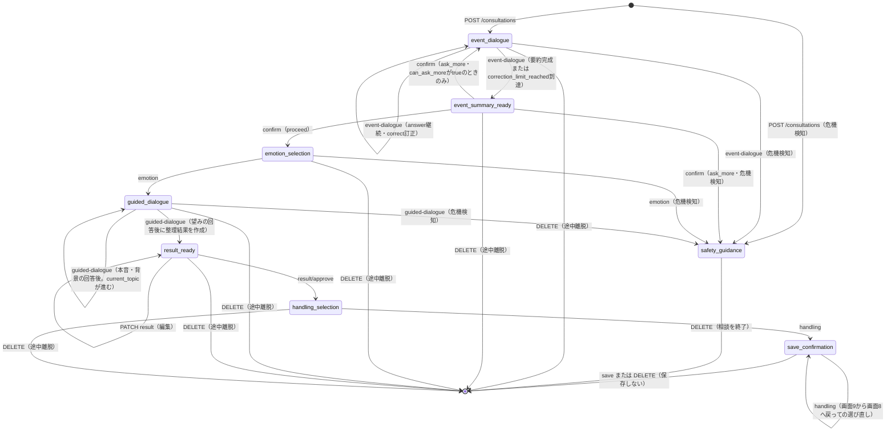

> **ステータス**：ドラフト（チーム内初稿・講師確認済み・レビュー指摘反映済）
> **作成日**：2026年9月25日
> **最終修正日**：2026年10月12日（Issue #59：決済方式を一回払いに決定し、決済API（6.8.6〜6.8.8）の契約・エラーコードと退会時の決済の照合（6.9）を反映。10月11日：Issue #52の保存API（6.5.2）・ID形式（3.3）・500の`code`、Issue #57のRedis利用回数制限を反映）
> **関連Issue**：依存 `#2` ／ 参照 `#4`〜`#8`、`#49`、`#52`、`#57`、`#59`、`#76` ／ 後続 実装Issue、`#13`、`#15`
　**作成** : じま
　**確認担当** : みほさん　もえさん

# API設計（API契約）

## 1. この資料の目的・位置づけ

フロントエンドとバックエンドを分離して並行実装できるよう、MVPで必要なAPIの入出力仕様（API契約）を定義する。ここでいうAPI契約とは、フロントエンドとバックエンドの間で共通認識とする、リクエスト・レスポンス・エラー等の取り決めを指す。

- 対象は[porori-mvp-wireframes.md](../issue-review/porori-mvp-wireframes.md)の画面1〜13に対応するMVP機能。
- 技術検証（`#4`〜`#8`）が未確定の項目は「**未定**」と明記する。仮の値・仮の方式で記載している箇所も、確定事項ではない。
- 本資料は本実装・OpenAPIの完全自動生成・認証方式や課金方式の断定を行わない。
- 決済方式（買い切り型／サブスク型）は、チームの判断が必要な選択肢として本文中に並記していたが、Issue #59で**一回払い（買い切り型）**に決定した（§6.8）。

## 2. 前提・保存方針（企画案・要件定義より）

- 相談中の会話全文・入力原文・未承認の内容は、DB・Redis・ログへ永続化しない。相談の進行状態は、相談完了または一定時間の未操作で破棄される**一時的な状態**として扱う。Issue #7の技術検証で、未承認・保存同意なしのデータがPostgreSQL・Redisへ保存されないことは確認済み。
- 相談中の一時状態（会話文脈）は**APIプロセスのメモリで保持する**。会話全文・入力原文・未承認の内容をDB・Redis・ログへ保存しないため、クライアント保持やRedis保持は採用しない。
- APIは**1ワーカー・1インスタンス（レプリカ数1、オートスケールなし）で起動する**。一時状態はAPIプロセスの再起動、開発時の自動リロード、インスタンスの切り替え、または一定時間の未操作による有効期限切れで失われる。ブラウザ再読み込み後の相談復帰は、APIプロセスに一時状態が残っている場合も含め、MVPでは保証しない。フロントエンドが相談IDを失った場合にサーバー側へ残る一時状態の扱いは、同時相談数・新規相談開始時の扱いとあわせてPR #37で整理中の後続実装Issueで決定する。1インスタンスでの配置・運用条件はI-03または別Issueで検討し、Issue・PRへ記録する。
- 一時状態が失われた相談IDへのアクセスは、相談内容をレスポンスやログへ含めず`404`として扱う。クライアントは相談を最初から開始できる状態へ戻す。一時状態は相談の終了・中断・保存成功時にも破棄する。具体的な保持時間・有効期限の実装詳細はPR #37で整理中の後続実装Issueで検討・決定し、Issue・PRへ記録する。
- 一時状態を前提とするGET・PATCH・POST等のAPIでは、一時状態が存在しない場合、TTLや再起動等ですでに破棄された場合、または本人所有の相談でない場合を`404`へ統一する。これらの原因はAPIレスポンスで区別せず、相談内容・入力原文・内部情報・消失原因をレスポンスやログへ含めない。
- ただし、`POST /consultations/{id}/save`は保存済みメモの確認を一時状態の確認より先に行うため、保存成功後の再試行では一時状態がなくても保存済みメモを`200`で返す（6.5.2）。
- フロントエンドは、相談系API（`/consultations/{id}`配下）で発生した上記の`404`の詳しい原因を区別せず、「相談を続けられませんでした。ホームから新しい相談を始めてください」と表示し、UI-002（画面2：ホーム）へ戻す。API設計上、相談を最初から開始できる状態へ戻すことをクライアント側の共通処理とする。メモ等の相談以外のリソースで発生した`404`には、この画面遷移を適用しない。
- `DELETE /consultations/{id}`は中断・終了処理を安全に繰り返せるよう、一時状態が存在しない場合、すでに破棄されている場合、または本人所有でない場合も`204`を返す。本人の一時状態が存在する場合だけ破棄し、それ以外は何も削除しない。この例外により、相談の存在や所有者情報を漏らさない。
- 同一`consultation_id`に対する一時状態の更新処理は、APIプロセス内で相談ID単位の排他制御を行い、状態の取得・検証・更新を直列化する。対象は訂正回数、質問回数、承認状態、ステータス遷移、一時状態の破棄を含む。Issue #49（I-03A）で次のとおり確定した。
  - 相談IDごとのロック（`asyncio.Lock`）を使い、グローバルロックは使わない。AI呼び出し中もロックを保持する。他の相談は止まらない。
  - ロック中の相談への別の更新リクエストは、待たずに`409`（`CONSULTATION_BUSY`。3.7参照）を返す（二重送信とみなす）。
  - AIの応答待ちの間に一時状態が破棄された場合は、応答後も状態を更新・復活させず`404`とする。
  - `GET`（6.2.2・6.4.1）はロックを取らずに読み取る。
- 一時状態の具体的な保持時間、破棄処理、1ユーザーが同時に保持できる相談数、新しい相談開始時の既存相談の扱い、GETで保持時間を延長するかはPR #37で整理中の後続実装Issueで検討・決定し、Issue・PRへ記録する。現時点では、GETによる参照だけでは保持時間を延長せず、相談内容を更新する操作が成功したときに最終操作時刻を更新する案を候補とする。
- 永続化されるのは、本人が確認・編集・承認し、保存を選んだ「整理メモ」のみ。Issue #7の技術検証で、`cryptography`ライブラリの`Fernet`による暗号化・復号・PostgreSQLへの保存と読み戻しを確認済み（**暫定推奨**。正式採用・鍵管理方式はDB設計・運用要件と合わせて別途決定するため未定）。
- API側で所有者（本人）を確認し、本人以外がメモ・アカウント情報を閲覧・変更・削除できないようにする。Issue #5の技術検証で、他人のデータへのアクセスを拒否できることを実接続で確認済み。
- エラーレスポンスの本文に、相談内容・入力原文・認証トークンを含めない。Issue #5・#7の技術検証で、レスポンス・収集ログへの混入がないことを確認済み。FastAPIの既定422ハンドラは送信値（`input`）を含むため、独自ハンドラで上書きする必要がある（3.5参照）。

## 3. 共通仕様

### 3.1 ベースパス・バージョニング

```
/api/v1
```

パスは仮置き。APIバージョニング方式は**未定**。

### 3.2 認証方式

- 認証方式はFirebase Authenticationを検証済み候補とする（Issue #5：IDトークンをFastAPI側で検証し、有効・無効・期限切れ・未指定を判定できることを実接続で確認済み）。正式採用の最終決定・全画面への組み込みは未実施のため、変更の可能性は残る。
- 認証が必要なAPIには `Authorization: Bearer <token>` ヘッダーを付与する（トークンはFirebase発行のIDトークンを想定）。
- トークンのリフレッシュ方法・有効期限の運用（フロントエンドでの再取得タイミング等）は**未定**。
- `check_revoked=True`（トークンの失効・ユーザー削除の確認）は、APIを呼ぶたびにFirebaseへの通信が発生するため、全APIでは使わない。**内部ユーザーを新規作成する唯一の経路である`POST /users/me`（6.1.1）でのみ使用する**。その他のAPIは署名・有効期限のみを検証し、トークンのUIDに対応する内部ユーザーが存在しない場合は、内部ユーザーを作成せず`401`を返す。
- 退会（6.9）で防ぎたいのは、**同じUID（退会前に発行されたトークン）による内部ユーザーの再作成**であり、同じ人の再登録ではない。Firebaseでは同じメールアドレスで再登録すると別のUIDが発行されるため、再登録は新規ユーザーとして扱う。そのため、`firebase_uid`を残す論理削除は行わず、退会完了時に内部ユーザーを物理削除する。

### 3.3 日時・ID形式

- 日時は ISO 8601（例：`2026-09-23T10:00:00+09:00`）を仮の形式とする。
- IDはUUIDとする（DB設計PR #23で確定）。パス・リクエスト・レスポンスのIDは、UUIDの文字列（例：`33333333-3333-4333-8333-333333333333`）で表す。UUIDの形式でないパスのIDは`422`とする。

### 3.4 共通レスポンス形式

正常系はリソースをそのままJSONで返す。一覧APIのページネーション方式（カーソル／オフセット）は**未定**。

### 3.5 共通エラーレスポンス形式

```json
{
  "error": {
    "code": "VALIDATION_ERROR",
    "message": "入力内容を確認してください。",
    "details": [
      { "field": "theme", "reason": "許可されていない値です。" }
    ]
  }
}
```

- `message`はユーザー・ログ双方に安全な定型文とし、相談内容や個人情報を含めない。
- `details`は入力検証エラー（422）でのみ使用する想定。
- FastAPIの既定`RequestValidationError`ハンドラは、失敗した項目の`input`に**送信された値そのもの**を含めるため、そのまま使うと相談内容がエラー本文に混入する。**独自の422ハンドラで上書きし、`input`（送信値そのもの）をレスポンスへ含めないこと**を必須とする。
- Issue #5の実装確認では`{"detail": "..."}`というFastAPI標準形式が使われていた。本実装では本資料の`{"error": {...}}`形式に統一する必要がある（既存実装との差分は後続 issue で解消する）。

### 3.6 主なHTTPステータスコードの使い分け

| コード | 意味 | 使用場面（例） |
| --- | --- | --- |
| 400 | Bad Request | リクエスト形式そのものが不正（JSON不正など） |
| 401 | Unauthorized | 未ログイン・トークン欠落／無効・期限切れ |
| 403 | Forbidden | ログイン済みだが、利用回数・プラン上の制限（相談回数・メモ保存件数の上限超過等）や、退会処理中（`deleting`状態）のアカウントであることに抵触する場合。本人以外のリソースへのアクセスは404を返す（下記「所有者確認の方針」参照） |
| 404 | Not Found | 指定したリソース（メモ・相談セッション等）が存在しない、または本人のものではなく存在を秘匿する場合 |
| 409 | Conflict | 相談セッションの状態と操作が矛盾する場合（例：承認済みの結果を再承認しようとした等）。状態の矛盾は409、入力値の誤りは422に揃える方針を採用する |
| 422 | Unprocessable Entity | Pydantic等によるスキーマ検証エラー（型・必須項目・文字数・許容値） |
| 500 | Internal Server Error | サーバー側の想定外エラー |
| 502 | Bad Gateway | AIの呼び出しに失敗した場合、またはAIの出力がスキーマ検証（4章）を満たさない場合（エラーコード例：`AI_OUTPUT_INVALID`）。クライアントの入力誤りではないため422は使わない |
| 503 | Service Unavailable | DBに接続できない場合（`DB_UNAVAILABLE`。I-01 PR #85の共通のエラー変換と同じcode）。利用回数（Issue #57・6.7.4）では、利用権限（プラン）・ユーザーの状態・保存件数をDBで確認できない場合も同じcodeとし、無料・無制限などと推測して処理を続けない。認証基盤の障害は`AUTH_UNAVAILABLE`（PR #85） |

#### 401と403の使い分け・所有者確認の方針

- **401**：誰であるかを認証できない場合（未ログイン、トークン欠落・無効・期限切れ）に返す。
- **403**：認証はできているが、利用回数・プラン上の制限に抵触する場合、または退会処理中（`deleting`状態。6.9参照）のアカウントである場合に返す。退会処理が途中で失敗した場合は`deleting`状態が残るため、`DELETE /users/me`（退会の再実行）以外の操作は403で拒否する。
- **所有者確認の方針**：メモ・相談セッション・アカウント情報など個人に紐づくリソースは、APIサーバー側で「トークンから復元したユーザーID」と「リソースの所有者ID」を必ず突き合わせる。一致しない場合は、リソースの存在自体を秘匿するため**404**を返す（他人のリソースIDの存在を推測されないようにするため）。Issue #5の技術検証で、他人のデータへのアクセスに対して404を返す動作を実接続で確認済みのため、本方針は検証済みとして採用する。
- **相談中の一時状態APIの例外**：上記の所有者確認にかかわらず、`DELETE /consultations/{id}`は冪等な中断・終了処理として、本人所有でない場合も`204`を返す。本人所有でない一時状態は削除せず、レスポンスでも本人所有かどうかを区別しない（6.5.3参照）。

### 3.7 相談APIのエラーコード（Issue #49で確定）

相談API（`/consultations`配下。6.2〜6.5.1）は、次の`code`を返す。`message`は相談内容を含まない定型文とする。フロントエンドは`message`の文言ではなく、HTTPステータスと`code`で処理を分ける。

| 原因 | ステータス | `code` |
| --- | --- | --- |
| 相談の一時状態がない・消失した・本人のものでない（§2） | 404 | `CONSULTATION_NOT_FOUND` |
| 同じ相談の別のリクエストを処理中（AI応答待ち中の二重送信など。§2） | 409 | `CONSULTATION_BUSY` |
| 状態と操作が合わない（すでに遷移済み、未承認、承認済み、上限到達など） | 409 | `CONSULTATION_STATE_CONFLICT` |
| 整理結果ができる前に取得しようとした（6.4.1） | 409 | `RESULT_NOT_READY` |
| 入力値の誤り（型・必須・文字数・許容値・組み合わせ。背景以外の質問で`skipped: true`を指定した場合を含む） | 422 | `VALIDATION_ERROR` |
| AIの呼び出しに失敗した（接続失敗・タイムアウト・エラー応答） | 502 | `AI_UNAVAILABLE` |
| AIの出力が不正（4章のSchemaを満たさない、項目の組み合わせが不正、サーバーが指定した進め方と違う） | 502 | `AI_OUTPUT_INVALID` |

- `401`（`UNAUTHORIZED`）・`403`（`ACCOUNT_DELETING`）は認証依存（I-01 #47）で共通に返す。
- 相談開始（6.2.1）では、利用回数の判定（Issue #57）により、`403`（`USAGE_LIMIT_EXCEEDED`）と`503`（`DB_UNAVAILABLE`）も返す。加算後のユーザー状態の確認で退会処理中・退会完了と分かった場合も、それぞれ`403`（`ACCOUNT_DELETING`）・`401`（`UNAUTHORIZED`）を返す（6.7.3）。
- `502`の場合、AIの出力をエラー本文・ログへ含めない。I-03Aではサーバー側で自動的に再試行しない（再試行の要否・回数はI-07 #54で決める）。
- **`422`・`500`・`502`では、一時状態（`question_count`・`correction_count`・`current_topic`・整理結果・`status`など）を更新しない。** AIの呼び出しと出力の検証が成功してから状態を更新する。`POST /consultations`（6.2.1）が失敗した場合は、相談の一時状態を作らない。
- 保存API（6.5.2）は、上の表の`CONSULTATION_NOT_FOUND`（404）・`CONSULTATION_STATE_CONFLICT`（409）・`VALIDATION_ERROR`（422）に加えて、保存処理に固有のエラーを返す。一覧は6.5.2に記載する（I-05 #52で確定）。
- 中断API（6.5.3）のエラーコードは、I-03B #50で確定して反映する。

## 4. AIの構造化結果と画面入力の境界

AIの応答は、フロントエンドがそのまま保存・信用する対象ではなく、**本人が確認・編集できる構造化データ（Schema）としてバックエンドが返す**。承認前の内容はDB・Redis・ログへ永続化しない一時データとして扱う。

- AIの生出力（自由文章）を直接クライアントに返さず、バックエンドで検証・整形したうえで、下記のような型付きスキーマとしてレスポンスする。
- ユーザーが編集した内容は、次のリクエストのrequest bodyとしてバックエンドへ送り返し、Pydantic等で型・文字数・許容値を検証する。想定外の項目・値は拒否する（422）。
- AIの構造化出力を、そのままDB操作・外部API呼び出し・権限判定に使用しない。
- AIの出力がスキーマ検証を満たさない場合は、クライアントの入力誤り（422）とは区別し、`502`（`AI_OUTPUT_INVALID`）として扱う（3.6・3.7参照）。エラー本文・ログにはAIの出力内容を含めない。I-03Aでは再試行しない。サーバー側で自動的に再試行するか（回数を含む）はI-07 #54で決める。
- **通常の出力と安全案内の識別（Issue #49で確定）**：AIを呼ぶ場面（相談開始／出来事の対話／感情入力の後／本音・背景・望み）ごとにAI出力Schemaを分け、どの場面でも`kind`（`normal`／`safety`）を必須項目とする。OpenAI系モデルのstrictモードに合わせて全項目を必須とし、使わない項目は`null`にする。`kind`の欠落・想定外の値、`kind`と各項目の不正な組み合わせ（例：`normal`なのに質問が`null`、`safety`なのに通常の項目がある）は検証で拒否し、`502`（`AI_OUTPUT_INVALID`）とする。
- `kind`はバックエンド内部だけで使い、公開APIのレスポンスには含めない。`kind: safety`を受けた場合、バックエンドは相談内容を一時状態から消去して`status`を`safety_guidance`へ切り替え、4.5の`SafetyGuidance`を返す。**フロントエンドは`status`だけで画面を分岐し、質問文やAI内部の`kind`を解析しない。**
- 本節のモデルは`model_config = ConfigDict(extra="forbid")`を付与し、想定外の項目を拒否する。必須文字列項目には`min_length=1`を付け、空文字での通過を防ぐ。
- AI出力スキーマ（`*Draft`）も`extra="forbid"`とする。`extra="ignore"`（余計な項目を無視）にすると、AIの構造化出力の想定外の項目を拒否するというリポジトリ共通ルール（AGENTS.md「プロンプトインジェクション・AI出力の扱い」）と矛盾するためである。AIが古い形や余計な項目で出力して検証に失敗する問題は、次の方法で抑える。
  - AIへ渡すJSON Schema・プロンプトを、本資料のAI出力スキーマと同じ内容にする。JSON Schemaでは`additionalProperties: false`を指定する（I-03A（PR #73）の`ai_schemas.py`で対応済み）。
  - 検証に失敗した場合は502（`AI_OUTPUT_INVALID`）とし、サーバー側での自動再試行の要否を決める（上記）。

### 4.0 スキーマの3分類（AI出力／ユーザー編集／サーバー状態）

AIの構造化結果・ユーザーの編集入力・サーバーが管理する状態を同じスキーマに混在させない。

- **AI出力スキーマ**：AIが生成する一次案。本人の確認前の内容（`EventDetailsDraft`、`ConsultationResultDraft`、`SafetyGuidanceDraft`）
- **ユーザー編集リクエスト**：本人が確認・編集して送り返す入力（`EventDetailsInput`、`EmotionInput`、`ConsultationResultInput`、`HandlingChoice`）
- **サーバー管理状態**：クライアントからは受け付けず、サーバー側のみで管理する値（`question_count`、`can_ask_more`、`correction_count`、`correction_limit_reached`、`current_topic`、`approved`、`status`）。これらはレスポンスにのみ含め、リクエストボディでは受け付けない（`extra="forbid"`により、送られてきた場合は422で拒否する）。

### 4.1 出来事の要約

```python
class EventDetailsDraft(BaseModel):
    """AIが生成する一次案（本人の確認前）"""
    model_config = ConfigDict(extra="forbid")
    what_happened: str = Field(max_length=500)      # 何があったか
    what_bothered_me: str = Field(max_length=500)   # 何が気になったか

class EventDetailsInput(BaseModel):
    """本人が確認・訂正・編集して送り返す内容（ユーザー編集リクエスト）"""
    model_config = ConfigDict(extra="forbid")
    what_happened: str = Field(min_length=1, max_length=500)
    what_bothered_me: str = Field(min_length=1, max_length=500)
```

`question_count`（追加質問回数）・`can_ask_more`（追加質問の余地）・`correction_count`（訂正回数）・`correction_limit_reached`（訂正上限到達）はサーバー管理状態としてレスポンスにのみ含める（6.3.1・6.3.2参照）。

項目名の使い分け：同じ項目名でデータの形が変わらないよう、段階的整理（6.2.2・6.3）と整理結果・メモ（6.4〜6.6）で項目名を分ける。

| 段階 | 出来事 | 感情 |
| --- | --- | --- |
| 段階的整理（6.2.2・6.3） | `event_details`（オブジェクト：`what_happened`／`what_bothered_me`） | `emotion_category`（`EmotionCategory`の値。例：`"anxious"`） |
| 整理結果・メモ（6.4〜6.6） | `event_summary`（文字列） | `emotion`（文字列） |

APIパスの`/event-summary/confirm`と状態名`event_summary_ready`は項目名ではないため変更しない。

### 4.2 感情の選択・具体化（EmotionInput）

```python
class EmotionCategory(str, Enum):
    LONELY = "lonely"            # 寂しい
    SAD = "sad"                  # 悲しい
    ANXIOUS = "anxious"          # 不安
    ANGRY = "angry"              # 怒り・いら立ち
    CONFUSED = "confused"        # モヤモヤ・違和感
    HURT = "hurt"                # 傷ついた
    SELF_BLAME = "self_blame"    # 自分を責める気持ち（情けなさ・罪悪感）
    OTHER = "other"              # その他・まだよく分からない

class EmotionInput(BaseModel):
    model_config = ConfigDict(extra="forbid")
    category: EmotionCategory
    detail: Optional[str] = Field(default=None, max_length=300)  # 自分の言葉での具体化
    cannot_verbalize: bool = False                                # 「うまく言葉にできない」を選んだか

    @model_validator(mode="after")
    def check_detail_or_cannot_verbalize(self):
        if not self.cannot_verbalize and not (self.detail and self.detail.strip()):
            raise ValueError("detailまたはcannot_verbalizeのいずれかが必要です")
        if self.cannot_verbalize and self.detail:
            raise ValueError("cannot_verbalize=Trueの場合はdetailを指定しない")
        return self
```

- mvp-decisions No.3は8択（「自分を責める気持ち（情けなさ・罪悪感）」を含む）であり、これを正とする。Issue #4の技術検証で使用した`schema.json`（`PororiStructuredResult`）は7択のままであり、この点はスキーマ側が古い。本実装（I-03A・PR #73）では8択の`EmotionCategory`を使い、Issue #4の`schema.json`は使わない。
- mvp-decisions No.4「自分の言葉で入力する」または「『うまく言葉にできない』を選ぶ」のどちらかで次へ進める仕様を、`detail`（任意）と`cannot_verbalize`の排他バリデーションで表現する。

### 4.3 整理結果

```python
class ConsultationResultDraft(BaseModel):
    """AIが生成する一次案（本人の確認前）"""
    model_config = ConfigDict(extra="forbid")
    event_summary: str = Field(max_length=500)     # 出来事
    emotion: str = Field(max_length=300)            # 感情
    true_feeling: str = Field(max_length=500)        # 本音（旧honne）
    background: str = Field(default="", max_length=500)  # 背景。読み取れない場合は空文字を許容し事実の創作はしない
    wish: str = Field(max_length=500)                # 望み

class ConsultationResultInput(BaseModel):
    """本人が確認・編集して送り返す内容（ユーザー編集リクエスト・部分更新）。approvedはここでは受け付けない"""
    model_config = ConfigDict(extra="forbid", str_strip_whitespace=True)
    event_summary: Optional[str] = Field(default=None, min_length=1, max_length=500)
    emotion: Optional[str] = Field(default=None, min_length=1, max_length=300)
    true_feeling: Optional[str] = Field(default=None, min_length=1, max_length=500)
    background: Optional[str] = Field(default=None, max_length=500)
    wish: Optional[str] = Field(default=None, min_length=1, max_length=500)

    @model_validator(mode="after")
    def check_fields(self) -> "ConsultationResultInput":
        # 更新する項目を1つも含まない {} は拒否する（6.4.2）
        if not self.model_fields_set:
            raise ValueError("更新する項目がありません")
        # 送られた項目に null は認めない（空文字にできるのは background のみ）
        if any(getattr(self, name) is None for name in self.model_fields_set):
            raise ValueError("nullは指定できません")
        return self
```

`approved`（本人が承認したか）はサーバー管理状態であり、`ConsultationResultInput`（PATCH）では受け付けず、専用の`/result/approve`（6.4.3）でのみ更新する。

`ConsultationResultDraft`（AI出力）は空文字を許容し、`ConsultationResultInput`（PATCH）は部分更新のため項目の省略を許容する。そのため、どちらも「承認できる内容であること」は保証しない。承認時（6.4.3）には、編集を反映した整理結果を次の`ApprovableResult`で改めて検証し、満たさない場合は承認しない（409）。

```python
class ApprovableResult(BaseModel):
    """承認・保存の対象とする整理結果（承認時にサーバー側で検証する）"""
    model_config = ConfigDict(extra="forbid")
    event_summary: str = Field(min_length=1, max_length=500)
    emotion: str = Field(min_length=1, max_length=300)
    true_feeling: str = Field(min_length=1, max_length=500)
    background: str = Field(default="", max_length=500)  # 任意（空文字を許容）
    wish: str = Field(min_length=1, max_length=500)
```

承認・保存対象では`background`のみ空文字を許容し、それ以外の項目は空文字を許容しない。背景が分からない場合は空文字のままとし、AIが推測して補わない。空白のみの値も空として扱う（検証前に前後の空白を除去する）。

Issue #4の`PororiStructuredResult`をもとに変更した。差分は次の通り。

- `emotion`：Issue #4はobject（`primary`／`detail`）→ 本資料では画面6-C・6-Dで確定する`EmotionInput`の内容を文字列として統合するため`str`に変更
- `honne`→`true_feeling`に改名
- `summary_for_confirmation`：画面7の確認表示はフロントエンドで整形するため削除
- `background`を追加。UI-007（整理結果）・UI-011（メモ詳細）に表示する。背景が分からない場合は空文字を許容し、AIが推測して補わない。

上記の差分により、Issue #4で使用したAI用のJSON Schema（`schema.json`）・プロンプトは本資料のスキーマと一致しなくなる。本実装では、I-03A（PR #73）の`ai_schemas.py`・`prompts.py`で本資料のスキーマに合わせたAI用スキーマ・プロンプトを定義した（4章冒頭の`kind`を含む）。

採用モデルは`gpt-oss-120b`を暫定候補とし、危機対応部分の追加対策は**未定**。

### 4.4 扱い方・保存対象（HandlingChoice）

```python
class HandlingType(str, Enum):
    TELL = "tell"           # 伝える
    HOLD = "hold"           # 今は保留する
    NOT_TELL = "not_tell"   # 伝えない

class HandlingChoice(BaseModel):
    model_config = ConfigDict(extra="forbid")
    handling: HandlingType
```

- `reason`（理由・任意入力）は画面9（保存確認）で入力するため、6.5.2の保存APIリクエストへ移動した（画面8で送っていた旧仕様から変更）。

### 4.5 危機的内容の安全案内（SafetyGuidance）

Issue #4の技術検証で使用した`PororiSafetyGuidanceResult`（`technical-verification/openrouter-model-comparison/eval/schema-safety.json`）をもとにする。相談文から安全面の配慮が必要な内容（希死念慮等）を検知した場合、通常の整理結果の代わりにこのスキーマを返す想定。

```python
class SafetyGuidanceDraft(BaseModel):
    """AIが生成する一次案（正規化前）。eval/schema-safety.jsonの必須項目に合わせ、safety_messageも受け取る"""
    model_config = ConfigDict(extra="forbid")
    risk_detected: bool
    safety_message: str                # AIが生成した文言。バックエンドは保存・使用せず、固定テンプレートへ差し替える
    continued_normal_structuring: bool

class SafetyGuidance(BaseModel):
    """サーバーが正規化して返す安全案内（AI出力をそのまま返さない）"""
    model_config = ConfigDict(extra="forbid")
    risk_detected: bool
    safety_message: str               # サーバー側で用意した固定テンプレートから選択する。AIの生成文をそのまま使わない
    continued_normal_structuring: bool # 通常の出来事・感情整理を継続したか（安全対応優先時はfalse）
```

- Issue #4で使用した`eval/schema-safety.json`は`risk_detected`・`safety_message`・`continued_normal_structuring`の3つを必須項目としているため、`SafetyGuidanceDraft`もこれに合わせて`safety_message`を受け取る（`extra="forbid"`のため、スキーマと項目がずれていると、正常なAI出力でも検証に失敗してしまうことを避ける）。ただし`SafetyGuidanceDraft.safety_message`の値はバックエンドで破棄し、`SafetyGuidance.safety_message`はサーバー側の固定テンプレートへ差し替える。
- Issue #4の検証で、`risk_detected: true`かつ`continued_normal_structuring: true`という矛盾した組み合わせが実際に発生した。バックエンドで`risk_detected: true`の場合は`continued_normal_structuring`を強制的に`false`へ正規化する。
- `safety_message`は電話番号等の詳細情報の誤生成を防ぐため、AIの生成文をそのまま使わず、サーバー側で用意した固定テンプレート（相談窓口の案内文言等）から選択して返す。
- AIを呼ぶAPI（`POST /consultations`（6.2.1）・`event-dialogue`（6.3.1）・`event-summary/confirm`の`ask_more`（6.3.2）・`emotion`（6.3.3）・`guided-dialogue`（6.3.4））は、いずれもAI出力の`kind: safety`（4章冒頭）を受けた場合に`status: safety_guidance`と`safety_guidance`を返す（Issue #49で確定）。
- I-03Aでは、`kind: safety`を識別して`safety_guidance`へ切り替えるところまでを実装した。`safety_message`の固定文言（現在は仮の定数）、危機の判定方法（Q-09）、安全案内の出力自体が不正な場合に安全側へ倒すか（Q-28。現在は他の不正と同じく`502`）は、I-03B #50で決める。

各文字数上限は仮置きであり、画面設計・要件定義の確定後に見直す。**未定**。

## 5. API一覧（概要）

| # | 分類 | Method | Path | 認証 |
| --- | --- | --- | --- | --- |
| 1 | 認証 | POST | /api/v1/users/me | 必要（初回ログイン時は内部ユーザーを作成、既存なら取得。upsert） |
| 2 | 認証 | PATCH | /api/v1/users/me | 必要（`has_seen_notice`の更新） |
| 3 | 相談開始 | POST | /api/v1/consultations | 必要 |
| 4 | 相談状態 | GET | /api/v1/consultations/{id} | 必要 |
| 5 | 段階的整理 | POST | /api/v1/consultations/{id}/event-dialogue | 必要 |
| 6 | 段階的整理 | POST | /api/v1/consultations/{id}/event-summary/confirm | 必要 |
| 7 | 段階的整理 | POST | /api/v1/consultations/{id}/emotion | 必要 |
| 8 | 段階的整理 | POST | /api/v1/consultations/{id}/guided-dialogue | 必要 |
| 9 | 整理結果確認 | GET | /api/v1/consultations/{id}/result | 必要 |
| 10 | 整理結果確認 | PATCH | /api/v1/consultations/{id}/result | 必要 |
| 11 | 整理結果確認 | POST | /api/v1/consultations/{id}/result/approve | 必要 |
| 12 | 扱い方選択 | POST | /api/v1/consultations/{id}/handling | 必要 |
| 13 | 保存確認 | POST | /api/v1/consultations/{id}/save | 必要 |
| 14 | 保存確認・中断 | DELETE | /api/v1/consultations/{id} | 必要（保存せず終了・途中離脱の両方に使用） |
| 15 | メモCRUD | GET | /api/v1/memos | 必要 |
| 16 | メモCRUD | GET | /api/v1/memos/{id} | 必要 |
| 17 | メモCRUD | DELETE | /api/v1/memos/{id} | 必要 |
| 18 | 利用回数 | GET | /api/v1/usage | 必要 |
| 19 | 決済 | GET | /api/v1/plans | 不要 |
| 20 | 決済（サブスク案） | GET | /api/v1/subscriptions/me | 必要（要チーム判断。6.8参照） |
| 21 | 決済（サブスク案） | POST | /api/v1/subscriptions/checkout-session | 必要（要チーム判断。6.8参照） |
| 22 | 決済（サブスク案） | POST | /api/v1/subscriptions/cancel | 必要（要チーム判断。6.8参照） |
| 23 | 決済（サブスク案） | POST | /api/v1/webhooks/stripe | Stripe署名検証（要チーム判断。6.8参照） |
| 24 | 決済（買い切り案・検証済み） | POST | /api/v1/payments/checkout-session | 必要（要チーム判断。6.8参照） |
| 25 | 決済（買い切り案・検証済み） | GET | /api/v1/payments/me | 必要（要チーム判断。6.8参照） |
| 26 | 決済（買い切り案・検証済み） | POST | /api/v1/payments/confirm | 必要（要チーム判断。6.8参照） |
| 27 | 退会 | DELETE | /api/v1/users/me | 必要 |

認証方式はFirebase Authenticationを検証済み候補とする（Issue #5）。登録・ログインはフロントエンドのFirebase SDKが行うため、旧`/auth/signup`・`/auth/login`・`/auth/logout`はバックエンドAPIとして不要（6.1参照）。

## 6. API詳細

以降の各APIで、`request`/`response`は主要フィールドのみを示すサンプルであり、フィールド名・必須/任意・型は画面設計・DB設計との整合確認後に変更しうる（**未定**）。IDのサンプルはUUID形式で統一する。

### 6.1 認証・内部ユーザー作成（画面1・3）

Firebase Authenticationでは、登録・ログイン処理はフロントエンドのFirebase SDKが行い、バックエンドはメール・パスワードを直接受け取らない（Issue #5「パスワード管理：Firebaseへ委ね、アプリDBにパスワードを保存しない」）。バックエンドは、Firebaseが発行したIDトークンを検証したうえで、内部ユーザーの作成・取得のみを行う。

#### 6.1.1 内部ユーザーの作成・取得（初回ログイン時）

- **POST /api/v1/users/me**（認証必要。FirebaseのIDトークンを検証）

フロントエンドがFirebaseへのログイン・サインアップ完了後に呼び出す。`firebase_uid`に対応する内部ユーザーが存在しない場合は新規作成し、存在する場合はそのまま返す（upsert。Issue #5「初回ログイン時の内部ユーザー作成は、API・DB設計で確定する」に対応）。

内部ユーザーが退会処理中（`deleting`状態。6.9参照）の場合は、新規作成せず`403`を返す。

退会完了後は内部ユーザーを物理削除するため、削除済みユーザーの行は残らない（DB設計PR #23に合わせる）。退会前に発行されたIDトークンによる自動再作成を防ぐため、新規作成の唯一の経路である本APIでは`check_revoked=True`でIDトークンを検証し、Firebase側で削除済みのユーザーのトークンを拒否する（401）。Firebaseで同じメールアドレスを再登録した場合は新しいUIDが発行されるため、新規ユーザーとして扱う。

request：なし（Authorizationヘッダーのみ）

response（200・既存ユーザー／201・新規作成）
```json
{
  "user_id": "11111111-1111-4111-8111-111111111111",
  "has_seen_notice": false
}
```

`has_seen_notice`は、初回利用時の詳細な注意（mvp-decisions No.5）を表示済みかどうかを示す。画面3（利用前の注意）でこれを参照し、初回は詳細な注意、2回目以降は短い注意を表示する。端末ではなくアカウント単位で判定するため、DBの`users`テーブルへ保存する（`has_seen_notice BOOLEAN NOT NULL DEFAULT false`。DB設計PR #23へ追加を依頼中）。

主なエラー：`401`（トークン無効・欠落・期限切れ、Firebase側で削除済み）、`403`（退会処理中のアカウント）

代替案（fastapi-users採用時のみ。正式採用は**未定**）：メール・パスワード方式を採用する場合は、`/auth/signup`・`/auth/login`・`/auth/logout`相当のAPIが別途必要になる。Issue #5では「文献調査のみで動作検証は未実施」の代替案と位置づけられており、採用する場合は本節を別途設計し直す。

#### 6.1.2 利用前の注意への同意（画面3）

- **PATCH /api/v1/users/me**（認証必要）

画面3で「同意して相談へ進む」を選んだときに呼び出し、`has_seen_notice`を更新する。

request
```json
{ "has_seen_notice": true }
```

response（200）
```json
{
  "user_id": "11111111-1111-4111-8111-111111111111",
  "has_seen_notice": true
}
```

`false`から`true`への更新のみ受け付け、`false`へ戻す更新は受け付けない。

主なエラー：`401`、`403`（退会処理中のアカウント）、`422`（`has_seen_notice`が真偽値でない、`false`を指定した等）

---

### 6.2 相談開始（画面4・5）

#### 6.2.0 相談テーマ（ThemeCategory）

```python
class ThemeCategory(str, Enum):
    COMMUNICATION = "communication"  # 会話・連絡・愛情表現
    LIFESTYLE = "lifestyle"          # 暮らし・家事・生活習慣
    MONEY = "money"                  # お金の感覚の違い
    CARE = "care"                    # 気遣い・思いやりの伝わり方
    FUTURE = "future"                # 将来・価値観・二人の関係
    OTHER = "other"                  # その他
```

mvp-decisions No.1の6項目（5テーマ＋その他）に対応するEnum。

#### 6.2.1 相談セッション作成

- **POST /api/v1/consultations**（認証必要）

画面4（テーマ選択）・画面5（具体的な内容の入力）の内容をまとめて送信し、相談の一時セッションを開始する。

request
```json
{
  "theme": "communication",
  "detail": "最近、連絡の返信が遅くて不安に思っている"
}
```

response（201）
```json
{
  "consultation_id": "22222222-2222-4222-8222-222222222222",
  "status": "event_dialogue",
  "ai_question": "そのとき、具体的にどのくらい返信が来なかったのでしょうか？"
}
```
response（201・危機的な内容を検知した場合。4.5参照）
```json
{
  "consultation_id": "22222222-2222-4222-8222-222222222222",
  "status": "safety_guidance",
  "safety_guidance": {
    "risk_detected": true,
    "safety_message": "（サーバー側の固定文言。I-03Bで確定）",
    "continued_normal_structuring": false
  }
}
```

- `detail`の文字数上限は2000文字（**仮**。画面設計・要件定義の確定後に見直す）。
- AIの呼び出しと出力の検証が成功してから一時状態を作る。失敗した場合（`502`・`500`）は相談の一時状態を残さない。

利用回数（Issue #57）：開始時に利用回数を判定・加算し、開始に失敗した場合と、開始時に安全案内へ切り替わった場合は加算した1回を戻す。Redis障害時はフェイルオープン（判定せずに開始を許可し、加算しない）。詳細は6.7.3・6.7.4。

主なエラー：
- `401`（`UNAUTHORIZED`） 未ログイン。加算後の状態確認で内部ユーザーが存在しない（退会完了）場合も含む
- `403`（`USAGE_LIMIT_EXCEEDED`） 利用回数の上限超過。回数を加算せず、AIも呼ばない
- `403`（`ACCOUNT_DELETING`） 退会処理中
- `409`（`CONSULTATION_BUSY`） 同じユーザーの開始処理中に2つ目の開始が届いた（I-03B #50）。加算した1回は戻す
- `422`（`VALIDATION_ERROR`） `theme`が許可された値でない、`detail`が空・文字数超過
- `502`（`AI_UNAVAILABLE`・`AI_OUTPUT_INVALID`） AIの呼び出し失敗・AI出力の検証失敗（3.7参照）。加算した1回は戻す
- `503`（`DB_UNAVAILABLE`） 利用権限（プラン）やユーザーの状態をDBで確認できない。AIは呼ばない

---

#### 6.2.2 相談状態の取得

- **GET /api/v1/consultations/{id}**（認証必要）

同一APIプロセスに一時状態が残っている場合、現在の状態に加えて、直前にAPIが返した内容相当を返す。プロセス再起動・開発時の自動リロード・有効期限切れなどで状態が失われた場合、相談内容を返さず`404`を返す。クライアントは相談を最初から開始できる状態へ戻す。

状態ごとに返す項目（Issue #49・PR #73で確定。値がない項目はレスポンスに含めない）：

| `status` | `consultation_id`・`status`に加えて返す項目 |
| --- | --- |
| `event_dialogue` | `question_count`、`correction_count`、`correction_limit_reached`、直近の`ai_understanding`・`ai_question` |
| `event_summary_ready` | `question_count`、`correction_count`、`correction_limit_reached`、`can_ask_more`、`event_details` |
| `emotion_selection` | `event_details` |
| `guided_dialogue` | `event_details`、`emotion_category`、直近の`ai_question`、`current_topic` |
| `result_ready`・`handling_selection` | `approved` |
| `save_confirmation` | `handling` |
| `safety_guidance` | `safety_guidance` |

整理結果の本文は返さない（6.4.1で取得する）。GETでは一時状態の保持時間を延長しない（§2）。

response（200・例：`event_dialogue`状態）
```json
{
  "consultation_id": "22222222-2222-4222-8222-222222222222",
  "status": "event_dialogue",
  "question_count": 1,
  "ai_understanding": "3日間、返信がなかったのですね。",
  "ai_question": "そのとき、どんなことが一番気になりましたか？",
  "correction_count": 0,
  "correction_limit_reached": false
}
```
response（200・例：`event_summary_ready`状態。訂正回数・上限フラグは要約確定後も含めて返す）
```json
{
  "consultation_id": "22222222-2222-4222-8222-222222222222",
  "status": "event_summary_ready",
  "question_count": 2,
  "can_ask_more": true,
  "event_details": {
    "what_happened": "3日間返信がなかった",
    "what_bothered_me": "既読なのに反応がないこと"
  },
  "correction_count": 1,
  "correction_limit_reached": false
}
```
response（200・例：`save_confirmation`状態。画面9から画面8へ戻る際に、現在選択中の`handling`を表示するために使う）
```json
{
  "consultation_id": "22222222-2222-4222-8222-222222222222",
  "status": "save_confirmation",
  "handling": "hold"
}
```
response（200・例：`guided_dialogue`状態）
```json
{
  "consultation_id": "22222222-2222-4222-8222-222222222222",
  "status": "guided_dialogue",
  "event_details": {
    "what_happened": "3日間返信がなかった",
    "what_bothered_me": "既読なのに反応がないこと"
  },
  "emotion_category": "anxious",
  "ai_question": "そう感じた背景には、どんなことがありそうですか？",
  "current_topic": "background"
}
```

主なエラー：`401`、`404`（`CONSULTATION_NOT_FOUND`。一時状態が存在しない・消失している・本人所有でない場合。§2参照）。ロックを取らないため、処理中でも`409`（`CONSULTATION_BUSY`）にはならない。

---

### 6.3 段階的整理（画面6-A〜6-E）

#### 6.3.1 出来事の対話・訂正（画面6-A）

- **POST /api/v1/consultations/{id}/event-dialogue**（認証必要）

ユーザーの回答を送り、AIからの次の質問または要約を受け取る。会話内容自体は永続化せず、一時セッションでのみ保持する。

ワイヤーフレーム画面6-Aでは、AIが回答の理解を短く提示し、必要に応じてその場で訂正できる（[porori-mvp-wireframes.md](../issue-review/porori-mvp-wireframes.md)手順3・7・9）。これに合わせ、`action`は`answer`（回答する）／`correct`（直前のAIの理解を訂正する）のいずれかとする。

request（回答する場合）
```json
{ "action": "answer", "answer": "3日くらい返信がありませんでした" }
```
request（AIの理解を訂正する場合）
```json
{ "action": "correct", "correction_input": "実際は5日間でした" }
```

response（200・回答後、AIの理解と次の質問を提示）
```json
{
  "status": "event_dialogue",
  "question_count": 1,
  "ai_understanding": "3日間、返信がなかったのですね。",
  "ai_question": "そのとき、どんなことが一番気になりましたか？",
  "correction_count": 0,
  "correction_limit_reached": false
}
```
response（200・訂正後、修正した理解を再提示。`correct`を受け付けた時点で1回とカウントする）
```json
{
  "status": "event_dialogue",
  "question_count": 1,
  "ai_understanding": "5日間、返信がなかったのですね。",
  "ai_question": "そのとき、どんなことが一番気になりましたか？",
  "correction_count": 1,
  "correction_limit_reached": false
}
```
質問が完了した場合のresponse例
```json
{
  "status": "event_summary_ready",
  "question_count": 2,
  "can_ask_more": true,
  "event_details": {
    "what_happened": "3日間返信がなかった",
    "what_bothered_me": "既読なのに反応がないこと"
  },
  "correction_count": 1,
  "correction_limit_reached": false
}
```
訂正回数が上限に達した場合のresponse例（**I-03B #50で実装**。`action: "correct"`のレスポンスとして、`event_dialogue`から`event_summary_ready`へ直接遷移し、要約と編集可能な状態を返す。ワイヤーフレーム画面6-Aの「少し違います」導線はここで終了し、画面6-Bの「要約を直接編集する」導線へ引き継ぐ。訂正上限到達後は追加質問も受け付けないため、`can_ask_more`は`false`を返す）
```json
{
  "status": "event_summary_ready",
  "question_count": 1,
  "can_ask_more": false,
  "event_details": {
    "what_happened": "5日間返信がなかった",
    "what_bothered_me": "既読なのに反応がないこと"
  },
  "correction_count": 2,
  "correction_limit_reached": true
}
```
危機的な内容を検知した場合のresponse例（4.5のSafetyGuidance。検知ロジックの実装方法は**未定**）
```json
{
  "status": "safety_guidance",
  "safety_guidance": {
    "risk_detected": true,
    "safety_message": "つらい状況について、専門の相談窓口も案内します……",
    "continued_normal_structuring": false
  }
}
```

`correction_count`（訂正回数）・`correction_limit_reached`（訂正上限到達）はサーバー側で管理し、クライアントから送られた値は信用しない。mvp-decisions No.2は、訂正入力→AIによる修正後理解の提示→本人の再確認までを1回とする。APIでは、サーバーが回数を確実に確定できるよう、**`action: "correct"`を受け付けた時点で`correction_count`を1増やす**。再確認用のactionは設けず、修正後の理解に対して本人が`answer`で回答を続けた場合（または6.3.2へ進んだ場合）は理解が合っていたものとし、再度`correct`を送った場合は次の1回として数える。これにより、訂正1回の区切りはmvp-decisions No.2と一致する。出来事を整理する工程全体（画面6-A・6-B）で最大2回までとする（上限値は初期値であり見直しの可能性あり）。AIの呼び出しに失敗した場合（502・500）は、`correction_count`を増やさない。

訂正上限到達後の画面遷移は、フロントエンドが単独で画面6-Bへ切り替えるのではなく、サーバー側の状態遷移に合わせる。`correction_count`が上限（2）に達した`action: "correct"`のレスポンスでは、`correction_limit_reached: true`とあわせて`status`を`event_dialogue`から`event_summary_ready`へ遷移させ、その時点までの`event_details`を返す。フロントエンドはこのレスポンスを受けて、画面6-Aの「少し違います」（訂正）導線を表示せず、画面6-Bの「要約を直接編集する」導線を表示する。訂正上限到達後は、ワイヤーフレームの「上限に達しても内容が合わない場合はやり取りを増やさず画面6-Bへ進む」に合わせ、6.3.2の`ask_more`を受け付けない（`can_ask_more: false`）。これにより、上限到達後に`event_dialogue`へ戻ることはない。

`question_count`の数え方（Issue #49で確定）：相談開始直後は`0`とし、**`action: "answer"`の処理が成功するごとに1増やす**（本人が回答した回数）。`correct`、6.3.2の`ask_more`、AI処理の失敗（422・500・502）では増やさない。上限の3は回答回数を指す。6.3.4の本音・背景・望みの回答は別に管理し、`question_count`には含めない。

`answer`・`correction_input`の文字数上限は1000文字（**仮**）。

主なエラー：`401`、`404`（`CONSULTATION_NOT_FOUND`。一時状態が存在しない・消失している・本人所有でない場合。§2参照）、`409`（`CONSULTATION_BUSY`：同じ相談を処理中。`CONSULTATION_STATE_CONFLICT`：`status`が既に`event_dialogue`から遷移済みの状態で本APIを呼び出した場合、`question_count`が3に達している状態で回答を続けようとした場合（I-03B #50で実装）、`correction_count`が上限に達した状態で`correct`を指定した場合（I-03B #50で実装））、`422`（`VALIDATION_ERROR`。`answer`または`correction_input`が空、`action`と合わない項目を指定した、両方またはどちらも指定していない等）、`502`（`AI_UNAVAILABLE`・`AI_OUTPUT_INVALID`。AIの呼び出し失敗・AI出力の検証失敗）

> **I-03B #50への引き継ぎ**：`question_count`・`correction_count`の上限に達したときの強制遷移（訂正上限到達時の`event_summary_ready`への遷移を含む）と上限超過時の`409`は、I-03Bで実装する。I-03A（PR #73）では、状態の不一致による`409`まで実装済み。

#### 6.3.2 出来事要約の確認・編集（画面6-B）

- **POST /api/v1/consultations/{id}/event-summary/confirm**（認証必要）

`action`は`proceed`（次へ進む。本人が直接編集した`event_details`を含められる）／`ask_more`（追加質問を増やす。`question_count<3`かつ訂正上限に達していないとき（`can_ask_more: true`のとき）のみ）のいずれか。AIの理解の訂正は6.3.1で行うため、このAPIでは扱わない。

request（次へ進む場合。直接編集を含む）
```json
{
  "action": "proceed",
  "event_details": {
    "what_happened": "3日間返信がなかった",
    "what_bothered_me": "既読なのに反応がないこと"
  }
}
```
request（もう少し整理したい場合、`can_ask_more: true`のときのみ）
```json
{ "action": "ask_more" }
```

response（200・proceedの場合）
```json
{ "status": "emotion_selection" }
```
response（200・ask_moreの場合）
```json
{
  "status": "event_dialogue",
  "ai_question": "他に気になったことはありますか？",
  "correction_count": 1,
  "correction_limit_reached": false
}
```

`can_ask_more`はサーバー管理状態であり、`question_count<3`かつ`correction_limit_reached: false`のときだけ`true`とする。フロントエンドは`can_ask_more`の値だけを見て、画面6-Bの「もう少し整理したい」を表示するかを決める。訂正上限到達後は「もう少し整理したい」を表示せず、本人は要約を直接編集して`proceed`で次へ進む。`correction_count`と`correction_limit_reached`は、`ask_more`後のレスポンスにも現在値を含める。

`ask_more`でもAIが`kind: safety`を返した場合は、`status: safety_guidance`と`safety_guidance`を返す（4.5）。`ask_more`に対してAIが追加の質問を返さなかった場合は、AI出力の不正として`502`（`AI_OUTPUT_INVALID`）とし、状態を変えない。`ask_more`の`event_details`の指定は`422`とする。

主なエラー：`404`（`CONSULTATION_NOT_FOUND`。一時状態が存在しない・消失している・本人所有でない場合。§2参照）、`409`（`CONSULTATION_BUSY`：同じ相談を処理中。`CONSULTATION_STATE_CONFLICT`：`event_summary_ready`以外の状態で呼び出した場合、`can_ask_more: false`（`question_count`が3に達している、または`correction_count`が上限に達している）の状態で`ask_more`を指定した場合）、`422`（`VALIDATION_ERROR`。文字数超過・必須項目の欠落等の入力値エラー）、`502`（`AI_UNAVAILABLE`・`AI_OUTPUT_INVALID`。`ask_more`でのAIの呼び出し失敗・AI出力の検証失敗）

#### 6.3.3 感情の選択・具体化（画面6-C・6-D）

- **POST /api/v1/consultations/{id}/emotion**（認証必要）

request
```json
{ "category": "anxious", "detail": "既読なのに反応がないと、見捨てられた気がして不安になる" }
```
request（「うまく言葉にできない」を選んだ場合）
```json
{ "category": "anxious", "cannot_verbalize": true }
```

response（200）
```json
{
  "status": "guided_dialogue",
  "ai_response": "不安に近いのですね。違っていたら教えてください。",
  "ai_question": "本当は、相手にどうしてほしいと感じていますか？",
  "current_topic": "true_feeling"
}
```

感情の受け止め（`ai_response`）に加えて、本音を聞く最初の質問（`ai_question`）と、いま質問している項目（`current_topic: "true_feeling"`）を返す（Issue #49で確定）。画面6-Eは、このレスポンスだけで最初の質問を表示できる。危機的な内容を検知した場合は`status: safety_guidance`と`safety_guidance`を返す（4.5）。

主なエラー：`404`（`CONSULTATION_NOT_FOUND`。一時状態が存在しない・消失している・本人所有でない場合。§2参照）、`409`（`CONSULTATION_BUSY`：同じ相談を処理中。`CONSULTATION_STATE_CONFLICT`：`emotion_selection`以外の状態で呼び出した場合）、`422`（`VALIDATION_ERROR`。`category`が許可された列挙値でない、`detail`文字数超過、`detail`と`cannot_verbalize`のどちらも指定していない・両方指定した場合）、`502`（`AI_UNAVAILABLE`・`AI_OUTPUT_INVALID`。AIの呼び出し失敗・AI出力の検証失敗）

#### 6.3.4 本音・背景・望みの対話（画面6-E）

- **POST /api/v1/consultations/{id}/guided-dialogue**（認証必要）

本音→背景→望みの3問を1問ずつ進める（Q-13。Issue #49で確定）。順序と進み具合はAIではなくサーバーが回答回数から決め、いま質問している項目を`current_topic`（`true_feeling`／`background`／`wish`）で返す。最初の質問（本音）は6.3.3のレスポンスで返す。

request（回答する場合）
```json
{ "answer": "本当は気にかけてほしいと伝えたい" }
```
request（「まだ分からない」を選んだ場合。**背景の質問中（`current_topic: "background"`）だけ**指定できる）
```json
{ "skipped": true }
```

- `answer`と`skipped: true`はどちらか一方だけを指定する。両方・どちらもなしは`422`とする。
- 背景以外の質問中に`skipped: true`を指定した場合は`422`（`VALIDATION_ERROR`、`details`の`field`は`skipped`）とする。
- 背景で`skipped: true`を選んだ場合、整理結果の`background`は空文字（`""`）にする。AIが背景を補った出力を返しても空文字にする（4.3）。
- `answer`の文字数上限は1000文字（**仮**）。

response（200・次の質問がある場合）
```json
{
  "status": "guided_dialogue",
  "ai_question": "そう感じた背景には、どんなことがありそうですか？",
  "current_topic": "background"
}
```
整理が完了した場合（3問目（望み）への回答後）
```json
{ "status": "result_ready" }
```
危機的な内容を検知した場合（4.5のSafetyGuidance）
```json
{
  "status": "safety_guidance",
  "safety_guidance": {
    "risk_detected": true,
    "safety_message": "（サーバー側の固定文言。I-03Bで確定）",
    "continued_normal_structuring": false
  }
}
```

- **整理結果の作成**：3問目への回答を処理する呼び出しで、AIが整理結果を作成する。バックエンドは整理結果を検証し、一時状態へ格納してから`result_ready`を返す。画面7は6.4.1で整理結果を取得する。作成・検証に失敗した場合（`502`・`500`）は`guided_dialogue`のまま状態を変えず、同じ回答を再送できる。
- **AIが指定と違う進め方をした場合**：3問目より前に整理完了を返した、または3問目の後にまだ質問を返した場合は、AI出力の不正として`502`（`AI_OUTPUT_INVALID`）とし、状態を変えない。これにより、`current_topic`とAIの質問の順番が必ず一致する。ただし、AIの質問文が実際にその項目を聞いているかはSchemaでは検証できないため、プロンプトとI-07 #54での実API確認で担保する。
- **往復回数の上限**：標準の質問数を3問としてサーバーが管理するため、1回の相談で`guided-dialogue`がAIを呼び出す回数は最大3回になる。往復回数の上限を別に設けるか、上限に達したときの扱いはI-03B #50で決める。なお、6.3.1の追加質問は`question_count`（最大3）、訂正は`correction_count`（最大2）、6.3.2の`ask_more`は`question_count<3`かつ`correction_limit_reached: false`のときのみ受け付けるため、それぞれ上限がある。

主なエラー：`404`（`CONSULTATION_NOT_FOUND`。一時状態が存在しない・消失している・本人所有でない場合。§2参照）、`409`（`CONSULTATION_BUSY`：同じ相談を処理中。`CONSULTATION_STATE_CONFLICT`：`guided_dialogue`以外の状態で呼び出した場合）、`422`（`VALIDATION_ERROR`。回答が空・文字数超過、`answer`と`skipped`の指定が不正、背景以外での`skipped: true`）、`502`（`AI_UNAVAILABLE`・`AI_OUTPUT_INVALID`。AIの呼び出し失敗・AI出力の検証失敗・指定と違う進め方）

---

### 6.4 整理結果の確認・編集・承認（画面7）

#### 6.4.1 整理結果の取得

- **GET /api/v1/consultations/{id}/result**（認証必要）

response（200）
```json
{
  "event_summary": "3日間返信がなく、既読なのに反応がなかった",
  "emotion": "不安、見捨てられた気がした",
  "true_feeling": "気にかけてほしいと思っている",
  "background": "",
  "wish": "既読になったら一言でも返事がほしい",
  "approved": false
}
```

UI-007では`background`（背景）を他の4項目と分けて表示する。背景が分からない場合は空欄とし、AIが推測して補わない（4.3参照）。

取得できる状態（Issue #49で確定）：`result_ready`・`handling_selection`・`save_confirmation`の場合に`200`を返す。承認後（`handling_selection`・`save_confirmation`）は、承認時点で確定した内容を`approved: true`で返す。ロックを取らないため、処理中でも`409`（`CONSULTATION_BUSY`）にはならない。

主なエラー：
- `404`（`CONSULTATION_NOT_FOUND`）：一時状態が存在しない・消失している・本人所有でない場合、破棄後（§2参照）
- `409`（`RESULT_NOT_READY`）：整理結果ができる前の状態（`event_dialogue`〜`guided_dialogue`）で取得しようとした場合
- `409`（`CONSULTATION_STATE_CONFLICT`）：`safety_guidance`の場合（安全案内へ切り替わった相談には整理結果がない）

#### 6.4.2 整理結果の編集

- **PATCH /api/v1/consultations/{id}/result**（認証必要）

request（**部分更新**。編集した項目だけを送る。`ConsultationResultInput`。Issue #49で確定）
```json
{ "wish": "既読になったら、一言でも返事がほしい" }
```
request（背景を消す場合。`background`だけは空文字を送れる）
```json
{ "background": "" }
```

`approved`はこのAPIでは受け付けない（送信された場合422で拒否する。承認は6.4.3の専用APIのみで行う）。

response（200）：送った項目だけでなく、**更新後の整理結果全体**を6.4.1と同じ形で返す（`approved`を含む）。
```json
{
  "event_summary": "3日間返信がなく、既読なのに反応がなかった",
  "emotion": "不安、見捨てられた気がした",
  "true_feeling": "気にかけてほしいと思っている",
  "background": "",
  "wish": "既読になったら、一言でも返事がほしい",
  "approved": false
}
```

主なエラー：`404`（`CONSULTATION_NOT_FOUND`。一時状態が存在しない・消失している・本人所有でない場合。§2参照）、`409`（`CONSULTATION_BUSY`：同じ相談を処理中。`CONSULTATION_STATE_CONFLICT`：`result_ready`以外の状態、承認済みの結果を編集しようとした場合）、`422`（`VALIDATION_ERROR`。`approved`を含む等、想定外の項目・文字数超過、`background`以外の項目を空文字にした、項目に`null`を指定した、更新する項目を1つも含まない`{}`）

#### 6.4.3 整理結果の承認

- **POST /api/v1/consultations/{id}/result/approve**（認証必要）

request：なし

response（200）
```json
{ "status": "handling_selection", "approved": true }
```

承認時点の整理結果と承認日時（DB設計の`approved_at`）を、APIプロセスのメモリ上の一時状態に確定させる。承認後の編集は409で拒否するため（6.4.2）、保存時（6.5.2）に保存対象が承認した内容と同じであることをサーバー側で保証できる。承認後、保存APIによる保存前に一時状態が失われた場合は、保存APIを`404`として扱う。保存済みメモがある場合の再試行は、6.5.2のとおり`200`を返す（§2参照）。

承認は不可逆な操作として扱う。`handling_selection`から`result_ready`へ戻すAPIは提供せず、画面8（扱い方選択）から画面7（整理結果の確認・編集・承認）へ戻る導線はUIとして設けない。画面7では、この操作が承認であること、承認後は編集画面（画面7）へ戻れないことを明示する。

主なエラー：`404`（`CONSULTATION_NOT_FOUND`。一時状態が存在しない・消失している・本人所有でない場合。§2参照）、`409`（`CONSULTATION_BUSY`：同じ相談を処理中。`CONSULTATION_STATE_CONFLICT`：`result_ready`以外の状態で呼び出した場合、編集を反映した整理結果が`ApprovableResult`（4.3）の検証を満たさない場合。例：`background`以外の必須項目が空のまま承認しようとした。承認は本文を受け取らず、送信値の誤りではなく相談の状態と操作の矛盾として扱うため422ではなく409とする。承認済みの結果を再承認しようとした場合も409）

---

### 6.5 扱い方選択・保存確認（画面8・9）

#### 6.5.1 扱い方の選択

- **POST /api/v1/consultations/{id}/handling**（認証必要）

request
```json
{ "handling": "hold" }
```

response（200）
```json
{ "status": "save_confirmation" }
```

本APIは`handling_selection`状態（画面8で初めて選ぶ場合）だけでなく、`save_confirmation`状態（画面9から画面8へ戻り、保存前に選び直す場合）からも呼び出せる。いずれの場合もレスポンスは`{ "status": "save_confirmation" }`であり、画面8へ戻った際は直前に選択した`handling`をGET（6.2.2）で表示する。扱い方の選び直しは同じ相談の一時状態を更新するだけであり、新しい相談開始ではないため、利用回数（`usage_limit`）を追加で加算しない。利用回数は相談開始時（6.2.1）に計上する（6.7参照）。

主なエラー：`404`（`CONSULTATION_NOT_FOUND`。一時状態が存在しない・消失している・本人所有でない場合。§2参照）、`422`（`VALIDATION_ERROR`。`handling`が許可値でない）、`409`（`CONSULTATION_BUSY`：同じ相談を処理中。`CONSULTATION_STATE_CONFLICT`：`handling_selection`・`save_confirmation`以外の状態、整理結果が未承認のまま扱い方を選ぼうとした場合）

#### 6.5.2 保存する（メモ作成）

- **POST /api/v1/consultations/{id}/save**（認証必要）

`reason`（扱い方を選んだ理由・任意入力）は画面9（保存確認）で入力するため、ここで送信する（旧仕様では6.5.1の`/handling`で送っていた）。

request
```json
{ "reason": null }
```

- リクエスト本文は必須とする（本文なしは`422`）。`reason`を送らない場合も、フロントエンドは`{}`を送る。定義にない項目は`422`とする。
- `reason`は任意。前後の空白を除いたうえで、空文字は未入力（`null`）として扱う。
- `reason`の文字数上限は**500文字（暫定。Issue #52で合意）**。501文字以上は`422`とし、黙って切り詰めない。

response（201・新規保存／200・保存済みの結果を返す場合）
```json
{
  "memo_id": "33333333-3333-4333-8333-333333333333",
  "created_at": "2026-09-23T10:00:00+09:00",
  "handling": "hold",
  "reason": null,
  "event_summary": "3日間返信がなく、既読なのに反応がなかった"
}
```

保存の手順と二重保存の防止（DB設計PR #23に合わせる。I-05 #52で実装）：

1. 認証とユーザー状態を確認した後、`user_id`とパスの`{id}`（相談ID）で`approved_memos`を検索する。保存済みメモがあれば、その結果を`200`で返す。この確認を一時状態の確認より先に行うことで、保存成功後に一時状態が破棄され、応答だけ届かなかった場合の再試行にも対応する。
2. 未保存の場合だけ、相談機能のService（6.5.4の`get_approved_result`）で、相談IDが本人の一時状態に属すること、整理結果が承認済みであること、扱い方が選択済みであることを確認する。一時状態がない場合は、保存済みメモを再検索する。1の後に別のリクエスト（二度押し・再試行）が保存して一時状態を破棄していた場合は、そのメモを`200`で返し、なければ`404`とする。
3. 整理結果・扱い方・理由を暗号化する（2章のとおり暫定で`Fernet`。暗号文の中に`user_id`・メモIDを含め、別のユーザー・別のメモの行へ移された暗号文は復号時の照合で失敗させる）。
4. 保存処理のトランザクション内でユーザー行をロックし、ユーザーが存在し`status=active`であることを再確認する。ロック取得後、保存件数の上限を判定する前に、同じ`user_id`と相談IDで保存済みメモを再検索する。見つかった場合はその結果を`200`で返し、未保存の場合だけ上限を判定してINSERTする。
5. パスの`{id}`（相談ID）は、DB設計の`approved_memos.source_consultation_id`として保存する。同時リクエストによる二重作成は、DB側の`UNIQUE (user_id, source_consultation_id)`制約でも防ぐ。INSERT・commitのどちらで一意制約違反になった場合も、rollback後に保存済みメモを取得して`200`で返す。
6. commitに成功してから、返すメモを復号・照合し、相談の一時状態を破棄する（6.5.4の`discard_consultation`）。

- 保存同意日時（DB設計の`save_consented_at`）はこのAPIの呼び出し時にサーバー側で設定する。承認日時（`approved_at`）は6.4.3で一時状態に確定した値を使う。扱い方・理由は承認後に入力するため、承認ではなく保存同意の対象として扱う。
- 保存に失敗した場合（commitの失敗、暗号化・復号・照合の失敗など）は、一時状態を破棄せず残し、再試行できるようにする。
- 一時状態の破棄だけが失敗した場合は、保存は成功として返す。残った一時状態は、再試行時に既存のメモを返したうえで破棄する。

主なエラー：

| 原因 | ステータス | `code` |
| --- | --- | --- |
| 未ログイン・トークン無効、または認証後（ロック時の再確認）に内部ユーザーが存在しなくなった | 401 | `UNAUTHORIZED` |
| 退会処理中（ロック時の再確認を含む） | 403 | `ACCOUNT_DELETING` |
| 保存済みメモの件数上限超過（無料プランの保存件数上限など） | 403 | `MEMO_LIMIT_EXCEEDED`（#48で確定） |
| 一時状態がない・消失した・本人のものでない（§2） | 404 | `CONSULTATION_NOT_FOUND` |
| 整理結果が未承認、または扱い方が未選択 | 409 | `CONSULTATION_STATE_CONFLICT` |
| 入力値の誤り（本文なし、定義にない項目、`reason`の文字数超過、UUIDでない相談ID） | 422 | `VALIDATION_ERROR` |
| 暗号化鍵の未設定・不正、復号・照合の失敗、DBの失敗（接続障害を除く）、そのほか想定外のエラー | 500 | `INTERNAL_SERVER_ERROR` |
| Firebase（認証）に接続できない | 503 | `AUTH_UNAVAILABLE` |
| データベースに接続できない（認証・保存処理のどちらでも） | 503 | `DB_UNAVAILABLE` |

- 401・403（`ACCOUNT_DELETING`）・503は、認証依存（I-01 #47）と同じ`code`・定型文を共通のエラーハンドラで返す。DBの接続障害の判定は、I-01の`is_database_connection_error`を使う（各機能のDB接続障害も503へそろえる。#47（PR #85）で確認済み）。
- 500では原因（鍵・復号・照合・DB）を区別せず、`message`は「メモを保存できませんでした。時間をおいてもう一度お試しください。」とする。`code`は共通の想定外エラー（#86・PR #87）と同じ`INTERNAL_SERVER_ERROR`にそろえる。エラー本文・ログに、メモの中身・鍵・暗号文を含めない。ログには例外の種類だけを記録する。
- 6.5.4の`get_approved_result`はロックを取らないため、保存APIは`409`（`CONSULTATION_BUSY`）を返さない。
- 保存件数の上限（403・`MEMO_LIMIT_EXCEEDED`）は#94で実装した。上限値とプランの判定は、`GET /usage`の`memo_limit`と同じもの（PR #90（#57）の設定。無料10件・有料100件。有料はMVPテスト用の暫定値。`unlimited`なら判定しない）を使う。
  - 判定の位置：ユーザー行のロック後、保存済みメモの再検索で該当がなかった場合だけ、本人の`approved_memos`の件数を数え、上限以上ならINSERTせずに`403`とする。ロック後に数えるため、同時に保存しても上限を超えない。
  - 保存済みの同じ相談への再試行は、上限に達していても既存のメモを`200`で返す。
  - `403`のときは一時状態を破棄せず残す（利用者は保存せず終了を選べる）。
  - プランを確認できない場合は、無料・無制限とみなさず`503`（`DB_UNAVAILABLE`）とし、保存しない。

相談の一時状態が保存成功前に失われていた場合は、相談内容を返さず`404`を返す。クライアントは相談を最初から開始できる状態へ戻す。

保存済みメモの確認を先に行うため、保存成功後の再試行で一時状態がなくても、既存の保存結果を`200`で返す（保存済みメモがない場合の`404`は§2の一時状態の扱いに従う）。

#### 6.5.3 保存せず終了・相談の中断

- **DELETE /api/v1/consultations/{id}**（認証必要）

相談の一時状態を破棄する。画面9「保存しない」と、画面6のどの段階からでも呼び出せる途中離脱の両方をこの1つのAPIに統合する（旧`POST /discard`は廃止）。本人の一時状態が存在する場合だけ破棄し、状態が存在しない場合・すでに破棄されている場合・本人所有でない場合は何も削除しない。

request：なし

response（204）：本文なし

主なエラー：`401`（未ログイン・トークン欠落／無効・期限切れ）、`403`（退会処理中（`deleting`状態）のアカウント）

主な結果：`204`（認証済みで、本人の一時状態が存在しない・消失している・本人所有でない場合も含め、削除処理を冪等に完了する）

#### 6.5.4 相談機能から保存処理へ公開するService（I-05向けの内部契約）

保存API（6.5.2）は、相談の一時状態を直接操作せず、相談機能（I-03A）が公開する次のServiceを使う（Issue #49で確定）。HTTPのAPIではなく、バックエンド内部の契約である。正確な型と説明は`backend/app/features/consultations/public.py`を正とし、本資料には要点だけを記載する。

| 関数（`async def`） | 用途 | 例外 |
| --- | --- | --- |
| `get_approved_result(user_id, consultation_id)` | 承認済みの整理結果・`approved_at`（UTC）・`handling`を、書き換えできないコピー（`ApprovedConsultation`）で返す | `ConsultationNotFound`（404）：状態がない・本人のものでない／`ConsultationStateConflict`（409）：未承認・扱い方が未選択 |
| `discard_consultation(user_id, consultation_id)` | 保存成功後に一時状態を破棄する。状態がない・本人のものでない場合も何もせず終わる（冪等） | なし |

- 引数の`user_id`・`consultation_id`は`UUID`とする。`user_id`は認証依存の`current_user.user_id`を使う。
- どちらの関数も相談IDのロックを取らないため、処理中でも`409`（`CONSULTATION_BUSY`）にならない。`save_confirmation`状態ではAIを呼ぶ処理がなく、状態の更新は途中で待ちが入らずに終わるため、ロックなしでも書き換え途中の状態を読まない。
- 保存APIのRouterに`route_class=ConsultationRoute`を指定すると、上記の例外を3.7と同じ`CONSULTATION_NOT_FOUND`（404）・`CONSULTATION_STATE_CONFLICT`（409）へ変換できる。
- 保存処理からimportするのは`app.features.consultations.public`だけとする。テストに限り、`ConsultationStore`と`tests/features/consultations/factories.py`の`make_save_confirmation_state`も使える（AIを通さずに`save_confirmation`状態を作るため）。

---

### 6.6 保存メモCRUD（画面10・11）

#### 6.6.1 メモ一覧

- **GET /api/v1/memos**（認証必要）

response（200）
```json
{
  "memos": [
    { "memo_id": "33333333-3333-4333-8333-333333333333", "created_at": "2026-09-23T10:00:00+09:00", "summary": "既読なのに返信がなかったこと", "handling": "hold" }
  ]
}
```
ページネーションの有無・方式は**未定**。

主なエラー：`401`

#### 6.6.2 メモ詳細

- **GET /api/v1/memos/{id}**（認証必要）

response（200）
```json
{
  "memo_id": "33333333-3333-4333-8333-333333333333",
  "created_at": "2026-09-23T10:00:00+09:00",
  "event_summary": "3日間返信がなく、既読なのに反応がなかった",
  "emotion": "不安、見捨てられた気がした",
  "true_feeling": "気にかけてほしいと思っている",
  "background": "",
  "wish": "既読になったら一言でも返事がほしい",
  "handling": "hold",
  "reason": null
}
```

UI-011では`background`（背景）を他の4項目と分けて表示する。背景が分からない場合は空欄とし、AIが推測して補わない（4.3参照）。

主なエラー：`401`、`404`（本人以外のメモID・存在しないID。所有者不一致は3.6の方針により404で統一）

#### 6.6.3 メモ削除

- **DELETE /api/v1/memos/{id}**（認証必要）

response（204）：本文なし

主なエラー：`401`、`404`

---

### 6.7 利用回数（画面2・12関連）

- **GET /api/v1/usage**（認証必要）

response（200）
```json
{
  "plan_code": "free",
  "consultation_count": 2,
  "consultation_limit": 3,
  "can_start_consultation": true,
  "consultation_resets_at": "2026-11-08T12:00:00Z",
  "memo_count": 5,
  "memo_limit": 10
}
```

| 項目 | 内容 | `null`の意味 |
| --- | --- | --- |
| `plan_code` | 利用中のプラン。利用権限（`user_entitlements`）の行がないユーザーは`free`として扱う（DB設計に従い、ここで明示する） | ― |
| `consultation_count` | 期間内に開始した相談の回数。Redisで数える | Redisから取得できず、回数が分からない |
| `consultation_limit` | プランの相談回数の上限（設定値） | 無制限 |
| `can_start_consultation` | 今、新しい相談を開始できるか。回数が分からない場合・無制限の場合は`true` | ― |
| `consultation_resets_at` | 回数が0に戻る日時（UTC） | まだ使っていない・無制限・回数が分からない |
| `memo_count` | 現在保存しているメモの件数。Redisでは数えず、DBの`approved_memos`を本人の`user_id`で数えた件数を返す（保存時の上限判定と同じ数え方。#94）。期間によるリセットはなく、メモ削除（6.6.3）で減る。保存時の上限判定は、DB設計のとおり保存処理のトランザクション内で件数を確認して行う（6.5.2の403）。件数をDBで確認できない場合は`503`（`DB_UNAVAILABLE`） | ― |
| `memo_limit` | プランの保存件数の上限（設定値） | 無制限 |

無制限のプランでは、`can_start_consultation`は常に`true`、`consultation_resets_at`は`null`とする。`consultation_count`は表示用に数え続ける。

主なエラー：`401`、`503`（`DB_UNAVAILABLE`。利用権限や保存件数をDBで確認できない場合）。Redis障害時はエラーにせず`200`を返す（6.7.4）。

#### 6.7.1 上限値とリセット（Issue #57で決定）

- 無料プランは**30日あたり3回**。有料プランは**30日あたり30回**。保存件数は無料10件・有料100件（有料プランの値は#59で決定したMVPテスト用の暫定値。販売前に改めて決める。6.8.1）
- 上限値・期間は、コードへ固定せず環境変数で変更できる設定値とする（`USAGE_FREE_CONSULTATION_LIMIT`など。`.env.example`参照）。上限値の`null`は「無制限」を意味し、設定値で`unlimited`を明示した場合だけ無制限とする。空欄や不正な値は起動時にエラーにし、「未設定」を無制限とみなさない
- リセットはTTL方式とする。初回の相談開始から30日で回数が0に戻る。有料プランへ切り替えても、期間と回数はリセットしない
- 上限ちょうどになる回の相談は開始でき、開始済みの相談は途中で止めない。上限超過で拒否した開始リクエストは加算しない

#### 6.7.2 Redisに保存する内容

- キーは`usage_limit:{内部ユーザーID}`（ハッシュ）。値は`count`（回数）と`period`（期間ID。期間が始まるたびに新しく振る値）だけで、相談内容・個人情報は保存しない
- 「上限未満なら加算し、初回だけTTLを設定する」処理と、「期間IDを確かめてから1回分を戻す」処理は、それぞれ1つのLuaスクリプトで原子的に行う
- Redisのデータは永続化しない。Redisの再起動などで回数が消えた場合は0から数え直す（既知の制約。回数の永続保持は保証しない）

#### 6.7.3 相談開始時の判定（6.2.1）

1. 利用回数を判定し、上限未満なら1回加算する（上限超過：`403`／`USAGE_LIMIT_EXCEEDED`。利用権限を確認できない：`503`／`DB_UNAVAILABLE`）
2. 加算後に、ユーザーの状態をDBからもう一度取得する（加算前の認証結果は使い回さない。退会処理と同時に開始された場合への対策）
   - 退会処理中：`403`／`ACCOUNT_DELETING`。そのユーザーのキーを丸ごと削除する
   - 内部ユーザーがいない（退会完了）：`401`／`UNAUTHORIZED`。キーを丸ごと削除する
   - DBで確認できない：`503`／`DB_UNAVAILABLE`。加算した1回を戻す
   - 確認中に中断（キャンセル）や想定外の例外が起きた：加算した1回を戻す
3. 相談を開始する（AIを呼ぶ）
4. 開始時に安全案内へ切り替わった場合は、加算した1回を戻す

状態の確認はAIを呼ぶ前に行う。状態を取得する関数は、I-01 #47のマージ後に#57・#60で配置・DBセッションの扱いを決めて接続する。接続するまでは、確認なしで相談を開始できないよう`503`とする。

回数を戻す条件：

| ケース | 回数 |
| --- | --- |
| 開始に失敗した（加算後のユーザー状態の確認での失敗・中断、AIの失敗`502`、想定外のエラー`500`、同時開始の`409`など） | 戻す |
| 加算後の確認で退会処理中・退会完了と分かった | キーを丸ごと削除する（そのあと戻す処理は行わない） |
| 開始時に安全案内へ切り替わった（キーワード判定・AIの判定のどちらも） | 戻す |
| 相談の途中で安全案内へ切り替わった | 戻さない |
| 一時状態が消えた（再起動・保持時間の経過など。`404`） | 戻さない |
| 保存したメモを削除した | 戻さない |
| Redis障害で、加算できたか分からない | 戻さない |

- 戻すのは、そのリクエストが実際に加算した1回分だけとし、同じリクエストで2回戻さない
- 加算したときと期間IDが違う（期間が切り替わった）場合は戻さない。新しい期間の回数を減らさないため
- 戻した結果、回数が0になったらキーごと削除する

#### 6.7.4 障害時の動作

- **Redis障害**（接続できない・応答がない）：相談開始はフェイルオープンとし、判定せずに許可して加算しない。`GET /usage`は`200`を返し、`consultation_count`・`consultation_resets_at`を`null`、`can_start_consultation`を`true`にする。ログには例外の種類だけを出し、ユーザーID・接続先は出さない
- **タイムアウト**：Redis専用の設定値とし、接続（`REDIS_CONNECT_TIMEOUT_SECONDS`）と処理（`REDIS_COMMAND_TIMEOUT_SECONDS`）を分ける。再試行はしない。秒数はどちらも0.5秒（Issue #57で、検証用の環境で待ち時間を実測して決定。障害時の待ち時間は、ほぼ設定した秒数と同じになる）
- **フェイルオープンの範囲**：Redisによる回数判定の障害だけに適用する。認証・退会状態・利用権限（プラン）・保存件数をDBで確認できない場合は、無料・無制限などと推測せず、相談開始や`GET /usage`を`503`（`DB_UNAVAILABLE`）にする

#### 6.7.5 退会処理との関係（6.9）

- 相談開始の加算後の状態確認で、退会処理中・退会完了と分かった場合は、相談開始の側でキーを丸ごと削除する（6.7.3）
- 退会処理（F-06 #60）は、6.9の手順4に加えて、内部ユーザーを削除した後にもう一度キーを削除する（#57で合意。削除順序と完了条件は#60で整理する）
- それでも、次の場合は退会後にキーが残る可能性がある
  - Redisが不調で、相談開始側・退会側の両方の削除が失敗した
  - タイムアウトした加算がRedis側で遅れて実行され、最後の削除より後にキーが作り直された
- 残るのは回数と期間IDだけで、TTL（最大30日）で消える。ただし内部ユーザーIDを含むため、この残存を許容するかはチームで確認する（**未定**。許容する場合は、残るデータ・TTLの起点と最大保持期間・退会完了を返す条件をDB設計と関連Issueへ記録する）

---

### 6.8 決済・プラン（画面12）

Stripe連携は、買い切り型（Issue #6で検証済み）とサブスク型（未検証・比較のみ）の2案を並記していた。Issue #59で、**一回払い（買い切り型）・有料権限は期間による終了なし・解約機能なし**に決定した。MVPで実装するのは6.8.1と6.8.6〜6.8.8で、サブスク案（6.8.2〜6.8.5）は検討の記録として残し、実装しない。

- 価格・利用条件は、Stripeテストモードで決済と権限反映を確認するための暫定の条件とする（テスト用の価格は¥300。本番で販売する場合は販売の前に別途決める）。
- 金額・通貨はStripe Priceを正とする。Stripe PriceのIDはサーバー設定（環境変数`STRIPE_PRICE_ID_PREMIUM`）で管理し、クライアントから金額・Price IDを受け取らない。
- 決済のエラーの本文・ログに、秘密鍵・Session ID・URL・Stripeの例外の詳細を含めない（`PAYMENT_CONFIRMATION_REQUIRED`で本人へ返す`session_id`を除く）。

#### 6.8.1 プラン一覧

- **GET /api/v1/plans**（認証不要）

response（200）
```json
{
  "plans": [
    { "plan_code": "free", "name": "無料プラン", "price_jpy": 0, "consultation_limit": 3, "memo_limit": 10 },
    { "plan_code": "premium", "name": "有料プラン", "price_jpy": 0, "consultation_limit": 30, "memo_limit": 100 }
  ]
}
```
価格・上限値は未確定のため仮の値（**未定**）。

- プランの識別には、DB設計の`plans.code`を`plan_code`として使う。`plans.id`（UUID）は環境ごとに値が変わるため、APIでは受け渡さない。サーバー側で`plan_code`から`plans.id`・`stripe_price_id`へ変換し、提供中（`is_active`）であることを確認する。
- `price_jpy`は、サーバーが`plans.stripe_price_id`に対応するStripe Priceから取得した金額を返す案とする（DB設計PR #23に合わせる。`stripe_price_id`をDBとサーバー設定のどちらで管理するかは課金方式の決定後に確定）。決済作成APIはクライアントから金額・Price IDを受け取らない。
- 上限値の`null`は「無制限」を意味する（Issue #57で決定。6.7.1）。有料プランは30日あたり30回・保存件数100件とする（#59で決定。MVPテスト用の暫定値で、販売前に改めて決める）。

#### 6.8.2 現在の契約状況（サブスク案）

- **GET /api/v1/subscriptions/me**（認証必要）

response（200）
```json
{ "plan_code": "free", "status": "active", "current_period_end": null }
```

主なエラー：`401`

#### 6.8.3 有料プランへの契約（サブスク案・Stripe Checkout Session作成）

- **POST /api/v1/subscriptions/checkout-session**（認証必要）

request
```json
{ "plan_code": "premium" }
```

response（200）
```json
{ "checkout_url": "https://checkout.stripe.com/pay/xxxxx" }
```
フロー（Checkout／Elements等）は**未定**。

主なエラー：`401`、`422`（`plan_code`不正・提供停止中）、`500`（Stripe API呼び出し失敗）

#### 6.8.4 解約（サブスク案）

- **POST /api/v1/subscriptions/cancel**（認証必要）

request：なし

response（200）
```json
{ "status": "cancel_scheduled", "current_period_end": "2026-10-23T00:00:00+09:00" }
```
即時解約か、期間終了時解約かは**未定**。

主なエラー：`401`、`404`（契約が存在しない）、`500`

#### 6.8.5 Stripe Webhook（サブスク案）

- **POST /api/v1/webhooks/stripe**（ユーザー認証なし。Stripe署名検証で認可）

request：Stripeから送信されるイベントペイロード（Stripe形式）

response（200）：受信確認のみ

主なエラー：`400`（署名検証失敗）

Webhookで受け取るイベントの種類・失敗時の再試行方針・冪等処理は**未定**（Stripe公式にat-least-once配信であり、同一イベントの二重処理防止が必要）。

#### 6.8.6 Checkout Session作成（一回払い。Issue #6をもとに拡張・#59で確定）

- **POST /api/v1/payments/checkout-session**（認証必要）

request
```json
{ "plan_code": "premium" }
```
- `plan_code`以外の項目（金額・Price IDなど）は受け付けない（422）。

response（200）：新しく作成した、または支払い前の既存のSession
```json
{
  "checkout_url": "https://checkout.stripe.com/c/pay/cs_test_xxxxx",
  "session_id": "cs_test_xxxxx"
}
```

処理の流れ（Stripeの呼び出し中はDBロックを持たない）：

1. Stripe Priceを取得し、一回払いの有効なPriceか、金額・通貨があるかを確認する（DBロックなし）。
2. トランザクション1：ユーザー行をロックし、`active`であることを再確認する → 有料の利用権限があれば`409`（`ALREADY_PAID`）→ プランが提供中か確認する → 同じユーザーの未決済の行（`creating`・`pending`）がなければ、`creating`の行を作る。このとき`idempotency_key`と、Stripeへ送る内容（`checkout_request`：Price ID・戻り先URL・`client_reference_id`・metadataの決済ID・有効期限）を1回だけ決めて保存する。有効期限は行の作成時刻から35分（Stripeの最短30分に、送信までの遅れの余裕5分を足す）。
3. `creating`の行：保存した内容と同じ`idempotency_key`で、StripeにSessionを作成する（DBロックなし）→ トランザクション2：ユーザー行→決済行の順にロックし、`creating`のままならSession IDを保存して`pending`にする。
4. `pending`の行：Session IDでStripeからSessionを取得する（DBロックなし）。`open`ならそのURLを返す。`expired`なら行を`expired`にして2からやり直す。`complete`（支払い済み）なら新しいSessionは作らず、`409`（`PAYMENT_CONFIRMATION_REQUIRED`）で決済の確認（6.8.8）へ進ませる。

二重決済の防止：

- 同じユーザーの未決済の行（`creating`・`pending`）は1件までとし、ユーザー行のロックに加えて、DBの部分UNIQUE索引でも守る（DB設計 payments）。索引の違反は、既存の行を取り直して上の3・4と同じ扱いにする。
- 再試行は、サーバーが発行した`idempotency_key`をStripeの`Idempotency-Key`として使う。同じキー・同じ内容なら、Stripeは作成済みのSessionを返す。

`creating`の行の扱い（Q-34。#59で確定）：

- 処理中か停滞しているかを時間で分けず、どちらも保存した内容・同じキーでStripeを呼び直す。最初のリクエストがまだ処理中でStripeが`409`を返した場合は、`409`（`CHECKOUT_IN_PROGRESS`）とする。
- 通信の失敗・タイムアウトでは行を`failed`にしない（`creating`のまま残し、次のリクエストで同じキーで再試行する。応答は`503`）。
- 内容の不一致・有効期限の拒否などでSessionを確認できない場合は、時間の経過だけで`expired`・`failed`にせず、新しいSessionも作らずに止める（応答は`409`・`CHECKOUT_IN_PROGRESS`）。止まった行は担当がStripeのダッシュボードで状態を確かめて片付ける（手順は`backend/manual_checks/payments.md`）。Session一覧での照合は後続のIssue（#91）で扱う。

主なエラー：

| ステータス | code | 意味 | 画面ですること（#58） |
| --- | --- | --- | --- |
| 401 | `UNAUTHORIZED` | 未ログイン。ロック後の再確認で内部ユーザーがいなかった場合も含む | 共通の扱い |
| 403 | `ACCOUNT_DELETING` | 退会処理中 | 共通の扱い |
| 409 | `ALREADY_PAID` | すでに有料 | プランを再取得して表示する |
| 409 | `CHECKOUT_IN_PROGRESS` | 同じユーザーのSession作成を処理中、または状態不明で止めている | 少し待って再試行してもらう |
| 409 | `PAYMENT_CONFIRMATION_REQUIRED` | 支払い済みでまだ確認していない。`error`に`session_id`を含める | その`session_id`で決済の確認（6.8.8）へ進む |
| 422 | `VALIDATION_ERROR` | 本文の形が不正（`plan_code`がない・定義外の項目がある） | エラー表示 |
| 422 | `PLAN_NOT_AVAILABLE` | 定義外・提供停止中・Price IDが未設定のプラン | エラー表示 |
| 503 | `PAYMENT_UNAVAILABLE` | Stripeに接続できない | 時間をおいて再試行 |
| 503 | `DB_UNAVAILABLE` | DBに接続できない | 時間をおいて再試行 |
| 500 | `INTERNAL_SERVER_ERROR` | Stripe Priceの設定の誤り・Stripeの想定外の応答・DBの失敗など。原因は区別して返さない | 共通の扱い |

`PAYMENT_CONFIRMATION_REQUIRED`のレスポンス例：
```json
{
  "error": {
    "code": "PAYMENT_CONFIRMATION_REQUIRED",
    "message": "お支払い済みの決済があります。決済を確認してください。",
    "session_id": "cs_test_xxxxx"
  }
}
```

`409`を3種類に分けている理由：3つとも「入力は正しいが、今のユーザーの状態と合わないため、新しい決済画面を作れない」場合で、相談APIの`CONSULTATION_BUSY`と同じく`409`にそろえ、画面の動きは`code`で分ける。`CHECKOUT_IN_PROGRESS`に`429`・`503`を使わないのは、それぞれ回数制限・サーバー障害の意味のため。`PAYMENT_CONFIRMATION_REQUIRED`を`200`にしないのは、このAPIの`200`が「`checkout_url`へ移動する」意味のため。

戻り先URL（サーバー設定。`CHECKOUT_SUCCESS_URL`・`CHECKOUT_CANCEL_URL`）：

- 成功：`http://localhost:3000/plan/success?session_id={CHECKOUT_SESSION_ID}`（仮。`{CHECKOUT_SESSION_ID}`はStripeが実際の値に置き換える）
- キャンセル：`http://localhost:3000/plan`（仮）。キャンセルで戻ったときは、サーバーへ何も送らない（行はSessionの期限切れの後、次の購入時に片付ける）
- 画面のパスは#58の実装に合わせて設定値で変える。

#### 6.8.7 現在のプラン（一回払い）

- **GET /api/v1/payments/me**（認証必要）

response（200）
```json
{ "plan_code": "free" }
```

- `plan_code`は`free`または`premium`。有効な有料の利用権限（`user_entitlements`）があれば`premium`、行がなければ`free`とする。
- DBで利用権限を確認できない場合は、無料と推測せず`503`（`DB_UNAVAILABLE`）とする。
- 判定は、F-03（#57）の`plans/public.py`の`get_current_plan`ができたら差し替え、`GET /usage`（6.7）と同じ判定にする。

主なエラー：`401`、`403`（`ACCOUNT_DELETING`）、`503`（`DB_UNAVAILABLE`）

#### 6.8.8 決済確認（一回払い・検証済み。Issue #6・#59で拡張）

- **POST /api/v1/payments/confirm**（認証必要）

Checkout Session成功後のリダイレクトで受け取った`session_id`を送り、Stripeの`Session.retrieve`で支払い状態を確認する（Webhookを使わない同期確認方式。Issue #6で検証済み）。同じ`session_id`で何度呼んでも同じ結果を返す。

request
```json
{ "session_id": "cs_test_xxxxx" }
```
- `session_id`は省略できる（本文なし・`{}`）。省略した場合は、本人の`pending`の行、なければ「`paid`だが利用権限へ未反映」の行を確認する。`creating`の行は対象にしない（URLがまだユーザーに渡っていないため）。成功画面ではURLの`session_id`を送り、マイページ・プラン画面の「決済を確認する」ボタンでは省略する（ブラウザを閉じた場合の再確認）。

response（200）
```json
{ "status": "paid" }
```

| `status` | 意味 | 画面ですること（#58） |
| --- | --- | --- |
| `paid` | 支払いを確認し、有料になった（確認済みのものも同じ） | 成功表示・プランを再取得 |
| `pending` | まだ支払われていない（行は変えない） | 「決済状態をまだ確認できません」→ UI-012で再確認 |
| `expired` | Sessionの有効期限が切れていて、支払われていなかった（行を`expired`にする） | 「手続きが完了していません」と表示し、再購入できるようにする |

確認の流れ（Stripeへの照会はDBのトランザクションの外で先に行う）：

1. 確認する行を決める。`paid`かつ利用権限へ反映済みなら、Stripeを呼ばずに`paid`を返す。`paid`だが未反映なら、利用権限の反映だけをやり直す。
2. Stripeに照会し、本人（`client_reference_id`）・metadataの決済IDが行と一致するか、金額・通貨が購入時に保存した値と一致するかを確認する。
3. 短いトランザクションで、ユーザー行→決済行の順にロックして再確認し、行を`paid`にする。ユーザーが`active`なら、利用権限の付与（`valid_until`はNULL）と反映日時の記録を同じトランザクションで行う。
4. 支払った後に退会処理が始まっていた場合は、利用権限を付与せず、`paid`の記録だけを確定してから`403`（`ACCOUNT_DELETING`）を返す。テストモードのため返金の処理は作らない。

主なエラー：

| ステータス | code | 意味 |
| --- | --- | --- |
| 401 | `UNAUTHORIZED` | 未ログイン |
| 403 | `ACCOUNT_DELETING` | 退会処理中（支払いの記録だけ残り、有料にはならない） |
| 404 | `PAYMENT_NOT_FOUND` | `session_id`の決済がない・本人のものではない・`client_reference_id`やmetadataが一致しない・確認できる決済がない（`creating`・`expired`・`failed`の行を含む）。原因は区別しない |
| 422 | `VALIDATION_ERROR` | 本文の形が不正（定義外の項目がある等） |
| 503 | `PAYMENT_UNAVAILABLE` | Stripeに接続できない |
| 503 | `DB_UNAVAILABLE` | DBに接続できない |
| 500 | `INTERNAL_SERVER_ERROR` | 金額・通貨が購入時の値と一致しない（`paid`にしない）、Stripeの想定外の応答など |

この方式はWebhookを使わないため、ユーザーが決済成功後に成功画面へ戻らなかった場合は、`session_id`を省略した再確認か、次の購入操作（`PAYMENT_CONFIRMATION_REQUIRED`）で反映する（Issue #6「既知の制約」）。

---

### 6.9 退会（画面13）

- **DELETE /api/v1/users/me**（認証必要）

request：なし（確認ダイアログはフロントエンド側で実施）

response（204）：本文なし。次の処理を**同期的に**この順序で行い、完了後に204を返す（DB設計PR #23「退会時の削除手順」に合わせる）。

1. 1つのDBトランザクション内で、次の順に処理する。
   1. `users`の対象行をロックする。
   2. ロック取得後に、未完了の決済や継続契約を確認する。退会を開始できない場合はロールバックし、状態を変更せずに`409`を返す。
   3. 退会を開始できる場合は、`status`を`deleting`へ変更して確定する。以降、保存・決済・利用権限の更新を拒否する（403）。

   決済作成（6.8）・保存（6.5.2）も同じユーザー行をロックしてから状態を確認するため、確認と`deleting`への変更の間に決済作成が割り込むことはない（ロック取得順序を統一する。DB設計側の手順にも同じ順序の反映を依頼する）。
2. 保存済みメモ（`approved_memos`）を削除する。個人性の高いメモを、外部サービスの処理より先に削除する。
3. 未完了の決済をStripeと照合して確定する（F-05の`payments/public.py`の`settle_unfinished_payments(user_id)`。#60で合意）。`pending`の行は、`open`のSessionを期限切れにして`expired`、`expired`は`expired`、支払い済みは`paid`の記録だけ残す（利用権限は付与しない）。確認できない場合・`creating`が残っている場合・Stripeに接続できない場合は例外で止め、`deleting`のまま再実行で再開する（照会はDBロックの外で行い、未確認のまま`expired`にしない）。
4. Redisの利用回数キー（`usage_limit:{user_id}`）を削除する（同時に開始された相談との関係は6.7.5参照）。
5. Firebase側のユーザーを削除する（Admin SDK）。「すでに存在しない」場合も処理済みとして続行する。
6. `user_entitlements`・`payments`（削除方針の合意が前提）・`users`を物理削除する。

非同期処理（202・ワーカーによるバックグラウンド実行）も候補だったが、現在の技術構成に非同期ワーカー基盤がないため、同期処理・204を採用する。将来的に処理時間が問題になれば非同期化を再検討する（**未定**）。

途中失敗と再実行：

- 上記はFirebase・内部DB（PostgreSQL）・Redisにまたがるため、単一のトランザクションでは括れない。途中で失敗した場合は`500`を返し、`users.status`は`deleting`のまま残す。
- 各ステップは、同じ処理を再実行しても安全に続行できるようにする（削除対象がすでに存在しない場合も成功扱い）。そのため、`deleting`状態であれば最初のステップからやり直せばよく、処理段階の記録は持たない案とする（再実行時はステップ1で`deleting`であることを確認し、決済の確認と409判定は行わずにステップ2へ進む。未完了の決済はステップ3で処理する）。
- 削除済みのメモは、以降の処理が失敗しても復元・再作成しない。
- Firebase削除（ステップ5）より前に失敗した場合は、本人が再度`DELETE /users/me`を呼び出せば再開できる（`deleting`状態でも本APIは受け付ける）。
- Firebase削除後に失敗した場合は本人が再ログインできないため、`deleting`のまま一定時間が経過した行を運用スクリプトで検出して再実行する（MVPでは手動実行を想定）。検出のために`users.deletion_requested_at`等の列を追加するかは、DB設計と合わせて確定する（**未定**）。

主なエラー：
- `401`
- `409`（退会を開始できない場合。決済では、Stripeを呼んでいる途中の`creating`の行がある場合（#60で合意）。`pending`の行は`deleting`にしてから手順3で照合する）
- `500`（途中失敗。`deleting`状態のまま残り、再実行で再開する）

## 7. 未確定項目一覧（本資料内の「未定」まとめ）

- **一時状態に関する後続実装Issueでの検討事項**：具体的な保持時間、破棄処理、1ユーザーが同時に保持できる相談数、新しい相談開始時の既存相談の扱い、GETで保持時間を延長するかを、PR #37で整理中の後続実装Issueで検討・決定し、関連Issue・PRへ記録する。現時点の候補は、GETでは延長せず、相談内容を更新する操作が成功したときに最終操作時刻を更新する方式とする。AI呼び出しには`httpx.AsyncClient`を使い、応答待ちで他のリクエストを止めないことをI-03A（Issue #49・PR #73）で確定した。保持時間（TTL）・`DELETE`・ユーザー単位の破棄はI-03B #50で決める。
- **利用回数（Issue #57で決定済みの事項は6.7）**：残る未定事項は次のとおり
  - 相談開始時にユーザーの状態を取得する関数の配置・DBセッションの扱い（I-01 #47のマージ後に、F-03の後続接続のIssueでもえさんと決める）
  - 上限値の設定とプランの判定を`backend/app/features/plans/`へ移す（#59の決定。F-05のマージ後に、F-03の後続接続のIssueで行う）
  - 退会後に利用回数のキーが残る可能性を許容するか（6.7.5。チームで確認）
  - テスト設計Q-05を、`DB_UNAVAILABLE`・`AUTH_UNAVAILABLE`（PR #85）を前提に更新する（るなさんと相談）
- ~~決済方式（買い切り型／サブスク型）~~：Issue #59で一回払い（買い切り型）に決定（6.8）。照合（Stripe上のSession一覧の検索）は後続のIssue（#91）で扱う
- APIバージョニング方式・ページネーション方式の最終採用（ID形式はUUIDで確定。3.3参照）
- 各文字数上限・保存件数上限の具体的な値（無料プランの相談回数とリセット周期は6.7.1で決定。保存件数の上限の判定は#94で実装済みで、MVPの上限値はPR #90（#57）の設定に従う）
- 安全案内の固定文言・危機の判定方法（Q-09）、安全案内の出力が不正な場合の扱い（Q-28）（I-03B #50。どのAPIで安全案内を返すかは4.5で確定済み）
- AIモデルの最終選定（`gpt-oss-120b`は暫定候補。危機対応の安全案内の精度向上策は追加検討が必要）
- メモ暗号化の正式採用方式・鍵管理（`Fernet`は暫定推奨。鍵の保管・更新・漏えい対応は未確定）
- fastapi-usersを代替案として採用する場合のメール・パスワード認証APIの仕様、メール重複時の409エラー採用可否
- 退会を開始できない決済・契約状態の判定条件（採用する課金方式に従う）、`payments`の退会時の削除可否
- 退会処理がFirebase削除後に失敗した場合の検出・再実行の担当と、`users.deletion_requested_at`等の追加要否
- `stripe_price_id`の管理場所（DB／サーバー設定）（#59。上限値の`null`の意味は6.7.1で決定）
- 1回の相談でAIを呼び出せる回数の上限と、`question_count`・`correction_count`の上限に達したときの強制遷移・`409`（I-03B #50。`guided-dialogue`は標準3問のサーバー管理で最大3回。6.3.4参照）
- AI出力の検証失敗（502）時に、サーバー側で自動的に再試行するか（回数を含む）（I-07 #54。I-03Aでは再試行しない）
- 文字数上限の確定値（相談本文2000文字、回答・訂正1000文字は**仮**。保存時の`reason`500文字は**暫定**（Issue #52で合意））
- トークンのリフレッシュ方法・有効期限の運用（Firebase Authentication採用は検証済み）

## 8. レビュー・確認の記録

| 日付 | 確認者 | 内容 | 対応 |
| --- | --- | --- | --- |
| 2026-09-25 | AI（Claude Code）によるセルフレビュー | 指摘事項一式（mvp-decisions・技術検証との不整合、状態管理、スキーマ分離等） | 本資料へ反映済み（決済方式はPR本文でチーム判断を仰ぐ） |
| 2026-09-25 | AI（Claude Code）によるセルフレビュー（2回目） | 画面番号・退会とupsertの矛盾・決済APIの抴け・SafetyGuidanceDraftの不整合等 | 本資料へ反映済み |
| 2026-09-26 | DB設計担当（PR #23との照合） | 退会時のユーザー状態・削除順序、`has_seen_notice`の保存先、`plan_id`の表現、承認から保存までの一時状態・二重保存防止 | 本資料へ反映済み（`deleting`＋物理削除、`plan_code`、`source_consultation_id`による再実行時の既存結果返却など。チーム・講師確認待ち） |
| 2026-09-26 | 再レビュー | 利用回数の取得元、退会と決済作成の競合、承認時の必須項目の検証、AI出力不正と422の混同（保存再実行の列・制約の指摘は、DB設計の最新版で定義済みのため対応不要） | 本資料へ反映済み（`memo_count`はDB件数、退会はロック後に決済確認、`ApprovableResult`、502／`AI_OUTPUT_INVALID`）。退会のロック順序はDB設計側へも反映を依頼 |
| 2026-09-26 | レビュー（2件目） | 同じ項目名でデータの形が異なる問題、訂正回数の数え方、AI用スキーマの更新とAI出力側の`extra`設定、`check_revoked`の適用範囲、1回の相談でのAI呼び出し回数 | 本資料へ反映済み（`event_details`・`emotion_category`へ改名、`correct`受付時に1回、`check_revoked`は`POST /users/me`のみ、`guided-dialogue`の往復上限を§7へ追加）。AI出力側の`extra="ignore"`は、AGENTS.mdのAI出力の扱いと矛盾するため採用せず、`forbid`を維持 |
| 2026-09-30 | 画面設計PR #25との照合 | 一時状態が存在しない場合の画面表示・UI-002への復帰、相談中APIの404統一、DELETEの冪等な204、I-03・利用回数制限Issueへの申し送り | 本資料へ反映済み |
| 2026-09-26 | 講師 | 初回レビュー | 講師確認済み |
| 2026-10-04 | Issue #76（Issue #49・PR #73との照合） | Issue #49で確定した相談API契約（`question_count`、`emotion`の最初の質問、本音→背景→望みと`current_topic`、`skipped`、整理結果の作成・取得・部分更新、エラーコード7件、`kind`と`status`の境界、ロック方式、I-05向けService） | 本資料へ反映済み（3.7・4章・4.5・6.2〜6.5.4・7章・10章）。上限到達時の強制遷移・安全案内・TTL・`DELETE`はI-03B、再試行・AI品質はI-07へ残す |
| 2026-10-04〜06 | PR #78のレビュー（みほ：全体、めぐ：3.7・6.2〜6.4・画面側のエラー分岐、るな：3.7・6.3.4・6.4.1・6.4.2とテスト設計書PR #31との照合） | `ConsultationResultInput`の空白除去と`null`・`{}`の拒否、上限到達時のレスポンス例とI-03Bでの実装、ID形式（UUID）、10章の状態遷移の条件 | 本資料へ反映済み（4.3・6.3.1・3.3・10章、08a5e24）。めぐ・るなは担当範囲を確認済み、みほはApprove（2026-10-06）。3.7の401・403はもえの確認後にマージする |
| 2026-10-10 | Issue #52（I-05。PR #74の実装との照合） | 保存API（6.5.2）のリクエスト（本文必須・`reason`暫定500文字）、保存の手順、保存失敗時に一時状態を残すこと、エラーコード（401・403・404・409・422・500）、ID形式（UUID） | 本資料へ反映済み（3.3・3.7・6.5.2・7章）。保存件数の上限（`MEMO_LIMIT_EXCEEDED`は#48で確定）の判定は#94で実装し、上限値はPR #90（#57）の設定に従う。暗号化する中身・鍵管理はチームの確認後 |
| 2026-10-11 | PR #87（#86）との照合 | 保存APIの500の`code`が、共通の想定外エラーの`INTERNAL_SERVER_ERROR`と異なっていた（`INTERNAL_ERROR`） | 6.5.2の`code`を`INTERNAL_SERVER_ERROR`へそろえた（`message`は保存用の文のまま）。各機能のDB接続障害を503にそろえることは#47（PR #85）で確認済み |
| 2026-10-11 | Issue #57（Redis利用回数制限） | 上限値・リセット、`null`の意味、回数を戻す条件、Redis障害時の動作、`GET /usage`の項目追加、加算後のユーザー状態の確認、退会処理との関係 | 本資料へ反映（3.6・3.7・6.2.1・6.7・6.8.1・6.9・7章）。決定の経緯はIssue #57のコメントに記録 |
| 2026-10-12 | Issue #59（F-05。実装との照合） | 決済方式（一回払い）、Session作成の流れ・`creating`の扱い（Q-34）、エラーコード（`ALREADY_PAID`・`CHECKOUT_IN_PROGRESS`・`PAYMENT_CONFIRMATION_REQUIRED`・`PLAN_NOT_AVAILABLE`・`PAYMENT_NOT_FOUND`・`PAYMENT_UNAVAILABLE`）、`confirm`の`session_id`省略と`pending`・`expired`、退会時の決済の照合 | 本資料へ反映（1章・6.8・6.8.6〜6.8.8・6.9・7章）。契約は#59でF-04（#58）へ共有済み |
| 2026-10-13 | Issue #94（保存件数の上限） | 保存API（6.5.2）の上限判定の位置・再試行・一時状態・プランを確認できない場合、`GET /usage`の`memo_count`の数え方 | 本資料へ反映（6.5.2・6.7・7章） |

講師への確認結果・指摘事項と対応内容は、Issueまたは対応するPull Requestにも記録する。

## 9. 画面とAPIの対応表

| 画面 | 内容 | 主に対応するAPI |
| --- | --- | --- |
| 1 | 登録・ログイン | Firebase SDK（フロント）＋ `POST /users/me` |
| 2 | ホーム | `GET /usage`（利用回数・プランの概況表示） |
| 3 | 利用前の注意 | `POST /users/me`（`has_seen_notice`参照）、同意後は`PATCH /users/me`（6.1.2） |
| 4・5 | テーマ選択・具体的な内容の入力 | `POST /consultations` |
| 6-A | 出来事の対話・訂正 | `POST /consultations/{id}/event-dialogue` |
| 6-B | 出来事要約の確認・直接編集 | `POST /consultations/{id}/event-summary/confirm` |
| 6-C・6-D | 感情の選択・具体化 | `POST /consultations/{id}/emotion` |
| 6-E | 本音・背景・望みの対話 | `POST /consultations/{id}/guided-dialogue`、復帰時は`GET /consultations/{id}` |
| 7 | 整理結果の確認・編集・承認 | `GET`/`PATCH /consultations/{id}/result`、`POST /consultations/{id}/result/approve` |
| 8 | 扱い方選択（画面9からの選び直しを含む） | `POST /consultations/{id}/handling`、復帰時は`GET /consultations/{id}` |
| 9 | 保存確認（理由入力・保存／保存しない） | `POST /consultations/{id}/save`、`DELETE /consultations/{id}` |
| 10・11 | 保存メモ一覧・詳細 | `GET /memos`、`GET /memos/{id}`、`DELETE /memos/{id}` |
| 12 | 利用回数・プラン・決済 | `GET /usage`、`GET /plans`、6.8の決済API（要チーム判断） |
| 13 | 設定・退会・ログアウト | `DELETE /users/me`。ログアウトはFirebase SDK（フロント）が行いバックエンドAPIはない |

## 10. 相談ステータス一覧（ConsultationStatus）

```python
class ConsultationStatus(str, Enum):
    EVENT_DIALOGUE = "event_dialogue"             # 画面6-A：出来事の対話・訂正中
    EVENT_SUMMARY_READY = "event_summary_ready"    # 画面6-B：要約の確認待ち
    EMOTION_SELECTION = "emotion_selection"        # 画面6-C：感情選択待ち
    GUIDED_DIALOGUE = "guided_dialogue"            # 画面6-D・6-E：本音・背景・望みの対話中
    RESULT_READY = "result_ready"                  # 画面7：整理結果の確認待ち
    HANDLING_SELECTION = "handling_selection"      # 画面8：扱い方選択待ち
    SAVE_CONFIRMATION = "save_confirmation"        # 画面9：保存確認待ち
    SAFETY_GUIDANCE = "safety_guidance"            # 危機的内容を検知し安全案内を提示中
```

### 状態遷移（概要）



`DELETE /consultations/{id}`はどの状態からも呼び出し可能で、一時状態を破棄して終了する（6.5.3参照）。

図の遷移は、いずれもAIの呼び出しと出力の検証が成功した場合だけ起こる。`422`・`500`・`502`では状態を変えない（3.7参照）。
