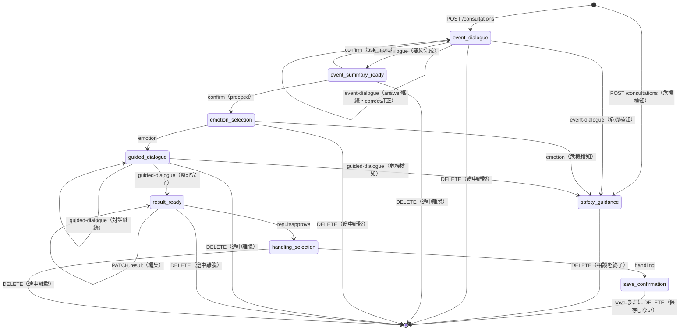

> **ステータス**：ドラフト（チーム内初稿・講師確認前・レビュー指摘反映済）
> **作成日**：2026年9月25日
> **関連Issue**：依存 `#2` ／ 参照 `#4`〜`#8` ／ 後続 実装Issue、`#13`、`#15`
　**作成** : じま
　**確認担当** : みほさん　もえさん

# API設計（API契約）

## 1. この資料の目的・位置づけ

フロントエンドとバックエンドを分離して並行実装できるよう、MVPで必要なAPIの入出力仕様（API契約）を定義する。ここでいうAPI契約とは、フロントエンドとバックエンドの間で共通認識とする、リクエスト・レスポンス・エラー等の取り決めを指す。

- 対象は[porori-mvp-wireframes.md](../issue-review/porori-mvp-wireframes.md)の画面1〜13に対応するMVP機能。
- 技術検証（`#4`〜`#8`）が未確定の項目は「**未定**」と明記する。仮の値・仮の方式で記載している箇所も、確定事項ではない。
- 本資料は本実装・OpenAPIの完全自動生成・認証方式や課金方式の断定を行わない。
- 以下の二点は、チームの判断が必要な選択肢として本文中に明記し、**本 PR でチームの意見を仰ぐ**（詳細はPR本文参照）。
  - 相談中の一時状態（会話文脈）の保持方式（§2）
  - 決済方式（買い切り型／サブスク型）（§6.8）

## 2. 前提・保存方針（企画案・要件定義より）

- 相談中の会話全文・入力原文・未承認の内容は、DB・Redis・ログへ永続化しない。相談の進行状態は、相談完了または一定時間の未操作で破棄される**一時的な状態**として扱う。Issue #7の技術検証で、未承認・保存同意なしのデータがPostgreSQL・Redisへ保存されないことは確認済み。
- **一時状態（会話文脈）の具体的な保持方式は本 PR での要確認事項**。相談中はAIへ渡す文脈（それまでの回答）をリクエストをまたいで保持する必要がある一方、Issue #7の保存可否表は会話全文・未承認の整理結果をRedisへも保存禁止としている。次の3候補から選定する必要があり、**チームの判断を仰ぐ**（PR本文参照）。
  - A：クライアントが文脈を保持し、毎回のリクエストに含めて送る
  - B：APIプロセスのメモリで保持する（プロセス再起動・複数ワーカー構成で消失する制約あり）
  - C：Redisへ保存する（Issue #7の保存可否方針の変更が必要）

  ※`correction_count`・`question_count`・`approved`は「サーバーが管理し、クライアントの値は信用しない」前提（4.0参照）であり、A案（クライアント保持）を採用する場合は、署名付き状態トークンなどで改ざん防止を代替する必要があり、`GET /consultations/{id}`（6.2.2）もA案では成り立たない。B・C案を前提とした設計である点はチーム判断の前に共有する。
- 永続化されるのは、本人が確認・編集・承認し、保存を選んだ「整理メモ」のみ。Issue #7の技術検証で、`cryptography`ライブラリの`Fernet`による暗号化・復号・PostgreSQLへの保存と読み戻しを確認済み（**暫定推奨**。正式採用・鍵管理方式はDB設計・運用要件と合わせて別途決定するため未定）。
- API側で所有者（本人）を確認し、本人以外がメモ・アカウント情報を閲覧・変更・削除できないようにする。Issue #5の技術検証で、他人のデータへのアクセスを拒否できることを実接続で確認済み。
- エラーレスポンスの本文に、相談内容・入力原文・認証トークンを含めない。Issue #5・#7の技術検証で、レスポンス・収集ログへの混入がないことを確認済み。FastAPIの既定422ハンドラは送信値（`input`）を含むため、独自ハンドラで上書きする必要がある（3.5参照）。

## 3. 共通仕様

### 3.1 ベースパス・バージョニング

```
/api/v1
```

パスは仮置き。APIバージョニング方式は**未定**。

### 3.2 認証方式

- 認証方式はFirebase Authenticationを検証済み候補とする（Issue #5：IDトークンをFastAPI側で検証し、有効・無効・期限切れ・未指定を判定できることを実接続で確認済み）。正式採用の最終決定・全画面への組み込みは未実施のため、変更の可能性は残る。
- 認証が必要なAPIには `Authorization: Bearer <token>` ヘッダーを付与する（トークンはFirebase発行のIDトークンを想定）。
- トークンのリフレッシュ方法・有効期限の運用（フロントエンドでの再取得タイミング等）は**未定**。

### 3.3 日時・ID形式

- 日時は ISO 8601（例：`2026-09-23T10:00:00+09:00`）を仮の形式とする。
- ID形式（UUID⁄連番のどちらを採用するか）はDB設計と合わせて**未定**。本資料のサンプル表記はUUID形式に統一済み。

### 3.4 共通レスポンス形式

正常系はリソースをそのままJSONで返す。一覧APIのページネーション方式（カーソル／オフセット）は**未定**。

### 3.5 共通エラーレスポンス形式

```json
{
  "error": {
    "code": "VALIDATION_ERROR",
    "message": "入力内容を確認してください。",
    "details": [
      { "field": "theme", "reason": "許可されていない値です。" }
    ]
  }
}
```

- `message`はユーザー・ログ双方に安全な定型文とし、相談内容や個人情報を含めない。
- `details`は入力検証エラー（422）でのみ使用する想定。
- FastAPIの既定`RequestValidationError`ハンドラは、失敗した項目の`input`に**送信された値そのもの**を含めるため、そのまま使うと相談内容がエラー本文に混入する。**独自の422ハンドラで上書きし、`input`（送信値そのもの）をレスポンスへ含めないこと**を必須とする。
- Issue #5の実装確認では`{"detail": "..."}`というFastAPI標準形式が使われていた。本実装では本資料の`{"error": {...}}`形式に統一する必要がある（既存実装との差分は後続 issue で解消する）。

### 3.6 主なHTTPステータスコードの使い分け

| コード | 意味 | 使用場面（例） |
| --- | --- | --- |
| 400 | Bad Request | リクエスト形式そのものが不正（JSON不正など） |
| 401 | Unauthorized | 未ログイン・トークン欠落／無効・期限切れ |
| 403 | Forbidden | ログイン済みだが、利用回数・プラン上の制限（相談回数・メモ保存件数の上限超過等）や、退会処理中（`deleting`状態）のアカウントであることに抵触する場合。本人以外のリソースへのアクセスは404を返す（下記「所有者確認の方針」参照） |
| 404 | Not Found | 指定したリソース（メモ・相談セッション等）が存在しない、または本人のものではなく存在を秘匿する場合 |
| 409 | Conflict | 相談セッションの状態と操作が矛盾する場合（例：承認済みの結果を再承認しようとした等）。状態の矛盾は409、入力値の誤りは422に揃える方針を採用する |
| 422 | Unprocessable Entity | Pydantic等によるスキーマ検証エラー（型・必須項目・文字数・許容値） |
| 500 | Internal Server Error | サーバー側の想定外エラー |

#### 401と403の使い分け・所有者確認の方針

- **401**：誰であるかを認証できない場合（未ログイン、トークン欠落・無効・期限切れ）に返す。
- **403**：認証はできているが、利用回数・プラン上の制限に抵触する場合、または退会処理中（`deleting`状態。6.9参照）のアカウントである場合に返す。退会処理が途中で失敗した場合は`deleting`状態が残るため、`DELETE /users/me`（退会の再実行）以外の操作は403で拒否する。
- **所有者確認の方針**：メモ・相談セッション・アカウント情報など個人に紐づくリソースは、APIサーバー側で「トークンから復元したユーザーID」と「リソースの所有者ID」を必ず突き合わせる。一致しない場合は、リソースの存在自体を秘匿するため**404**を返す（他人のリソースIDの存在を推測されないようにするため）。Issue #5の技術検証で、他人のデータへのアクセスに対して404を返す動作を実接続で確認済みのため、本方針は検証済みとして採用する。

## 4. AIの構造化結果と画面入力の境界

AIの応答は、フロントエンドがそのまま保存・信用する対象ではなく、**本人が確認・編集できる構造化データ（Schema）としてバックエンドが返す**。承認前の内容はDB・Redis・ログへ永続化しない一時データとして扱う。

- AIの生出力（自由文章）を直接クライアントに返さず、バックエンドで検証・整形したうえで、下記のような型付きスキーマとしてレスポンスする。
- ユーザーが編集した内容は、次のリクエストのrequest bodyとしてバックエンドへ送り返し、Pydantic等で型・文字数・許容値を検証する。想定外の項目・値は拒否する（422）。
- AIの構造化出力を、そのままDB操作・外部API呼び出し・権限判定に使用しない。
- 本節のモデルは`model_config = ConfigDict(extra="forbid")`を付与し、想定外の項目を拒否する。必須文字列項目には`min_length=1`を付け、空文字での通過を防ぐ。

### 4.0 スキーマの3分類（AI出力／ユーザー編集／サーバー状態）

AIの構造化結果・ユーザーの編集入力・サーバーが管理する状態を同じスキーマに混在させない。

- **AI出力スキーマ**：AIが生成する一次案。本人の確認前の内容（`EventSummaryDraft`、`ConsultationResultDraft`、`SafetyGuidanceDraft`）
- **ユーザー編集リクエスト**：本人が確認・編集して送り返す入力（`EventSummaryInput`、`EmotionInput`、`ConsultationResultInput`、`HandlingChoice`）
- **サーバー管理状態**：クライアントからは受け付けず、サーバー側のみで管理する値（`question_count`、`can_ask_more`、`correction_count`、`correction_limit_reached`、`approved`、`status`）。これらはレスポンスにのみ含め、リクエストボディでは受け付けない（`extra="forbid"`により、送られてきた場合は422で拒否する）。

### 4.1 出来事の要約

```python
class EventSummaryDraft(BaseModel):
    """AIが生成する一次案（本人の確認前）"""
    model_config = ConfigDict(extra="forbid")
    what_happened: str = Field(max_length=500)      # 何があったか
    what_bothered_me: str = Field(max_length=500)   # 何が気になったか

class EventSummaryInput(BaseModel):
    """本人が確認・訂正・編集して送り返す内容（ユーザー編集リクエスト）"""
    model_config = ConfigDict(extra="forbid")
    what_happened: str = Field(min_length=1, max_length=500)
    what_bothered_me: str = Field(min_length=1, max_length=500)
```

`question_count`（追加質問回数）・`can_ask_more`（追加質問の余地）・`correction_count`（訂正回数）・`correction_limit_reached`（訂正上限到達）はサーバー管理状態としてレスポンスにのみ含める（6.3.1・6.3.2参照）。

### 4.2 感情の選択・具体化（EmotionInput）

```python
class EmotionCategory(str, Enum):
    LONELY = "lonely"            # 寂しい
    SAD = "sad"                  # 悲しい
    ANXIOUS = "anxious"          # 不安
    ANGRY = "angry"              # 怒り・いら立ち
    CONFUSED = "confused"        # モヤモヤ・違和感
    HURT = "hurt"                # 傷ついた
    SELF_BLAME = "self_blame"    # 自分を責める気持ち（情けなさ・罪悪感）
    OTHER = "other"              # その他・まだよく分からない

class EmotionInput(BaseModel):
    model_config = ConfigDict(extra="forbid")
    category: EmotionCategory
    detail: Optional[str] = Field(default=None, max_length=300)  # 自分の言葉での具体化
    cannot_verbalize: bool = False                                # 「うまく言葉にできない」を選んだか

    @model_validator(mode="after")
    def check_detail_or_cannot_verbalize(self):
        if not self.cannot_verbalize and not (self.detail and self.detail.strip()):
            raise ValueError("detailまたはcannot_verbalizeのいずれかが必要です")
        if self.cannot_verbalize and self.detail:
            raise ValueError("cannot_verbalize=Trueの場合はdetailを指定しない")
        return self
```

- mvp-decisions No.3は8択（「自分を責める気持ち（情けなさ・罪悪感）」を含む）であり、これを正とする。Issue #4の技術検証で使用した`schema.json`（`PororiStructuredResult`）は7択のままであり、この点はスキーマ側が古いため、後続issueで更新が必要（**未定**）。
- mvp-decisions No.4「自分の言葉で入力する」または「『うまく言葉にできない』を選ぶ」のどちらかで次へ進める仕様を、`detail`（任意）と`cannot_verbalize`の排他バリデーションで表現する。

### 4.3 整理結果

```python
class ConsultationResultDraft(BaseModel):
    """AIが生成する一次案（本人の確認前）"""
    model_config = ConfigDict(extra="forbid")
    event_summary: str = Field(max_length=500)     # 出来事
    emotion: str = Field(max_length=300)            # 感情
    true_feeling: str = Field(max_length=500)        # 本音（旧honne）
    background: str = Field(default="", max_length=500)  # 背景。読み取れない場合は空文字を許容し事実の創作はしない
    wish: str = Field(max_length=500)                # 望み

class ConsultationResultInput(BaseModel):
    """本人が確認・編集して送り返す内容（ユーザー編集リクエスト）。approvedはここでは受け付けない"""
    model_config = ConfigDict(extra="forbid")
    event_summary: Optional[str] = Field(default=None, min_length=1, max_length=500)
    emotion: Optional[str] = Field(default=None, min_length=1, max_length=300)
    true_feeling: Optional[str] = Field(default=None, min_length=1, max_length=500)
    background: Optional[str] = Field(default=None, max_length=500)
    wish: Optional[str] = Field(default=None, min_length=1, max_length=500)
```

`approved`（本人が承認したか）はサーバー管理状態であり、`ConsultationResultInput`（PATCH）では受け付けず、専用の`/result/approve`（6.4.3）でのみ更新する。

Issue #4の`PororiStructuredResult`をもとに変更した。差分は次の通り。

- `emotion`：Issue #4はobject（`primary`／`detail`）→ 本資料では画面6-C・6-Dで確定する`EmotionInput`の内容を文字列として統合するため`str`に変更
- `honne`→`true_feeling`に改名
- `summary_for_confirmation`：画面7の確認表示はフロントエンドで整形するため削除
- `background`を追加。GET result（6.4.1）・メモ詳細（6.6.2）のレスポンス例にも反映する。画面7（ワイヤーフレーム）に対応する表示欄を設けるかどうかは**未定**

採用モデルは`gpt-oss-120b`を暫定候補とし、危機対応部分の追加対策は**未定**。

### 4.4 扱い方・保存対象（HandlingChoice）

```python
class HandlingType(str, Enum):
    TELL = "tell"           # 伝える
    HOLD = "hold"           # 今は保留する
    NOT_TELL = "not_tell"   # 伝えない

class HandlingChoice(BaseModel):
    model_config = ConfigDict(extra="forbid")
    handling: HandlingType
```

- `reason`（理由・任意入力）は画面9（保存確認）で入力するため、6.5.2の保存APIリクエストへ移動した（画面8で送っていた旧仕様から変更）。

### 4.5 危機的内容の安全案内（SafetyGuidance）

Issue #4の技術検証で使用した`PororiSafetyGuidanceResult`（`technical-verification/openrouter-model-comparison/eval/schema-safety.json`）をもとにする。相談文から安全面の配慮が必要な内容（希死念慮等）を検知した場合、通常の整理結果の代わりにこのスキーマを返す想定。

```python
class SafetyGuidanceDraft(BaseModel):
    """AIが生成する一次案（正規化前）。eval/schema-safety.jsonの必須項目に合わせ、safety_messageも受け取る"""
    model_config = ConfigDict(extra="forbid")
    risk_detected: bool
    safety_message: str                # AIが生成した文言。バックエンドは保存・使用せず、固定テンプレートへ差し替える
    continued_normal_structuring: bool

class SafetyGuidance(BaseModel):
    """サーバーが正規化して返す安全案内（AI出力をそのまま返さない）"""
    model_config = ConfigDict(extra="forbid")
    risk_detected: bool
    safety_message: str               # サーバー側で用意した固定テンプレートから選択する。AIの生成文をそのまま使わない
    continued_normal_structuring: bool # 通常の出来事・感情整理を継続したか（安全対応優先時はfalse）
```

- Issue #4で使用した`eval/schema-safety.json`は`risk_detected`・`safety_message`・`continued_normal_structuring`の3つを必須項目としているため、`SafetyGuidanceDraft`もこれに合わせて`safety_message`を受け取る（`extra="forbid"`のため、必須項目を欠くとAI出力側の解析が422相当で失敗してしまうことを避ける）。ただし`SafetyGuidanceDraft.safety_message`の値はバックエンドで破棄し、`SafetyGuidance.safety_message`はサーバー側の固定テンプレートへ差し替える。
- Issue #4の検証で、`risk_detected: true`かつ`continued_normal_structuring: true`という矛盾した組み合わせが実際に発生した。バックエンドで`risk_detected: true`の場合は`continued_normal_structuring`を強制的に`false`へ正規化する。
- `safety_message`は電話番号等の詳細情報の誤生成を防ぐため、AIの生成文をそのまま使わず、サーバー側で用意した固定テンプレート（相談窓口の案内文言等）から選択して返す。
- 危機的な内容は最初の自由記述（画面5）で最も出やすいため、`POST /consultations`（6.2.1）・`event-dialogue`（6.3.1）・`emotion`（6.3.3）・`guided-dialogue`（6.3.4）のいずれのレスポンスでも`safety_guidance`を返せることを候補とする。どのAPIで判定するかは**未定**。
- 入力だけから危機を自動検知するロジックの実装方法は**未定**（Issue #4の検証は、安全用スキーマをあらかじめ指定した場合の生成品質確認にとどまる）。

各文字数上限は仮置きであり、画面設計・要件定義の確定後に見直す。**未定**。

## 5. API一覧（概要）

| # | 分類 | Method | Path | 認証 |
| --- | --- | --- | --- | --- |
| 1 | 認証 | POST | /api/v1/users/me | 必要（初回ログイン時は内部ユーザーを作成、既存なら取得。upsert） |
| 2 | 認証 | PATCH | /api/v1/users/me | 必要（`has_seen_notice`の更新） |
| 3 | 相談開始 | POST | /api/v1/consultations | 必要 |
| 4 | 相談状態 | GET | /api/v1/consultations/{id} | 必要 |
| 5 | 段階的整理 | POST | /api/v1/consultations/{id}/event-dialogue | 必要 |
| 6 | 段階的整理 | POST | /api/v1/consultations/{id}/event-summary/confirm | 必要 |
| 7 | 段階的整理 | POST | /api/v1/consultations/{id}/emotion | 必要 |
| 8 | 段階的整理 | POST | /api/v1/consultations/{id}/guided-dialogue | 必要 |
| 9 | 整理結果確認 | GET | /api/v1/consultations/{id}/result | 必要 |
| 10 | 整理結果確認 | PATCH | /api/v1/consultations/{id}/result | 必要 |
| 11 | 整理結果確認 | POST | /api/v1/consultations/{id}/result/approve | 必要 |
| 12 | 扱い方選択 | POST | /api/v1/consultations/{id}/handling | 必要 |
| 13 | 保存確認 | POST | /api/v1/consultations/{id}/save | 必要 |
| 14 | 保存確認・中断 | DELETE | /api/v1/consultations/{id} | 必要（保存せず終了・途中離脱の両方に使用） |
| 15 | メモCRUD | GET | /api/v1/memos | 必要 |
| 16 | メモCRUD | GET | /api/v1/memos/{id} | 必要 |
| 17 | メモCRUD | DELETE | /api/v1/memos/{id} | 必要 |
| 18 | 利用回数 | GET | /api/v1/usage | 必要 |
| 19 | 決済 | GET | /api/v1/plans | 不要 |
| 20 | 決済（サブスク案） | GET | /api/v1/subscriptions/me | 必要（要チーム判断。6.8参照） |
| 21 | 決済（サブスク案） | POST | /api/v1/subscriptions/checkout-session | 必要（要チーム判断。6.8参照） |
| 22 | 決済（サブスク案） | POST | /api/v1/subscriptions/cancel | 必要（要チーム判断。6.8参照） |
| 23 | 決済（サブスク案） | POST | /api/v1/webhooks/stripe | Stripe署名検証（要チーム判断。6.8参照） |
| 24 | 決済（買い切り案・検証済み） | POST | /api/v1/payments/checkout-session | 必要（要チーム判断。6.8参照） |
| 25 | 決済（買い切り案・検証済み） | GET | /api/v1/payments/me | 必要（要チーム判断。6.8参照） |
| 26 | 決済（買い切り案・検証済み） | POST | /api/v1/payments/confirm | 必要（要チーム判断。6.8参照） |
| 27 | 退会 | DELETE | /api/v1/users/me | 必要 |

認証方式はFirebase Authenticationを検証済み候補とする（Issue #5）。登録・ログインはフロントエンドのFirebase SDKが行うため、旧`/auth/signup`・`/auth/login`・`/auth/logout`はバックエンドAPIとして不要（6.1参照）。

## 6. API詳細

以降の各APIで、`request`/`response`は主要フィールドのみを示すサンプルであり、フィールド名・必須/任意・型は画面設計・DB設計との整合確認後に変更しうる（**未定**）。IDのサンプルはUUID形式で統一する。

### 6.1 認証・内部ユーザー作成（画面1・3）

Firebase Authenticationでは、登録・ログイン処理はフロントエンドのFirebase SDKが行い、バックエンドはメール・パスワードを直接受け取らない（Issue #5「パスワード管理：Firebaseへ委ね、アプリDBにパスワードを保存しない」）。バックエンドは、Firebaseが発行したIDトークンを検証したうえで、内部ユーザーの作成・取得のみを行う。

#### 6.1.1 内部ユーザーの作成・取得（初回ログイン時）

- **POST /api/v1/users/me**（認証必要。FirebaseのIDトークンを検証）

フロントエンドがFirebaseへのログイン・サインアップ完了後に呼び出す。`firebase_uid`に対応する内部ユーザーが存在しない場合は新規作成し、存在する場合はそのまま返す（upsert。Issue #5「初回ログイン時の内部ユーザー作成は、API・DB設計で確定する」に対応）。

内部ユーザーが退会処理中（`deleting`状態。6.9参照）の場合は、新規作成せず`403`を返す。

退会完了後は内部ユーザーを物理削除するため、削除済みユーザーの行は残らない（DB設計PR #23に合わせる）。退会前に発行されたIDトークンによる自動再作成を防ぐため、新規作成の唯一の経路である本APIでは`check_revoked=True`でIDトークンを検証し、Firebase側で削除済みのユーザーのトークンを拒否する（401）。Firebaseで同じメールアドレスを再登録した場合は新しいUIDが発行されるため、新規ユーザーとして扱う。

request：なし（Authorizationヘッダーのみ）

response（200・既存ユーザー／201・新規作成）
```json
{
  "user_id": "11111111-1111-4111-8111-111111111111",
  "has_seen_notice": false
}
```

`has_seen_notice`は、初回利用時の詳細な注意（mvp-decisions No.5）を表示済みかどうかを示す。画面3（利用前の注意）でこれを参照し、初回は詳細な注意、2回目以降は短い注意を表示する。端末ではなくアカウント単位で判定するため、DBの`users`テーブルへ保存する（`has_seen_notice BOOLEAN NOT NULL DEFAULT false`。DB設計PR #23へ追加を依頼中）。

主なエラー：`401`（トークン無効・欠落・期限切れ、Firebase側で削除済み）、`403`（退会処理中のアカウント）

代替案（fastapi-users採用時のみ。正式採用は**未定**）：メール・パスワード方式を採用する場合は、`/auth/signup`・`/auth/login`・`/auth/logout`相当のAPIが別途必要になる。Issue #5では「文献調査のみで動作検証は未実施」の代替案と位置づけられており、採用する場合は本節を別途設計し直す。

#### 6.1.2 利用前の注意への同意（画面3）

- **PATCH /api/v1/users/me**（認証必要）

画面3で「同意して相談へ進む」を選んだときに呼び出し、`has_seen_notice`を更新する。

request
```json
{ "has_seen_notice": true }
```

response（200）
```json
{
  "user_id": "11111111-1111-4111-8111-111111111111",
  "has_seen_notice": true
}
```

`false`から`true`への更新のみ受け付け、`false`へ戻す更新は受け付けない。

主なエラー：`401`、`403`（退会処理中のアカウント）、`422`（`has_seen_notice`が真偽値でない、`false`を指定した等）

---

### 6.2 相談開始（画面4・5）

#### 6.2.0 相談テーマ（ThemeCategory）

```python
class ThemeCategory(str, Enum):
    COMMUNICATION = "communication"  # 会話・連絡・愛情表現
    LIFESTYLE = "lifestyle"          # 暮らし・家事・生活習慣
    MONEY = "money"                  # お金の感覚の違い
    CARE = "care"                    # 気遣い・思いやりの伝わり方
    FUTURE = "future"                # 将来・価値観・二人の関係
    OTHER = "other"                  # その他
```

mvp-decisions No.1の6項目（5テーマ＋その他）に対応するEnum。

#### 6.2.1 相談セッション作成

- **POST /api/v1/consultations**（認証必要）

画面4（テーマ選択）・画面5（具体的な内容の入力）の内容をまとめて送信し、相談の一時セッションを開始する。

request
```json
{
  "theme": "communication",
  "detail": "最近、連絡の返信が遅くて不安に思っている"
}
```

response（201）
```json
{
  "consultation_id": "22222222-2222-4222-8222-222222222222",
  "status": "event_dialogue",
  "ai_question": "そのとき、具体的にどのくらい返信が来なかったのでしょうか？"
}
```

主なエラー：
- `401` 未ログイン
- `403` 利用回数の上限超過（無料プランの相談回数上限など。具体的な上限値は**未定**。Issue #8の技術検証でRedisのキー`usage_limit:{user_id}`によるカウント・判定方式を確認済み。Redis障害時はフェイルオープン（判定不能時は許可扱い）とする方針も確認済み）
- `422` `theme`が許可された値でない、`detail`が空・文字数超過

---

#### 6.2.2 相談状態の取得

- **GET /api/v1/consultations/{id}**（認証必要）

リロード時の復帰や、直前の内容を確認する（画面6-E等）ために、現在の状態に加えて、直前にAPIが返した内容相当（直近の`ai_question`・`ai_understanding`・`event_summary`・`emotion`など、状態に応じて存在するもの）を返す。含めるフィールドの詳細は状態ごとに実装時に確定する（**未定**）。

response（200・例：`event_dialogue`状態）
```json
{
  "consultation_id": "22222222-2222-4222-8222-222222222222",
  "status": "event_dialogue",
  "question_count": 1,
  "ai_understanding": "3日間、返信がなかったのですね。",
  "ai_question": "そのとき、どんなことが一番気になりましたか？",
  "correction_count": 0,
  "correction_limit_reached": false
}
```
response（200・例：`guided_dialogue`状態）
```json
{
  "consultation_id": "22222222-2222-4222-8222-222222222222",
  "status": "guided_dialogue",
  "event_summary": {
    "what_happened": "3日間返信がなかった",
    "what_bothered_me": "既読なのに反応がないこと"
  },
  "emotion": "anxious",
  "ai_question": "その気持ちの背景には、どんな望みがありそうですか？"
}
```

主なエラー：`401`、`404`（所有者不一致・存在しない・破棄済み）

---

### 6.3 段階的整理（画面6-A〜6-E）

#### 6.3.1 出来事の対話・訂正（画面6-A）

- **POST /api/v1/consultations/{id}/event-dialogue**（認証必要）

ユーザーの回答を送り、AIからの次の質問または要約を受け取る。会話内容自体は永続化せず、一時セッションでのみ保持する。

ワイヤーフレーム画面6-Aでは、AIが回答の理解を短く提示し、必要に応じてその場で訂正できる（[porori-mvp-wireframes.md](../issue-review/porori-mvp-wireframes.md)手順3・7・9）。これに合わせ、`action`は`answer`（回答する）／`correct`（直前のAIの理解を訂正する）のいずれかとする。

request（回答する場合）
```json
{ "action": "answer", "answer": "3日くらい返信がありませんでした" }
```
request（AIの理解を訂正する場合）
```json
{ "action": "correct", "correction_input": "実際は5日間でした" }
```

response（200・回答後、AIの理解と次の質問を提示）
```json
{
  "status": "event_dialogue",
  "question_count": 1,
  "ai_understanding": "3日間、返信がなかったのですね。",
  "ai_question": "そのとき、どんなことが一番気になりましたか？",
  "correction_count": 0,
  "correction_limit_reached": false
}
```
response（200・訂正後、修正した理解を再提示。再確認まで完了して1回とカウントする）
```json
{
  "status": "event_dialogue",
  "question_count": 1,
  "ai_understanding": "5日間、返信がなかったのですね。",
  "ai_question": "そのとき、どんなことが一番気になりましたか？",
  "correction_count": 1,
  "correction_limit_reached": false
}
```
質問が完了した場合のresponse例
```json
{
  "status": "event_summary_ready",
  "question_count": 2,
  "can_ask_more": true,
  "event_summary": {
    "what_happened": "3日間返信がなかった",
    "what_bothered_me": "既読なのに反応がないこと"
  }
}
```
危機的な内容を検知した場合のresponse例（4.5のSafetyGuidance。検知ロジックの実装方法は**未定**）
```json
{
  "status": "safety_guidance",
  "safety_guidance": {
    "risk_detected": true,
    "safety_message": "つらい状況について、専門の相談窓口も案内します……",
    "continued_normal_structuring": false
  }
}
```

`correction_count`（訂正回数）・`correction_limit_reached`（訂正上限到達）はサーバー側で管理し、クライアントから送られた値は信用しない。mvp-decisions No.2により、訂正入力→AIによる修正後理解の提示→本人の再確認までを1回と数え、出来事を整理する工程全体（画面6-A・6-B）で最大2回までとする（上限値は初期値であり見直しの可能性あり）。`correction_limit_reached: true`の状態で`action: "correct"`を指定した場合は`409`を返し、画面6-Bへ進んで本人が`event_summary`を直接編集するよう促す。

主なエラー：`401`、`404`（所有者不一致・存在しない・破棄済みセッション）、`409`（`question_count`が3に達している状態で回答を続けようとした場合、`correction_limit_reached`後に`correct`を指定した場合）、`422`（`answer`または`correction_input`が空、両方またはどちらも指定していない等）

#### 6.3.2 出来事要約の確認・編集（画面6-B）

- **POST /api/v1/consultations/{id}/event-summary/confirm**（認証必要）

`action`は`proceed`（次へ進む。本人が直接編集した`event_summary`を含められる）／`ask_more`（追加質問を増やす。`question_count<3`のときのみ）のいずれか。AIの理解の訂正は6.3.1で行うため、このAPIでは扱わない。

request（次へ進む場合。直接編集を含む）
```json
{
  "action": "proceed",
  "event_summary": {
    "what_happened": "3日間返信がなかった",
    "what_bothered_me": "既読なのに反応がないこと"
  }
}
```
request（もう少し整理したい場合、質問3問未満のときのみ）
```json
{ "action": "ask_more" }
```

response（200・proceedの場合）
```json
{ "status": "emotion_selection" }
```
response（200・ask_moreの場合）
```json
{ "status": "event_dialogue", "ai_question": "他に気になったことはありますか？" }
```

主なエラー：`404`（所有者不一致・存在しない）、`409`（`question_count`が3に達している状態で`ask_more`を指定した場合）、`422`（文字数超過・必須項目の欠落等の入力値エラー）

#### 6.3.3 感情の選択・具体化（画面6-C・6-D）

- **POST /api/v1/consultations/{id}/emotion**（認証必要）

request
```json
{ "category": "anxious", "detail": "既読なのに反応がないと、見捨てられた気がして不安になる" }
```
request（「うまく言葉にできない」を選んだ場合）
```json
{ "category": "anxious", "cannot_verbalize": true }
```

response（200）
```json
{ "status": "guided_dialogue", "ai_response": "不安に近いのですね。違っていたら教えてください。" }
```

主なエラー：`404`、`422`（`category`が許可された列挙値でない、`detail`文字数超過、`detail`と`cannot_verbalize`のどちらも指定していない・両方指定した場合）

#### 6.3.4 本音・背景・望みの対話（画面6-E）

- **POST /api/v1/consultations/{id}/guided-dialogue**（認証必要）

request
```json
{ "answer": "本当は気にかけてほしいと伝えたい" }
```

response（200）
```json
{
  "status": "guided_dialogue",
  "ai_question": "その気持ちの背景には、どんな望みがありそうですか？"
}
```
整理が完了した場合
```json
{ "status": "result_ready" }
```
危機的な内容を検知した場合（4.5のSafetyGuidance。検知ロジックの実装方法は**未定**）
```json
{
  "status": "safety_guidance",
  "safety_guidance": {
    "risk_detected": true,
    "safety_message": "つらい状況について、専門の相談窓口も案内します……",
    "continued_normal_structuring": false
  }
}
```

主なエラー：`404`、`422`（回答が空等）

---

### 6.4 整理結果の確認・編集・承認（画面7）

#### 6.4.1 整理結果の取得

- **GET /api/v1/consultations/{id}/result**（認証必要）

response（200）
```json
{
  "event_summary": "3日間返信がなく、既読なのに反応がなかった",
  "emotion": "不安、見捨てられた気がした",
  "true_feeling": "気にかけてほしいと思っている",
  "background": "",
  "wish": "既読になったら一言でも返事がほしい",
  "approved": false
}
```

`background`（背景）はConsultationResultDraft（4.3）に含まれるが、画面7（ワイヤーフレーム）での表示要否は**未定**。

主なエラー：`404`

#### 6.4.2 整理結果の編集

- **PATCH /api/v1/consultations/{id}/result**（認証必要）

request（編集したい項目のみ送信。`ConsultationResultInput`。方式は**未定**、全項目送信に統一する可能性あり）
```json
{ "wish": "既読になったら、一言でも返事がほしい" }
```

`approved`はこのAPIでは受け付けない（送信された場合422で拒否する。承認は6.4.3の専用APIのみで行う）。

response（200）：更新後の`ConsultationResultDraft`相当（`approved`を含む）

主なエラー：`404`、`409`（承認済みの結果を編集しようとした場合）、`422`（`approved`を含む等、想定外の項目・文字数超過）

#### 6.4.3 整理結果の承認

- **POST /api/v1/consultations/{id}/result/approve**（認証必要）

request：なし

response（200）
```json
{ "status": "handling_selection", "approved": true }
```

承認時点の整理結果と承認日時（DB設計の`approved_at`）を、サーバー側の一時状態に確定させる。承認後の編集は409で拒否するため（6.4.2）、保存時（6.5.2）に保存対象が承認した内容と同じであることをサーバー側で保証できる（B・C案の場合。A案では署名付き状態トークン等による同一性の確認が別途必要。§2参照）。

主なエラー：`404`、`409`（未編集で必須項目が空のまま承認しようとした場合）

---

### 6.5 扱い方選択・保存確認（画面8・9）

#### 6.5.1 扱い方の選択

- **POST /api/v1/consultations/{id}/handling**（認証必要）

request
```json
{ "handling": "hold" }
```

response（200）
```json
{ "status": "save_confirmation" }
```

主なエラー：`404`、`422`（`handling`が許可値でない）、`409`（整理結果が未承認のまま扱い方を選ぼうとした場合）

#### 6.5.2 保存する（メモ作成）

- **POST /api/v1/consultations/{id}/save**（認証必要）

`reason`（扱い方を選んだ理由・任意入力）は画面9（保存確認）で入力するため、ここで送信する（旧仕様では6.5.1の`/handling`で送っていた）。

request
```json
{ "reason": null }
```

response（201・新規保存／200・保存済みの結果を返す場合）
```json
{
  "memo_id": "33333333-3333-4333-8333-333333333333",
  "created_at": "2026-09-23T10:00:00+09:00",
  "handling": "hold",
  "reason": null,
  "event_summary": "3日間返信がなく、既読なのに反応がなかった"
}
```

二重保存の防止（DB設計PR #23に合わせる）：

- パスの`{id}`（相談ID）を、DB設計の`approved_memos.source_consultation_id`として保存する。相談IDが本人の一時状態に属することはサーバー側で確認する。
- 通信エラー時の再送などで同じ相談IDの保存が再実行された場合は、新規作成せず、保存済みの結果を返す（200）。同時リクエストによる二重作成は、DB側の`UNIQUE (user_id, source_consultation_id)`制約で防ぐ。
- 保存同意日時（DB設計の`save_consented_at`）はこのAPIの呼び出し時にサーバー側で設定する。承認日時（`approved_at`）は6.4.3で一時状態に確定した値を使う。扱い方・理由は承認後に入力するため、承認ではなく保存同意の対象として扱う。
- 保存に成功したら、相談の一時状態を破棄する。

主なエラー：
- `404`
- `409`（未承認・扱い方未選択のまま保存しようとした場合）
- `403`（保存済みメモの件数上限超過。無料プランの保存件数上限など。具体的な上限値は**未定**）
- `422`（`reason`文字数超過）

#### 6.5.3 保存せず終了・相談の中断

- **DELETE /api/v1/consultations/{id}**（認証必要）

相談の一時状態を破棄する。画面9「保存しない」と、画面6のどの段階からでも呼び出せる途中離脱の両方をこの1つのAPIに統合する（旧`POST /discard`は廃止）。

request：なし

response（204）：本文なし

主なエラー：`404`

---

### 6.6 保存メモCRUD（画面10・11）

#### 6.6.1 メモ一覧

- **GET /api/v1/memos**（認証必要）

response（200）
```json
{
  "memos": [
    { "memo_id": "33333333-3333-4333-8333-333333333333", "created_at": "2026-09-23T10:00:00+09:00", "summary": "既読なのに返信がなかったこと", "handling": "hold" }
  ]
}
```
ページネーションの有無・方式は**未定**。

主なエラー：`401`

#### 6.6.2 メモ詳細

- **GET /api/v1/memos/{id}**（認証必要）

response（200）
```json
{
  "memo_id": "33333333-3333-4333-8333-333333333333",
  "created_at": "2026-09-23T10:00:00+09:00",
  "event_summary": "3日間返信がなく、既読なのに反応がなかった",
  "emotion": "不安、見捨てられた気がした",
  "true_feeling": "気にかけてほしいと思っている",
  "background": "",
  "wish": "既読になったら一言でも返事がほしい",
  "handling": "hold",
  "reason": null
}
```

`background`の表示要否は6.4.1と同様に**未定**。

主なエラー：`401`、`404`（本人以外のメモID・存在しないID。所有者不一致は3.6の方針により404で統一）

#### 6.6.3 メモ削除

- **DELETE /api/v1/memos/{id}**（認証必要）

response（204）：本文なし

主なエラー：`401`、`404`

---

### 6.7 利用回数（画面2・12関連）

- **GET /api/v1/usage**（認証必要）

response（200）
```json
{
  "plan_code": "free",
  "consultation_count": 2,
  "consultation_limit": 3,
  "memo_count": 5,
  "memo_limit": 10
}
```

上限値・リセット周期の具体値は**未定**。カウントはIssue #8で検証済みのRedisキー`usage_limit:{user_id}`を使い、相談開始時（`POST /consultations`呼び出し時。6.2.1）にインクリメントする想定。リセット方式はTTL方式を第一候補とし（Issue #8参照）、日付キー方式（カレンダー月次でリセットする案）は要件次第の代替候補とする。リセット方式が確定するまで、カレンダー月次を示す`period`のようなフィールドは含めない。Redis障害時はフェイルオープン（判定不能時は許可扱い）とする。相談開始時に加算した後、AI呼び出しの失敗（500）や安全案内での早期終了があった場合に加算を取り消す（デクリメントする）かどうかは**未定**。

主なエラー：`401`

---

### 6.8 決済・プラン（画面12）※要チーム判断（PR参照）

Stripe連携は、買い切り型（Issue #6で検証済み）とサブスク型（未検証・比較のみ）の2案がある。**どちらを採用するかはPR本文でチームに判断を仰ぐ**。以下は両案を並記する。

#### 6.8.1 プラン一覧

- **GET /api/v1/plans**（認証不要）

response（200）
```json
{
  "plans": [
    { "plan_code": "free", "name": "無料プラン", "price_jpy": 0, "consultation_limit": 3, "memo_limit": 10 },
    { "plan_code": "premium", "name": "有料プラン", "price_jpy": 0, "consultation_limit": null, "memo_limit": null }
  ]
}
```
価格・上限値は未確定のため仮の値（**未定**）。

- プランの識別には、DB設計の`plans.code`を`plan_code`として使う。`plans.id`（UUID）は環境ごとに値が変わるため、APIでは受け渡さない。サーバー側で`plan_code`から`plans.id`・`stripe_price_id`へ変換し、提供中（`is_active`）であることを確認する。
- `price_jpy`は、サーバーが`plans.stripe_price_id`に対応するStripe Priceから取得した金額を返す案とする（DB設計PR #23に合わせる。`stripe_price_id`をDBとサーバー設定のどちらで管理するかは課金方式の決定後に確定）。決済作成APIはクライアントから金額・Price IDを受け取らない。
- 上限値の`null`を「無制限」と「未設定」のどちらとして扱うかは、DB設計と合わせて統一する（**未定**）。

#### 6.8.2 現在の契約状況（サブスク案）

- **GET /api/v1/subscriptions/me**（認証必要）

response（200）
```json
{ "plan_code": "free", "status": "active", "current_period_end": null }
```

主なエラー：`401`

#### 6.8.3 有料プランへの契約（サブスク案・Stripe Checkout Session作成）

- **POST /api/v1/subscriptions/checkout-session**（認証必要）

request
```json
{ "plan_code": "premium" }
```

response（200）
```json
{ "checkout_url": "https://checkout.stripe.com/pay/xxxxx" }
```
フロー（Checkout／Elements等）は**未定**。

主なエラー：`401`、`422`（`plan_code`不正・提供停止中）、`500`（Stripe API呼び出し失敗）

#### 6.8.4 解約（サブスク案）

- **POST /api/v1/subscriptions/cancel**（認証必要）

request：なし

response（200）
```json
{ "status": "cancel_scheduled", "current_period_end": "2026-10-23T00:00:00+09:00" }
```
即時解約か、期間終了時解約かは**未定**。

主なエラー：`401`、`404`（契約が存在しない）、`500`

#### 6.8.5 Stripe Webhook（サブスク案）

- **POST /api/v1/webhooks/stripe**（ユーザー認証なし。Stripe署名検証で認可）

request：Stripeから送信されるイベントペイロード（Stripe形式）

response（200）：受信確認のみ

主なエラー：`400`（署名検証失敗）

Webhookで受け取るイベントの種類・失敗時の再試行方針・冪等処理は**未定**（Stripe公式にat-least-once配信であり、同一イベントの二重処理防止が必要）。

#### 6.8.6 Checkout Session作成（買い切り案・Issue #6をもとに拡張）

- **POST /api/v1/payments/checkout-session**（認証必要）

request
```json
{ "plan_code": "premium" }
```

response（200）
```json
{
  "checkout_url": "https://checkout.stripe.com/pay/xxxxx",
  "session_id": "cs_test_xxxxx"
}
```

Session作成時に`client_reference_id`（またはmetadata）へ内部ユーザーIDを埋め込み、6.8.8の`confirm`での所有者検証に使う。

二重決済防止（Issue #6の申し送り事項）は、以下の手順で行う（**講師指摘反映**：「既に有料プランか」の事前チェックだけでは、同一ユーザーが複数タブ・同時リクエストでSessionを作成した場合を防げない。両方のリクエストが有料プランではないと判定してしまい、それぞれSessionを作成できてしまうため）。

1. `payments`テーブルの`user_id`に対し、`status`が`creating`または`pending`の未決済行が既に存在する場合は、新規Sessionを作成せず、その既存Session（`checkout_url`・`session_id`）を返す（200）。Stripe側でSessionが期限切れの場合はDB設計側の`expired`更新を経てから新規作成する。
2. 同時に複数リクエストが届いても1件しか`creating`行を作れないよう、`payments`に「同一`user_id`について`status`が`creating`／`pending`の行は1件まで」という部分ユニーク制約（またはユーザー単位のDBロック）を設け、作成処理をDBトランザクション内で直列化する。制約違反時は新規作成をせず、直後に既存行を再取得して1と同様に返す。
3. 上記1・2とは別に、既に有料プランの場合は`409`を返し、新たなSessionを作成しない（既存の事前チェックは維持する）。
4. クライアント都合の再試行（通信エラー時の再送など）は、Stripe APIへの`Idempotency-Key`ヘッダーに`payments.idempotency_key`を指定し、同一リクエストの重複作成を防ぐ。`idempotency_key`はクライアントではなくサーバーが発行・管理する。

主なエラー：`401`、`409`（既に有料プランの場合）、`422`（`plan_code`不正・提供停止中）、`500`（Stripe API呼び出し失敗）

#### 6.8.7 現在の有料状態（買い切り案）

- **GET /api/v1/payments/me**（認証必要）

response（200）
```json
{ "plan_code": "free" }
```

主なエラー：`401`

#### 6.8.8 決済確認（買い切り案・検証済み。Issue #6）

- **POST /api/v1/payments/confirm**（認証必要）

Checkout Session成功後のリダイレクトで受け取った`session_id`を送り、Stripeの`Session.retrieve`で`payment_status`を確認する（Webhookを使わない同期確認方式。Issue #6で検証済み）。同一`session_id`で複数回呼んでも同じ結果（200）を返す冪等な実装とする。二重決済の防止は6.8.6のSession作成時に行うため、このAPIでは409を返さない。

request
```json
{ "session_id": "cs_test_xxxxx" }
```

response（200）
```json
{ "status": "paid" }
```

主なエラー：
- `401`
- `404`（`session_id`が存在しない、または`client_reference_id`／metadataのユーザーIDが本人と一致しない。Issue #6では所有者検証が未実装のため本実装で追加する）
- `500`

この方式はWebhookを使わないため、ユーザーが決済成功後`success_url`へ遷移する前に離脱した場合は反映されない制約がある（Issue #6「既知の制約」参照）。

---

### 6.9 退会（画面13）

- **DELETE /api/v1/users/me**（認証必要）

request：なし（確認ダイアログはフロントエンド側で実施）

response（204）：本文なし。次の処理を**同期的に**この順序で行い、完了後に204を返す（DB設計PR #23「退会時の削除手順」に合わせる）。

1. 未完了の決済や継続契約があり退会を開始できない場合は、状態を変更せずに`409`を返す。
2. `users`の対象行をロックし、`status`を`deleting`へ変更して確定する。以降、保存・決済・利用権限の更新を拒否する（403）。
3. 保存済みメモ（`approved_memos`）を削除する。個人性の高いメモを、外部サービスの処理より先に削除する。
4. 未完了の決済や継続契約について、採用する課金方式に従って必要なキャンセル・解約・状態照合を行う。
5. Redisの利用回数キー（`usage_limit:{user_id}`）を削除する。
6. Firebase側のユーザーを削除する（Admin SDK）。「すでに存在しない」場合も処理済みとして続行する。
7. `user_entitlements`・`payments`（削除方針の合意が前提）・`users`を物理削除する。

非同期処理（202・ワーカーによるバックグラウンド実行）も候補だったが、現在の技術構成に非同期ワーカー基盤がないため、同期処理・204を採用する。将来的に処理時間が問題になれば非同期化を再検討する（**未定**）。

途中失敗と再実行：

- 上記はFirebase・内部DB（PostgreSQL）・Redisにまたがるため、単一のトランザクションでは括れない。途中で失敗した場合は`500`を返し、`users.status`は`deleting`のまま残す。
- 各ステップは、同じ処理を再実行しても安全に続行できるようにする（削除対象がすでに存在しない場合も成功扱い）。そのため、`deleting`状態であれば最初のステップからやり直せばよく、処理段階の記録は持たない案とする。
- 削除済みのメモは、以降の処理が失敗しても復元・再作成しない。
- Firebase削除（ステップ6）より前に失敗した場合は、本人が再度`DELETE /users/me`を呼び出せば再開できる（`deleting`状態でも本APIは受け付ける）。
- Firebase削除後に失敗した場合は本人が再ログインできないため、`deleting`のまま一定時間が経過した行を運用スクリプトで検出して再実行する（MVPでは手動実行を想定）。検出のために`users.deletion_requested_at`等の列を追加するかは、DB設計と合わせて確定する（**未定**）。

主なエラー：
- `401`
- `409`（未完了の決済や継続契約があり退会を開始できない場合。判定条件は採用する課金方式に従う。**未定**）
- `500`（途中失敗。`deleting`状態のまま残り、再実行で再開する）

## 7. 未確定項目一覧（本資料内の「未定」まとめ）

- **一時状態（会話文脈）の保持方式（A：クライアント保持／B：メモリ保持／C：Redis保持）**：チーム判断待ち（PR参照）
- **決済方式（買い切り型／サブスク型）**：チーム判断待ち（PR参照）。買い切り型はIssue #6で検証済み、サブスク型は比較のみで未検証
- 相談の一時状態の保持期間（TTLの具体的な秒数・分数）
- APIバージョニング方式・ページネーション方式・ID形式の最終採用（UUID／連番。サンプル表記はUUIDに統一済み）
- 各文字数上限・利用回数上限・保存件数上限の具体的な値、利用回数のリセット周期（TTL方式を第一候補とし、日付キー方式を代替候補とする）
- 危機的な内容を自動検知するロジックの実装方法・どのAPIで安全案内を返すか（`POST /consultations`・`event-dialogue`・`emotion`・`guided-dialogue`を候補として提示）
- AIモデルの最終選定（`gpt-oss-120b`は暫定候補。危機対応の安全案内の精度向上策は追加検討が必要）
- `background`（背景）を画面7・メモ詳細画面に表示するかどうか
- メモ暗号化の正式採用方式・鍵管理（`Fernet`は暫定推奨。鍵の保管・更新・漏えい対応は未確定）
- fastapi-usersを代替案として採用する場合のメール・パスワード認証APIの仕様、メール重複時の409エラー採用可否
- 退会を開始できない決済・契約状態の判定条件（採用する課金方式に従う）、`payments`の退会時の削除可否
- 退会処理がFirebase削除後に失敗した場合の検出・再実行の担当と、`users.deletion_requested_at`等の追加要否
- プラン上限値の`null`の意味（無制限／未設定）、`stripe_price_id`の管理場所（DB／サーバー設定）
- トークンのリフレッシュ方法・有効期限の運用（Firebase Authentication採用は検証済み）

## 8. レビュー・確認の記録

| 日付 | 確認者 | 内容 | 対応 |
| --- | --- | --- | --- |
| 2026-09-25 | AI（Claude Code）によるセルフレビュー | 指摘事項一式（mvp-decisions・技術検証との不整合、状態管理、スキーマ分離等） | 本資料へ反映済み（決済方式・一時状態の保持方式はPR本文でチーム判断を仰ぐ） |
| 2026-09-25 | AI（Claude Code）によるセルフレビュー（2回目） | 画面番号・退会とupsertの矛盾・決済APIの抴け・SafetyGuidanceDraftの不整合等 | 本資料へ反映済み |
| （未記入） | （画面設計担当） | （未実施） | - |
| 2026-09-26 | DB設計担当（PR #23との照合） | 退会時のユーザー状態・削除順序、`has_seen_notice`の保存先、`plan_id`の表現、承認から保存までの一時状態・二重保存防止 | 本資料へ反映済み（`deleting`＋物理削除、`plan_code`、`source_consultation_id`による再実行時の既存結果返却など。チーム・講師確認待ち） |
| （未記入） | 講師 | （未実施） | - |

講師への確認結果・指摘事項と対応内容は、Issueまたは対応するPull Requestにも記録する。

## 9. 画面とAPIの対応表

| 画面 | 内容 | 主に対応するAPI |
| --- | --- | --- |
| 1 | 登録・ログイン | Firebase SDK（フロント）＋ `POST /users/me` |
| 2 | ホーム | `GET /usage`（利用回数・プランの概況表示） |
| 3 | 利用前の注意 | `POST /users/me`（`has_seen_notice`参照）、同意後は`PATCH /users/me`（6.1.2） |
| 4・5 | テーマ選択・具体的な内容の入力 | `POST /consultations` |
| 6-A | 出来事の対話・訂正 | `POST /consultations/{id}/event-dialogue` |
| 6-B | 出来事要約の確認・直接編集 | `POST /consultations/{id}/event-summary/confirm` |
| 6-C・6-D | 感情の選択・具体化 | `POST /consultations/{id}/emotion` |
| 6-E | 本音・背景・望みの対話 | `POST /consultations/{id}/guided-dialogue`、復帰時は`GET /consultations/{id}` |
| 7 | 整理結果の確認・編集・承認 | `GET`/`PATCH /consultations/{id}/result`、`POST /consultations/{id}/result/approve` |
| 8 | 扱い方選択 | `POST /consultations/{id}/handling` |
| 9 | 保存確認（理由入力・保存／保存しない） | `POST /consultations/{id}/save`、`DELETE /consultations/{id}` |
| 10・11 | 保存メモ一覧・詳細 | `GET /memos`、`GET /memos/{id}`、`DELETE /memos/{id}` |
| 12 | 利用回数・プラン・決済 | `GET /usage`、`GET /plans`、6.8の決済API（要チーム判断） |
| 13 | 設定・退会・ログアウト | `DELETE /users/me`。ログアウトはFirebase SDK（フロント）が行いバックエンドAPIはない |

## 10. 相談ステータス一覧（ConsultationStatus）

```python
class ConsultationStatus(str, Enum):
    EVENT_DIALOGUE = "event_dialogue"             # 画面6-A：出来事の対話・訂正中
    EVENT_SUMMARY_READY = "event_summary_ready"    # 画面6-B：要約の確認待ち
    EMOTION_SELECTION = "emotion_selection"        # 画面6-C：感情選択待ち
    GUIDED_DIALOGUE = "guided_dialogue"            # 画面6-D・6-E：本音・背景・望みの対話中
    RESULT_READY = "result_ready"                  # 画面7：整理結果の確認待ち
    HANDLING_SELECTION = "handling_selection"      # 画面8：扱い方選択待ち
    SAVE_CONFIRMATION = "save_confirmation"        # 画面9：保存確認待ち
    SAFETY_GUIDANCE = "safety_guidance"            # 危機的内容を検知し安全案内を提示中
```

### 状態遷移（概要）



`DELETE /consultations/{id}`はどの状態からも呼び出し可能で、一時状態を破棄して終了する（6.5.3参照）。
