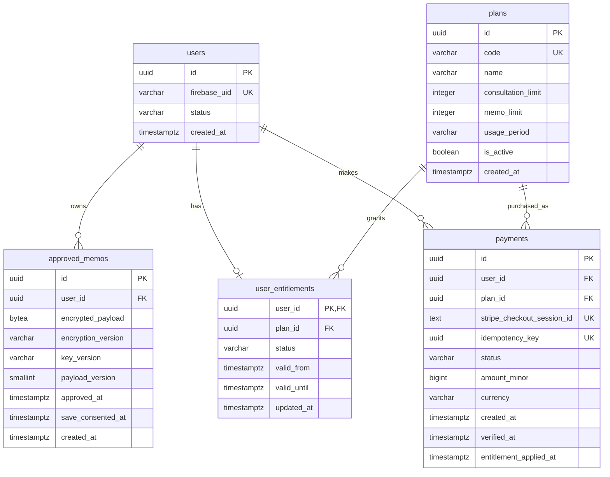

# MVP DB設計書（初稿）

## 対応Issue・状態

- 対応Issue：#11
- 主担当：もえ
- 確認担当：みほ・じま
- 状態：初稿作成済み・PR #23 Draftで確認中
- チーム確認：未実施
- 講師確認：未実施
- 最終レビュー：未実施

## 目的・範囲

本人が承認し、保存に同意した整理メモだけを保存するため、
テーブル、制約、暗号化対象、所有者確認、削除方法を整理する。

本書は設計案であり、マイグレーションやDB変更は実施しない。
未確定事項は、チーム・画面設計担当・API設計担当・講師への確認後に更新する。

## 参照資料と確認状況

以下は本書更新時点の確認状況。

- Issue #2・PR #20：MVP共通前提。developへマージ済み。
- Issue #4・PR #24：OpenRouterのモデル比較結果。developへマージ済み。
- Issue #5・PR #21：Firebase AuthenticationとFastAPIの認証・認可検証。レビュー完了・developへマージ済み。
- Issue #6・PR #19：Stripeの単発テスト決済の検証結果。developへマージ済み。
- Issue #7・PR #22：暗号化・非保存の検証結果。レビュー完了・developへマージ済み。
- Issue #8・PR #18：Redisによる利用回数制限の検証結果。developへマージ済み。
- Issue #9：画面設計書の最新版との照合待ち。
- Issue #10：API設計書の最新版との照合待ち。
- Issue #13：要件定義書fix候補の作成・照合待ち。

## 共通前提

- 相談完了とメモ保存は別とし、保存は本人が選択する。
- 承認・保存同意済みの整理メモだけを保存する。
- 会話全文・入力原文・未承認内容は保存しない。
- 気持ちの扱い方は「伝える・今は保留する・伝えない」とする。
- 扱い方を選んだ理由の入力は任意とする。
- 保存済みメモの再編集はMVP対象外とする。
- 選択後に別の「次の一歩」の入力は求めない。
- Firebase AuthenticationとFastAPIによる認証・認可は、技術検証済みの採用候補とする。
- 承認済みメモのアプリ側暗号化とPostgreSQLへの暗号文保存は、技術検証済みの採用候補とする。
- 技術の正式採用と本番の鍵管理方法は、チームで決定する。

## 未確定・照合待ち

- 5テーマ・感情8種類をDBへ保存するか、および保存形式
- 整理メモに含める項目と、画面・APIの項目名
- メモ一覧の表示項目と検索・絞り込みの必要性
- 無料・有料プランの内容、価格、相談回数、保存件数
- 買い切り型・サブスク型の選択
- 利用回数のリセット期間
- 決済状態と利用権限の対応
- 退会時の外部認証・決済サービス側の処理
- 退会処理の進捗記録・再試行・復旧方法


## 保存対象・保存禁止対象

| 情報 | 保存先・扱い |
| --- | --- |
| アプリ内ユーザーID | PostgreSQL。所有者判定に使用する |
| 外部認証のユーザー識別子 | PostgreSQL。内部ユーザーとの対応付けに必要な範囲で保存する |
| パスワード・認証トークン | アプリのDB・Redis・ログへ保存しない |
| 承認・保存同意済みの整理メモ本文 | PostgreSQLへ暗号化して保存する |
| テーマ・感情・気持ちの扱い方・任意の理由 | 保存する項目を画面設計と照合する。初稿では暗号化対象に含める案とする |
| 会話全文・入力原文・未承認のAI出力 | DB・Redis・ログへ保存しない |
| 保存に同意していない整理メモ | DB・Redis・ログへ保存しない |
| メモID・所有者ID・保存日時 | PostgreSQLへ構造化項目として保存する |
| 暗号方式・鍵バージョンの識別情報 | PostgreSQLへ保存する案。鍵そのものは保存しない |
| 暗号鍵 | DB・Redis・Git・ログへ保存しない。保管方法は別途決定する |
| プランの識別子・利用権限・決済状態 | PostgreSQLへ必要最小限の構造化項目を保存する |
| Stripeの決済識別子 | 本人の決済確認・重複処理防止に必要な範囲で保存する |
| カード番号・CVC・決済APIの応答全文 | アプリのDB・Redis・ログへ保存しない |
| 利用回数 | Redisへ本文を含まない整数として保存する案。期間・障害時方針は別途照合する |

構造化項目にもユーザーに紐付く情報が含まれる。
平文で保存する項目も、アクセス制御とログ出力制限の対象とする。

承認済みメモも、平文・暗号文ともにログへ出力しない。

メモの暗号化はアプリ側で行う。
DB・ディスク・バックアップの暗号化や、通信の暗号化とは別に扱う。

## テーブル候補

以下は初稿の候補であり、画面・API設計との事前確認で調整する。

| テーブル候補 | 役割 | 主な関係 |
| --- | --- | --- |
| users | アプリ内ユーザーと外部認証IDを対応付ける | メモ・利用権限・決済記録の所有者 |
| approved_memos | 承認・保存同意済みメモの暗号文を保存する | usersに所属する |
| plans | プランの識別子と、確定後の利用条件を管理する | 利用権限・購入対象から参照する |
| user_entitlements | ユーザーが利用できるプランと有効期間を管理する | usersとplansを参照する |
| payments | 決済試行と確認済みの決済状態を管理する | usersと購入対象のplansを参照する |

### 設計上の区別

- 決済記録と利用権限は分ける。
  決済画面から戻っただけでは、有料機能を利用可能にしない。
- 外部サービスで確認した決済状態と、採用するプラン仕様に基づいて利用権限を更新する。
- 価格・利用上限・有効期間の具体値は、この初稿で確定しない。
- サブスク契約やWebhookイベント用のテーブルは、採用方式が決まってから必要性を判断する。
- 会話履歴・入力原文・未承認メモを保存するテーブルは作らない。
- AIの追加質問数・訂正回数を管理するために、会話本文の保存先を作らない。

## テーブル定義案

以下はPostgreSQLを想定した初稿。
型・項目名はAPI設計との確認後に確定する。

### users：アプリ内ユーザー

| カラム | 型 | 制約・用途 |
| --- | --- | --- |
| id | UUID | PRIMARY KEY。アプリ内のユーザー識別子 |
| firebase_uid | VARCHAR(128) | NOT NULL、UNIQUE。FirebaseのUID。採用確定までは暫定 |
| status | VARCHAR(20) | NOT NULL、DEFAULT 'active'。active / deleting |
| created_at | TIMESTAMPTZ | NOT NULL、DEFAULT CURRENT_TIMESTAMP |

- statusにはCHECK制約を設け、active / deleting以外を拒否する。
- メールアドレス・表示名は、画面上の必要性を確認するまで保存項目へ追加しない。
- パスワード・認証トークンは保存しない。
- Firebase採用時は、検証済みIDトークンのUIDから内部ユーザーを特定する。
- リクエスト本文のユーザーIDやUIDを、そのまま本人の識別に使用しない。
- deletingのユーザーは通常の閲覧・保存・決済操作を拒否する。
- 退会処理の途中失敗に備え、usersの削除は関連処理が終わった後に行う。

### approved_memos：承認・保存同意済みメモ

| カラム | 型 | 制約・用途 |
| --- | --- | --- |
| id | UUID | PRIMARY KEY。メモ識別子 |
| user_id | UUID | NOT NULL。users.idへの外部キー |
| encrypted_payload | BYTEA | NOT NULL。保存対象の整理メモを暗号化した値 |
| encryption_version | VARCHAR(32) | NOT NULL。暗号形式の識別子 |
| key_version | VARCHAR(64) | NOT NULL。鍵の識別子。鍵そのものは保存しない |
| payload_version | SMALLINT | NOT NULL。復号後のデータ構造の版 |
| approved_at | TIMESTAMPTZ | NOT NULL。本人が整理内容を承認した日時 |
| save_consented_at | TIMESTAMPTZ | NOT NULL。本人が保存に同意した日時 |
| created_at | TIMESTAMPTZ | NOT NULL、DEFAULT CURRENT_TIMESTAMP。保存日時 |

制約・索引：

- user_idはusers.idを参照し、ON DELETE RESTRICTとする。
- octet_length(encrypted_payload) > 0のCHECK制約を設ける。
- payload_version > 0のCHECK制約を設ける。
- メモ一覧取得用に(user_id, created_at, id)の索引を設ける。
- user_idにUNIQUE制約は付けず、1人が複数のメモを保存できるようにする。

保存処理：

1. 認証済みユーザーを特定する。
2. 保存対象の整理内容について、本人の承認と保存同意を確認する。
3. 保存対象の項目・型・長さ・許容値を検証する。
4. 保存対象を暗号化する。
5. DBトランザクション内で対象のユーザー行をロックする。
6. ロック取得後にstatusがactiveであることと利用権限を確認する。
7. 保存件数の上限を採用する場合は、現在の保存件数と上限を確認する。
8. 本人のuser_idと暗号文を同じ行へ保存し、トランザクションを確定する。

- 上限確認とINSERTを同じDBトランザクションで行い、
  複数の同時保存による上限超過や退会処理との競合を防ぐ。
- 同じユーザーの保存・退会・利用権限変更では、ロック取得順序を統一する。
- user_id、承認日時、保存同意日時はサーバー側で設定する。
- NOT NULL制約だけで本人の承認・同意を証明できるわけではない。
  本人の操作と対象の整理内容を結び付けるAPI仕様が必要。
- 未承認・保存同意なしのデータは、行を作成しない。
- 保存前の下書きや会話原文を保存する列は設けない。
- 保存後の本文再編集はMVP対象外。
- 鍵更新のための再暗号化は、本文再編集とは別の運用操作として扱う。

### 暗号化するデータの候補

encrypted_payloadには、本人が確認した保存対象だけをまとめて格納する案とする。

- 出来事の整理結果
- 感情・本音・背景・望みの整理結果
- 気持ちの扱い方
- 扱い方を選んだ任意の理由
- 保存対象として合意した場合のテーマ・感情の選択値

項目名・必須項目・最大文字数は、PR #20、画面設計、API設計と照合して決める。
入力原文やAI応答全文を、そのまま暗号化して保存する設計にはしない。

- テーマ・感情・扱い方を暗号化する案では、それらを通常のSQLで検索・絞り込みできない。
- 一覧に表示する項目、検索・絞り込みの必要性、復号する件数を画面・API設計と確認する。
- 一覧は所有者条件とページ件数で対象を限定してから、必要な項目を復号する案とする。
- 検索のために同じ内容を平文の列へ複製する場合は、保存方針の変更としてチーム確認を行う。

### 本人所有データの判定

メモの取得・削除では、メモIDだけでなく、
認証済みユーザーから特定したuser_idも条件に含める。

```sql
SELECT id, encrypted_payload, encryption_version, key_version, payload_version
FROM approved_memos
WHERE id = :memo_id
  AND user_id = :authenticated_user_id;
```

上記は説明用のパラメータ表記。
実装では利用するDBライブラリのパラメータ化クエリを使用する。

- 所有者確認が成立してから復号する。
- 他人のメモと存在しないメモは、同じ404応答とする案。
- UUIDを知っていることだけで、閲覧・削除を許可しない。

### plans：プラン定義

| カラム | 型 | 制約・用途 |
| --- | --- | --- |
| id | UUID | PRIMARY KEY |
| code | VARCHAR(50) | NOT NULL、UNIQUE。プランの識別コード |
| name | VARCHAR(100) | NOT NULL。表示名 |
| consultation_limit | INTEGER | NULL可。相談回数の上限候補 |
| memo_limit | INTEGER | NULL可。保存件数の上限候補 |
| usage_period | VARCHAR(32) | NULL可。回数集計期間の識別子候補 |
| is_active | BOOLEAN | NOT NULL、DEFAULT true。新規提供の可否 |
| created_at | TIMESTAMPTZ | NOT NULL、DEFAULT CURRENT_TIMESTAMP |

- 上限値には、NULLまたは0以上とするCHECK制約を設ける。
- NULLを無制限・未設定のどちらとして扱うかは、実装前に統一する。
  未設定のまま利用可能と判定しない。
- usage_periodの許容値は、Redisのリセット方針と合わせて決める。
- 価格、通貨、Stripe Priceとの対応は、課金方式の決定後に追加設計する。
- 利用中のプランの上限変更が既存ユーザーへ与える影響は要確認。
- 参照されているプランは削除せず、必要に応じて新規提供を停止する。

### user_entitlements：現在の利用権限

| カラム | 型 | 制約・用途 |
| --- | --- | --- |
| user_id | UUID | PRIMARY KEY。users.idへの外部キー |
| plan_id | UUID | NOT NULL。plans.idへの外部キー |
| status | VARCHAR(20) | NOT NULL。active / suspended |
| valid_from | TIMESTAMPTZ | NOT NULL。利用開始日時 |
| valid_until | TIMESTAMPTZ | NULL可。利用終了日時 |
| updated_at | TIMESTAMPTZ | NOT NULL。更新時にサーバー側で設定 |

- user_id、plan_idの外部キーはON DELETE RESTRICTとする。
- statusにはCHECK制約を設ける。
- valid_untilはNULL、またはvalid_fromより後とするCHECK制約を設ける。
- 1ユーザーにつき現在の利用権限は最大1件とする初稿案。
- valid_untilのNULLは期間による終了なしを意味する。
  課金方式が未決定の有料権限へ、安易にNULLを設定しない。
- 利用許可にはusers.status、権限のstatus、有効期間を確認する。
- 権限が存在しない場合の無料プラン割当ては、API仕様で明示する。
  有料権限を推測して付与しない。
- valid_untilを過ぎた後の無料プラン移行と保存済みメモの扱いは要確認。
  自動的にメモを削除する仕様にはしない。
- この表は現在の権限を扱う。契約履歴やサブスク管理の代替にはしない。

### payments：決済試行・確認結果

| カラム | 型 | 制約・用途 |
| --- | --- | --- |
| id | UUID | PRIMARY KEY。アプリ内の決済試行ID |
| user_id | UUID | NOT NULL。users.idへの外部キー |
| plan_id | UUID | NOT NULL。購入対象のplans.idへの外部キー |
| stripe_checkout_session_id | TEXT | NULL可、UNIQUE。Stripeで発行されたSession ID |
| idempotency_key | UUID | NOT NULL、UNIQUE。同じ決済作成処理の再試行に使用 |
| status | VARCHAR(24) | NOT NULL。creating / pending / paid / expired / failed |
| amount_minor | BIGINT | NOT NULL。通貨の最小単位による購入時の金額 |
| currency | VARCHAR(3) | NOT NULL。購入時の通貨コード |
| created_at | TIMESTAMPTZ | NOT NULL、DEFAULT CURRENT_TIMESTAMP |
| verified_at | TIMESTAMPTZ | NULL可。Stripeで状態を確認した日時 |
| entitlement_applied_at | TIMESTAMPTZ | NULL可。利用権限へ反映した日時 |

制約：

- user_id、plan_idの外部キーはON DELETE RESTRICTとする。
- statusにはCHECK制約を設ける。
- amount_minor >= 0のCHECK制約を設ける。
- paidの場合は、Session IDとverified_atを必須とする。
- entitlement_applied_atがある場合はstatus = 'paid'を必須とする。
- Session IDは作成前にはNULLとなる。取得後の重複登録はUNIQUE制約で拒否する。
- 購入金額・通貨は、クライアントの申告値を信用せずサーバー側で決める。

状態の扱い：

- creating：決済作成処理を開始し、Session IDが未確定。
- pending：Session作成済みで、支払い完了を確認していない。
- paid：Stripeへ問い合わせ、支払い完了を確認済み。
- expired：Stripe側でSessionの期限切れを確認済み。
- failed：その決済試行を継続できないことが確定した状態。
- 通信タイムアウトや確認画面のキャンセルだけでfailedへ変更しない。
- カード拒否後も同じSessionで再試行できる場合はpendingのままとする。
- 返金・継続課金の状態は本表だけでは扱わず、採用範囲に応じて追加設計する。

### 決済と利用権限の整合性

- Session IDを知っているだけでは、決済確認・権限付与を許可しない。
- 認証済みユーザーとpayments.user_idの一致を確認する。
- Stripe側の支払い状態、購入対象、金額、通貨、テスト／本番環境を照合する。
- 確認結果の保存と利用権限への反映は、DBトランザクション内で行う。
- 同じユーザー行、対象の決済行の順にロックを取得する案とし、
  保存・退会などの処理とロック取得順序を統一する。
- ロック取得後にusers.statusを確認し、deletingの場合は利用権限を付与しない。
- entitlement_applied_atを確認して、同じ決済の二重反映を防ぐ。
- 別の決済が同時に完了する場合にも、同じユーザーへの権限更新を直列化する。
- 同じ処理の再試行では同じidempotency_keyを使う。
  新しいキーでの重複購入は防げないため、別途購入可否の確認が必要。
- 外部APIとDB更新を単一のトランザクションにはできないため、
  通信失敗時の再照合・復旧手順をAPI設計へ申し送る。
- ブラウザを閉じた場合など、決済後の画面遷移が完了しない場合の
  状態反映方法は未確定。Webhook等の採用要否を確認する。

### 課金仕様として残る確認事項

- 買い切り型・サブスク型の選択
- 有料権限の有効期間と無料プランへの戻し方
- 重複購入、返金、解約時の扱い
- 決済記録の保持期間と退会時の削除方針
- Stripe側に残るデータと、アプリ内データの扱いの違い

## ER図（初稿）



NULL可否・CHECK制約・削除動作は、前節のテーブル定義を参照する。

## 個別メモの削除

1. 認証済みユーザーを特定し、通常操作が可能な状態か確認する。
2. メモIDと本人のuser_idを条件に削除する。
3. 削除件数が0の場合は、他人のメモと存在しないメモを区別せず404とする。
4. 削除のために本文を復号しない。
5. 本文や暗号文をログへ出さない。

- MVPでは論理削除用の本文を残さず、対象行を物理削除する案。
- メモ削除で過去の相談利用回数を戻すかは別の仕様とする。
  初稿では自動的に戻さない。
- DBの行削除は、バックアップやストレージ上の即時完全消去を保証しない。
  バックアップの保持期間・復元後の再削除方法は別途決定する。

## 退会時の削除手順（初稿案）

### 方針

- 本人の退会意思を確認してから処理する。
- 退会開始後は新しいメモ保存・決済作成・権限付与を止める。
- PostgreSQL、Redis、Firebase、Stripeをまたぐ処理は、
  単一のDBトランザクションでは完結しない。
- 途中失敗を検知し、完了していない処理を安全に再開できる設計が必要。

### 処理順序

1. 本人確認と退会意思の確認を行う。
2. usersの対象行をロックし、statusをdeletingへ変更して確定する。
   通常の保存・決済・権限更新も同じユーザー行をロックして状態を確認し、
   退会開始との競合を防ぐ。
3. 未完了の決済や継続契約の有無を確認する。
   必要なキャンセル・解約・状態照合は、採用する課金方式に従う。
4. 本人のRedis利用回数キーを削除する。
   deletingのユーザーについて、新しいキーを作成しない。
   退会開始前から進行中の処理によるキーの再作成も防ぐ。
5. Firebaseの認証アカウントを削除する。
   再試行時に「すでに存在しない」場合の扱いも定義する。
6. PostgreSQL内の関連データを、以下の順に同一トランザクションで削除する。
   - approved_memos
   - user_entitlements
   - payments（削除方針の合意が前提）
   - users
7. 各サービスで必要な処理が完了したことを確認し、退会完了とする。

plansは他ユーザーも参照する共通定義なので、退会では削除しない。

### 決済記録に関する前提

- paymentsの削除可否・保持期間はチーム確認事項。
- この初稿の削除順序は、アプリ内の決済記録を削除する方針を採用した場合の案。
- 保持が必要な場合は、個人との紐付け、保持目的・期間、
  users削除との外部キー整合性を再設計する。
- アプリのDBから削除しても、Stripe側のデータが同時に消えるわけではない。
- Stripe側のデータ処理・継続契約の終了条件は別途確認する。

### 途中失敗と再実行

- 外部処理が失敗した場合は、退会完了と表示しない。
- users.status = deletingを維持し、通常利用を再開させない。
- Firebase削除後は本人が再ログインできない場合があるため、
  復旧処理を本人のログインだけに依存させない。
- 処理段階・再試行回数を記録する仕組みと実行担当をAPI設計で決める。
  その記録に本文・鍵・認証トークンは含めない。
- 遅れて届く決済通知や再試行処理が、
  削除済みユーザーや利用権限を再作成しないようにする。
- バックアップから復元した際に退会済みデータを復活させない手順は別途設計する。
- 現在の5テーブルには、退会処理の進捗・再試行を永続記録する項目がない。
- status = deletingだけでは処理段階を特定できないため、
  進捗列または専用ジョブ記録の追加要否をAPI設計担当と確認する。
- users削除後も復旧・完了確認に記録が必要な場合は、
  記録の保持期間と個人との紐付けの扱いを決める。
- この仕組みが未確定のため、退会処理は実装可能な完成設計ではなく初稿案とする。

## レビュー・照合事項

| 確認先 | 主な確認内容 | 状態 |
| --- | --- | --- |
| PR #20 | MVP共通前提、気持ちの扱い方、保存方針 | 反映済み |
| Issue #5・PR #21 | 認証ID、本人所有データの判定、認可方針 | 反映済み |
| Issue #7・PR #22 | 暗号化対象、保存禁止対象、鍵管理の確認事項 | 反映済み |
| 画面設計担当 | 保存項目、任意理由、一覧・検索、個別削除・退会の導線 | 最新版との照合待ち |
| API設計担当 | 所有者確認、承認・同意、保存上限の同時実行制御 | 最新版との照合待ち |
| API設計担当 | 決済状態、ロック順序、退会の競合・進捗記録・再試行 | 最新版との照合待ち |
| チーム | プラン条件、決済記録の保持、期限後のメモの扱い | 未決定 |
| 講師 | テーブル分割、制約、暗号化、削除・決済の整合性 | 未依頼 |
| みほ・じま | DB設計初稿と講師指摘反映後の最終確認 | 未依頼 |

PR #23のDraftをもとに、Discordの`to-instructors`で講師へ確認を依頼し、
並行して確認担当者へレビューを依頼する。
回答・指摘・対応結果はIssueまたはPRへ記録し、
必要な修正を反映してから最終レビューを依頼する。

## 本書の確認状況

- テーブル定義とER図の項目・関係：文面上の対応を確認
- PR #20のMVP共通前提：反映済み
- Issue #5の認証・認可検証結果：反映済み
- Issue #6のStripe検証結果：反映済み
- Issue #7の暗号化・非保存検証結果：反映済み
- Issue #8のRedis利用回数制限の検証結果：反映済み
- マイグレーション・DB変更：未実施（本Issueの対象外）
- DB上での制約・同時実行・削除動作の検証：未実施
- Mermaidの描画確認：未実施
- Lint・テスト・ビルド：未実施（文書のみの変更）
- 現行要件定義・画面設計・API設計との最終照合：未完了
- 講師確認・指摘反映・確認担当2名のApprove：未完了