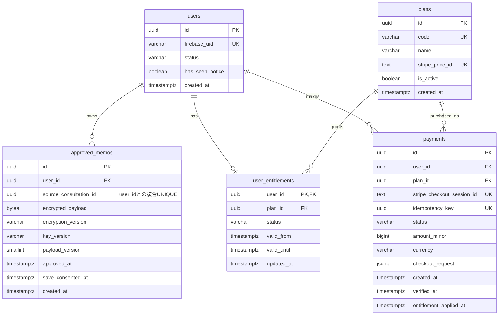

# MVP DB設計書（初稿）

## 対応Issue・状態

- 対応Issue：#11（初稿）、#60（退会関連の更新）
- 主担当：もえ
- 確認担当：みほ・じま
- 状態：初稿レビュー承認済み。未確定事項は後続Issueで確認・決定する。
- チーム確認：画面・API設計との今回の照合結果を反映し、要件定義書とも相互照合済み。API設計のマージ版までの追加差分も確認済み。
- 講師確認：初回回答・指摘内容を反映済み
- 初稿の最終レビュー：みほさん・じまさんのApprove受領済み。
- 今回の更新：2026-10-24、#60の退会関連をPR #101の実装とPR #112のAPI設計へ合わせて更新。今回の文書差分はレビュー待ちで、初稿のApproveを流用しない。

## 目的・範囲

本人が承認し、保存に同意した整理メモだけを保存するため、
テーブル、制約、暗号化対象、所有者確認、削除方法を整理する。

本書は設計案であり、マイグレーションやDB変更は実施しない。
未確定事項は、チーム・画面設計担当・API設計担当・講師への確認後に更新する。

## 参照資料と確認状況

以下は初稿時点の照合記録と、日付を付した追加照合の記録。今回、退会以外の全資料を再照合したものではない。

- Issue #2・PR #20：MVP共通前提。developへマージ済み。
- Issue #4・PR #24：OpenRouterのモデル比較結果。developへマージ済み。
- Issue #5・PR #21：Firebase AuthenticationとFastAPIの認証・認可検証。レビュー完了・developへマージ済み。
- Issue #6・PR #19：Stripeの単発テスト決済の検証結果。developへマージ済み。
- Issue #7・PR #22：暗号化・非保存の検証結果。レビュー完了・developへマージ済み。
- Issue #8・PR #18：Redisによる利用回数制限の検証結果。developへマージ済み。
- Issue #9・PR #25：画面設計書はa73aca3でdevelopへマージ済み。一時状態・承認と保存同意・保存メモの一覧／詳細について照合し、本書へ反映。
- Issue #10・PR #27：2fd82ddでdevelopへマージ済み。前回照合した68c0d3cからの追加差分を確認し、今回の変更範囲について本書への仕様の追加反映は不要と判断した。
- Issue #13：要件定義書の修正は142ee6eでpush済み。今回の変更範囲を相互照合済みで、APIマージ後の照合記録も5d69115で更新・push済み。
- Issue #60（2026-10-24）：developの7eda4a2を基準に、退会実装（PR #101、3dafff4）、API設計6.9等（PR #112、7eda4a2）、`backend/manual_checks/account_deletion.md`を読み取り照合。実接続・復旧CLIの実運用は今回確認していない。

## 共通前提

- 相談完了とメモ保存は別とし、保存は本人が選択する。
- 承認・保存同意済みの整理メモだけを保存する。
- 会話全文・入力原文・未承認内容は保存しない。
- 相談中の一時状態はAPIプロセスのメモリで保持し、DB・Redis・ログへ永続保存しない。
- 一時状態を保存するためのテーブルは作成しない。
- APIプロセスの再起動・開発時の自動リロード・有効期限切れなどで、一時状態は失われる。
- ブラウザ再読み込み後の相談復帰は、APIプロセスに一時状態が残っている場合も含め、MVPでは保証しない。
- 気持ちの扱い方は「伝える・今は保留する・伝えない」とする。
- 扱い方を選んだ理由の入力は任意とする。
- 保存済みメモの再編集はMVP対象外とする。
- 選択後に別の「次の一歩」の入力は求めない。
- Firebase AuthenticationとFastAPIによる認証・認可は、技術検証済みの採用候補とする。
- 承認済みメモのアプリ側暗号化とPostgreSQLへの暗号文保存は、技術検証済みの採用候補とする。
- 技術の正式採用と本番の鍵管理方法は、チームで決定する。

## 未確定・照合待ち

- 5テーマ＋「その他」の選択値・感情8種類の選択値を、整理結果とは別に保存するか、および保存形式
- 画面・APIと照合した整理メモの保存候補項目の最終確定と最大文字数
- 一覧用の短い要約を保存するか表示時に作るか、ページ分割の方式と復号する件数
- 無料・有料プランの内容、価格、相談回数、保存件数（課金方式・テスト用の価格・上限値をサーバー設定で持つことは#59・#57で決定。上限値の具体的な値は#57・#59で確認中）
- ~~買い切り型・サブスク型の選択~~：#59で一回払い（買い切り型）に決定
- 利用回数のリセット期間
- ~~決済状態と利用権限の対応~~：#59で決定（payments・決済と利用権限の整合性を参照）
- 退会手順・再試行・手動復旧の仕様は#60・PR #101で実装し、PR #112でAPI設計へ反映済み（退会時の削除手順を参照）。退会のFirebase・Stripe実接続と復旧CLI実運用の未確認範囲・対応先は#60で整理する。仕様の決定と運用検証の完了を区別する。


## 保存対象・保存禁止対象

| 情報 | 保存先・扱い |
| --- | --- |
| アプリ内ユーザーID | PostgreSQL。所有者判定に使用する |
| 利用前注意の表示済み状態 | PostgreSQL。初回の詳しい注意と2回目以降の短い注意を切り替えるため、has_seen_noticeとして保存する |
| 外部認証のユーザー識別子 | PostgreSQL。内部ユーザーとの対応付けに必要な範囲で保存する |
| パスワード・認証トークン | アプリのDB・Redis・ログへ保存しない |
| 承認・保存同意済みの整理メモ本文 | PostgreSQLへ暗号化して保存する |
| 整理結果の感情・気持ちの扱い方・任意の理由 | 保存に同意した整理メモの暗号化対象に含める。項目はemotion・handling・reasonに対応する |
| テーマの選択値・感情カテゴリの選択値 | 整理結果とは別に保存するかは未確定。現時点では専用の平文列を追加しない |
| 会話全文・入力原文・未承認のAI出力 | DB・Redis・ログへ保存しない |
| 保存に同意していない整理メモ | DB・Redis・ログへ保存しない |
| メモID・所有者ID・保存日時 | PostgreSQLへ構造化項目として保存する |
| 暗号方式・鍵バージョンの識別情報 | PostgreSQLへ保存する案。鍵そのものは保存しない |
| 暗号鍵 | DB・Redis・Git・ログへ保存しない。保管方法は別途決定する |
| プランの識別子・利用権限・決済状態 | PostgreSQLへ必要最小限の構造化項目を保存する |
| Stripeの決済識別子 | 本人の決済確認・重複処理防止に必要な範囲で保存する |
| カード番号・CVC・決済APIの応答全文 | アプリのDB・Redis・ログへ保存しない |
| 利用回数 | Redisへ本文を含まない整数として保存する案。期間・障害時方針は別途照合する |

構造化項目にもユーザーに紐付く情報が含まれる。
平文で保存する項目も、アクセス制御とログ出力制限の対象とする。

承認済みメモも、平文・暗号文ともにログへ出力しない。

メモの暗号化はアプリ側で行う。
DB・ディスク・バックアップの暗号化や、通信の暗号化とは別に扱う。

## テーブル候補

以下は初稿の候補であり、画面・API設計との事前確認で調整する。

| テーブル候補 | 役割 | 主な関係 |
| --- | --- | --- |
| users | アプリ内ユーザーと外部認証IDを対応付ける | メモ・利用権限・決済記録の所有者 |
| approved_memos | 承認・保存同意済みメモの暗号文を保存する | usersに所属する |
| plans | プランの識別子と、確定後の利用条件を管理する | 利用権限・購入対象から参照する |
| user_entitlements | ユーザーが利用できるプランと有効期間を管理する | usersとplansを参照する |
| payments | 決済試行と確認済みの決済状態を管理する | usersと購入対象のplansを参照する |

### 設計上の区別

- 決済記録と利用権限は分ける。
  決済画面から戻っただけでは、有料機能を利用可能にしない。
- 外部サービスで確認した決済状態と、採用するプラン仕様に基づいて利用権限を更新する。
- 価格・利用上限・有効期間の具体値は、この初稿で確定しない。
- サブスク契約やWebhookイベント用のテーブルは、採用方式が決まってから必要性を判断する。
- 会話履歴・入力原文・未承認メモを保存するテーブルは作らない。
- AIの追加質問数・訂正回数を管理するために、会話本文の保存先を作らない。

## テーブル定義案

以下はPostgreSQLを想定した初稿。
型・項目名はAPI設計との確認後に確定する。

### users：アプリ内ユーザー

| カラム | 型 | 制約・用途 |
| --- | --- | --- |
| id | UUID | PRIMARY KEY。アプリ内のユーザー識別子 |
| firebase_uid | VARCHAR(128) | NOT NULL、UNIQUE。FirebaseのUID。採用確定までは暫定 |
| status | VARCHAR(20) | NOT NULL、DEFAULT 'active'。active / deleting |
| has_seen_notice | BOOLEAN | NOT NULL、DEFAULT false。初回の詳しい利用前注意を表示済みか |
| created_at | TIMESTAMPTZ | NOT NULL、DEFAULT CURRENT_TIMESTAMP |

- statusにはCHECK制約を設け、active / deleting以外を拒否する。
- メールアドレス・表示名は、画面上の必要性を確認するまで保存項目へ追加しない。
- パスワード・認証トークンは保存しない。
- Firebase採用時は、検証済みIDトークンのUIDから内部ユーザーを特定する。
- リクエスト本文のユーザーIDやUIDを、そのまま本人の識別に使用しない。
- deletingのユーザーは通常の閲覧・保存・決済操作を拒否する。
- 退会処理の途中失敗に備え、usersの削除は関連処理が終わった後に行う。
- has_seen_noticeは、初回の詳しい注意と2回目以降の短い注意をアカウント単位で切り替えるために使用する。
- has_seen_noticeはfalseからtrueへの更新だけを受け付け、通常操作ではfalseへ戻さない。

### approved_memos：承認・保存同意済みメモ

| カラム | 型 | 制約・用途 |
| --- | --- | --- |
| id | UUID | PRIMARY KEY。メモ識別子 |
| user_id | UUID | NOT NULL。users.idへの外部キー |
| source_consultation_id | UUID | NOT NULL。保存元の相談ID。保存処理の再試行による二重保存を防ぐ |
| encrypted_payload | BYTEA | NOT NULL。保存対象の整理メモを暗号化した値 |
| encryption_version | VARCHAR(32) | NOT NULL。暗号形式の識別子 |
| key_version | VARCHAR(64) | NOT NULL。鍵の識別子。鍵そのものは保存しない |
| payload_version | SMALLINT | NOT NULL。復号後のデータ構造の版 |
| approved_at | TIMESTAMPTZ | NOT NULL。本人が整理内容を承認した日時 |
| save_consented_at | TIMESTAMPTZ | NOT NULL。本人が保存に同意した日時 |
| created_at | TIMESTAMPTZ | NOT NULL、DEFAULT CURRENT_TIMESTAMP。保存日時 |

制約・索引：

- user_idはusers.idを参照し、ON DELETE RESTRICTとする。
- octet_length(encrypted_payload) > 0のCHECK制約を設ける。
- payload_version > 0のCHECK制約を設ける。
- メモ一覧取得用に(user_id, created_at, id)の索引を設ける。
- user_idにUNIQUE制約は付けず、1人が複数のメモを保存できるようにする。
- `(user_id, source_consultation_id)`にUNIQUE制約を設け、同じユーザーの同じ相談から複数のメモが作成されることを防ぐ。
- 同じ相談IDで保存処理が再実行された場合は、新しい行を作らず、既存の保存結果を返す案とする。
- 同時リクエストが事前確認を両方通過した場合も、`UNIQUE (user_id, source_consultation_id)`制約で二重保存を拒否し、一意制約違反時は既存の保存結果を取得して返す。
- 相談IDをクライアントから受け取る場合も、認証済みユーザーが所有する相談であることをサーバー側で確認する。

保存処理：

1. 認証済みユーザーを特定し、ユーザーの`status`が`active`であることを確認する。
2. `user_id`と`source_consultation_id`で保存済みメモを検索する。
   保存済みの場合は、一時状態がすでに失われていても新しい行を作らず、既存の保存結果を200で返す。
3. 未保存の場合だけ、保存元の相談IDが本人の一時状態に属することを確認する。
   一時状態が存在しない・破棄済み・本人所有でない場合は、内容や原因を明かさず404を返し、メモを作成しない。
4. 保存対象の整理内容について、本人の承認と保存同意を確認する。
5. 保存対象の項目・型・長さ・許容値を検証する。
6. メモIDをサーバー側で生成する。
7. 保存対象を暗号化する。
   採用する暗号方式に応じて、`user_id`とメモIDを暗号文へ検証可能な形でひも付ける。
8. DBトランザクションを開始し、対象のユーザー行をロックする。
9. ロック取得後に、ユーザーの`status`が`active`であることと利用権限を再確認する。
10. `user_id`と`source_consultation_id`で保存済みメモを再検索する。
   保存済みの場合は新しい行を作らず、既存の保存結果を返して処理を終了する。
11. 保存件数の上限を採用する場合は、現在の保存件数と上限を確認する。
12. 本人の`user_id`、`source_consultation_id`、暗号文を同じ行へ保存し、トランザクションを確定する。
13. `UNIQUE (user_id, source_consultation_id)`違反が発生した場合は、
    同じ識別子の既存メモを取得して返し、二重保存として扱わない。

- 上限確認とINSERTを同じDBトランザクションで行い、
  複数の同時保存による上限超過や退会処理との競合を防ぐ。
- 同じユーザーの保存・退会・利用権限変更では、ロック取得順序を統一する。
- user_id、承認日時、保存同意日時はサーバー側で設定する。
- approved_atとsave_consented_atは、整理結果の承認（UI-007）と保存同意（UI-009）が別操作のため、別々に記録する。
- approved_atは、本人が承認した時点でサーバーが設定し、承認済みの整理結果とともにAPIプロセスのメモリ上の一時状態で保持する。この時点ではDBへ保存しない。
- 承認後の整理結果の編集は拒否し、保存時には一時状態に保持した承認済みの内容とapproved_atを使用する。
- save_consented_atは、保存APIの呼び出し時にサーバー側で設定する。扱い方と任意の理由は、整理結果の承認後に入力するため、保存同意の対象として扱う。
- NOT NULL制約だけで本人の承認・同意を証明できるわけではない。
  本人の操作と対象の整理内容を結び付けるAPI仕様が必要。
- 未承認・保存同意なしのデータは、行を作成しない。
- DBへの保存成功後に、相談の一時状態を破棄する。保存に失敗した場合は保存完了として扱わない。
- 保存成功後に応答が届かなかった場合も、再試行では保存済みメモを先に確認し、既存の保存結果を返す。
- 保存前の下書きや会話原文を保存する列は設けない。
- 保存後の本文再編集はMVP対象外。
- 鍵更新のための再暗号化は、本文再編集とは別の運用操作として扱う。
- AADを利用できる暗号方式を採用する場合は、user_idとメモIDをAADへ含め、別の行へ移された暗号文の復号を拒否する。
- 検証済み候補のFernetはAADを直接指定できないため、Fernetを採用する場合はuser_idとメモIDを暗号化対象へ含め、復号後にDB行の値と一致することを確認する案とする。
- 暗号文と行のひも付け方法は、正式な暗号方式と合わせて講師・チーム確認後に確定する。

### 暗号化するデータの候補

encrypted_payloadには、本人が確認した保存対象だけをまとめて格納する案とする。

- 出来事の整理結果：event_summary
- 感情の整理結果：emotion
- 本音：true_feeling
- 背景：background。分からない場合は空欄を許容し、推測で補わない
- 望み：wish
- 気持ちの扱い方：handling
- 扱い方を選んだ任意の理由：reason
- テーマの選択値・感情カテゴリの選択値を追加で保存するかは未確定。整理結果のemotionとは区別する

上記の項目名はAPI設計PR #27 §6.6.2、表示内容は画面設計PR #25のUI-011に対応する。
保存対象の最終確定と最大文字数は、関連設計・実装Issueで確認する。
入力原文やAI応答全文を、そのまま暗号化して保存する設計にはしない。

- テーマ・感情・扱い方を暗号化する案では、それらを通常のSQLで検索・絞り込みできない。
- メモ一覧は新しい順に表示し、表示項目は保存日時・短い要約・気持ちの扱い方とする（画面設計UI-010、API設計§6.6.1）。
- APIの一覧項目はmemo_id・created_at・summary・handlingとし、センシティブな本文を長く表示しない。
- 短い要約（summary）を暗号化して保存するか、保存済みの内容を復号して表示時に作るかは未確定とする。現時点で平文の要約列は追加しない。
- 本文検索・複数条件検索・比較・分析・集計はMVP対象外とする。ページ分割の方式と、一覧取得時に復号する件数は後続実装Issueで決定する。
- 一覧は所有者条件とページ件数で対象を限定してから、必要な項目を復号する案とする。
- 検索のために同じ内容を平文の列へ複製する場合は、保存方針の変更としてチーム確認を行う。

### 本人所有データの判定

メモの取得・削除では、メモIDだけでなく、
認証済みユーザーから特定したuser_idも条件に含める。

```sql
SELECT id, encrypted_payload, encryption_version, key_version, payload_version
FROM approved_memos
WHERE id = :memo_id
  AND user_id = :authenticated_user_id;
```

上記は説明用のパラメータ表記。
実装では利用するDBライブラリのパラメータ化クエリを使用する。

- 所有者確認が成立してから復号する。
- 他人のメモと存在しないメモは、同じ404応答とする案。
- UUIDを知っていることだけで、閲覧・削除を許可しない。

### plans：プラン定義

| カラム | 型 | 制約・用途 |
| --- | --- | --- |
| id | UUID | PRIMARY KEY |
| code | VARCHAR(50) | NOT NULL、UNIQUE。プランの識別コード |
| name | VARCHAR(100) | NOT NULL。表示名 |
| stripe_price_id | TEXT | NULL可、UNIQUE。Stripe Priceとの対応。MVPでは使わず、NULLのままとする（下記） |
| is_active | BOOLEAN | NOT NULL、DEFAULT true。新規提供の可否 |
| created_at | TIMESTAMPTZ | NOT NULL、DEFAULT CURRENT_TIMESTAMP |

- idはDBが発行する（`gen_random_uuid()`）。環境ごとに値が変わるため、APIでは`code`を使う。
- `free`（無料プラン）・`premium`（有料プラン）の2行は、マイグレーションで作成する（#59・F-05）。
- **上限値（相談回数・保存件数）と集計期間の列は持たない**（#59・#57で決定）。
  上限値・期間はサーバー設定（環境変数）で管理し、設定値の`unlimited`だけを無制限とする（#57）。
  使わない列がNULLのまま残ると、「NULLは無制限」と読み違えるおそれがあるため、列そのものを作らない。
- Stripe PriceのIDは、環境ごとのサーバー設定（`STRIPE_PRICE_ID_PREMIUM`）で管理する（#59）。
  サーバーがそのStripe Priceを取得し、一回払いの有効なPriceであること・金額・通貨を確認する。
  stripe_price_idの列をDBでの管理へ切り替えるかは、F-03（`plans/`）の作成時に確認する。
- クライアントから送られた金額・Price IDを、そのまま決済作成に使用しない。
- 利用中のプランの上限変更が既存ユーザーへ与える影響は要確認。
- 参照されているプランは削除せず、必要に応じて新規提供を停止する。

### user_entitlements：現在の利用権限

| カラム | 型 | 制約・用途 |
| --- | --- | --- |
| user_id | UUID | PRIMARY KEY。users.idへの外部キー |
| plan_id | UUID | NOT NULL。plans.idへの外部キー |
| status | VARCHAR(20) | NOT NULL。active / suspended |
| valid_from | TIMESTAMPTZ | NOT NULL。利用開始日時 |
| valid_until | TIMESTAMPTZ | NULL可。利用終了日時 |
| updated_at | TIMESTAMPTZ | NOT NULL。更新時にサーバー側で設定 |

- user_id、plan_idの外部キーはON DELETE RESTRICTとする。
- statusにはCHECK制約を設ける。
- valid_untilはNULL、またはvalid_fromより後とするCHECK制約を設ける。
- 1ユーザーにつき現在の利用権限は最大1件とする初稿案。
- valid_untilのNULLは期間による終了なしを意味する。
  #59で一回払い・期間による終了なしに決定したため、有料権限はNULLで付与する。
- 決済の確認（API設計6.8.8）で、支払い済みの確認と同じトランザクションで1ユーザー1行をupsertする。
  権限の行がないユーザーは無料プランとして扱う（API設計6.7・6.8.7）。
- 利用許可にはusers.status、権限のstatus、有効期間を確認する。
- 権限が存在しない場合の無料プラン割当ては、API仕様で明示する。
  有料権限を推測して付与しない。
- valid_untilを過ぎた後の無料プラン移行と保存済みメモの扱いは要確認。
  自動的にメモを削除する仕様にはしない。
- この表は現在の権限を扱う。契約履歴やサブスク管理の代替にはしない。

### payments：決済試行・確認結果

| カラム | 型 | 制約・用途 |
| --- | --- | --- |
| id | UUID | PRIMARY KEY。アプリ内の決済試行ID |
| user_id | UUID | NOT NULL。users.idへの外部キー |
| plan_id | UUID | NOT NULL。購入対象のplans.idへの外部キー |
| stripe_checkout_session_id | TEXT | NULL可、UNIQUE。Stripeで発行されたSession ID |
| idempotency_key | UUID | NOT NULL、UNIQUE。同じ決済作成処理の再試行に使用 |
| status | VARCHAR(24) | NOT NULL。creating / pending / paid / expired / failed |
| amount_minor | BIGINT | NOT NULL。通貨の最小単位による購入時の金額 |
| currency | VARCHAR(3) | NOT NULL。購入時の通貨コード |
| checkout_request | JSONB | NOT NULL。Stripeへ送るSession作成の内容（#59。下記） |
| created_at | TIMESTAMPTZ | NOT NULL、DEFAULT CURRENT_TIMESTAMP |
| verified_at | TIMESTAMPTZ | NULL可。Stripeで状態を確認した日時 |
| entitlement_applied_at | TIMESTAMPTZ | NULL可。利用権限へ反映した日時 |

制約：

- user_id、plan_idの外部キーはON DELETE RESTRICTとする。
- statusにはCHECK制約を設ける。
- amount_minor >= 0のCHECK制約を設ける。
- paidの場合は、Session IDとverified_atを必須とする。
- entitlement_applied_atがある場合はstatus = 'paid'を必須とする。
- Session IDは作成前にはNULLとなる。取得後の重複登録はUNIQUE制約で拒否する。
- 購入金額・通貨は、クライアントの申告値を信用しない。
- サーバーが選択されたプランに対応するStripe Priceを取得して金額・通貨を確認し、決済時点の値をpaymentsへ保存する案とする。
- Stripe Priceの取得元と管理方法は、買い切り型・サブスク型の決定およびAPI設計と合わせて確定する。
- 同じユーザーについてstatusがcreatingまたはpendingの未決済行は、
  原則として同時に1件だけ存在できるようにする。
- PostgreSQLでは、次の部分UNIQUE索引を設ける。
  `CREATE UNIQUE INDEX uq_payments_user_id_unfinished ON payments (user_id) WHERE status IN ('creating', 'pending');`
- 決済Session作成時はusersの対象行をロックし、
  statusがactiveであること、既存の利用権限、creating・pendingの決済行を確認する。
- 有効なpending行が存在する場合は新しいSessionを作成せず、
  既存のStripe Checkout Sessionを再利用する案とする。
- creating行が存在する場合は、保存した`checkout_request`と同じidempotency_keyでStripeを呼び直す。
  Sessionを確認できない場合は新しいSessionを作らずに止める（API設計6.8.6で確定。Q-34）。
- Stripe側でSessionが期限切れの場合はpayments.statusをexpiredへ更新してから、
  新しい決済試行を作成する。
- Stripe APIへのSession作成では、サーバーが発行したidempotency_keyを
  StripeのIdempotency-Keyとして使用する。
- 部分UNIQUE索引とユーザー行ロックの両方を採用する（#59・F-05）。
  索引の違反は、既存の行を取り直して同じ扱いにする。

checkout_request（#59）：

- creating行を作るときに1回だけ決めて保存し、同じidempotency_keyで再試行するときもこの内容をそのまま送る。
  環境の設定値が途中で変わっても、初回と同じ内容でStripeを呼び直せるようにするため。
- 内容は、Price ID、Sessionの有効期限（行の作成時刻＋35分）、戻り先URL、client_reference_id（内部ユーザーID）、
  metadataの決済ID。秘密情報・相談内容は含めない。

状態の扱い：

- creating：決済作成処理を開始し、Session IDが未確定。
- pending：Session作成済みで、支払い完了を確認していない。
- paid：Stripeへ問い合わせ、支払い完了を確認済み。
- expired：Stripe側でSessionの期限切れを確認済み。
- failed：その決済試行を継続できないことが確定した状態。
- 通信タイムアウトや確認画面のキャンセルだけでfailedへ変更しない。
- pendingの行で、保存したSession IDのSessionがStripeに存在しない場合（テストモードのデータ削除など）はfailedとする。
- カード拒否後も同じSessionで再試行できる場合はpendingのままとする。
- 返金・継続課金の状態は本表だけでは扱わず、採用範囲に応じて追加設計する。

### 決済と利用権限の整合性

- Session IDを知っているだけでは、決済確認・権限付与を許可しない。
- 認証済みユーザーとpayments.user_idの一致を確認する。
- Stripe側の支払い状態、購入対象、金額、通貨、テスト／本番環境を照合する。
- 確認結果の保存と利用権限への反映は、DBトランザクション内で行う。
- 同じユーザー行、対象の決済行の順にロックを取得する案とし、
  保存・退会などの処理とロック取得順序を統一する。
- ロック取得後にusers.statusを確認し、deletingの場合は利用権限を付与しない。
- entitlement_applied_atを確認して、同じ決済の二重反映を防ぐ。
- 別の決済が同時に完了する場合にも、同じユーザーへの権限更新を直列化する。
- 同じ処理の再試行では同じidempotency_keyを使う。
  新しいキーでの重複購入は防げないため、別途購入可否の確認が必要。
- 外部APIとDB更新を単一のトランザクションにはできないため、
  通信失敗時の再照合・復旧手順をAPI設計へ申し送る。
- ブラウザを閉じた場合など、決済後の画面遷移が完了しない場合の
  状態反映方法は未確定。Webhook等の採用要否を確認する。

### 課金仕様として残る確認事項

- ~~買い切り型・サブスク型の選択~~：#59で一回払いに決定
- ~~有料権限の有効期間と無料プランへの戻し方~~：#59で期間による終了なし（valid_untilはNULL）・解約機能なしに決定
- 重複購入（有料権限があれば新しいSessionを作らない。#59）、返金（テストモードのため作らない。#59）
- MVPの退会時の決済記録は、#60・PR #101で照合後にusersの前に物理削除する実装。Stripe側の記録や本番での保持方針とは区別する（退会時の削除手順を参照）。
- Stripe側に残るデータと、アプリ内データの扱いの違い
- 状態不明で止まったcreating行の照合（Stripe上のSession一覧の検索）は後続のIssue（#91）で扱う。それまでは担当がStripeのダッシュボードで片付ける

## ER図（初稿）



NULL可否・CHECK制約・削除動作は、前節のテーブル定義を参照する。

## 個別メモの削除

1. 認証済みユーザーを特定し、通常操作が可能な状態か確認する。
2. メモIDと本人のuser_idを条件に削除する。
3. 削除件数が0の場合は、他人のメモと存在しないメモを区別せず404とする。
4. 削除のために本文を復号しない。
5. 本文や暗号文をログへ出さない。

- MVPでは論理削除用の本文を残さず、対象行を物理削除する案。
- メモ削除で過去の相談利用回数を戻すかは別の仕様とする。
  初稿では自動的に戻さない。
- DBの行削除は、バックアップやストレージ上の即時完全消去を保証しない。
  バックアップの保持期間・復元後の再削除方法は別途決定する。

## 退会時の削除手順（Issue #60）

### 方針

- 本人確認はバックエンドで行う。退会意思の確認ダイアログ・再開導線は画面側（#61）の担当範囲とする。
- 退会開始後は新しいメモ保存・決済作成・権限付与を止める。
- PostgreSQL、Redis、Firebase、Stripeをまたぐ処理は、
  単一のDBトランザクションでは完結しない。
- users.statusはactive / deletingのみとし、完了時にusersを物理削除する。deleted状態や進捗検出用の列は追加しない。
- 途中失敗を完了扱いにせず、本人のAPI再実行と手動復旧を区別する。

### 処理順序

1. IDトークンをcheck_revoked=Falseで検証してUIDを得る。
   初回登録と共有するUID単位のロックを取得後、check_revoked=Trueで再検証する。
   UID不一致・無効なトークン等は401とし、DBの削除処理に進まない。
2. DBトランザクション内でusersの対象行をロックする。内部ユーザー不在は401。
   creatingの決済があれば、状態を変更せず409 ACCOUNT_DELETION_BLOCKEDで停止する
   （初回はactiveのまま、既にdeletingならdeletingのまま）。
   pendingはここでは開始を妨げず、statusをdeletingとしてcommitし、手順5で照合する。
   通常の保存・決済作成・利用権限更新もユーザー行ロック後に状態を確認し、deletingでは許可しない。
3. 別のDBトランザクションでusers行をロックし、deletingであることを確認して、
   本人のapproved_memosをuser_id条件で削除・commitする。
   後続の決済・Redis・Firebase処理より先にメモを削除し、後続が失敗しても復元しない。
4. `discard_user_consultations(user_id)`で本人の一時相談と開始処理中の予約を破棄する。
   退会による破棄の後に届いた同じユーザーの相談開始も受け付けない（#96）。
   失敗した場合は後続処理へ進まない。
5. `settle_unfinished_payments(user_id)`で未完了の決済を照合する。
   pendingに対応するopenのSessionは期限切れにしてexpired、expiredはexpired、
   支払い済みはpaidとして記録するが、利用権限は付与しない。
   確認できない決済を推測でexpiredやfailedへ変更しない。停止条件の詳細はAPI設計6.9を参照する。
6. 本人のRedis利用回数キーを削除する。Redisを利用できなければ503 USAGE_UNAVAILABLEで停止し、
   利用回数判定のフェイルオープンを退会時の削除には適用しない。
7. Firebaseの認証アカウントを削除する。明示的に不在と確認できた場合だけ処理済みとして継続し、
   通信障害・権限不足を不在扱いにしない。
8. 本人のRedis利用回数キーを再削除する。失敗時はdeletingを残して停止し、usersを削除しない。
9. 最後のDBトランザクションでusers行をロックし、deletingであることと、
   creating・pendingの決済が残っていないことを再確認する。未完了決済があれば409で停止する。
   本人のuser_entitlements、payments、usersをこの順に同一トランザクションで物理削除する。
   必須処理と最後のcommitが成功した場合だけ204・本文なしを返す。

手順2・3・9はそれぞれ独立した短いトランザクションとし、外部サービス呼び出し中はDBの行ロックを保持しない。
UIDロックは再検証から処理終了まで保持し、DBの行ロックとは区別する。
最終DB削除の失敗時は利用権限・決済・usersの削除をrollbackするが、先にcommitしたメモ削除は戻さない。
外部キーはON DELETE RESTRICTのままで、CASCADEへ変更しない。
plansは他ユーザーも参照する共通定義なので削除しない。

### 決済記録に関する前提

- #59・#60のMVP（一回払い・Stripeテストモード）では、照合済みのpaymentsを退会完了時に物理削除する。
- 本番などで保持が必要な場合は、個人との紐付け、保持目的・期間、
  users削除との外部キー整合性を再設計する。
- アプリのDBから削除しても、Stripe側のデータが同時に消えるわけではない。
- サブスク解約は今回の対象外。本番でのStripe側のデータ処理・保持方針は別途確認する。

### 途中失敗と再実行

- 必須処理が失敗した場合は退会完了とせず、deleting確定後ならその状態を維持する。
  通常APIはdeletingなら403、内部ユーザー不在なら401で拒否する。
  決済確認APIもこの認証・認可を通し、退会処理中は403、退会後は401で拒否する。
- 退会APIは、前回失敗によるdeletingだけを理由に403や409を返さず、認証後に再実行を受け付ける。
  再実行時も手順2のcreating確認と、手順9のcreating・pending確認を省略しない。
- 同じUIDの別のDELETEが実行中の場合だけ409 ACCOUNT_DELETION_IN_PROGRESSで拒否する。
  409 ACCOUNT_DELETION_BLOCKEDは開始前にもdeleting確定後にも返り得るため、409だけでactiveと判断しない。
- 認証・DB・Stripe・Redisの利用不能は503、決済状態による停止は409、
  照合不一致などその他の想定外の失敗は固定500とする。公開code・詳細条件はAPI設計6.9を参照する。
- 処理段階ごとの進捗記録は持たない。削除済みメモ等は再削除しても復元せず、処理をやり直せる。
  ただし、本人確認や復旧に必要なusers行の不在まで成功扱いにはしない。
- Firebase削除前の失敗は、有効な本人認証を通してDELETE /users/meを再実行する。
  Firebase削除後は本人のトークンが401となり得るため、手動復旧を使用する。401を退会成功としない。
- 手動復旧は指定した1アカウントのusers.statusがdeletingであることと、Firebaseユーザーの不在を明示確認してから、
  決済照合・Redis再削除を含めて再実行する。時間経過だけで判断せず、deletion_requested_at等の列は追加しない。
  通信障害・権限不足をFirebase不在と解釈しない。
- 手動復旧前にすべてのAPIプロセスと関連する書き込みジョブを停止し、対象環境・権限・実行条件について人間の承認を得る。
  `--api-stopped`は実施者の確認表明であり、停止状態を自動検証しない。
  コマンドと詳細条件は[退会処理と手動復旧の手順書](../backend/manual_checks/account_deletion.md)を参照する。
- 運用上の記録に、メモ本文・暗号鍵・認証トークンを含めない。
- バックアップから復元した際に退会済みデータを復活させない手順は別途設計する。
- approved_memos削除後に外部処理が失敗した場合も、メモは削除済みのままとし、再試行で復元・再作成しない。
- 退会処理の各段階は、同じ処理を再実行しても安全に継続できるようにする。

### 排他・残存データの制約と確認範囲

- UIDロックは単一APIプロセス・単一イベントループの中だけで有効。複数インスタンスへ拡張する前に排他方法を見直す。
- 同じUIDの初回登録は退会のロック解放を待ち、取得後にFirebaseを再検証してからDBへ進む。
  遅延した初回登録による内部ユーザーの再作成を防ぐが、外部通信が遅いと登録も待機する。
- Redis再削除の後でも、並行処理によるキー再作成とその処理自身の後始末失敗により、
  内部ユーザーIDを含むキー・回数・期間IDが残る可能性がある。再作成からUSAGE_PERIOD_SECONDS（既定30日）で失効する。
  MVPの既知の制約として扱うが、退会処理自身の必須削除失敗時は204を返さない（API設計6.7.5・6.9）。
- PR #101の既存記録では、一時PostgreSQL・Redisで862件成功、スキップなし。Firebase・Stripeは模擬処理。
  今回は記録・実装との照合のみで再実行しておらず、退会の実接続・復旧CLI実運用まで成功した意味ではない。
- 画面と再開導線は#61、テスト設計書の更新は#62へ引き継ぐ。退会の実接続・復旧CLIの実施または持ち越し先は#60で整理する。

## レビュー・照合事項

初稿の照合・Approveは当時の記録として残す。2026-10-24の#60更新は下表の追加行に示す範囲であり、初稿の承認を今回の差分への承認とは扱わない。

| 確認先 | 主な確認内容 | 状態 |
| --- | --- | --- |
| PR #20 | MVP共通前提、気持ちの扱い方、保存方針 | 反映済み |
| Issue #5・PR #21 | 認証ID、本人所有データの判定、認可方針 | 反映済み |
| Issue #7・PR #22 | 暗号化対象、保存禁止対象、鍵管理の確認事項 | 反映済み |
| 画面設計PR #25 | 保存項目、任意理由、一覧・検索、個別削除・退会の導線 | a73aca3の保存項目・承認と保存同意・一覧／詳細・一時状態を照合して反映。個別削除・退会についても、本人確認・削除確認・失敗を完了扱いにしない方針との整合を確認。復旧方法・決済記録の保持などの未確定事項は残す |
| API設計PR #27 | 所有者確認、承認・同意、一時状態、保存処理、決済・退会 | 68c0d3cからマージ版2fd82ddまでの追加差分を確認済み。今回の変更範囲について仕様の追加反映は不要 |
| チーム | プラン条件、決済記録の保持、期限後のメモの扱い | MVP退会時のアプリ内決済記録の削除は#60で決定し、今回反映。本番の保持方針等とは区別する（課金方式・有料権限の期間は#59で決定） |
| Issue #59（F-05） | plans・user_entitlements・paymentsの実装（マイグレーション`e193a45a308a`）との照合 | 2026-10-12に反映（plansの上限値の列を持たない、checkout_request、部分UNIQUE索引とロックの併用、creatingの扱い、退会時の決済の照合）。主担当もえさんの確認待ち |
| Issue #60（2026-10-24） | PR #101の退会実装、PR #112のAPI設計6.9・関連記載、手動復旧手順 | develop 7eda4a2を読み取り照合。退会順序・トランザクション境界・再実行・手動復旧・排他とRedis残存の制約を反映。今回の文書差分はみほさん・じまさんのレビュー待ち。実接続・復旧CLI実運用は未確認 |
| 講師 | テーブル分割、制約、暗号化、削除・決済の整合性 | 初回回答・指摘内容を反映済み |
| みほさん | 削除順序、暗号文のひも付け、承認・同意日時、決済金額 | （初稿時点）最終レビューのApprove受領済み。承認後の追加変更は記録のみ（仕様変更なし） |
| じまさん | メモ保存の二重実行防止 | （初稿時点）最終レビューのApprove受領済み。今回の照合記録の更新はApprove後の変更（仕様変更なし） |

以下は初稿時点の確認記録であり、今回の#60更新のレビュー結果ではない。
PR #23のDraftをもとに、Discordの`to-instructors`で講師へ確認を依頼済み。
みほ・じまの初回コメント、画面設計PR #25、API設計PR #27との照合内容を確認し、
確定できない事項は確認待ちとして区別している。
講師指摘は反映済み。画面・API設計と要件定義書との今回の照合、およびAPIマージ版までの追加差分確認を完了した。みほさん・じまさんのApproveを受領済み。承認後の追加変更は照合・レビュー状況の記録のみで、仕様変更は含まない。

## 本書の確認状況

以下は初稿時点の記録。今回の退会関連の確認範囲は末尾に別記する。

- テーブル定義とER図の項目・関係：文面上の対応を確認
- PR #20のMVP共通前提：反映済み
- Issue #5の認証・認可検証結果：反映済み
- Issue #6のStripe検証結果：反映済み
- Issue #7の暗号化・非保存検証結果：反映済み
- Issue #8のRedis利用回数制限の検証結果：反映済み
- マイグレーション・DB変更：未実施（本Issueの対象外）
- DB上での制約・同時実行・削除動作の検証：未実施
- Mermaidの描画確認：未実施
- Lint・テスト・ビルド：未実施（文書のみの変更）
- API設計との照合：PR #27の68c0d3cからマージ版2fd82ddまでの追加差分を確認済み。今回の変更範囲について仕様の追加反映は不要
- 画面設計との照合：PR #25のa73aca3をもとに、保存項目・一覧／詳細・承認と保存同意・一時状態・個別削除・退会を確認
- 要件定義との照合：142ee6eでpush済みの修正内容と、一時状態・保存項目・承認と保存同意・二重保存防止・一覧表示を相互照合済み。要件定義側の照合記録は5d69115で更新・push済み
- 講師確認・指摘反映：完了
- 確認担当2名の最終Approve：受領済み。承認後の追加変更は照合・レビュー状況の記録のみ（仕様変更なし）

### 2026-10-24：Issue #60の退会関連更新

- 照合基準：develop 7eda4a2（PR #112マージ後）。PR #101の退会実装・既存テストソース・手動復旧手順、API設計6.9等との読み取り照合。
- 変更対象：本書の退会関連記述と確認記録のみ。テーブル定義・ER図・マイグレーション・コード・他の設計書は変更していない。
- 今回の実行：実DB・Redis・Firebase・Stripeの検証、復旧CLI、Lint・テスト・ビルドは未実施（文書のみの変更）。既存の862件成功の記録とは区別する。
- 未確認：退会のFirebase・Stripe実接続、復旧CLI実運用、画面結合。本書の反映だけで#60の残件完了とは扱わない。
- 今回の文書差分の確認担当：みほ・じま。レビュー待ち。
