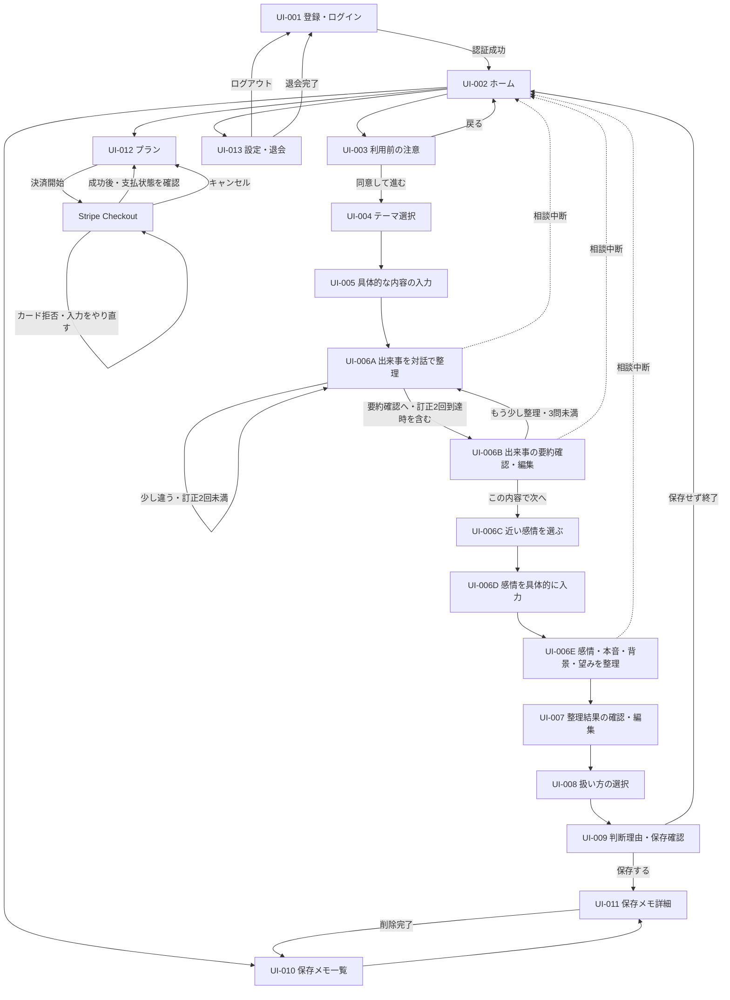

# ぽろり。MVP画面設計書

- 作成日：2026年9月23日
- ステータス：初稿・チームレビュー前
- 対象：スマートフォン向けWebアプリ（MVP）
- 対応Issue：GitHub Issue #9「MVP画面設計書の初稿を作成する」
- 主担当：めぐ
- 確認担当：るな

## この文書の読み方

この文書は、既存の画面ワイヤーフレームを、実装担当者が画面単位で分担できる粒度へ具体化するための初稿です。完成デザインやAPI・DBの詳細を単独で決定するものではありません。

| 表記 | 意味 |
| --- | --- |
| 現行前提 | 企画案とワイヤーフレームで共通している、現時点の設計前提 |
| 共通前提（#2） | Issue #2でチーム回答を整理し、PR #20へ記録したMVP共通前提 |
| 未確定 | 技術検証、API・DB設計、またはチーム確認後に決める項目 |
| MVP外 | 今回のMVPには含めない項目 |

### 参照資料

- [`issue-review/porori-mvp-wireframes.md`](../issue-review/porori-mvp-wireframes.md)
- [`issue-review/porori-project-plan-v0.3.md`](../issue-review/porori-project-plan-v0.3.md)
- GitHub Issue #2「MVP確認事項を確定し、共通前提を整理する」
- GitHub PR #20「MVP共通前提と決定内容を反映」（`develop`へマージ済み）
- GitHub PR #18・#19・#21・#22で`develop`へマージ済みの技術検証結果
- GitHub PR #24（Issue #4、OpenRouterモデル比較・再レビュー中）
- `project-template-main/docs/画面設計.md`

PR #20は`develop`へマージ済みです。本書では、`docs/mvp-decisions.md`、更新後の企画案、更新後のワイヤーフレーム本文をMVPの共通前提として参照します。

### この文書で決めないこと

- 最終的な配色、書体、イラスト、余白、ロゴ配置
- APIのmethod、path、request、response、エラー形式
- DBのテーブル、カラム、型、制約
- 認証・AI・暗号化・決済ライブラリの採用決定
- 料金、相談回数、保存件数の具体値
- 本文の最大文字数など、API・DBと合わせて決める必要がある制限値

## 1. 設計方針

### 1.1 ターゲットデバイス

- スマートフォンを主対象とするレスポンシブWebアプリ
- PC・タブレットでも主要操作を妨げない幅へ調整する
- ブラウザや対応OSの確定はMVP実装前に別途確認する

### 1.2 UI・操作方針

- 一度に求める判断や入力を一つに絞る
- 選択肢を入口にし、必要な箇所だけ短い自由記述を組み合わせる
- 「伝える・今は保留する・伝えない」を同じ強さで表示し、特定の選択を正解として誘導しない
- AIが整理した内容は本人が確認・編集・承認するまで確定扱いにしない
- 相談中は現在の段階が分かる進捗表示を置く
- 出来事・感情・本音・背景・望みを整理し、「伝える・今は保留する・伝えない」から扱い方を選び、整理結果を確認できた時点で1回の相談完了とする
- 整理メモの保存は相談完了の必須条件にせず、選択後に別の「次の一歩」や行動計画を求めない
- 破壊的な操作であるメモ削除と退会には確認ダイアログを挟む
- 相談を中断する操作では、未保存内容が破棄されることを事前に知らせる

### 1.3 アクセシビリティ方針

- 色だけで選択状態・エラー・成功を区別しない
- 入力欄にはラベルを付け、プレースホルダーだけで説明しない
- キーボード操作時にもフォーカス位置が分かるようにする
- ボタンとリンクは役割が分かる文言にする
- エラーは該当入力欄の近くと、必要に応じて画面上部へ表示する
- 読み上げ時に入力項目名、必須・任意、エラー内容が分かる構造にする
- WCAGの適合レベル、コントラスト比、タップ領域の具体値は実装時に確認する

### 1.4 保存・プライバシー方針

- 相談中の会話全文、入力原文、未承認内容はDB・Redis・ログへ永続保存しない
- 本人が確認・編集・承認し、保存を選んだ整理メモだけを保存候補とする
- 相談本文、整理メモ、プロンプト、AI応答、認証トークンをログへ出力しない
- 相談内容を外部AIへ送信すること、実名・住所・連絡先等を入力しないことを利用前に案内する
- 「どこにも保存されない」とは表示せず、アプリ内の保存方針と外部AIへの送信を分けて説明する
- 医療・心理相談の代替ではないことと、つらさが強い場合の相談窓口を確認できるようにする

## 2. 画面遷移図

### 2.1 共通の例外遷移

- 未認証または認証切れ：認証が必要な画面からUI-001へ遷移する。再ログイン後の戻り先は未確定
- 認証基盤・設定の障害：認証情報の誤りとは区別し、内部情報を表示せず再試行を案内する
- 通信エラー：同じ画面に留まり、再試行または安全に戻る操作を表示する
- AI処理失敗：入力内容を画面内の一時状態に保持し、再試行または相談中断を選べるようにする。保持方法と再試行回数は未確定
- 相談中断：破棄確認後にUI-002へ戻り、未承認内容を永続保存しない
- 保存失敗：保存完了とは表示せず、UI-009に留まって再試行できるようにする
- 削除失敗：対象メモを削除済みとして扱わず、UI-011に留まる
- 退会失敗：アカウントや保存データを削除済みとして扱わず、UI-013に留まる

## 3. 画面一覧

| 画面ID | 画面名 | 役割 | 主な入出力 | 関連API |
| --- | --- | --- | --- | --- |
| UI-001 | 登録・ログイン | 利用者を識別してアプリへ入る | メールアドレス、パスワード | 認証API（未確定） |
| UI-002 | ホーム | 相談開始と主要機能への入口 | 保存メモ概要、利用状況 | ユーザー・利用状況API（未確定） |
| UI-003 | 利用前の注意 | 外部AI送信・保存方針・安全案内を確認する | 同意操作 | 同意状態API（要否未確定） |
| UI-004 | モヤモヤのテーマ選択 | 相談の入口となるテーマを一つ選ぶ | テーマ単一選択 | 相談API（未確定） |
| UI-005 | 具体的な内容の入力 | 気になる出来事や言葉を入力する | 自由記述 | AI相談API（未確定） |
| UI-006A | 出来事を対話で整理 | AIの理解を確認・訂正しながら出来事を整理する | AI質問、回答、理解確認 | AI相談API（未確定） |
| UI-006B | 出来事の要約確認・編集 | 出来事の要約を本人が確認・編集する | 要約編集、追加質問選択 | AI相談API（未確定） |
| UI-006C | 近い感情を選ぶ | 感情を考える入口を作る | 感情単一選択 | AI相談API（未確定） |
| UI-006D | 感情を具体的に入力 | 選択した感情を本人の言葉で補う | 自由記述または代替選択 | AI相談API（未確定） |
| UI-006E | 感情・本音・背景・望みを整理 | AIとの対話で整理を進める | AI質問、回答 | AI相談API（未確定） |
| UI-007 | 整理結果の確認・編集 | AIの整理結果を本人が編集・承認する | 出来事、感情、本音・背景、望み | AI相談API（未確定） |
| UI-008 | 扱い方の選択 | 気持ちの扱い方を本人が選ぶ | 伝える・保留・伝えない | 相談状態API（未確定） |
| UI-009 | 判断理由・保存確認 | 任意理由と保存有無を決める | 理由、保存選択 | メモ保存API（未確定） |
| UI-010 | 保存メモ一覧 | 保存済みメモを新しい順に確認する | 日付、短い要約、選択状態 | メモ一覧API（未確定） |
| UI-011 | 保存メモ詳細 | 保存済みメモを閲覧・削除する | 承認済み整理メモ | メモ詳細・削除API（未確定） |
| UI-012 | プラン | 現在のプランと決済導線を確認する | プラン、利用上限、決済状態 | 利用状況・決済API（未確定） |
| UI-013 | 設定・退会 | ログアウト、案内確認、退会を行う | アカウント操作 | 認証・退会API（未確定） |

## 4. コンポーネント設計

ここでの名称は役割を共有するための仮称であり、実装時のファイル名やUIライブラリを確定するものではありません。

| 仮称 | 役割 | 使用画面 |
| --- | --- | --- |
| `PageHeader` | 画面名、戻る操作、必要に応じた中断操作を表示する | UI-003〜013 |
| `BottomNavigation` | ホーム、保存メモ、プラン、設定への入口 | UI-002、010〜013 |
| `PrimaryButton` | 各画面の主操作 | 全画面 |
| `SecondaryButton` | 戻る、保存しない、追加で整理する等の副操作 | UI-003、006A〜B、009、011、013 |
| `SelectionCard` | テーマ、感情、扱い方を単一選択する | UI-004、006C、008 |
| `TextInput` | メールアドレス等の短い入力 | UI-001 |
| `TextArea` | 出来事、感情、要約、整理結果、理由を入力・編集する | UI-005、006A〜B、006D〜E、007、009 |
| `StepIndicator` | 相談の現在位置を表示する | UI-005〜009 |
| `InlineNotice` | 個人情報、外部AI送信、任意入力等の補足 | UI-001、003、005、006D、009、013 |
| `LoadingState` | 認証、AI処理、保存、削除、決済確認中を示す | 関連する各画面 |
| `ErrorMessage` | 入力・通信・認証・処理エラーを説明する | 全画面 |
| `EmptyState` | 保存メモがない、利用状況がない場合の案内 | UI-002、010、012 |
| `ConfirmDialog` | 相談中断、保存せず終了、削除、ログアウト、退会を確認する | UI-006A〜E、009、011、013 |
| `MemoCard` | 日付、短い要約、扱い方を表示する | UI-002、010 |
| `SupportLink` | つらさが強い場合の相談窓口へ案内する | UI-001、UI-003、必要な共通領域 |

## 5. バリデーション・エラー表示

### 5.1 共通ルール

- 必須項目が未入力の場合は、主操作を無効化するか、押下時に該当項目の近くへエラーを表示する
- エラー表示だけで入力済み内容を消さない
- 送信中は二重送信を防ぎ、処理中であることを表示する
- APIのエラー本文をそのまま画面へ表示しない
- エラー文、ログ、分析データへ相談内容・整理メモ・トークンを含めない
- エラー時に「何が起きたか」「ユーザーが次に何をできるか」を示す
- 文字数、許容文字、タイムアウト、再試行回数はAPI設計と合わせて確定する

### 5.2 入力項目別の初稿

| 入力項目 | 必須・任意 | 初稿での扱い | 未確定事項 |
| --- | --- | --- | --- |
| メールアドレス | 必須（暫定） | 空欄と形式不正を表示する | 認証方式、長さ、メール確認 |
| パスワード | 必須（暫定） | 空欄を表示し、入力値を伏せる | 最小文字数、複雑性、再設定 |
| テーマ | 必須（共通前提 #2 No.1） | 確定した5テーマと「その他」から一つだけ選択する | なし |
| 具体的な内容 | 必須（現行フロー上） | 空欄ではAI対話へ進めない。500文字を初稿値とする | API側の制限との一致 |
| 画面6-Aの回答 | 必須（共通前提 #2 No.2） | 一度に一問へ回答する。追加質問は最大3問、同じ内容の訂正・再確認は別枠で最大2回 | API側の回数管理との一致 |
| 出来事の要約 | 必須（現行前提） | 本人が確認し、必要なら編集する | 最大文字数 |
| 感情 | 必須（共通前提 #2 No.3） | 8選択肢から最も近いものを一つ選ぶ | なし |
| 感情の具体化 | 必須（共通前提 #2 No.4） | 300文字以内の自由記述または「うまく言葉にできない」を選ぶ | API側の制限との一致 |
| 整理結果 | 必須（現行前提） | 本人が確認・編集・承認する | 各項目の文字数 |
| 扱い方 | 必須（現行前提） | 三つから一つ選ぶ | なし |
| 扱い方を選んだ理由 | 任意（共通前提 #2 No.6） | 空欄でも完了できる | 最大文字数 |
| 保存する・しない | 必須（現行前提） | どちらかを本人が選ぶ | 保存上限到達時の扱い |

具体的な内容の500文字、感情の具体化の300文字は、既存ワイヤーフレーム画像に表示されている初稿値です。API設計で同じ制限を扱えるか確認し、異なる値にする場合は画面表示とAPIを同時に更新します。

### 5.3 主なエラーと復帰方法

| 種類 | 表示例の方向性 | 復帰方法 |
| --- | --- | --- |
| 入力不足 | 「入力されていない項目があります」 | 該当項目へフォーカスする |
| 認証失敗 | 「メールアドレスまたはパスワードを確認してください」 | UI-001で再入力する |
| 認証切れ | 「安全のため、もう一度ログインしてください」 | UI-001へ移動する |
| 通信失敗 | 「通信できませんでした。接続を確認してもう一度お試しください」 | 同じ画面で再試行する |
| 利用上限超過 | 「現在のプランで利用できる回数に達しました」 | UI-002からUI-012でプランを確認する。開始済みの相談は止めない |
| 利用状況取得失敗 | 「利用状況を確認できませんでした。相談は開始できます」 | 相談開始を許可し、利用状況は後から再読み込みする |
| AI処理失敗 | 「整理を続けられませんでした。もう一度試すか、相談を終了できます」 | 再試行または中断する |
| 保存失敗 | 「保存できませんでした。内容はまだ保存されていません」 | UI-009で再試行する |
| 一覧取得失敗 | 「保存メモを読み込めませんでした」 | UI-010で再読み込みする |
| 削除失敗 | 「削除できませんでした。メモは残っています」 | UI-011に留まる |
| 決済キャンセル | 「手続きはキャンセルされました」 | UI-012に戻る |
| 決済確認失敗 | 「決済状態を確認できませんでした」 | UI-012で再確認する。課金状態を推測しない |
| 退会失敗 | 「退会処理を完了できませんでした」 | UI-013に留まり、再試行または問い合わせを案内する |

表示文言は初稿であり、APIエラー分類と画面試用後に調整します。

## 6. 画面別詳細設計

### 6.1 UI-001 登録・ログイン

- ワイヤーフレーム：[`01-auth.svg`](../issue-review/assets/porori-mvp-wireframes/01-auth.svg)
- 役割：本人の保存メモと利用状況を他の利用者から分けて管理する入口
- 遷移元：未ログイン状態、ログアウト後、退会完了後、認証切れ後

| 区分 | 内容 |
| --- | --- |
| 表示 | アプリ名、説明、メールアドレス、パスワード、ログイン、新規登録、「つらさが強いときの相談窓口」へのリンク |
| 入力 | メールアドレス（必須・暫定）、パスワード（必須・暫定） |
| 操作 | ログイン、新規登録。成功時はUI-002へ遷移。相談窓口リンクから外部の案内先を開く |
| 処理中 | ボタンを無効化し、二重送信を防ぐ |
| エラー | 入力不足、形式不正、認証失敗、認証切れ、認証基盤・設定の障害、通信失敗。認証情報の誤りとサービス側の障害を同じ表示にしない |
| 保存 | 認証情報を画面やログへ残さない |
| 技術検証 | Firebase Authentication＋Firebase Admin SDKで、実トークン検証、期限切れ拒否、本人所有データの取得、他人のデータの拒否を確認済み。正式採用前の推奨候補とする |
| 未確定 | Firebaseの正式採用、フロント側のログイン・ログアウトとトークン更新、初回登録、メール確認、パスワード再設定、失効・無効化の反映、相談窓口の具体的な案内先と開き方 |

### 6.2 UI-002 ホーム

- ワイヤーフレーム：[`02-home.svg`](../issue-review/assets/porori-mvp-wireframes/02-home.svg)
- 役割：新しい相談を主目的として示し、保存メモ・プラン・設定への入口をまとめる
- 遷移元：UI-001、UI-003、UI-009、下部ナビゲーション

| 区分 | 内容 |
| --- | --- |
| 表示 | 新しく気持ちを整理する、保存メモへの入口、プラン、設定、取得できた場合は利用回数・保存件数の状況 |
| 操作 | 利用可能または利用状況を取得できない場合は、相談開始でUI-003へ進む。保存メモでUI-010、プランでUI-012、設定でUI-013へ遷移 |
| 利用上限状態 | 上限到達となる今回の相談は開始・完了できる。上限超過後は新しい相談を開始せず、UI-012への導線を表示する |
| 空状態 | 保存メモがない場合は本文を出さず、「まだ保存したメモはありません」と相談開始導線を表示する |
| 処理中 | 保存メモ概要や利用状況を読み込んでいることを表示する |
| エラー | Redis等から利用状況を取得できない場合はフェイルオープンとし、内部技術名を表示せず相談開始を許可する。保存メモ等の取得失敗とは分けて表示する |
| 未確定 | ホームに表示する利用回数・保存件数の粒度、上限値、リセット期間、上限到達・超過時の最終文言 |

### 6.3 UI-003 利用前の注意

- ワイヤーフレーム：[`03-privacy-notice.svg`](../issue-review/assets/porori-mvp-wireframes/03-privacy-notice.svg)
- 役割：相談前に外部AIへの送信、アプリ内の保存方針、安全上の注意を知らせる
- 遷移元：UI-002の相談開始

| 区分 | 内容 |
| --- | --- |
| 表示 | 外部AIへ送信すること、相談中のやり取りはアプリ内に残さないこと、承認した整理メモだけ保存できること、個人情報を入力しないこと、医療等の代替ではないこと、相談窓口 |
| 入力 | 同意確認（方式は未確定） |
| 操作 | 同意してUI-004へ進む、UI-002へ戻る |
| 初回 | 詳しい注意を表示する（共通前提 #2 No.5） |
| 2回目以降 | 短い注意を表示する（共通前提 #2 No.5） |
| エラー | 同意状態を保存する場合の取得・保存失敗 |
| 未確定 | 同意履歴をDBへ保存するか、短い表示の具体文言、初回判定方法 |

### 6.4 UI-004 モヤモヤのテーマ選択

- ワイヤーフレーム：[`04-topic-selection.svg`](../issue-review/assets/porori-mvp-wireframes/04-topic-selection.svg)
- 役割：長文入力の前に、相談を始めるきっかけを作る
- 遷移元：UI-003

| 区分 | 内容 |
| --- | --- |
| 表示・入力 | 会話・連絡・愛情表現／暮らし・家事・生活習慣／お金の感覚の違い／気遣い・思いやりの伝わり方／将来・価値観・二人の関係／その他から単一選択（共通前提 #2 No.1） |
| 補足 | 「完全に当てはまらなくても大丈夫」と表示する |
| 操作 | 一つ選択後、次へ進んでUI-005へ遷移。戻る場合はUI-003 |
| 初期状態 | 未選択。次へ進む操作は無効または押下時に未選択エラーを表示 |
| エラー | 選択状態を保持したまま再操作できるようにする |
| 保存 | テーマは相談中の一時状態。承認済みメモへ含めるかはDB設計で確認 |
| 未確定 | 「その他」を選んだ時点で追加入力を求めるか。具体的な出来事はUI-005で入力するため、重複入力にしないことを優先する |

画面上の説明例は次のとおりです。

| テーマ | 説明例 |
| --- | --- |
| 会話・連絡・愛情表現 | 連絡の頻度、会話のすれ違い、愛情の伝わり方など |
| 暮らし・家事・生活習慣 | 家事の分担、生活リズム、片付け方など |
| お金の感覚の違い | お金の使い方・貯め方、負担の考え方など |
| 気遣い・思いやりの伝わり方 | 言葉や態度、距離感、気持ちの受け取り方など |
| 将来・価値観・二人の関係 | 将来像、結婚、仕事、家族、関係のあり方など |
| その他 | 当てはまるものがない、まだよく分からない場合 |

### 6.5 UI-005 具体的な内容の入力

- ワイヤーフレーム：[`05-detail-input.svg`](../issue-review/assets/porori-mvp-wireframes/05-detail-input.svg)
- 役割：選択したテーマをきっかけに、気になる出来事や言葉を入力する
- 遷移元：UI-004

| 区分 | 内容 |
| --- | --- |
| 表示 | 選択したテーマ、入力案内、個人情報を入力しない注意 |
| 入力 | 自由記述（必須、500文字以内を初稿値とする） |
| 操作 | AIとの対話へ進んでUI-006Aへ遷移、UI-004へ戻る |
| 初期状態 | 入力欄は空。選択テーマを表示する |
| 処理中 | AIへの送信中であることを表示し、二重送信を防ぐ |
| エラー | 空欄、500文字超過、通信失敗、AI処理失敗 |
| 保存 | 入力原文はDB・Redis・ログへ永続保存しない |
| 未確定 | 最小文字数、500文字制限のAPI側での扱い、送信タイムアウト、再試行時の画面内保持方法 |

### 6.6 UI-006A 出来事を対話で整理

- ワイヤーフレーム：[`06-event-dialogue.svg`](../issue-review/assets/porori-mvp-wireframes/06-event-dialogue.svg)
- 役割：AIの理解を本人が確認・訂正し、出来事を整理する
- 遷移元：UI-005、UI-006Bの「もう少し整理したい」

| 区分 | 内容 |
| --- | --- |
| 表示 | 相談全体の進捗、「出来事の確認 1/3」等の追加質問数、AIが捉えた内容、「この理解で合っていますか？」、相談中断 |
| 確認操作 | 「はい、合っています」「少し違います」の二つを表示する |
| 訂正入力 | 「少し違います」を選ぶと、「違うところや補足したいこと」の入力欄と「修正内容を送る」を表示する |
| 再確認 | AIが修正後の理解を提示し、再び「はい、合っています」「少し違います」で確認する |
| 質問数 | 出来事の追加質問は原則1〜2問、希望時は最大3問（共通前提 #2 No.2） |
| 訂正回数 | 訂正入力からAIによる修正後の理解の提示・再確認までを1回と数える。追加質問数とは別枠で、同じ内容について最大2回 |
| 回数表示 | 訂正を開始した場合は「理解の確認 1/2」等を表示し、追加質問の「1/3」と混同しないようにする |
| 上限到達 | 2回の訂正後も合わない場合は「次の画面で内容を直接直せます」と案内し、UI-006Bの編集状態へ進む |
| 操作 | 理解が合えば次の追加質問またはUI-006Bへ進む。訂正内容を送信する。相談を中断する |
| 処理中 | AI応答待ちを表示し、連続送信を防ぐ |
| エラー | 通信失敗、タイムアウト、不正なAI出力。再試行または中断を提示 |
| 保存 | 会話全文・入力原文・AI応答をDB・Redis・ログへ永続保存しない |
| 未確定 | 質問数と訂正回数をAPI応答のどの値で受け取るか、再試行時に回数を増やすか |

### 6.7 UI-006B 出来事の要約確認・編集

- ワイヤーフレーム：[`06-event-summary.svg`](../issue-review/assets/porori-mvp-wireframes/06-event-summary.svg)
- 役割：AIがまとめた「何があったか」「何が気になったか」を本人が確定する
- 遷移元：UI-006A（通常の要約確認、追加質問後、訂正2回到達後の直接編集）

| 区分 | 内容 |
| --- | --- |
| 表示 | 何があったか、何が気になったか、現在の追加質問数、進捗。訂正2回到達後は、直接編集できることを案内する |
| 入力 | 二つの要約を必要に応じて編集（確認は必須、編集自体は任意） |
| 操作 | 「この内容で次へ」でUI-006C、3問未満なら「もう少し整理したい」でUI-006A、中断 |
| 最大3問到達時 | 追加質問を表示せず、本人が要約を直接編集して次へ進める |
| エラー | 編集内容の入力エラー、AI追加質問の失敗 |
| 保存 | 要約は相談中の一時状態。UI-007で承認されるまで永続保存しない |
| 未確定 | 要約の最大文字数、質問数をユーザーへ表示するか |

### 6.8 UI-006C 近い感情を選ぶ

- ワイヤーフレーム：[`06a-emotion-selection.svg`](../issue-review/assets/porori-mvp-wireframes/06a-emotion-selection.svg)
- 役割：感情をゼロから言葉にする負担を減らす
- 遷移元：UI-006B

| 区分 | 内容 |
| --- | --- |
| 表示・入力 | 寂しい／悲しい／不安／怒り・いら立ち／モヤモヤ・違和感／傷ついた／自分を責める気持ち（情けなさ・罪悪感）／その他・まだよく分からない、の8選択肢から単一選択（共通前提 #2 No.3） |
| 補足 | 「完全に一致しなくても大丈夫」と表示する |
| 操作 | 一つ選択してUI-006Dへ進む、UI-006Bへ戻る |
| 初期状態 | 未選択 |
| エラー | 未選択では次へ進めないことを表示する |
| 保存 | 選択内容は相談中の一時状態。承認前は永続保存しない |
| 未確定 | なし。画面試用では8選択肢の見つけやすさと表示量を確認する |

### 6.9 UI-006D 感情を具体的に入力

- ワイヤーフレーム：[`06b-emotion-detail.svg`](../issue-review/assets/porori-mvp-wireframes/06b-emotion-detail.svg)
- 役割：選択肢だけで決めつけず、本人の言葉で感情を補う
- 遷移元：UI-006C

| 区分 | 内容 |
| --- | --- |
| 表示 | 選択した感情、入力案内、「うまく言葉にできない」選択肢 |
| 入力 | 300文字以内の自由記述または「うまく言葉にできない」のどちらか（回答必須・共通前提 #2 No.4） |
| 操作 | 回答してUI-006Eへ進む、UI-006Cへ戻る |
| 初期状態 | 自由記述なし、代替選択なし |
| エラー | 両方が未回答、300文字超過、通信失敗 |
| 保存 | 入力原文は承認前に永続保存しない |
| 未確定 | 300文字制限のAPI側での扱い。「うまく言葉にできない」を選んだ場合は自由記述を送信対象に含めない |

### 6.10 UI-006E 感情・本音・背景・望みを整理

- ワイヤーフレーム：[`06-guided-dialogue.svg`](../issue-review/assets/porori-mvp-wireframes/06-guided-dialogue.svg)
- 役割：出来事と感情をもとに、本音・背景・望みを一つずつ整理する
- 遷移元：UI-006D

| 区分 | 内容 |
| --- | --- |
| 表示 | 進捗、AIの理解確認、一度に一問、前の内容、相談中断 |
| 入力 | AIからの一問への回答、理解が違う場合の補足 |
| 操作 | 回答送信、前の内容を確認、中断。整理後はUI-007へ遷移 |
| AI表示方針 | 感情や相手の意図を断定せず、「違っていたら教えてください」と確認する |
| 処理中 | AI応答待ちを表示し、連続送信を防ぐ |
| エラー | 通信失敗、タイムアウト、不正なAI出力、安全案内への切り替え |
| 保存 | 会話全文・入力原文・AI応答をDB・Redis・ログへ永続保存しない |
| 未確定 | 本音・背景・望みの質問数、AIモデル、危機的入力の判定方法、再試行回数 |

### 6.11 UI-007 整理結果の確認・編集

- ワイヤーフレーム：[`07-review-result.svg`](../issue-review/assets/porori-mvp-wireframes/07-review-result.svg)
- 役割：AIがまとめた内容を本人の表現へ直し、承認する
- 遷移元：UI-006E

| 区分 | 内容 |
| --- | --- |
| 表示・入力 | 出来事、感情、本音・背景、望みを項目ごとに表示し、編集できるようにする |
| 操作 | 各項目を編集、「この内容で合っている」で承認してUI-008へ進む |
| 初期状態 | AIの整理結果を表示するが、未承認として扱う |
| エラー | 必須項目の空欄、文字数超過、通信失敗 |
| 保存 | この画面での承認だけでは保存しない。保存有無はUI-009で本人が選ぶ |
| 未確定 | 「本音」と「背景」を別項目にするか、同一項目にするか。各項目の文字数 |

### 6.12 UI-008 扱い方の選択

- ワイヤーフレーム：[`08-handling-choice.svg`](../issue-review/assets/porori-mvp-wireframes/08-handling-choice.svg)
- 役割：整理した気持ちを今どう扱うか、本人が決める
- 遷移元：UI-007

| 区分 | 内容 |
| --- | --- |
| 表示・入力 | 伝える／今は保留する／伝えないを同じ強さで単一選択 |
| 補足 | 「今の時点での選択で、後から気持ちが変わってもよい」と表示する |
| 操作 | 一つ選択してUI-009へ進む、UI-007へ戻る |
| 初期状態 | 未選択 |
| エラー | 未選択では次へ進めないことを表示する |
| MVP外 | 選択後の「次の一歩」、伝え方メモ、会話練習 |
| 未確定 | なし。文言の微調整は画面試用で確認する |

### 6.13 UI-009 判断理由・保存確認

- ワイヤーフレーム：[`09-reason-and-save.svg`](../issue-review/assets/porori-mvp-wireframes/09-reason-and-save.svg)
- 役割：選んだ扱い方と任意理由を確認し、整理メモを保存するか決める
- 遷移元：UI-008

| 区分 | 内容 |
| --- | --- |
| 表示 | 承認した整理結果、扱い方、保存対象、理由入力、保存する・保存せず終了 |
| 入力 | 扱い方を選んだ理由（任意・共通前提 #2 No.6） |
| 操作 | 保存してUI-011、保存せず終了してUI-002、UI-008へ戻る |
| 保存確認 | 保存対象が会話全文ではなく、本人が承認した整理メモであることを示す |
| 処理中 | 保存中を表示し、二重保存を防ぐ |
| エラー | 保存失敗、保存上限到達、認証切れ。保存完了と誤表示しない |
| 保存しない | 確認後にホームへ戻り、相談中の内容を永続保存しない |
| 未確定 | 保存上限到達時の案内、理由の最大文字数、保存対象の最終項目 |

### 6.14 UI-010 保存メモ一覧

- ワイヤーフレーム：[`10-memo-list.svg`](../issue-review/assets/porori-mvp-wireframes/10-memo-list.svg)
- 役割：本人が保存した整理メモを新しいものから確認する
- 遷移元：UI-002、UI-011、下部ナビゲーション

| 区分 | 内容 |
| --- | --- |
| 表示 | 日付、短い要約、扱い方の選択状態。センシティブな本文を長く表示しない |
| 操作 | メモを選択してUI-011へ、ホーム等へ移動 |
| 空状態 | 「まだ保存したメモはありません」と相談開始導線を表示する |
| 処理中 | 一覧読み込み中を表示する |
| エラー | 取得失敗、認証切れ。本文や内部エラーを表示しない |
| MVP外 | 本文検索、複数条件検索、比較、分析、集計 |
| 未確定 | 短い要約を保存するか表示時に作るか、ページ分割、保存件数表示 |

### 6.15 UI-011 保存メモ詳細

- ワイヤーフレーム：[`11-memo-detail.svg`](../issue-review/assets/porori-mvp-wireframes/11-memo-detail.svg)
- 役割：本人が承認して保存した内容を見返し、不要な場合は削除する
- 遷移元：UI-009、UI-010

| 区分 | 内容 |
| --- | --- |
| 表示 | 日付、出来事、感情、本音・背景、望み、扱い方、任意理由 |
| 操作 | 一覧へ戻る、削除確認ダイアログを開く、削除を確定またはキャンセル |
| 削除確認 | 削除後は元に戻せないことを明示する |
| 処理中 | 削除中を表示し、二重操作を防ぐ |
| エラー | メモ不存在、本人以外のメモ、取得失敗、削除失敗、認証切れ |
| 再編集 | MVPでは行わない（共通前提 #2 No.7）。閲覧と削除のみ |
| 未確定 | 表示項目の最終構成、削除完了メッセージ、暗号化された項目の取得境界 |

### 6.16 UI-012 プラン

- ワイヤーフレーム：[`12-plan.svg`](../issue-review/assets/porori-mvp-wireframes/12-plan.svg)
- 役割：現在のプラン、利用状況、決済への入口を確認する
- 遷移元：UI-002、下部ナビゲーション、Stripeからの戻り

| 区分 | 内容 |
| --- | --- |
| 表示 | 現在のプラン、相談回数、保存件数、決済・変更操作。具体値は未確定のため、ワイヤーフレーム画像の「3回・5件」を確定値として扱わない |
| 操作 | Stripe Checkoutへ進む、ホーム等へ戻る。買い切り型のテスト決済でCheckoutへの遷移を確認済み |
| 処理中 | Checkout Session作成中と、Stripeから戻った後の支払状態確認中を区別し、二重操作を防ぐ |
| 決済成功状態 | Stripeから成功先へ戻った後、サーバー側で`payment_status == paid`を確認できた場合だけ成功を表示する |
| キャンセル状態 | Stripeからキャンセル先へ戻った場合はプランを更新せず、手続きが完了していないことを表示してUI-012に留まる |
| カード拒否状態 | Stripe Checkout内でエラーが表示され、アプリの成功画面へは遷移しない。支払済みとして扱わない |
| エラー | Session作成または支払状態を確認できない場合、成功・失敗を推測せず「確認できない」と表示し、再試行または安全に戻る操作を示す |
| 既知の制約 | Webhookを使わない同期確認方式では、支払後に成功先へ戻る前にブラウザを閉じるとアプリ側で検知できない。画面だけで有料状態を推測しない |
| 未確定 | 買い切り・サブスク、価格、無料枠、上限値、Webhook、解約、返金、二重決済防止、認証・ユーザーとの紐付け、決済状態の永続化、決済完了画面を独立させるか。価格・回数・件数は固定値へ埋め込まず、後から変更できる設定値としてAPI・DB設計へ引き継ぐ |

### 6.17 UI-013 設定・退会

- ワイヤーフレーム：[`13-settings.svg`](../issue-review/assets/porori-mvp-wireframes/13-settings.svg)
- 役割：ログアウト、プライバシー情報の確認、退会を行う
- 遷移元：UI-002、下部ナビゲーション

| 区分 | 内容 |
| --- | --- |
| 表示 | ログアウト、プライバシー説明、退会への入口 |
| 操作 | ログアウト確認、退会確認、各操作の確定・キャンセル |
| 退会確認 | 保存メモ等の関連データが削除され、元に戻せないことを表示する |
| 処理中 | ログアウトまたは退会処理中を表示し、二重操作を防ぐ |
| エラー | ログアウト失敗、退会失敗、認証切れ。有料契約と解約を採用する場合は、決済解約失敗も別状態として扱う |
| 成功 | ログアウト・退会完了後はUI-001へ遷移する |
| 未確定 | 有料契約中の解約とデータ削除の順序、失敗時の復旧、退会前の再認証要否 |

## 7. 共通状態・確認ダイアログ

| 対象 | 表示する内容 | 確定時 | キャンセル時 |
| --- | --- | --- | --- |
| 相談中断 | 未承認内容が保存されないこと | UI-002へ戻る | 相談へ戻る |
| 保存せず終了 | 整理メモが保存されないこと | UI-002へ戻る | UI-009へ戻る |
| メモ削除 | 対象メモと、元に戻せないこと | 削除後UI-010へ | UI-011へ戻る |
| ログアウト | 現在のアカウントからログアウトすること | UI-001へ | UI-013へ戻る |
| 退会 | アカウントと対象データが削除されること | 完了後UI-001へ | UI-013へ戻る |

確認ダイアログ内へ相談本文や保存メモ全文を必要以上に再表示しません。

## 8. 保存対象と保存禁止対象

| 情報 | 相談中 | 本人承認・保存選択後 | DB | Redis | ログ |
| --- | --- | --- | --- | --- | --- |
| テーマ | 一時利用 | 保存要否は未確定 | 未確定 | 保存しない | 保存しない |
| 具体的な入力原文 | 一時利用 | 保存しない | 保存禁止 | 保存禁止 | 保存禁止 |
| AIとの会話全文 | 一時利用 | 保存しない | 保存禁止 | 保存禁止 | 保存禁止 |
| AIの未承認要約 | 一時利用 | 保存しない | 保存禁止 | 保存禁止 | 保存禁止 |
| 本人が承認した整理メモ | 一時利用 | 保存候補 | 承認・保存同意を確認して暗号化保存できることを検証済み。対象項目と方式はDB設計で確定 | 保存しない | 保存禁止 |
| 扱い方 | 一時利用 | 保存候補 | 保存方法はDB設計で確定 | 保存しない | 保存禁止 |
| 任意の判断理由 | 一時利用 | 保存候補 | 暗号化対象をDB設計で確認 | 保存しない | 保存禁止 |
| 利用回数 | 参照・加算候補 | プラン判定に利用 | 必要性は未確定 | ユーザー単位の整数値だけを期限付きで保存できることを検証済み | 個人を特定できる形で保存しない |
| 認証トークン | 認証に利用 | 保存方法は認証設計に従う | 生値を保存しない | 生値を保存しない | 保存禁止 |

## 9. API・DB設計担当への確認事項

### 9.1 API設計（Issue #10）

- 各画面が必要とするAPIと認証要否
- Firebase IDトークンの未指定・不正・期限切れを401、認証基盤・設定の障害を別の失敗として画面へ伝える方法
- 検証済みトークンのUIDを本人確認の根拠とし、クライアントが送ったUIDやuser_idを信頼しないこと
- 他人のメモと存在しないメモを同じ404として扱い、メモの存在や所有者情報を漏らさないこと
- 相談テーマ6種類、感情8種類、扱い方3種類の許容値
- UI-006Dの自由記述と「うまく言葉にできない」をどう区別して送るか
- AI相談中の一時状態をどこで保持するか
- AI応答の正常・タイムアウト・Schema不正・安全案内の区別
- 画面6-Aの追加質問最大3問と、同じ内容の訂正・再確認最大2回を別の値としてどう管理するか
- 訂正入力、AIによる修正後の理解、ユーザーの再確認までを1回として扱う状態遷移
- 訂正2回到達後にUI-006Bの直接編集へ切り替えるための応答・状態
- UI-009で保存対象にする項目と、保存完了の判定
- 401、403、404、422、500等を画面でどう区別するか
- Stripe Checkout Sessionとログインユーザーの紐付け、成功後の状態確認、確認不能時、二重決済、成功先へ戻らなかった場合の扱い
- Redisの上限到達・超過・取得不能を画面へ返す状態と、障害時に相談を止めないフェイルオープンの制御
- 承認・保存同意をサーバー側で確認し、暗号化できない場合は本文や内部情報を返さず保存を拒否すること
- エラー本文へ相談内容やトークンを含めないこと

### 9.2 DB設計（Issue #11）

- 承認済み整理メモの項目と暗号化対象
- テーマ、感情、扱い方、判断理由を保存するか
- 一覧用の短い要約を保存するか、復号した本文から作るか
- 本人所有データであることを判定する関連
- Firebase UIDとアプリ内ユーザーを対応づけ、メモの所有者をサーバー側で決定する方法
- 個別削除と退会時一括削除の対象・順序
- プラン・決済状態をどこまで保持するか
- Stripeの決済状態とアプリ内プラン状態の永続化、重複Session・返金・解約を採用する場合の扱い
- Redisの利用回数とDB側のプラン・契約情報の責務分担、リセット期間、Redis再起動時の扱い
- 価格・相談回数・保存件数を固定値へ埋め込まず、後から変更できる設定値として扱う方法
- 暗号化対象、鍵の識別・保管・更新・復旧方法。鍵をDB・Redis・Gitへ保存しないこと
- 会話全文・入力原文・未承認内容の保存先を作らないこと

## 10. MVP共通前提・画像差分・未確定事項

### 10.1 Issue #2 No.1〜8の反映状況

PR #20は`develop`へマージ済みです。以下は、チーム全員の回答を整理した共通前提として本書へ反映しています。

| No. | 項目 | 本書への反映 | 今後の確認 |
| --- | --- | --- | --- |
| 1 | 5テーマの名称 | 確定した5テーマ＋その他と説明例をUI-004へ反映 | 画面試用で分かりやすさを確認 |
| 2 | AIの追加質問と要約確認 | 追加質問最大3問、訂正・再確認は別枠で同じ内容について最大2回、上限後は直接編集 | 技術検証・画面試用で初期値を見直す場合は別途相談 |
| 3 | 感情候補と選択方法 | 8選択肢から単一選択をUI-006Cへ反映 | 画面試用で表示量と見つけやすさを確認 |
| 4 | 感情の具体化 | 自由記述または「うまく言葉にできない」を必須回答としてUI-006Dへ反映 | API側の入力形式と合わせる |
| 5 | 利用前の注意 | 初回は詳しく、2回目以降は短く表示。UI-001にも相談窓口導線を設置 | 案内先・初回判定方法を確定 |
| 6 | 扱い方を選んだ理由 | UI-009で任意入力 | 最大文字数をAPI設計と確認 |
| 7 | 保存メモの再編集 | UI-011は閲覧・削除のみ。再編集はMVP外 | MVP後の拡張時に再検討 |
| 8 | 無料・有料プラン | 相談回数と保存件数を差の候補とし、具体値は未決定。変更可能な設定値として引き継ぐ | Stripe検証結果を踏まえ、プラン仕様を扱う後続Issueで価格・回数・件数を決定 |

### 10.2 ワイヤーフレーム画像の更新内容

PR #20で確定した共通前提と、マージ済みの技術検証結果をレビュー時にも確認しやすいよう、既存SVGのうち差分がある画面を本書と同時に更新します。完成デザインではなく、画面構成・文言・ユーザーから見える状態を確認するためのワイヤーフレームです。

| 画像 | 更新前の主な差分 | 今回の更新内容 | 備考 |
| --- | --- | --- | --- |
| `01-auth.svg` | 相談窓口リンクがない | 「つらさが強いときの相談窓口」への導線を追加 | 案内先URLは未確定 |
| `02-home.svg` | 利用状況の確認先が分かりにくい | 利用状況をプラン画面で確認できる案内を追加 | 上限・取得不能等の状態別文言は本書を参照 |
| `04-topic-selection.svg` | 旧テーマ名を表示 | 確定した5テーマ＋「その他」の名称へ更新 | 説明例は本書を参照 |
| `06-event-dialogue.svg` | 肯定例と追加質問最大3問だけを表示 | 二つの理解確認、訂正・再確認最大2回、上限後の直接編集案内を追加 | 訂正入力と修正後の理解は同画面の状態変化として扱う |
| `06a-emotion-selection.svg` | 7選択肢 | 「自分を責める気持ち」を加えた8選択肢へ更新 | 単一選択 |
| `06b-emotion-detail.svg` | 自由記述欄だけを表示 | 「うまく言葉にできない」の代替選択肢を追加 | 自由記述とのどちらかへ回答 |
| `10-memo-list.svg` | 「お金・負担について」という旧テーマ例 | 「お金の感覚の違い」へ更新 | 一覧の短い要約との区別はDB設計で確認 |
| `12-plan.svg` | 確定していない価格・回数・件数、契約・解約を表示 | 具体値を外し、Stripeテスト画面・確認後の反映・キャンセル時非更新を表示 | プラン方式と具体値は後続Issueで決定 |

### 10.3 技術検証結果・後続Issueへの引き継ぎ

| 項目 | 現状 | 画面設計での扱い |
| --- | --- | --- |
| OpenRouter・AIモデル | PR #24で5モデルの一次確認・2モデルの詳細比較を実施し、再レビュー中 | 画面構成は変更せず、特定モデル名と最終的な危機対応を固定しない。危機時の相談窓口は検証済み情報を固定表示する方針を後続Issueへ渡す |
| 認証方式 | PR #21マージ済み。Firebase Authentication＋Admin SDKで実トークン検証・期限切れ拒否・本人所有データの認可を確認 | Firebaseを推奨候補とし、認証切れと認証基盤・設定障害を区別する。正式採用とフロント実装は後続Issueで確定 |
| Stripe | PR #19マージ済み。買い切り型の成功・キャンセル・カード拒否をテストモードで確認 | 成功確認中・成功・キャンセル・確認不能をUI-012へ反映し、カード拒否はCheckout内の状態として扱う。プラン方式と永続化は未確定 |
| Redis | PR #18マージ済み。利用回数、上限判定、TTL方式、障害時フェイルオープンを検証 | 上限到達の相談は完了可能、超過後の新規相談は制限、取得不能時は相談開始を許可する。具体的な上限・期間は未確定 |
| 暗号化 | PR #22マージ済み。承認・保存同意済みメモの暗号化保存・復号と、未承認内容の非保存を確認 | 保存失敗時に本文や内部情報を表示せず、保存対象と保存禁止対象を維持する。暗号方式と本番鍵管理は未確定 |
| API契約 | Issue #10で作成 | method、path、型、エラー形式を決めない |
| DB設計 | Issue #11で作成 | テーブル、カラム、型を決めない |

## 11. Issue #9レビュー確認表

- [x] MVP対象の17画面・状態を一覧化した
- [x] 各画面の表示・入力・操作・遷移を記載した
- [x] 必須・任意、空状態、処理中、主なエラー状態を記載した
- [x] 保存しない、相談中断、削除、ログアウト、退会の導線を記載した
- [x] API・DB担当への確認事項を分けた
- [x] 相談中の会話全文・入力原文・未承認内容を永続保存しない境界を記載した
- [x] PR #20のMVP共通前提を反映した
- [x] ワイヤーフレーム画像内の旧文言・選択肢との差分を整理した
- [x] 差分があるワイヤーフレーム画像を画面設計書に合わせて更新した
- [x] PR #20の確定内容と画面設計書の最終差分を確認した
- [x] PR #18・#19・#21・#22の技術検証結果を画面設計へ反映した
- [ ] PR #24の再レビュー・マージ状況をPR作成直前に再確認する
- [ ] Issue #9の確認担当によるレビューを受ける
- [ ] API・DB設計初稿との不一致を確認する
