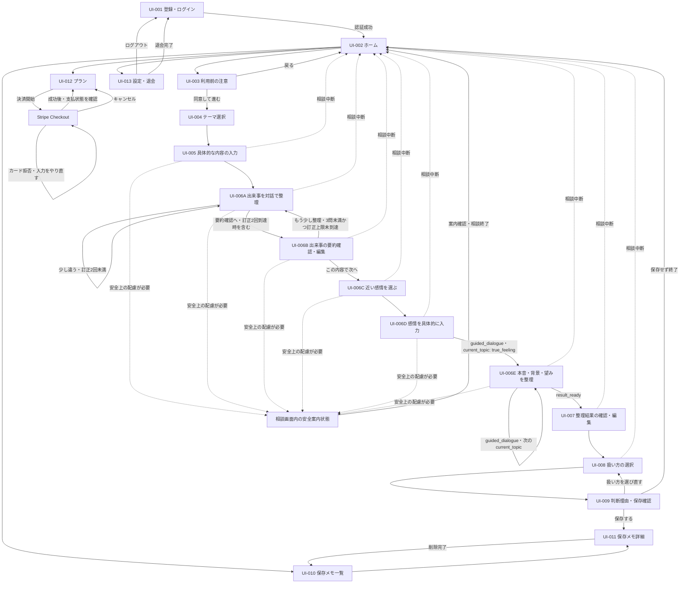

# ぽろり。MVP画面設計書

- 作成日：2026年9月23日
- 更新日：2026年9月28日
- ステータス：初稿・講師／チームレビュー対応中
- 対象：スマートフォン向けWebアプリ（MVP）
- 対応Issue：GitHub Issue #9「MVP画面設計書の初稿を作成する」
- 主担当：めぐ
- 確認担当：るな

## この文書の読み方

この文書は、既存の画面ワイヤーフレームを、実装担当者が画面単位で分担できる粒度へ具体化するための初稿です。完成デザインやAPI・DBの詳細を単独で決定するものではありません。

| 表記 | 意味 |
| --- | --- |
| 現行前提 | 企画案とワイヤーフレームで共通している、現時点の設計前提 |
| 共通前提（#2） | Issue #2でチーム回答を整理し、PR #20へ記録したMVP共通前提 |
| 未確定 | 技術検証、API・DB設計、またはチーム確認後に決める項目 |
| MVP外 | 今回のMVPには含めない項目 |

### 参照資料

- [`issue-review/porori-mvp-wireframes.md`](../issue-review/porori-mvp-wireframes.md)
- [`issue-review/porori-project-plan-v0.3.md`](../issue-review/porori-project-plan-v0.3.md)
- GitHub Issue #2「MVP確認事項を確定し、共通前提を整理する」
- GitHub PR #20「MVP共通前提と決定内容を反映」（`develop`へマージ済み）
- GitHub PR #18・#19・#21・#22で`develop`へマージ済みの技術検証結果
- GitHub PR #24（Issue #4、OpenRouterモデル比較、`develop`へマージ済み）
- GitHub PR #26の技術選定（`develop`へマージ済み）と、PR #23・#27・#28のDB設計・API設計・PRD初稿（未マージの資料は最新案との整合確認の参考として参照）
- `project-template-main/docs/画面設計.md`

PR #20は`develop`へマージ済みです。本書では、`docs/mvp-decisions.md`、更新後の企画案、更新後のワイヤーフレーム本文をMVPの共通前提として参照します。

### この文書で決めないこと

- 最終的な配色、書体、イラスト、余白、ロゴ配置
- APIのmethod、path、request、response、エラー形式
- DBのテーブル、カラム、型、制約
- 認証・AI・暗号化・決済ライブラリの採用決定
- 料金、相談回数、保存件数の具体値
- 本文の最大文字数など、API・DBと合わせて決める必要がある制限値

配色、書体、イラスト、余白、ロゴ配置等の完成デザインは、講師による画面・API・DB設計の確認後、フロントエンド実装前または実装初期に共通UIルールとして決定する。専用Issueを作成しない場合も、実装開始前に色、文字サイズ、ボタン、入力欄、余白、エラー・選択状態の最低限のルールをチームで共有する。

## 1. 設計方針

### 1.1 ターゲットデバイス

- スマートフォンを主対象とするレスポンシブWebアプリ
- PC・タブレットでも主要操作を妨げない幅へ調整する
- ブラウザや対応OSの確定はMVP実装前に別途確認する

### 1.2 UI・操作方針

- 一度に求める判断や入力を一つに絞る
- 選択肢を入口にし、必要な箇所だけ短い自由記述を組み合わせる
- 「伝える・今は保留する・伝えない」を同じ強さで表示し、特定の選択を正解として誘導しない
- AIが整理した内容は本人が確認・編集・承認するまで確定扱いにしない
- 相談中は現在の段階が分かる進捗表示を置く
- 出来事・感情・本音・背景・望みを整理し、本人が整理結果を承認したうえで「伝える・今は保留する・伝えない」から扱い方を選んだ時点（UI-008）で1回の相談完了とする。UI-009の理由入力と保存選択は完了後の任意操作として扱う。利用回数の技術的な加算は相談開始時に行い、UI-009から扱い方を選び直しても重複加算しない
- 整理メモの保存は相談完了の必須条件にせず、選択後に別の「次の一歩」や行動計画を求めない
- 破壊的な操作であるメモ削除と退会には確認ダイアログを挟む
- 相談を中断する操作では、未保存内容が破棄されることを事前に知らせる

整理する5項目は、次の意味で区別します。

| 項目 | 定義 | 架空の表示例 |
| --- | --- | --- |
| 出来事 | 実際に起きたことや相手の言動など、本人が確認できる事実 | 話しているとき、相手がスマホを見ていた |
| 感情 | 出来事に対して本人が感じた気持ち | 寂しい、大切にされていないように感じた |
| 本音 | 感情の奥にある、本人が本当は大切にしたい気持ち | 自分との時間を大切にしたい |
| 背景 | そう感じた理由につながる本人の価値観、過去の経験、現在の関係状況。相手の意図は推測しない | 会話中はお互いに目を向けることを大切にしている |
| 望み | 今後どうなってほしいか、本人が望む状態 | 話すときは少しだけこちらを見てほしい |

### 1.3 アクセシビリティ方針

- 色だけで選択状態・エラー・成功を区別しない
- 入力欄にはラベルを付け、プレースホルダーだけで説明しない
- キーボード操作時にもフォーカス位置が分かるようにする
- ボタンとリンクは役割が分かる文言にする
- エラーは該当入力欄の近くと、必要に応じて画面上部へ表示する
- 読み上げ時に入力項目名、必須・任意、エラー内容が分かる構造にする
- WCAGの適合レベル、コントラスト比、タップ領域の具体値は実装時に確認する

### 1.4 保存・プライバシー方針

- 相談中の会話全文、入力原文、未承認内容はDB・Redis・ログへ永続保存しない
- 相談中の一時状態は、DB・Redis・ログへ保存せず、APIプロセスのメモリで保持する
- APIは1ワーカーで起動する
- APIプロセスの再起動、開発時の自動リロード、一定時間の未操作により、一時状態が失われる場合がある
- 相談終了、相談中断、一定時間の未操作時に、一時状態を破棄する
- 一時状態の具体的な保持時間と破棄判定は、I-03B（Issue #50）で決定・記録する
- ブラウザ再読み込み後の相談復帰はMVPでは保証しない。一時状態を取得できない場合は、相談内容や内部情報を表示せず、ホームから新しい相談を開始できる状態へ戻す
- 本人が確認・編集・承認し、保存を選んだ整理メモだけを保存候補とする
- 相談本文、整理メモ、プロンプト、AI応答、認証トークンをログへ出力しない
- 相談内容を外部AIへ送信すること、実名・住所・連絡先等を入力しないことを利用前に案内する
- 「どこにも保存されない」とは表示せず、アプリ内の保存方針と外部AIへの送信を分けて説明する
- 医療・心理相談の代替ではないことと、つらさが強い場合の相談窓口を確認できるようにする

## 2. 画面遷移図

### 2.1 共通の例外遷移

- 未認証または認証切れ：認証が必要な画面からUI-001へ遷移する。再ログイン後の戻り先は未確定
- 認証基盤・設定の障害：認証情報の誤りとは区別し、内部情報を表示せず再試行を案内する
- 通信エラー：同じ画面に留まり、相談IDを保持している場合は、同じPOSTをすぐに再送せず、先に`GET /consultations/{id}`で公開APIの`status`・直近の`ai_question`・`current_topic`を再取得する。送信前より状態が進んでいる場合はPOST成功として再送せず、取得した状態に合う画面へ進む。状態が進んでいない場合だけ同じ画面で再試行できるようにする。再取得が404の場合は、理由を区別せずUI-002へ戻す。質問文を解析して状態を推測しない
- 入力・サーバー・AI処理失敗：422・500・502では回数・`current_topic`・整理結果が更新されないため、APIプロセスのメモリに一時状態が残っている場合は同じ画面で再試行または相談中断を選べるようにする。一時状態を取得できない場合は、相談内容や内部情報を表示せず、UI-002から新しい相談を開始できる状態へ戻す
- 状態競合：409では内部原因を推測せず、`CONSULTATION_BUSY`・`CONSULTATION_STATE_CONFLICT`・`RESULT_NOT_READY`と公開APIの`status`に基づいて表示・遷移を決める。必要に応じて`GET /consultations/{id}`で現在の状態を再取得する
- 一時状態の不存在・破棄・本人所有でない相談：いずれも404として受け取り、画面上で理由を区別せず、相談内容や内部情報を表示しないでUI-002へ戻す
- 安全案内への切り替え：安全上の配慮が必要と判定された場合は通常の整理を続けず、AIが生成した案内文ではなく、確認済み情報に基づく固定文言と相談窓口を表示する。判定方法と対象APIは未確定
- ブラウザ再読み込み：再読み込み後の相談復帰はMVPでは保証しない。ブラウザ再読み込みとAPIプロセスの再起動は別の事象として扱い、再読み込みだけでAPIプロセス内の一時状態が必ず失われるとはみなさない。ただし、復帰できない場合はUI-002へ戻す
- APIプロセスの再起動・開発時の自動リロード：APIプロセスのメモリに保持した一時状態が失われるため、相談途中への復帰はできない。内部状態や相談内容をエラーへ含めず、UI-002から新しい相談を開始できる状態へ戻す
- 一定時間の未操作：I-03B（Issue #50）で定める保持時間を超えた場合は一時状態を破棄し、UI-002から新しい相談を開始できる状態へ戻す
- 相談中断：UI-005からUI-008まで表示できる。破棄確認後に一時状態を破棄してUI-002へ戻り、未保存内容を永続保存しない。UI-009では相談完了後の「保存せず終了」として扱う
- 相談終了：UI-009で保存または保存しない処理が完了した後、相談中の一時状態を破棄する。保存する場合も、永続保存するのは本人が承認し、保存に同意した整理メモだけとする
- 保存失敗：保存完了とは表示せず、UI-009に留まって再試行できるようにする
- 削除失敗：対象メモを削除済みとして扱わず、UI-011に留まる
- 退会失敗：アカウントや保存データを削除済みとして扱わず、UI-013に留まる

## 3. 画面一覧

| 画面ID | 画面名 | 役割 | 主な入出力 | 関連API |
| --- | --- | --- | --- | --- |
| UI-001 | 登録・ログイン | 利用者を識別してアプリへ入る | メールアドレス、パスワード | 認証API（未確定） |
| UI-002 | ホーム | 相談開始と主要機能への入口 | 保存メモ概要、利用状況 | ユーザー・利用状況API（未確定） |
| UI-003 | 利用前の注意 | 外部AI送信・保存方針・安全案内を確認する | 同意操作 | 同意状態API（要否未確定） |
| UI-004 | モヤモヤのテーマ選択 | 相談の入口となるテーマを一つ選ぶ | テーマ単一選択 | 相談API（未確定） |
| UI-005 | 具体的な内容の入力 | 気になる出来事や言葉を入力する | 自由記述 | AI相談API（未確定） |
| UI-006A | 出来事を対話で整理 | AIの理解を確認・訂正しながら出来事を整理する | AI質問、回答、理解確認 | AI相談API（未確定） |
| UI-006B | 出来事の要約確認・編集 | 出来事の要約を本人が確認・編集する | 要約編集、追加質問選択 | AI相談API（未確定） |
| UI-006C | 近い感情を選ぶ | 感情を考える入口を作る | 感情単一選択 | AI相談API（未確定） |
| UI-006D | 感情を具体的に入力 | 選択した感情を本人の言葉で補う | 自由記述または代替選択 | `POST /consultations/{id}/emotion` |
| UI-006E | 本音・背景・望みを整理 | AIとの対話で整理を進める | AI質問、自由記述 | `POST /consultations/{id}/guided-dialogue`、`GET /consultations/{id}` |
| UI-007 | 整理結果の確認・編集 | AIの整理結果を本人が編集・承認する | 出来事、感情、本音、背景、望み | `GET`・`PATCH /consultations/{id}/result`、`POST /consultations/{id}/result/approve` |
| UI-008 | 扱い方の選択 | 気持ちの扱い方を本人が選ぶ | 伝える・今は保留する・伝えない | 相談状態API（未確定） |
| UI-009 | 判断理由・保存確認 | 任意理由と保存有無を決める | 理由、保存選択 | メモ保存API（未確定） |
| UI-010 | 保存メモ一覧 | 保存済みメモを新しい順に確認する | 日付、短い要約、選択状態 | メモ一覧API（未確定） |
| UI-011 | 保存メモ詳細 | 保存済みメモを閲覧・削除する | 承認済み整理メモ | メモ詳細・削除API（未確定） |
| UI-012 | プラン | 現在のプランと決済導線を確認する | プラン、利用上限、決済状態 | 利用状況・決済API（未確定） |
| UI-013 | 設定・退会 | ログアウト、案内確認、退会を行う | アカウント操作 | 認証・退会API（未確定） |

## 4. コンポーネント設計

ここでの名称は役割を共有するための仮称であり、実装時のファイル名やUIライブラリを確定するものではありません。

| 仮称 | 役割 | 使用画面 |
| --- | --- | --- |
| `PageHeader` | 画面名、必要に応じた戻る操作・中断操作を表示する。UI-007では画面内で編集を完結し、承認後のUI-008にはUI-007へ戻る操作を表示しない | UI-003〜013 |
| `BottomNavigation` | ホーム、保存メモ、プラン、設定への入口 | UI-002、010〜013 |
| `PrimaryButton` | 各画面の主操作 | 全画面 |
| `SecondaryButton` | 戻る、相談中断、保存しない、追加で整理する等の副操作 | UI-003〜009、011、013 |
| `SelectionCard` | テーマ、感情、扱い方を単一選択する | UI-004、006C、008 |
| `TextInput` | メールアドレス等の短い入力 | UI-001 |
| `TextArea` | 出来事、感情、要約、整理結果、理由を入力・編集する | UI-005、006A〜B、006D〜E、007、009 |
| `StepIndicator` | 相談の現在位置を表示する | UI-005〜009 |
| `InlineNotice` | 個人情報、外部AI送信、任意入力等の補足 | UI-001、003、005、006D、009、013 |
| `LoadingState` | 認証、AI処理、保存、削除、決済確認中を示す | 関連する各画面 |
| `ErrorMessage` | 入力・通信・認証・処理エラーを説明する | 全画面 |
| `EmptyState` | 保存メモがない、利用状況がない場合の案内 | UI-002、010、012 |
| `ConfirmDialog` | 相談中断、保存せず終了、削除、ログアウト、退会を確認する | UI-005〜008、009、011、013 |
| `MemoCard` | 日付、短い要約、扱い方を表示する | UI-002、010 |
| `SupportLink` | つらさが強い場合の相談窓口へ案内する | UI-001、UI-003、必要な共通領域 |
| `SafetyGuidanceState` | 通常の相談整理を止め、確認済みの固定文言、相談窓口、相談終了の導線を表示する | UI-005〜006Eの相談画面内状態 |

## 5. バリデーション・エラー表示

### 5.1 共通ルール

- 必須項目が未入力の場合は、主操作を無効化するか、押下時に該当項目の近くへエラーを表示する
- エラー表示だけで入力済み内容を消さない
- 送信中は二重送信を防ぎ、処理中であることを表示する
- APIのエラー本文をそのまま画面へ表示しない
- エラー文、ログ、分析データへ相談内容・整理メモ・トークンを含めない
- エラー時に「何が起きたか」「ユーザーが次に何をできるか」を示す
- 文字数、許容文字、タイムアウト、再試行回数はAPI設計と合わせて確定する

### 5.2 入力項目別の初稿

| 入力項目 | 必須・任意 | 初稿での扱い | 未確定事項 |
| --- | --- | --- | --- |
| メールアドレス | 必須（暫定） | 空欄と形式不正を表示する | 認証方式、長さ、メール確認 |
| パスワード | 必須（暫定） | 空欄を表示し、入力値を伏せる | 最小文字数、複雑性、再設定 |
| テーマ | 必須（共通前提 #2 No.1） | 確定した5テーマと「その他」から一つだけ選択する | なし |
| 具体的な内容 | 必須（現行フロー上） | 空欄ではAI対話へ進めない。500文字を初稿値とする | API側の制限との一致 |
| UI-006Aの回答 | 必須（共通前提 #2 No.2） | 一度に一問へ回答する。追加質問は最大3問、訂正・再確認は出来事を整理する工程全体で通算最大2回。追加質問へ進んでも回数をリセットしない | API側の回数管理との一致 |
| 出来事の要約 | 必須（現行前提） | 本人が確認し、必要なら編集する | 最大文字数 |
| 感情 | 必須（共通前提 #2 No.3） | 8選択肢から最も近いものを一つ選ぶ | なし |
| 感情の具体化 | 必須（共通前提 #2 No.4） | 300文字以内の自由記述または「うまく言葉にできない」を選ぶ | API側の制限との一致 |
| 本音・背景・望みの整理 | 本音・望みは必須、背景は任意 | 本音→背景→望みの3問を標準とし、サーバーが返す`current_topic`に従って一問ずつ短い自由記述で回答する。背景は「まだ分からない」で先へ進める | 各項目の最大文字数、「答えにくい」も代替操作として設けるか |
| 整理結果 | 本人の確認・承認は必須。背景のみ空欄可 | 本人が確認・編集・承認する。背景は空欄へ戻せる | 各項目の文字数 |
| 扱い方 | 必須（現行前提） | 三つから一つ選ぶ | なし |
| 扱い方を選んだ理由 | 任意（共通前提 #2 No.6） | 空欄でも完了できる | 最大文字数 |
| 保存する・しない | 必須（現行前提） | どちらかを本人が選ぶ | 保存上限到達時の扱い |

具体的な内容の500文字、感情の具体化の300文字は、既存ワイヤーフレーム画像に表示されている初稿値です。API設計で同じ制限を扱えるか確認し、異なる値にする場合は画面表示とAPIを同時に更新します。

### 5.3 主なエラーと復帰方法

利用回数の「上限到達」は今回の相談で上限回数に達する状態、「上限超過」は相談開始前に利用枠を使い切っている状態として区別します。上限到達となる相談は途中で止めず完了でき、上限超過後の新しい相談開始を制限します。

| 種類 | 表示例の方向性 | 復帰方法 |
| --- | --- | --- |
| 入力不足 | 「入力されていない項目があります」 | 該当項目へフォーカスする |
| 認証失敗 | 「メールアドレスまたはパスワードを確認してください」 | UI-001で再入力する |
| 認証切れ | 「安全のため、もう一度ログインしてください」 | UI-001へ移動する |
| 通信失敗 | 「通信できませんでした。接続を確認してもう一度お試しください」 | 相談IDを保持している場合は同じPOSTをすぐに再送せず、先に`GET /consultations/{id}`で現在の状態を確認する。送信前より進んでいればPOSTを再送せず現在の状態に合う画面へ進み、進んでいなければ同じ画面で再試行する。再取得が404の場合は理由を区別せずUI-002へ戻す |
| 利用上限超過 | 「現在のプランで利用できる回数に達しました」 | UI-002からUI-012でプランを確認する。開始済みの相談は止めない |
| 利用状況取得失敗 | 「利用状況を確認できませんでした。相談は開始できます」 | 相談開始を許可し、利用状況は後から再読み込みする |
| 入力値エラー（422） | 「入力内容を確認してください」 | 同じ画面に留まり、入力を修正する。回数・`current_topic`・整理結果は進んでいないものとして扱う |
| 相談処理中（409／`CONSULTATION_BUSY`） | 「前の操作を処理しています」 | 二重送信せず、必要に応じて相談状態を再取得する |
| 状態競合（409／`CONSULTATION_STATE_CONFLICT`） | 「現在の相談の状態では、この操作はできません」 | `GET /consultations/{id}`で公開APIの`status`を再取得し、現在の状態に合う画面へ進む。`safety_guidance`では通常の整理へ戻さない |
| 整理結果の準備前（409／`RESULT_NOT_READY`） | 「整理結果はまだできていません」 | UI-007を表示せず、相談状態を再取得して現在の相談画面へ戻る |
| AI処理失敗（500・502） | 「整理を続けられませんでした。もう一度試すか、相談を終了できます」 | 回数・`current_topic`・整理結果は進んでいないものとして、同じ画面で再試行または中断する |
| 一時状態の消失・不存在（404） | 「相談を続けられませんでした。ホームから新しい相談を始めてください」 | 状態不存在・破棄済み・本人所有でない場合を区別せず、相談内容・一時状態の有無・内部情報を表示しないでUI-002へ戻す |
| 安全案内 | 確認済みの固定文言で、緊急時を含む相談先と通常の整理を続けないことを案内する | 相談窓口を確認する、相談を終了してUI-002へ戻る |
| 保存失敗 | 「保存できませんでした。内容はまだ保存されていません」 | UI-009で再試行する |
| 一覧取得失敗 | 「保存メモを読み込めませんでした」 | UI-010で再読み込みする |
| 削除失敗 | 「削除できませんでした。メモは残っています」 | UI-011に留まる |
| 決済キャンセル | 「手続きはキャンセルされました」 | UI-012に戻る |
| 決済確認失敗 | 「決済状態を確認できませんでした」 | UI-012で再確認する。課金状態を推測しない |
| 退会失敗 | 「退会処理を完了できませんでした」 | UI-013に留まり、再試行または問い合わせを案内する |

表示文言は初稿であり、APIエラー分類と画面試用後に調整します。

## 6. 画面別詳細設計

### 6.1 UI-001 登録・ログイン

- ワイヤーフレーム：[`01-auth.svg`](../issue-review/assets/porori-mvp-wireframes/01-auth.svg)
- 役割：本人の保存メモと利用状況を他の利用者から分けて管理する入口
- 遷移元：未ログイン状態、ログアウト後、退会完了後、認証切れ後

| 区分 | 内容 |
| --- | --- |
| 表示 | アプリ名、説明、メールアドレス、パスワード、ログイン、新規登録、「つらさが強いときの相談窓口」へのリンク |
| 入力 | メールアドレス（必須・暫定）、パスワード（必須・暫定） |
| 操作 | ログイン、新規登録。成功時はUI-002へ遷移。相談窓口リンクから外部の案内先を開く |
| 処理中 | ボタンを無効化し、二重送信を防ぐ |
| エラー | 入力不足、形式不正、認証失敗、認証切れ、認証基盤・設定の障害、通信失敗。認証情報の誤りとサービス側の障害を同じ表示にしない |
| 保存 | 認証情報を画面やログへ残さない |
| 技術検証 | Firebase Authentication＋Firebase Admin SDKで、実トークン検証、期限切れ拒否、本人所有データの取得、他人のデータの拒否を確認済み。正式採用前の推奨候補とする |
| 未確定 | Firebaseの正式採用、フロント側のログイン・ログアウトとトークン更新、初回登録、メール確認、パスワード再設定、失効・無効化の反映、相談窓口の具体的な案内先と開き方 |

### 6.2 UI-002 ホーム

- ワイヤーフレーム：[`02-home.svg`](../issue-review/assets/porori-mvp-wireframes/02-home.svg)
- 役割：新しい相談を主目的として示し、保存メモ・プラン・設定への入口をまとめる
- 遷移元：UI-001、UI-003、UI-009、下部ナビゲーション

| 区分 | 内容 |
| --- | --- |
| 表示 | 新しく気持ちを整理する、保存メモへの入口、プラン、設定、取得できた場合は利用回数・保存件数の概要と現在利用できるか |
| 操作 | 利用可能または利用状況を取得できない場合は、相談開始でUI-003へ進む。保存メモでUI-010、プランでUI-012、設定でUI-013へ遷移 |
| 利用上限状態 | 上限到達となる今回の相談は開始・完了できる。上限超過後は新しい相談を開始せず、UI-012への導線を表示する |
| 空状態 | 保存メモがない場合は本文を出さず、「まだ保存したメモはありません」と相談開始導線を表示する |
| 処理中 | 保存メモ概要や利用状況を読み込んでいることを表示する |
| エラー | Redis等から利用状況を取得できない場合はフェイルオープンとし、内部技術名を表示せず相談開始を許可する。保存メモ等の取得失敗とは分けて表示する |
| 未確定 | ホームに表示する利用回数・保存件数の粒度、相談開始前に保存枠の残りを表示するか、上限値、リセット期間、上限到達・超過時の最終文言 |

### 6.3 UI-003 利用前の注意

- ワイヤーフレーム：[`03-privacy-notice.svg`](../issue-review/assets/porori-mvp-wireframes/03-privacy-notice.svg)
- 役割：相談前に外部AIへの送信、アプリ内の保存方針、安全上の注意を知らせる
- 遷移元：UI-002の相談開始

| 区分 | 内容 |
| --- | --- |
| 表示 | 入力内容がOpenRouter経由でAIモデル提供元へ送信されること、学習には利用されない設定であること、採用モデルによっては提供元で一定期間保持される可能性があること、相談中のやり取りはアプリ内に残さないこと、承認した整理メモだけ保存できること、個人情報を入力しないこと、医療等の代替ではないこと、相談窓口 |
| 入力 | 同意確認（方式は未確定） |
| 操作 | 同意してUI-004へ進む、UI-002へ戻る |
| 初回 | 詳しい注意を表示する（共通前提 #2 No.5） |
| 2回目以降 | 外部AIへの送信、学習には利用されない設定であること、提供元で一定期間保持される可能性、相談中の内容をアプリ内へ保存しないこと、個人情報を入力しないこと、医療・心理相談の代替ではないことを短く表示する（共通前提 #2 No.5）。「詳しい注意を見る」と相談窓口への導線は省略せず、毎回「確認して進む」を操作してからUI-004へ進む |
| エラー | 同意状態を保存する場合の取得・保存失敗 |
| 未確定 | 同意履歴をDBへ保存するか、短い表示の具体文言・配置、初回判定方法、注意事項の重要な変更時に詳しい表示を再表示する判定方法。具体的な見た目は講師・チームレビュー後、フロントエンド実装前または実装初期に決定する |

### 6.4 UI-004 モヤモヤのテーマ選択

- ワイヤーフレーム：[`04-topic-selection.svg`](../issue-review/assets/porori-mvp-wireframes/04-topic-selection.svg)
- 役割：長文入力の前に、相談を始めるきっかけを作る
- 遷移元：UI-003

| 区分 | 内容 |
| --- | --- |
| 表示・入力 | 会話・連絡・愛情表現／暮らし・家事・生活習慣／お金の感覚の違い／気遣い・思いやりの伝わり方／将来・価値観・二人の関係／その他から単一選択（共通前提 #2 No.1） |
| 補足 | 「完全に当てはまらなくても大丈夫」と表示する |
| 操作 | 一つ選択後、次へ進んでUI-005へ遷移。戻る場合はUI-003 |
| 初期状態 | 未選択。次へ進む操作は無効または押下時に未選択エラーを表示 |
| エラー | 選択状態を保持したまま再操作できるようにする |
| 保存 | テーマは相談中の一時状態。承認済みメモへ含めるかはDB設計で確認 |
| 未確定 | 「その他」を選んだ時点で追加入力を求めるか。具体的な出来事はUI-005で入力するため、重複入力にしないことを優先する |

画面上の説明例は次のとおりです。

| テーマ | 説明例 |
| --- | --- |
| 会話・連絡・愛情表現 | 連絡の頻度、会話のすれ違い、愛情の伝わり方など |
| 暮らし・家事・生活習慣 | 家事の分担、生活リズム、片付け方など |
| お金の感覚の違い | お金の使い方・貯め方、負担の考え方など |
| 気遣い・思いやりの伝わり方 | 言葉や態度、距離感、気持ちの受け取り方など |
| 将来・価値観・二人の関係 | 将来像、結婚、仕事、家族、関係のあり方など |
| その他 | 当てはまるものがない、まだよく分からない場合 |

### 6.5 UI-005 具体的な内容の入力

- ワイヤーフレーム：[`05-detail-input.svg`](../issue-review/assets/porori-mvp-wireframes/05-detail-input.svg)
- 役割：選択したテーマをきっかけに、気になる出来事や言葉を入力する
- 遷移元：UI-004

| 区分 | 内容 |
| --- | --- |
| 表示 | 選択したテーマ、入力案内、個人情報を入力しない注意 |
| 入力 | 自由記述（必須、500文字以内を初稿値とする） |
| 操作 | AIとの対話へ進んでUI-006Aへ遷移、UI-004へ戻る、相談を中断する |
| 初期状態 | 入力欄は空。選択テーマを表示する |
| 処理中 | AIへの送信中であることを表示し、二重送信を防ぐ |
| エラー | 空欄、500文字超過、通信失敗、AI処理失敗。安全案内が返された場合は通常の整理へ進まず、相談画面内の安全案内状態へ切り替える |
| 保存 | 入力原文はDB・Redis・ログへ永続保存しない |
| 未確定 | 最小文字数、500文字制限のAPI側での扱い、送信タイムアウト、再試行時の画面内保持方法 |

### 6.6 UI-006A 出来事を対話で整理

- ワイヤーフレーム：[`06-event-dialogue.svg`](../issue-review/assets/porori-mvp-wireframes/06-event-dialogue.svg)
- 役割：AIの理解を本人が確認・訂正し、出来事を整理する
- 遷移元：UI-005、UI-006Bの「もう少し整理したい」（追加質問3問未満かつ訂正上限未到達時のみ）

| 区分 | 内容 |
| --- | --- |
| 表示 | 相談全体の進捗、「出来事の確認 1/3」等の追加質問数、AIが捉えた内容、「この理解で合っていますか？」、相談中断 |
| 確認操作 | 「はい、合っています」「少し違います」の二つを表示する |
| 訂正入力 | 「少し違います」を選ぶと、「違うところや補足したいこと」の入力欄と「修正内容を送る」を表示する |
| 再確認 | AIが修正後の理解を提示し、再び「はい、合っています」「少し違います」で確認する |
| 質問数 | 出来事の追加質問は原則1〜2問、希望時かつ訂正上限未到達時は最大3問（共通前提 #2 No.2） |
| 訂正回数 | 訂正入力からAIによる修正後の理解の提示・再確認までを1回と数える。追加質問数とは別枠で、UI-006A〜006Bの出来事整理工程全体を通算して最大2回。質問が変わった場合や追加質問へ進んだ場合もリセットしない |
| 回数表示 | 訂正を開始した場合は「訂正 1/2」等、工程全体の通算回数を表示し、追加質問の「1/3」と混同しないようにする |
| 上限到達 | 2回の訂正後も合わない場合は「次の画面で内容を直接直せます」と案内し、UI-006Bの編集状態へ進む |
| 操作 | 理解が合えば次の追加質問またはUI-006Bへ進む。訂正内容を送信する。相談を中断する |
| 処理中 | AI応答待ちを表示し、連続送信を防ぐ |
| エラー | 通信失敗、タイムアウト、不正なAI出力。再試行または中断を提示する。安全案内が返された場合は通常の質問を止め、安全案内状態へ切り替える |
| 保存 | 会話全文・入力原文・AI応答をDB・Redis・ログへ永続保存しない |
| API連携 | `question_count`、`correction_count`、`correction_limit_reached`をサーバー管理状態として受け取る。訂正上限到達時は`event_summary_ready`と要約を受け取り、UI-006Bへ進む。AI呼び出し失敗時は訂正回数を増やさない |
| 未確定 | 質問数・訂正回数を画面へ表示する際の最終文言 |

### 6.7 UI-006B 出来事の要約確認・編集

- ワイヤーフレーム：[`06-event-summary.svg`](../issue-review/assets/porori-mvp-wireframes/06-event-summary.svg)
- 役割：AIがまとめた「何があったか」「何が気になったか」を本人が確定する
- 遷移元：UI-006A（通常の要約確認、追加質問後、訂正2回到達後の直接編集）

| 区分 | 内容 |
| --- | --- |
| 表示 | 何があったか、何が気になったか、現在の追加質問数、進捗。`can_ask_more: true`の場合のみ「もう少し整理したい」を表示する。訂正2回到達後はボタンを表示せず、直接編集できることを案内する |
| 入力 | 二つの要約を必要に応じて編集（確認は必須、編集自体は任意） |
| 操作 | 「この内容で次へ」でUI-006Cへ進む。追加質問3問未満かつ訂正上限未到達（`can_ask_more: true`）の場合のみ、「もう少し整理したい」でUI-006Aへ戻る。相談を中断する |
| 追加質問非表示時 | 追加質問が最大3問に達した場合、または訂正が最大2回に達した場合は「もう少し整理したい」を表示せず、本人が要約を直接編集して次へ進める |
| エラー | 編集内容の入力エラー、AI追加質問の失敗。安全案内が返された場合は通常の整理を止め、安全案内状態へ切り替える |
| 保存 | 要約は相談中の一時状態。UI-007で承認されるまで永続保存しない |
| 未確定 | 要約の最大文字数、質問数をユーザーへ表示するか |

### 6.8 UI-006C 近い感情を選ぶ

- ワイヤーフレーム：[`06a-emotion-selection.svg`](../issue-review/assets/porori-mvp-wireframes/06a-emotion-selection.svg)
- 役割：感情をゼロから言葉にする負担を減らす
- 遷移元：UI-006B

| 区分 | 内容 |
| --- | --- |
| 表示・入力 | 寂しい／悲しい／不安／怒り・いら立ち／モヤモヤ・違和感／傷ついた／自分を責める気持ち（情けなさ・罪悪感）／その他・まだよく分からない、の8選択肢から単一選択（共通前提 #2 No.3） |
| 補足 | 「完全に一致しなくても大丈夫」と表示する |
| 操作 | 一つ選択してUI-006Dへ進む、UI-006Bへ戻る、相談を中断する |
| 初期状態 | 未選択 |
| エラー | 未選択では次へ進めないことを表示する |
| 安全案内 | APIから安全案内が返された場合は通常の感情整理へ進まず、相談画面内の安全案内状態へ切り替える |
| 保存 | 選択内容は相談中の一時状態。承認前は永続保存しない |
| 未確定 | なし。画面試用では8選択肢の見つけやすさと表示量を確認する |

### 6.9 UI-006D 感情を具体的に入力

- ワイヤーフレーム：[`06b-emotion-detail.svg`](../issue-review/assets/porori-mvp-wireframes/06b-emotion-detail.svg)
- 役割：選択肢だけで決めつけず、本人の言葉で感情を補う
- 遷移元：UI-006C

| 区分 | 内容 |
| --- | --- |
| 表示 | 選択した感情、入力案内、「うまく言葉にできない」選択肢 |
| 入力 | 300文字以内の自由記述または「うまく言葉にできない」のどちらか（回答必須・共通前提 #2 No.4） |
| 操作 | 回答してUI-006Eへ進む、UI-006Cへ戻る、相談を中断する |
| 初期状態 | 自由記述なし、代替選択なし。「うまく言葉にできない」を選ぶと入力欄を無効にし、入力済み文字列は画面内だけに保持して送信対象から外す。選択を解除した場合は入力欄と入力済み文字列を復元する |
| API連携 | 選択した感情と、`detail`または`cannot_verbalize: true`のどちらか一方を送る。成功時は`ai_response`・最初の`ai_question`・`current_topic: true_feeling`を受け取り、`status: guided_dialogue`に基づいてUI-006Eへ進む |
| エラー | 両方が未回答、300文字超過、通信失敗。安全案内が返された場合は通常の整理へ進まず、安全案内状態へ切り替える |
| 保存 | 入力原文は承認前に永続保存しない |
| 未確定 | 300文字制限の最終値 |

### 6.10 UI-006E 本音・背景・望みを整理

- ワイヤーフレーム：[`06-guided-dialogue.svg`](../issue-review/assets/porori-mvp-wireframes/06-guided-dialogue.svg)
- 役割：出来事と感情をもとに、本音・背景・望みを一つずつ整理する
- 遷移元：UI-006D

| 区分 | 内容 |
| --- | --- |
| 表示 | `current_topic`に基づく進捗、`ai_question`、選択・入力済みの感情、前の内容、相談中断。本音・背景・望みは別の観点として扱い、ここで感情をもう一度入力させない。AIの質問文を解析して現在の項目を推測しない |
| 入力 | 本音→背景→望みの3問を標準とし、`current_topic`（`true_feeling`／`background`／`wish`）に対応する一問へ短い自由記述で回答する。背景のみ「まだ分からない」で先へ進める |
| 操作 | 通常回答は`answer`、「まだ分からない」は`skipped: true`で送り、同時には指定しない。`skipped: true`は`current_topic: background`のときだけ表示・送信する。`status: guided_dialogue`では次の`ai_question`と`current_topic`を表示し、`status: result_ready`では`GET .../result`で整理結果を取得してUI-007へ進む |
| 確認方法 | 客観的な出来事の認識をそろえるUI-006Aとは異なり、主観的な本音・背景・望みには訂正回数を設けず、一問ずつ回答する。全項目の最終確認・直接編集はUI-007で行う |
| AI表示方針 | 感情や相手の意図、背景を推測で断定しない。背景を読み取れない場合に事実を作らない。AI内部の`kind`はフロントで直接使用せず、公開APIの`status`で通常状態と安全案内を分岐する |
| 処理中 | AI応答待ちを表示し、連続送信を防ぐ |
| 状態再取得 | POSTの応答を受信できなかった場合は同じPOSTをすぐに再送せず、先に`GET /consultations/{id}`で`status`・直近の`ai_question`・`current_topic`を取得する。送信前より状態が進んでいればPOSTを再送せず取得した状態に合う表示へ進み、進んでいなければ同じ項目で再試行する。再取得が404の場合は理由を区別せずUI-002へ戻す。ただし、ブラウザ再読み込み後の相談復帰をMVPで保証するものではない |
| エラー | `answer`と`skipped: true`の併用、または背景以外での`skipped: true`は422。同じ相談の処理中は`CONSULTATION_BUSY`、状態不一致は`CONSULTATION_STATE_CONFLICT`として扱う。500・502では同じ項目に留まる。`status: safety_guidance`では通常の整理を止め、安全案内状態へ切り替える |
| 保存 | 会話全文・入力原文・AI応答をDB・Redis・ログへ永続保存しない |
| 未確定 | 各回答の最大文字数、「答えにくい」も代替操作として設けるか、AIモデル、危機的入力の判定方法、最大往復回数（I-03B（Issue #50）で決定）、再試行回数 |

### 6.11 UI-007 整理結果の確認・編集

- ワイヤーフレーム：[`07-review-result.svg`](../issue-review/assets/porori-mvp-wireframes/07-review-result.svg)
- 役割：AIがまとめた内容を本人の表現へ直し、承認する
- 遷移元：UI-006E

| 区分 | 内容 |
| --- | --- |
| 表示・入力 | 出来事、感情、本音、背景、望みを別項目として表示し、本人が編集できるようにする。背景を整理できなかった場合は空欄を許容し、推測した内容を補わない |
| API連携 | `status: result_ready`を受け取った後に`GET .../result`で整理結果を取得する。編集項目だけを`PATCH .../result`へ送り、更新後の整理結果全体を受け取る。背景は`{"background": ""}`で空欄へ戻せる |
| 操作 | 各項目を編集、「この内容で合っている」で承認してUI-008へ進む。承認は不可逆であり、承認後はUI-007へ戻って編集できないことを操作前に明示する。UI-006Eへは戻らず、必要な修正はこの画面で行う。相談を中断する |
| ブラウザ操作 | 承認後にブラウザの戻る操作・履歴・直接URLからUI-007へ移動しようとしても、編集可能な状態を復元しない。APIから取得した現在の相談状態に応じてUI-008以降へ遷移し、一時状態を取得できない場合はUI-002へ戻す |
| 初期状態 | `GET /consultations/{id}`で現在の`status`を確認する。 ・`result_ready`：`GET .../result`で取得したAIの整理結果を未承認として表示する ・`handling_selection`／`save_confirmation`：`GET .../result`は200になるが、編集可能なUI-007を復元せずUI-008以降へ進む |
| エラー | 必須項目の空欄、文字数超過、通信失敗。背景の空欄はエラーにしない。結果取得が早い場合は`RESULT_NOT_READY`、`safety_guidance`では`CONSULTATION_STATE_CONFLICT`としてUI-007を表示しない。状態不存在・破棄後・本人所有でない場合は404として区別せずUI-002へ戻す |
| 保存 | この画面での承認だけでは保存しない。保存有無はUI-009で本人が選ぶ |
| 未確定 | 各項目の最大文字数 |

### 6.12 UI-008 扱い方の選択

- ワイヤーフレーム：[`08-handling-choice.svg`](../issue-review/assets/porori-mvp-wireframes/08-handling-choice.svg)
- 役割：整理した気持ちを今どう扱うか、本人が決める
- 遷移元：UI-007

| 区分 | 内容 |
| --- | --- |
| 表示・入力 | 伝える／今は保留する／伝えないを同じ強さで単一選択 |
| 補足 | 「今の時点での選択で、後から気持ちが変わってもよい」と表示する |
| 操作 | 一つ選択してUI-009へ進む、相談を中断する。承認済みの整理結果は編集不可とし、UI-007へ戻る操作は設けない |
| 初期状態 | UI-007から初めて進んだ場合は未選択。UI-009から選び直しに戻った場合は、直前の選択を選択済みで表示する |
| エラー | 未選択では次へ進めないことを表示する |
| MVP外 | 選択後の「次の一歩」、伝え方メモ、会話練習 |
| 完了判定 | 扱い方を初めて選択してUI-009へ進む時点で相談完了とする。UI-009の任意理由と保存選択は完了条件に含めず、扱い方を選び直しても相談完了や利用回数を重複計上しない |
| API連携 | UI-009から戻った場合は、相談取得APIが返す現在の`handling`を選択済みで表示する。再選択は同じ相談の一時状態の更新として扱う |

### 6.13 UI-009 判断理由・保存確認

- ワイヤーフレーム：[`09-reason-and-save.svg`](../issue-review/assets/porori-mvp-wireframes/09-reason-and-save.svg)
- 役割：選んだ扱い方と任意理由を確認し、整理メモを保存するか決める
- 遷移元：UI-008

| 区分 | 内容 |
| --- | --- |
| 表示 | 承認した整理結果、扱い方、保存対象、理由入力、保存する・保存せず終了 |
| 入力 | 扱い方を選んだ理由（任意・共通前提 #2 No.6） |
| 操作 | 保存してUI-011、保存せず終了してUI-002へ進む。保存前はUI-008へ戻って扱い方を選び直せる。戻ったUI-008では直前の選択を表示する |
| 保存確認 | 保存対象が会話全文ではなく、本人が承認した整理メモであることを示す |
| 処理中 | 保存中を表示し、二重保存を防ぐ |
| エラー | 保存失敗、保存上限到達、認証切れ。保存完了と誤表示しない |
| 保存しない | 確認後にホームへ戻り、相談中の内容を永続保存しない |
| 未確定 | 保存上限到達時の案内、理由の最大文字数、保存対象の最終項目 |

### 6.14 UI-010 保存メモ一覧

- ワイヤーフレーム：[`10-memo-list.svg`](../issue-review/assets/porori-mvp-wireframes/10-memo-list.svg)
- 役割：本人が保存した整理メモを新しいものから確認する
- 遷移元：UI-002、UI-011、下部ナビゲーション

| 区分 | 内容 |
| --- | --- |
| 表示 | 日付、短い要約、扱い方の選択状態。センシティブな本文を長く表示しない |
| 操作 | メモを選択してUI-011へ、ホーム等へ移動 |
| 空状態 | 「まだ保存したメモはありません」と相談開始導線を表示する |
| 処理中 | 一覧読み込み中を表示する |
| エラー | 取得失敗、認証切れ。本文や内部エラーを表示しない |
| MVP外 | 本文検索、複数条件検索、比較、分析、集計 |
| 未確定 | 短い要約を保存するか表示時に作るか、ページ分割、保存件数表示 |

### 6.15 UI-011 保存メモ詳細

- ワイヤーフレーム：[`11-memo-detail.svg`](../issue-review/assets/porori-mvp-wireframes/11-memo-detail.svg)
- 役割：本人が承認して保存した内容を見返し、不要な場合は削除する
- 遷移元：UI-009、UI-010

| 区分 | 内容 |
| --- | --- |
| 表示 | 日付、出来事、感情、本音、背景、望み、扱い方、任意理由。背景が空欄の場合は「背景」項目を非表示にするか、「未記入」と表示するかの2案から決定する |
| 操作 | 一覧へ戻る、削除確認ダイアログを開く、削除を確定またはキャンセル |
| 削除確認 | 削除後は元に戻せないことを明示する |
| 処理中 | 削除中を表示し、二重操作を防ぐ |
| エラー | メモ不存在、本人以外のメモ、取得失敗、削除失敗、認証切れ |
| 再編集 | MVPでは行わない（共通前提 #2 No.7）。閲覧と削除のみ |
| 未確定 | 表示項目の最終構成、削除完了メッセージ、暗号化された項目の取得境界 |

### 6.16 UI-012 プラン

- ワイヤーフレーム：[`12-plan.svg`](../issue-review/assets/porori-mvp-wireframes/12-plan.svg)
- 役割：現在のプラン、利用状況、決済への入口を確認する
- 遷移元：UI-002、下部ナビゲーション、Stripeからの戻り

| 区分 | 内容 |
| --- | --- |
| 表示 | 現在のプラン、相談回数、保存件数、決済操作。具体値は未確定のため、ワイヤーフレーム画像へ固定値を表示しない |
| 操作 | Stripe Checkoutへ進む、ホーム等へ戻る。買い切り型のテスト決済でCheckoutへの遷移を確認済み |
| 処理中 | Checkout Session作成中と、Stripeから戻った後の支払状態確認中を区別し、二重操作を防ぐ |
| 決済成功状態 | Stripeから成功先へ戻った後、サーバー側で`payment_status == paid`を確認できた場合だけ成功を表示する |
| キャンセル状態 | Stripeからキャンセル先へ戻った場合はプランを更新せず、手続きが完了していないことを表示してUI-012に留まる |
| カード拒否状態 | Stripe Checkout内でエラーが表示され、アプリの成功画面へは遷移しない。支払済みとして扱わない |
| エラー | Session作成または支払状態を確認できない場合、成功・失敗を推測せず「確認できない」と表示し、再試行または安全に戻る操作を示す |
| 既知の制約 | Webhookを使わない同期確認方式では、支払後に成功先へ戻る前にブラウザを閉じるとアプリ側で検知できない。画面だけで有料状態を推測しない |
| 未確定 | 買い切り・サブスク、価格、無料枠、上限値、Webhook、解約、返金、二重決済防止、認証・ユーザーとの紐付け、決済状態の永続化、決済完了画面を独立させるか。価格・回数・件数は固定値へ埋め込まず、後から変更できる設定値としてAPI・DB設計へ引き継ぐ |

### 6.17 UI-013 設定・退会

- ワイヤーフレーム：[`13-settings.svg`](../issue-review/assets/porori-mvp-wireframes/13-settings.svg)
- 役割：ログアウト、プライバシー情報の確認、退会を行う
- 遷移元：UI-002、下部ナビゲーション

| 区分 | 内容 |
| --- | --- |
| 表示 | ログアウト、プライバシー説明、退会への入口 |
| 操作 | ログアウト確認、退会確認、各操作の確定・キャンセル |
| 退会確認 | 保存メモ等の関連データが削除され、元に戻せないことを表示する |
| 処理中 | ログアウトまたは退会処理中を表示し、二重操作を防ぐ |
| エラー | ログアウト失敗、退会失敗、認証切れ。有料契約と解約を採用する場合は、決済解約失敗も別状態として扱う |
| 成功 | ログアウト・退会完了後はUI-001へ遷移する |
| 未確定 | 有料契約中の解約とデータ削除の順序、失敗時の復旧、退会前の再認証要否 |

## 7. 共通状態・確認ダイアログ

| 対象 | 表示する内容 | 確定時 | キャンセル時 |
| --- | --- | --- | --- |
| 安全案内 | 確認済みの固定文言、相談窓口、通常の整理を続けないこと | 案内確認後UI-002へ | 通常の相談整理には戻さない。緊急時の連絡先確認等、案内内の操作は利用できる |
| 相談中断 | 未承認内容が保存されないこと | UI-002へ戻る | 相談へ戻る |
| 保存せず終了 | 整理メモが保存されないこと | UI-002へ戻る | UI-009へ戻る |
| メモ削除 | 対象メモと、元に戻せないこと | 削除後UI-010へ | UI-011へ戻る |
| ログアウト | 現在のアカウントからログアウトすること | UI-001へ | UI-013へ戻る |
| 退会 | アカウントと対象データが削除されること | 完了後UI-001へ | UI-013へ戻る |

確認ダイアログ内へ相談本文や保存メモ全文を必要以上に再表示しません。

## 8. 保存対象と保存禁止対象

以下の「相談中」の「一時利用」は、APIプロセスのメモリ上での一時保持を指します。会話全文・入力原文・未承認内容はDB・Redis・ログへ保存せず、相談終了・中断・一定時間の未操作時に破棄します。

| 情報 | 相談中 | 本人承認・保存選択後 | DB | Redis | ログ |
| --- | --- | --- | --- | --- | --- |
| テーマ | 一時利用 | 保存要否は未確定 | 未確定 | 保存しない | 保存しない |
| 具体的な入力原文 | 一時利用 | 保存しない | 保存禁止 | 保存禁止 | 保存禁止 |
| AIとの会話全文 | 一時利用 | 保存しない | 保存禁止 | 保存禁止 | 保存禁止 |
| AIの未承認要約 | 一時利用 | 保存しない | 保存禁止 | 保存禁止 | 保存禁止 |
| 本人が承認した整理メモ | 一時利用 | 保存候補 | 承認・保存同意を確認して暗号化保存できることを検証済み。対象項目と方式はDB設計で確定 | 保存しない | 保存禁止 |
| 扱い方 | 一時利用 | 保存候補 | 保存方法はDB設計で確定 | 保存しない | 保存禁止 |
| 任意の判断理由 | 一時利用 | 保存候補 | 暗号化対象をDB設計で確認 | 保存しない | 保存禁止 |
| 利用回数 | 相談開始時に加算 | プラン判定に利用 | 保存しない | ユーザー単位の整数値だけを期限付きで保存できることを検証済み | 個人を特定できる形で保存しない |
| 認証トークン | 認証に利用 | 保存方法は認証設計に従う | 生値を保存しない | 生値を保存しない | 保存禁止 |

## 9. API・DB設計担当への確認事項

### 9.1 API設計との対応（Issue #10・#49・#76）

Issue #49で確定した画面向け契約を、画面が利用する項目と状態遷移の範囲で次に整理します。method、path、request、response、エラー形式の正本はAPI設計書とし、Issue #76でPR #73の実装と一致させます。

| 画面 | 利用する公開API | 画面が参照する主な値 |
| --- | --- | --- |
| UI-006D | `POST /consultations/{id}/emotion` | `status`、`ai_response`、`ai_question`、`current_topic: true_feeling` |
| UI-006E | `POST /consultations/{id}/guided-dialogue`、`GET /consultations/{id}` | `status`、`ai_question`、`current_topic`。質問文から現在の項目を推測しない |
| UI-007 | `GET`・`PATCH /consultations/{id}/result`、`POST /consultations/{id}/result/approve` | 整理結果全体、`approved`、相談の`status` |
| 共通の復帰 | `GET /consultations/{id}` | 現在の`status`、直近の`ai_question`、`current_topic`。一時状態を取得できない404ではUI-002へ戻る |

- 各画面が必要とするAPIと認証要否
- Firebase IDトークンの未指定・不正・期限切れを401、認証基盤・設定の障害を別の失敗として画面へ伝える方法
- 検証済みトークンのUIDを本人確認の根拠とし、クライアントが送ったUIDやuser_idを信頼しないこと
- 他人のメモと存在しないメモを同じ404として扱い、メモの存在や所有者情報を漏らさないこと
- 相談テーマ6種類、感情8種類、扱い方3種類の許容値
- UI-006Dの自由記述は`detail`、「うまく言葉にできない」は`cannot_verbalize: true`として、どちらか一方だけを送ること
- 相談中の一時状態はAPIプロセスのメモリで保持し、APIは1ワーカーで起動する。DB・Redis・ログへ会話全文・入力原文・未承認内容を保存しないこと
- 相談終了・中断・一定時間の未操作時に一時状態を破棄すること。具体的な保持時間、未操作判定、破棄処理はI-03B（Issue #50）で決定・記録すること
- APIプロセスの再起動・開発時の自動リロードで一時状態が失われた場合は、相談内容や内部情報を返さず、画面が新しい相談を開始できる状態を返すこと
- ブラウザ再読み込み後の復帰はMVPでは保証しない。ブラウザ再読み込みとAPIプロセスの再起動を区別し、復帰できない場合の画面状態を一貫させること
- AI内部の`kind: normal | safety`はフロントで直接使用せず、公開APIの`status`で通常状態と`safety_guidance`を区別すること。AI呼び出し失敗とSchema不正は502として区別し、再試行の要否はI-07（Issue #54）で決定すること
- 安全上の配慮が必要な場合に、AIの生成文をそのまま表示せず、確認済みの固定文言へ置き換え、通常の整理を継続しない状態を返すこと。判定方法と対象APIは未確定
- 安全案内を責められていると感じにくい文言にし、誤判定時に改めて相談を始められることを案内するか、安全案内へ切り替わった相談を利用回数に含めるか
- UI-006Aの追加質問数は`question_count`、出来事整理工程全体で通算する訂正回数は`correction_count`でサーバー側が別々に管理すること。`question_count`は`action: answer`の処理成功ごとに増やし、`correct`・`ask_more`・AI処理失敗では増やさない。`guided-dialogue`の回数とは別に扱うこと
- 訂正入力を受け付けた時点で`correction_count`を増やし、AI呼び出しに失敗した場合は増やさないこと。訂正上限到達後の`correct`は409で拒否すること
- 訂正2回到達時は`correction_limit_reached: true`、`can_ask_more: false`、`event_summary_ready`と要約を返してUI-006Bの直接編集へ切り替えること。「もう少し整理したい」は`question_count < 3`かつ訂正上限未到達の場合だけ表示し、上限後の`ask_more`は409で拒否すること
- UI-007での承認を不可逆とし、承認済み結果の編集を409で拒否すること。UI-008からUI-007へ状態を戻すAPIと画面上の戻る導線は設けないこと
- 利用回数は相談開始時に加算すること。UI-009からUI-008へ戻って扱い方を選び直す場合は、現在の`handling`を返し、同じ相談の更新として扱って相談完了・利用回数を重複計上しないこと。AI失敗・安全案内等で早期終了した場合に加算を戻すかは未確定
- UI-006Eは本音→背景→望みの3問を標準とし、順序と進捗をサーバーが管理して`current_topic`で返すこと。背景の「まだ分からない」は`{"skipped": true}`で送り、`answer`との併用や背景以外での指定は422とする。「答えにくい」も代替操作として設けるかは未確定
- 整理完了時は結果の生成・検証・一時状態への格納後に`result_ready`を返し、失敗時は`guided_dialogue`を維持すること。整理結果では本音と背景を別項目として返し、背景を読み取れない場合は`background: ""`として事実を創作しないこと
- `GET .../result`は`result_ready`・`handling_selection`・`save_confirmation`で200、それ以前は`RESULT_NOT_READY`、`safety_guidance`では`CONSULTATION_STATE_CONFLICT`とすること。`PATCH .../result`は部分更新し、更新後の全体を返して`{"background": ""}`による空欄への更新を許可すること
- UI-009で保存対象にする項目と、保存完了の判定
- 409は`CONSULTATION_BUSY`・`CONSULTATION_STATE_CONFLICT`・`RESULT_NOT_READY`を区別し、画面はコードと公開APIの`status`に基づいて復帰すること。422・500・502では回数・`current_topic`・整理結果を更新せず、404では状態不存在・破棄済み・本人所有でない場合を画面上で区別しないこと
- Stripe Checkout Sessionとログインユーザーの紐付け、成功後の状態確認、確認不能時、二重決済、成功先へ戻らなかった場合の扱い
- Redisの上限到達・超過・取得不能を画面へ返す状態と、障害時に相談を止めないフェイルオープンの制御
- 相談開始前に保存枠の残りを表示するか。保存上限到達時も保存せず終了でき、相談完了自体は取り消さないこと
- 承認・保存同意をサーバー側で確認し、暗号化できない場合は本文や内部情報を返さず保存を拒否すること
- エラー本文へ相談内容やトークンを含めないこと

### 9.2 DB設計（Issue #11）

- 承認済み整理メモの項目と暗号化対象
- テーマ、感情、扱い方、判断理由を保存するか
- 出来事、感情、本音、背景、望みを別項目として暗号化対象へ含め、背景が空欄の場合も保存できるか
- 一覧用の短い要約を保存するか、復号した本文から作るか
- 本人所有データであることを判定する関連
- Firebase UIDとアプリ内ユーザーを対応づけ、メモの所有者をサーバー側で決定する方法
- 個別削除と退会時一括削除の対象・順序
- プラン・決済状態をどこまで保持するか
- Stripeの決済状態とアプリ内プラン状態の永続化、重複Session・返金・解約を採用する場合の扱い
- Redisの利用回数とDB側のプラン・契約情報の責務分担、リセット期間、Redis再起動時の扱い
- 価格・相談回数・保存件数を固定値へ埋め込まず、後から変更できる設定値として扱う方法
- 暗号化対象、鍵の識別・保管・更新・復旧方法。鍵をDB・Redis・Gitへ保存しないこと
- 会話全文・入力原文・未承認内容の保存先を作らないこと

## 10. MVP共通前提・画像差分・未確定事項

### 10.1 Issue #2 No.1〜8の反映状況

PR #20は`develop`へマージ済みです。以下は、チーム全員の回答を整理した共通前提として本書へ反映しています。

| No. | 項目 | 本書への反映 | 今後の確認 |
| --- | --- | --- | --- |
| 1 | 5テーマの名称 | 確定した5テーマ＋その他と説明例をUI-004へ反映 | 画面試用で分かりやすさを確認 |
| 2 | AIの追加質問と要約確認 | 追加質問最大3問、訂正・再確認は別枠で出来事整理工程全体を通算して最大2回。追加質問へ進んでもリセットせず、上限後は直接編集 | 技術検証・画面試用で初期値を見直す場合は別途相談 |
| 3 | 感情候補と選択方法 | 8選択肢から単一選択をUI-006Cへ反映 | 画面試用で表示量と見つけやすさを確認 |
| 4 | 感情の具体化 | 自由記述または「うまく言葉にできない」を必須回答としてUI-006Dへ反映 | API側の入力形式と合わせる |
| 5 | 利用前の注意 | 初回は詳しく、2回目以降は要点を短く表示。詳しい注意と相談窓口への導線は残し、UI-001にも相談窓口導線を設置 | 案内先、短い表示の具体文言・配置、初回判定方法を確定 |
| 6 | 扱い方を選んだ理由 | UI-009で任意入力 | 最大文字数をAPI設計と確認 |
| 7 | 保存メモの再編集 | UI-011は閲覧・削除のみ。再編集はMVP外 | MVP後の拡張時に再検討 |
| 8 | 無料・有料プラン | 相談回数と保存件数を差の候補とし、具体値は未決定。変更可能な設定値として引き継ぐ | Stripe検証結果を踏まえ、プラン仕様を扱う後続Issueで価格・回数・件数を決定 |

### 10.2 ワイヤーフレーム画像の更新内容

PR #20で確定した共通前提と、マージ済みの技術検証結果をレビュー時にも確認しやすいよう、既存SVGのうち差分がある画面を本書と同時に更新します。完成デザインではなく、画面構成・文言・ユーザーから見える状態を確認するためのワイヤーフレームです。

| 画像 | 更新前の主な差分 | 今回の更新内容 | 備考 |
| --- | --- | --- | --- |
| `01-auth.svg` | 相談窓口リンクがない | 「つらさが強いときの相談窓口」への導線を追加 | 案内先URLは未確定 |
| `02-home.svg` | 利用状況の確認先が分かりにくい | 固定回数を使わず、利用可否の概要とプラン画面への導線を追加 | 上限・取得不能等の状態別文言は本書を参照 |
| `03-privacy-notice.svg` | 初回の詳しい注意だけを表示 | 外部AI送信、学習利用なしの設定、提供元で一定期間保持される可能性、アプリ内保存、個人情報、安全案内を利用者向け文言で表示。2回目以降の仕様は本書へ記載 | 採用モデル確定後に保持条件の最終文言を確認する |
| `04-topic-selection.svg` | 旧テーマ名を表示 | 確定した5テーマ＋「その他」の名称へ更新 | 説明例は本書を参照 |
| `06-event-dialogue.svg` | 肯定例と追加質問最大3問だけを表示 | 同じ強さの二つの理解確認、訂正後の再確認、上限後の直接編集案内を追加 | 訂正は出来事整理工程全体で通算最大2回。設計上の回数説明は本書へ記載 |
| `06a-emotion-selection.svg` | 7選択肢 | 「自分を責める気持ち」を加えた8選択肢へ更新 | 単一選択 |
| `06b-emotion-detail.svg` | 自由記述欄だけを表示 | 「うまく言葉にできない」の代替選択肢を追加 | 自由記述とのどちらかへ回答 |
| `06-guided-dialogue.svg` | 進捗に背景がなく、入力方式が読み取りにくい | 本音・背景・望みを別の観点として示し、一問ずつ本人の言葉で答える画面文言へ更新 | 背景のみ「まだ分からない」で進める |
| `07-review-result.svg` | 背景の確認・編集欄がない | 本音と背景を別項目として表示し、承認後は編集画面へ戻れないことを明示 | 背景を整理できなかった場合は空欄を許容する |
| `08-handling-choice.svg` | UI-007へ戻る矢印がある | 承認後はUI-007へ戻れないため、戻る矢印を削除 | UI-009から選び直しに戻る場合は直前の選択を表示する |
| `10-memo-list.svg` | テーマ名をメモの見出しとして表示 | テーマ保存を前提にしない架空の短い要約へ更新 | 短い要約を保存するか表示時に作るかはDB設計で確認 |
| `11-memo-detail.svg` | 背景の表示欄がない | 本音と背景を別項目として表示 | 背景が空欄の場合の表示方法は未確定 |
| `12-plan.svg` | 確定していない価格・回数・件数、契約・解約を表示 | 具体値を外し、Stripeテスト画面・確認後の反映・キャンセル時非更新を表示 | プラン方式と具体値は後続Issueで決定 |

### 10.3 技術検証結果・後続Issueへの引き継ぎ

| 項目 | 現状 | 画面設計での扱い |
| --- | --- | --- |
| OpenRouter・AIモデル | PR #24でモデル比較、PR #26でデータ取扱いを整理し、いずれも`develop`へマージ済み。`gpt-oss-120b`は第一候補だがモデル確定ではない。OpenRouter自体は送信内容を保存せず、学習利用・公開を行う提供元には振り分けない設定だが、OpenAI系モデルは不正利用監視のため提供元で一定期間保持される可能性がある | 特定モデル名を画面へ表示せず、外部AI送信、学習利用なしの設定、提供元で一定期間保持される可能性、個人情報を入力しないことをUI-003へ表示する。安全案内は確認済みの固定文言と相談窓口を表示し、具体的な文言・危機判定・不正出力時の扱いはI-03B（Issue #50）へ残す |
| 認証方式 | PR #21マージ済み。Firebase Authentication＋Admin SDKで実トークン検証・期限切れ拒否・本人所有データの認可を確認 | Firebaseを推奨候補とし、認証切れと認証基盤・設定障害を区別する。正式採用とフロント実装は後続Issueで確定 |
| Stripe | PR #19で買い切り型の成功・キャンセル・カード拒否をテストモードで確認し、PR #26では一回払いを最小構成、サブスクを追加候補として整理。いずれもマージ済み | 成功確認中・成功・キャンセル・確認不能をUI-012へ反映し、カード拒否はCheckout内の状態として扱う。買い切り・サブスクの最終選択と永続化は未確定 |
| Redis | PR #18マージ済み。利用回数、上限判定、TTL方式、障害時フェイルオープンを検証 | 上限到達の相談は完了可能、超過後の新規相談は制限、取得不能時は相談開始を許可する。具体的な上限・期間は未確定 |
| 相談中の一時状態 | Issue #33の共通方針として、APIプロセスのメモリ保持・1ワーカー起動をチームで決定。DB・Redis・ログへ会話全文・入力原文・未承認内容を保存しない | 再起動・開発時の自動リロード・一定時間の未操作で一時状態が失われる制約を明記し、復帰できない場合は情報を漏らさずUI-002から相談を開始できる状態へ戻す。具体的な保持時間はI-03B（Issue #50）で決定する |
| 暗号化 | PR #22マージ済み。承認・保存同意済みメモの暗号化保存・復号と、未承認内容の非保存を確認 | 保存失敗時に本文や内部情報を表示せず、保存対象と保存禁止対象を維持する。暗号方式と本番鍵管理は未確定 |
| API契約 | Issue #49で画面向け契約を確定し、PR #73へ実装済み。API設計書への反映はIssue #76で進める | method、path、型、エラー形式の正本はAPI設計書とし、本書ではUI-006D〜UI-007が参照する公開APIの`status`・`current_topic`・固定エラーコードと復帰方法を記録する |
| AI質問と`current_topic` | サーバーが本音→背景→望みの順序を管理し、プロンプトで次の項目を指定する。質問文が実際にその項目を尋ねているかの確認方法はPR #73で確認中 | フロントは質問文を解析せず`current_topic`を正として表示する。AI質問の意味的な品質と実APIでの再確認はI-07（Issue #54）へ引き継ぐ |
| 相談画面実装 | UI-004〜UI-009の実装はIssue #51で進める | 本書の状態・エラー復帰を前提に、利用者向け文言、読み込み表示、二重送信防止、戻る操作・直接URL、フォーカス等のアクセシビリティを実装時に確認する |
| DB設計 | PR #23で初稿を作成しDraftレビュー中 | テーブル、カラム、型は本書で確定せず、保存対象、一覧・詳細、削除・退会との不一致だけを確認事項として記録する |

### 10.4 関連設計PRとの照合結果

PR #23・#27・#28との初稿間の照合記録に、Issue #49で確定しPR #73へ実装された画面向け契約を追加する。Issue #75に関係する行だけを更新する。PR #73で契約変更が生じた場合は、画面実装前に再確認する。

| 論点 | 初稿間の状況 | 画面設計での扱い |
| --- | --- | --- |
| 相談中の一時状態 | Issue #33の共通方針で、APIプロセスのメモリ保持・1ワーカー起動に確定。会話全文・入力原文・未承認内容はDB・Redis・ログへ保存しない | 相談終了・中断・一定時間の未操作時に破棄する。APIプロセスの再起動・開発時の自動リロードで失われる制約を明記し、具体的な保持時間はI-03B（Issue #50）で決定する |
| ブラウザ再読み込み後の復帰 | ブラウザ再読み込みはAPIプロセスの再起動とは別の事象だが、MVPでは相談復帰を保証しない | 一時状態を取得できない場合は、相談内容や内部情報を表示せずUI-002へ戻し、新しい相談を開始できるようにする |
| 本音・背景 | Issue #49で別項目として確定。背景で「まだ分からない」を選んだ場合は整理結果を`background: ""`とする | UI-006E・007・011で別項目として表示し、推測で補わない。UI-007では背景を空欄へ戻せる |
| 訂正上限後の追加質問 | PR #27は、`can_ask_more`を追加質問3問未満かつ訂正上限未到達時だけ`true`とし、上限到達後の`ask_more`を409で拒否する案 | UI-006Bの「もう少し整理したい」は`can_ask_more: true`の場合のみ表示し、訂正2回到達後は要約の直接編集へ進む |
| 決済方式 | マージ済みPR #26は一回払いを最小構成、サブスクを追加候補として整理。PR #27・#28にはサブスク・解約の案もある | 買い切り・サブスク・解約を未確定のまま残し、チーム判断後にUI-012・013を更新する |
| UI-006Eの回答 | Issue #49で本音→背景→望みの3問を標準とし、`current_topic`をサーバーが返す契約に確定。背景の「まだ分からない」は`{"skipped": true}`で送る | 一問ずつ自由記述し、進捗は`current_topic`で判定する。質問文を解析して現在の項目を推測しない。「答えにくい」も設けるかは未確定 |
| 整理結果の取得・編集 | Issue #49で、生成・検証・一時状態への格納後に`result_ready`を返し、`GET .../result`で取得する契約に確定。`PATCH`は部分更新して更新後の全体を返す | `result_ready`でUI-007を表示する。`GET`が許可される承認後の状態でも編集可能な画面を復元せず、`status`に応じてUI-008以降へ進む |
| 相談APIの409と復帰 | Issue #49で`CONSULTATION_BUSY`・`CONSULTATION_STATE_CONFLICT`・`RESULT_NOT_READY`を確定。`GET /consultations/{id}`で`status`・直近の`ai_question`・`current_topic`を取得できる | 内部原因や質問文から状態を推測せず、コードと公開APIの`status`で表示・遷移を決める。404では理由を区別せずUI-002へ戻す |
| 承認後の再編集 | PR #27は承認を不可逆とし、承認済み結果の編集を409で拒否し、UI-008からUI-007へ状態を戻すAPIを設けない | UI-007で承認後は編集画面へ戻れないことを明示し、UI-008からUI-007への戻る導線を設けない |
| 扱い方の選び直し | PR #27は`save_confirmation`状態からも扱い方を更新でき、相談取得APIで現在の`handling`を返す | UI-009からUI-008へ戻って選び直せる。直前の選択を表示し、相談完了・利用回数を重複計上しない |

## 11. Issue #9レビュー確認表

- [x] MVP対象の17画面・状態と、画面横断の安全案内状態を一覧化した
- [x] 各画面の表示・入力・操作・遷移を記載した
- [x] 必須・任意、空状態、処理中、主なエラー状態を記載した
- [x] 保存しない、相談中断、削除、ログアウト、退会の導線を記載した
- [x] API・DB担当への確認事項を分けた
- [x] 相談中の会話全文・入力原文・未承認内容を永続保存しない境界を記載した
- [x] PR #20のMVP共通前提を反映した
- [x] ワイヤーフレーム画像内の旧文言・選択肢との差分を整理した
- [x] 差分があるワイヤーフレーム画像を画面設計書に合わせて更新した
- [x] PR #20の確定内容と画面設計書の最終差分を確認した
- [x] PR #18・#19・#21・#22の技術検証結果を画面設計へ反映した
- [x] PR #24のマージ状況と検証結果を再確認し、安全案内状態と未確定事項へ反映した
- [x] 講師とIssue #9の確認担当へレビューを依頼した
- [x] 講師と確認担当から受けた指摘を記録した
- [x] 指摘を反映し、反映しない項目がある場合は理由をPRへ記録する
- [x] PR #23・#27のAPI・DB設計初稿との不一致を確認し、未確定事項を記録した
- [x] 完成デザインを決める時期、2回目以降の短い注意、UI-006Eの自由記述を明記した
