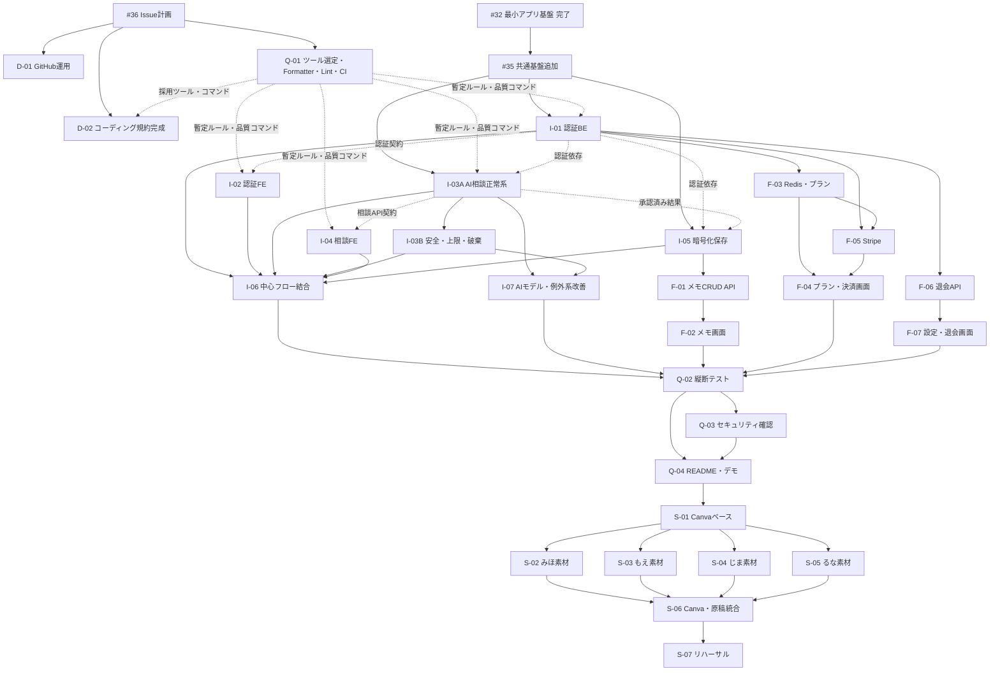

# Sprint3〜8 Issue計画

## 1. この文書について

### 1.1 目的

この文書は、「ぽろり。」の2026年10月19日のアプリレビューまでのMVP実装と、10月29日のSTAGEまでの発表準備について、次を整理するための計画書です。

- 親Issue・子Issueの構成
- 各Issueの作業範囲と対象外
- 主担当・確認担当・相談先
- Issue間の依存関係と並行作業の境界
- 各Issue内で決定する事項と、その取りまとめ担当
- 技術検証から実装への引き継ぎ
- Issue #33で確認していた論点の引き継ぎ
- 中間レビュー、アプリレビュー、STAGEまでの進行
- 共有ファイルの競合を防ぐ運用

本書をIssue #36のDraft PRでチーム確認し、承認後に親Issue・子IssueをGitHubへ登録します。

### 1.2 文書の状態

- 状態：Draft PRで最終調整中
- 対応Issue：[Issue #36](https://github.com/ms-engineer-bc26-05/Section9_TeamD/issues/36)
- 基準ブランチ：`develop`
- Issue番号：`#35`・`#36`以外は仮ID
- 担当：確認済みの担当と、回答期限付きの暫定担当を併記する
- 設計PRがOpenの箇所：関連PRの確定後にIssue詳細を更新する

### 1.3 10月1日時点の確認状況

| 内容 | 状態 | 確認者・次の確認 |
| --- | --- | --- |
| I-01の範囲・認証契約の先行共有 | 確認済み | もえさん |
| I-06の確認担当をるなさん、バックエンド相談先をもえさんとする | 確認済み | るなさん・もえさん |
| F-07の確認担当をめぐとする | 確認済み | めぐ・もえさん |
| I-03A・I-03BのQ-22・Q-13・Q-09・Q-28・Q-33をみほさんが取りまとめる | 確認済み | みほさん |
| Formatter・Lintの選定・設定・CIをQ-01へまとめ、D-02を規約文書の完成へ変更する | 調整案・確認中 | じまさん・みほさんに10月1日中の確認を依頼。るなさんは10月3日夜に確認 |
| I-03A → I-03B → F-03 → I-07の作業順 | 確認中 | みほさんに10月1日中の確認を依頼 |
| 期限までに確認担当が対応できない場合の代理確認ルール | 調整案・確認中 | 10月1日にチーム確認 |

るなさんは10月1日・2日は作業・確認ができないため、るなさんに関係する新しい調整案は、10月3日夜の再確認を前提とした暫定運用とします。不在中の未回答を承認とは扱わず、るなさんへ新しい作業を追加しません。すでに本人が対応可能と回答した担当は、確認済みとして扱います。

## 2. 目標日と進め方

| 日付 | 目標 |
| --- | --- |
| 2026年10月5日 | 中間レビュー。その時点で安全に動作する範囲と今後の計画を説明する |
| 2026年10月18日 | MVP実装・テスト・README・デモ確認を完了する |
| 2026年10月19日 | アプリレビューで一連の操作を実演できる |
| 2026年10月22日 | STAGEスライド初版を完成させる |
| 2026年10月26日 | STAGEリハーサル時点でアプリ・スライド・デモを完成させる |
| 2026年10月29日 | STAGE本番 |

10月5日に向けて実装を早期に打ち切ることはせず、10月3日・4日も10月19日の完成を目指して実装を進めます。

中間レビュー専用の大規模な結合作業や発表資料作成は行わず、その時点で安全に動作する範囲を共有します。

## 3. MVPの中心となる流れ

1. ユーザー登録・ログイン
2. 利用前の注意の確認
3. 相談テーマと具体的な内容の入力
4. AIとの段階的な対話
5. 出来事・感情・本音・背景・望みの整理
6. 整理結果を本人が確認・編集・承認
7. 「伝える・今は保留する・伝えない」の選択
8. 必要に応じた理由入力
9. 整理メモを保存するか本人が選択
10. 保存する場合だけ、承認済み整理メモを暗号化して保存
11. 保存メモの一覧・詳細・削除
12. 利用回数とプランの確認
13. Stripeテストモードによる一回払い
14. ログアウト・退会

## 4. 省略しない共通要件

- 会話全文・入力原文・入力途中・未承認内容をDB・Redis・ログへ永続保存しない
- 相談中の一時状態はAPIプロセスのメモリで保持する
- APIは1ワーカーで起動する
- デモ・デプロイ環境は1インスタンス・レプリカ数1・オートスケールなしを前提とする
- ブラウザ再読み込み後の相談復帰はMVPでは保証しない
- 一時状態を取得できない場合は、内容を漏らさずホームへ戻す
- 本人が確認・承認し、保存に同意した整理メモだけを保存する
- 保存する整理メモはアプリケーション層で暗号化する
- バックエンドで本人所有のデータであることを確認する
- AI出力を型・必須項目・文字数・許容値で検証する
- 危機的な内容への安全案内を省略しない
- ユーザー入力とシステム指示を分離する
- AI出力を権限判定やDB操作へ直接使用しない
- 秘密情報・認証トークン・暗号化鍵・相談内容をログやエラーへ出力しない
- テストには架空のデータだけを使用する

## 5. 担当・更新・決定ルール

### 5.1 担当区分

| 区分 | 役割 |
| --- | --- |
| 主担当 | Issueの実作業、判断事項の取りまとめ、テスト、PR作成、Issue更新を行う1名 |
| 確認担当 | PRをレビューする。共同実装者ではない |
| 相談先 | 技術検証や関連機能の知識を共有する。共同実装者ではない |
| 親Issue管理担当 | 子Issue、依存関係、ブロック状況を管理する。子Issueの実装を引き取らない |

原則として、1つの子Issueを実際に作業する主担当は1名とします。

### 5.2 未確定事項の決定区分

#### A：主担当が決定できる

コーディング規約、設計書、共通ディレクトリ構成、他機能との契約を変更しない範囲で、担当機能内だけに閉じる命名・関数分割・補助ファイル構成を主担当が決定できます。

APIのパス・リクエスト・レスポンス、DBのテーブル・カラム、画面遷移、利用者に見える文言、共通ディレクトリ構成、他機能へ公開する型やServiceはAに含めません。

#### B：関係者へ確認して主担当が決定する

次のように、依存する機能へ影響するものが該当します。

- 他機能から利用する型やService関数
- APIと画面のエラー対応
- 一時状態の保持時間
- テスト方法
- 機能間の呼び出し方法

主担当が推奨案・理由・影響・回答期限を提示し、関係者の意見を取りまとめて決定します。

#### C：チーム確認が必要

次に該当する場合は、主担当が案を整理したうえでチームへ確認します。

- MVPの対象範囲を変更する
- プライバシー・セキュリティ方針を変更する
- 画面・API・DB契約を大きく変更する
- 決済条件や利用回数など、プロダクト仕様を変更する
- 担当・期限・依存関係を大きく変更する

意見が分かれて期限までに決定できない場合に、リーダーへ最終調整を依頼します。

### 5.3 各Issueでの決定事項の記載方法

各Issueには、必要に応じて次の表を設けます。

| 決定事項 | 決定区分 | 取りまとめ担当 | 確認相手 | 決定期限 | 記録先 |
| --- | --- | --- | --- | --- | --- |

「後続Issueで検討」とだけ記載せず、対応Issue・担当・期限・記録先を明記します。

### 5.4 Issue更新ルール

主担当は、次の場合にIssueを更新します。

- 決定事項が確定した
- 作業範囲や完了条件に補足が必要になった
- 関連Issueとの契約を共有した
- ブロックが発生した
- テスト結果が出た
- 既知の制約や今後の改善候補が判明した

担当・範囲・依存関係・完了条件を大きく変更する場合は、変更前にチームへ共有します。

### 5.5 不具合の管理

作業中のIssueの範囲内であり、完了条件を満たすために必要な修正は、元のIssue・PRで対応します。

次の場合は、不具合を発見した人が新しいIssueへ記録します。

- 元のIssue・PRがマージ済み
- 別機能・別担当の変更が必要
- 原因調査や修正にまとまった時間が必要
- セキュリティ・プライバシー・データ消失に関係する
- 修正を後日に回す

起票者が必ず修正するのではなく、優先度と影響を確認した後、主担当を1名設定します。

不具合Issueには、発生した操作、期待する結果、実際の結果、再現手順、影響範囲、緊急度、関連Issue・PRを記載します。実際の相談内容や秘密情報は記載しません。

### 5.6 共有ファイル

次のファイルは、複数Issueから同時に変更しないようにします。

- `backend/app/main.py`
- `frontend/app/layout.tsx`
- `README.md`
- `compose.yaml`
- 共通設定ファイル
- GitHub ActionsのWorkflow
- マイグレーションの共通設定

共有ファイルの最終接続は、結合Issueまたは担当を明記したIssueで行います。

### 5.7 確認担当が対応できない場合

- 主担当は、PR作成時に希望する確認期限を共有する
- 確認担当が期限までに対応できない場合は、相談先または関連機能の担当者から代理確認者を1名決める
- PR作成者本人は代理確認者にならない
- 代理確認者と変更理由をIssue・PRへ記録する
- 代理確認でApprove済みの場合、当初の確認担当による再レビューを必須としない

これは確認待ちで実装を止めないためのレビュー運用であり、1つのIssueを複数人で共同実装する運用にはしません。

## 6. 親Issue案

| 仮ID | タイトル | 管理担当 |
| --- | --- | --- |
| E-01 | `[EPIC][Sprint3-6][MVP] 「ぽろり。」のMVPを完成させる` | めぐ |
| E-02 | `[EPIC][Sprint3-5][CORE] 中心相談フローを実装・結合する` | めぐ |
| E-03 | `[EPIC][Sprint5][FEATURE] メモ管理・利用回数・決済・退会を実装する` | めぐ |
| E-04 | `[EPIC][Sprint6][QUALITY] MVPの結合・品質確認を完了する` | めぐ |
| E-05 | `[EPIC][Sprint6-8][STAGE] 発表・デモ・質疑応答の準備を完成させる` | めぐ |

親Issueではブランチ・実装・PRを作成しません。

## 7. 子Issue一覧

| 仮ID | Sprint | 概要 | 主担当候補 | 確認担当 | 相談先 |
| --- | --- | --- | --- | --- | --- |
| #36 | Sprint3 | Issue計画を作成・確認する | めぐ | チームメンバー4名 | ― |
| #35 | Sprint3 | 共通基盤の追加対応 | みほ | もえ | るな・じま |
| D-01 | Sprint3 | GitHub運用ルール更新 | めぐ | るな | ― |
| D-02 | Sprint5 | フロント・バックのコーディング規約完成 | るな | じま | みほ・Q-01担当者 |
| Q-01 | Sprint4 | Formatter・Lint選定・共通設定・テスト・ビルドCI | じま | みほ | るな |
| I-01 | Sprint4 | 認証バックエンド | もえ | じま | みほ |
| I-02 | Sprint4 | 認証フロントエンド | るな | もえ | ― |
| I-03A | Sprint4 | AI相談の正常系・一時状態の基本構造 | みほ | もえ | じま・めぐ |
| I-03B | Sprint4-5 | 安全案内・回数上限・中断・一時状態破棄 | みほ | もえ | じま・めぐ |
| I-04 | Sprint4 | 相談フロントエンド | めぐ | るな | みほ |
| I-05 | Sprint4 | 暗号化メモ保存 | じま | みほ | もえ |
| I-06 | Sprint5 | 中心フロー結合 | めぐ | るな | もえ・I-01〜I-05担当者 |
| I-07 | Sprint5 | AIモデル最終確認・例外系・品質改善 | みほ | じま | めぐ |
| F-01 | Sprint5 | 保存メモCRUD API | もえ | じま | ― |
| F-02 | Sprint5 | 保存メモ画面 | めぐ | るな | もえ |
| F-03 | Sprint5 | Redis利用回数・プラン判定 | みほ | もえ | じま・るな |
| F-04 | Sprint5 | 利用回数・プラン・決済画面 | るな | めぐ | みほ・じま |
| F-05 | Sprint5 | Stripe一回払い・権限反映 | じま | もえ | みほ・るな |
| F-06 | Sprint5 | 退会API・無効ユーザー制御 | もえ | じま | るな |
| F-07 | Sprint5 | 設定・ログアウト・退会画面 | るな | めぐ | もえ |
| Q-02 | Sprint6 | MVP縦断・異常系テスト | るな | めぐ | 各機能担当者 |
| Q-03 | Sprint6 | セキュリティ・非保存確認 | じま | もえ | みほ |
| Q-04 | Sprint6 | README・デモ手順完成 | めぐ | るな | 各機能担当者 |
| S-01 | Sprint6-7 | Canvaスライドのベース作成 | めぐ | るな | ― |
| S-02 | Sprint7 | AI・共通基盤の発表素材 | みほ | めぐ | ― |
| S-03 | Sprint7 | 認証・メモ・DBの発表素材 | もえ | めぐ | ― |
| S-04 | Sprint7 | 暗号化・決済・安全性の発表素材 | じま | めぐ | ― |
| S-05 | Sprint7 | フロント・テストの発表素材 | るな | めぐ | ― |
| S-06 | Sprint7-8 | Canva反映・発表原稿統合 | めぐ | るな | 各素材担当者 |
| S-07 | Sprint8 | リハーサルと改善記録 | じま（進行・記録） | めぐ | 全員（参加） |

## 8. 依存関係

破線の依存関係は、相手の実装完了を待つのではなく、型・API契約・モックを先に共有して並行作業できる関係を表します。

I-06はI-03A完了後に正常系の接続確認を開始できますが、中心フローの完了判定にはI-03Bも必要です。

みほさんの担当は、I-03A、I-03B、F-03、I-07の順を基本案とします。I-03Aの正常系API契約とモックで動作する範囲は10月2日頃までの先行共有を目標とし、最小限の実API確認後にI-03Bへ移ります。I-03Bは10月5日までを目標とし、未完了の場合はSprint5前半へ継続します。その後は、F-04・F-05を待たせるF-03をI-07より先に進めます。この順番は、みほさんの最終確認後に確定します。

## 9. 技術検証から実装への引き継ぎ

| 技術検証 | 検証担当 | 主な実装先 | 引き継ぎ時の立場 |
| --- | --- | --- | --- |
| Issue #3 Docker Compose・FastAPI | じま | #35、Q-01 | 相談・確認 |
| Issue #4 OpenRouter | みほ | I-03A、I-03B、I-07 | 主担当 |
| Issue #5 Firebase Authentication | もえ | I-01、I-02、F-06 | I-01主担当・他Issue相談 |
| Issue #6 Stripe | じま | F-05、F-04 | F-05主担当・F-04相談 |
| Issue #7 暗号化・非保存 | もえ | I-05、F-01、Q-03 | 確認・相談 |
| Issue #8 Redis | みほ | F-03 | 主担当 |

## 10. Issue #33からの引き継ぎ

Issue #33では各コメントへ個別回答を追加せず、本書とDraft PRで未回答・未確定論点を引き継ぎます。本書の承認後、Issue #33へ移行先をまとめてコメントします。

| Issue #33の論点 | 対応先 | 状態・扱い | 元コメント |
| --- | --- | --- | --- |
| 1 Issueの実作業者を1名にする | D-01・本書 | 方針確定 | [共通方針](https://github.com/ms-engineer-bc26-05/Section9_TeamD/issues/33#issuecomment-5854208469) |
| MVP全体とSTAGEの親Issue | E-01〜E-05 | 10月19日基準に再編 | [MVP親Issue案](https://github.com/ms-engineer-bc26-05/Section9_TeamD/issues/33#issuecomment-5854208904) |
| 10月5日専用の親Issue・結合・デモ準備 | E-02・全体日程 | 専用Issueは原則廃止し、10月19日の完成を優先 | [中間レビュー親Issue案](https://github.com/ms-engineer-bc26-05/Section9_TeamD/issues/33#issuecomment-5854209201) |
| I-05を必須前提にしない結合 | I-06 | 旧案から引き継ぎ。新計画では保存をMVPに含めて10月19日までに結合 | [もえさんの確認](https://github.com/ms-engineer-bc26-05/Section9_TeamD/issues/33#issuecomment-5855423696) |
| AI相談の例外系の受け皿 | I-07 | 新Issue候補 | [みほさんのMVP親Issueコメント](https://github.com/ms-engineer-bc26-05/Section9_TeamD/issues/33#issuecomment-5856549121) |
| 機能別ディレクトリ構成 | Issue #35 | 採用済み | [みほさんの提案](https://github.com/ms-engineer-bc26-05/Section9_TeamD/issues/33#issuecomment-5856588964)、[決定コメント](https://github.com/ms-engineer-bc26-05/Section9_TeamD/issues/33#issuecomment-5871191731) |
| 422ハンドラ・1ワーカー・自動リロード | Issue #35 | PR #38で再レビュー待ち | [みほさんの提案](https://github.com/ms-engineer-bc26-05/Section9_TeamD/issues/33#issuecomment-5856588964) |
| I-01完成前の仮認証依存 | I-01・I-03A・I-05 | I-01が契約を10月1日中を目標に先行共有し、各Issueはdependency overrideで進める | [みほさんのコメント](https://github.com/ms-engineer-bc26-05/Section9_TeamD/issues/33#issuecomment-5856554141) |
| I-03とI-05のService境界 | I-03A・I-05 | 両Issueへ契約を記録 | [I-03コメント](https://github.com/ms-engineer-bc26-05/Section9_TeamD/issues/33#issuecomment-5856597037) |
| I-03の範囲が広いため分割したい | #35・I-03A・I-03B・I-07 | Issue単位でも段階分割 | [I-03コメント](https://github.com/ms-engineer-bc26-05/Section9_TeamD/issues/33#issuecomment-5856597037) |
| Formatter・Lintツールの決定時期 | Q-01・D-02 | Issue #32では未決定。Q-01で選定・導入し、D-02で採用内容を規約へ反映する調整案 | [るなさんのコメント](https://github.com/ms-engineer-bc26-05/Section9_TeamD/issues/33#issuecomment-5857525504) |
| るなさんの10月1日・2日の稼働制約 | I-02・D-02・確認運用 | I-02を優先し、D-02はSprint5へ移す。期限があるPRは代理確認者を設定できる | [るなさんのコメント](https://github.com/ms-engineer-bc26-05/Section9_TeamD/issues/33#issuecomment-5857525504) |
| 一時状態のTTL・同時相談数・GET延長 | I-03B | みほさんが案を取りまとめる | [じまさんの確認](https://github.com/ms-engineer-bc26-05/Section9_TeamD/issues/33#issuecomment-5871436214) |
| 状態不存在時の404・DELETEの204 | I-03B | PR #27のAPI設計へ反映済み。I-03Bでは決定済み契約として実装 | [方針案](https://github.com/ms-engineer-bc26-05/Section9_TeamD/issues/33#issuecomment-5872543749) |
| 一時状態消失時に利用回数を戻すか | F-03 | みほさんが関係者の意見を取りまとめる | [じまさんの確認](https://github.com/ms-engineer-bc26-05/Section9_TeamD/issues/33#issuecomment-5871436214) |
| 利用上限到達後に一時状態が消失した場合 | F-03・I-04 | 回数を戻さない場合も含め、新しい相談を開始できない利用者への表示・導線を決定 | [PR #25](https://github.com/ms-engineer-bc26-05/Section9_TeamD/pull/25) |
| フロントが相談IDを失いAPIメモリに状態が残る場合 | I-03B・I-04 | 残存状態が新規相談を妨げないよう、破棄・再利用・開始拒否の扱いを決定 | [PR #25](https://github.com/ms-engineer-bc26-05/Section9_TeamD/pull/25) |
| Q-22・Q-13：AI出力Schema、質問数、代替回答 | I-03A | みほさんが取りまとめ、めぐが画面契約を確認 | [るなさんのPR #37コメント](https://github.com/ms-engineer-bc26-05/Section9_TeamD/pull/37#issuecomment-5920516408) |
| Q-26：UI-006CからUI-006Bへ戻る操作 | I-04 | めぐが取りまとめ、みほさんへAPI契約を確認。該当画面の実装前に決定 | [るなさんのPR #37コメント](https://github.com/ms-engineer-bc26-05/Section9_TeamD/pull/37#issuecomment-5920516408) |
| Q-09・Q-28・Q-33：危機判定、安全案内不正時、対話上限 | I-03B | みほさんが着手時に取りまとめる | [るなさんのPR #37コメント](https://github.com/ms-engineer-bc26-05/Section9_TeamD/pull/37#issuecomment-5920516408) |
| Q-34：`creating`でSession情報が未確定の場合 | F-05 | じまさんが応答・再試行・タイムアウトを取りまとめる | [るなさんのPR #37コメント](https://github.com/ms-engineer-bc26-05/Section9_TeamD/pull/37#issuecomment-5920516408) |

## 11. 各Issue詳細案

<strong>#36：[Sprint3][DOCS] 10/19アプリレビュー・STAGEに向けたIssue計画を整理する</strong>

### 担当

- 主担当：めぐ
- 確認担当：チームメンバー4名

### 目的

10月19日のMVP完成と10月29日のSTAGEを基準に、実装・テスト・発表準備のIssue計画を確定します。

### 作業範囲

- 本計画ファイルの作成
- 親Issue・子Issue案
- 担当・依存関係
- Issue #33からの引き継ぎ
- 未確定事項の決定責任
- Sprintと優先順位
- Draft PRでのチーム確認

### やらないこと

- 実装Issueの先行登録
- アプリ実装
- マイルストーンの直接更新
- Issue #33への個別回答追加・即時Close

### このIssueで決定する事項

- Issueの分割単位
- 暫定担当
- 親子関係
- Sprint
- 登録順序

決定区分はCとし、Draft PRでチーム確認します。

### 成果物

- `docs/sprint3-8-issue-plan.md`
- Draft PR
- 承認済みIssue一覧

### 完了条件

- [ ] 全員が共通方針を確認している
- [ ] 各主担当が担当可否を確認している
- [ ] Issue #33の論点に対応先がある
- [ ] 未確定事項に取りまとめ担当がいる
- [ ] Draft PRがApprove・マージされている

### ブランチ

`docs/issue-36-sprint3-8-issue-plan`

<strong>#35：[Sprint3][COMMON] 共通エラーハンドラ・起動設定・READMEを追加し、ディレクトリ構成を整理する</strong>

### 担当

- 主担当：みほさん
- 確認担当：もえさん
- 相談先：るなさん、じまさん

### 目的

後続の認証・AI相談・メモ保存を並行実装できる、安全な共通アプリ基盤を完成させます。

### 作業範囲

- 安全な400・422エラーハンドラ
- `core/`・`features/`・`integrations/`構成
- 自動リロード切替
- 1ワーカー起動
- README更新
- health機能の移動
- import・テスト修正

実際のデモ・デプロイ環境における1インスタンス・レプリカ数1・オートスケールなしの確認は、Q-04へ引き継ぎます。

### やらないこと

- DB接続
- Firebase認証
- AI相談
- メモ保存
- 利用回数・決済

### 完了条件

- [ ] 入力値を含まない400・422を返せる
- [ ] 1ワーカーで起動する
- [ ] 自動リロードなしで起動できる
- [ ] 機能別構成へ整理されている
- [ ] READMEに一時状態の制約がある
- [ ] バックエンドテストが成功する

### ブランチ

担当者がすでに使用しているブランチを優先し、途中で変更しません。

<strong>D-01：[Sprint3][DOCS] 親子Issueと担当・更新ルールをGitHub運用ルールへ追加する</strong>

### 担当

- 主担当：めぐ
- 確認担当：るなさん

### 作業範囲

- 親Issueと子Issueの役割
- 1 Issue＝実作業者1名
- 主担当・確認担当・相談先
- 決定区分A・B・C
- Issue更新ルール
- 不具合Issueの起票条件
- 共有ファイルの編集ルール
- README更新のタイミング

### やらないこと

- コーディング規約
- アプリ実装
- 既存Issueの一括修正

### 成果物

- `docs/github-rules.md`

### 完了条件

- [ ] 担当と決定権限が区別されている
- [ ] 不具合の記録方法が分かる
- [ ] 共有ファイルの競合防止策が分かる
- [ ] 確認担当からApproveを得ている

### ブランチ案

`docs/issue-{Issue番号}-github-rules`

<strong>D-02：[Sprint5][DOCS] フロントエンド・バックエンドのコーディング規約を完成させる</strong>

### 担当

- 主担当：るなさん
- 確認担当：じまさん
- 相談先：みほさん、Q-01担当者

### 作業範囲

- TypeScript・React・Next.jsの命名と型
- Python・FastAPI・Pydanticの命名と型
- Router・Service・Schema・Modelの責務
- エラー・ログ・秘密情報
- テスト・fixture・架空データ
- Q-01で採用したFormatter・Lint・テスト・ビルドコマンドの記載
- PR前に確認するコマンドと例外時の記録方法

### このIssueで決定する事項

- 命名・型・責務分割の共通ルール
- PR前に実行する確認コマンドの説明
- 規約の例外を認める条件と記録方法

Formatter・Lintツールの選定、依存パッケージ・設定ファイルの追加、CIへの導入はQ-01でまとめて行います。D-02はI-02を優先した後に着手し、Q-01の採用結果と実装中に得た知見を規約文書へ反映します。D-02の完了はQ-01やSprint4の機能実装を開始する前提にしません。

### やらないこと

- Formatter・Lintツールの選定と設定ファイルの導入
- GitHub Actionsの実装
- 既存コードの一括整形
- アプリ機能実装

### 成果物

- `docs/coding-conventions.md`
- Q-01で採用したツール・コマンドを説明する規約

### 完了条件

- [ ] フロント・バック双方の規約がある
- [ ] ログ禁止項目がある
- [ ] Q-01で採用したツールとコマンドが反映されている
- [ ] PR前の確認コマンドが分かる
- [ ] 例外時の相談・記録方法が分かる

### ブランチ案

`docs/issue-{Issue番号}-coding-conventions`

<strong>Q-01：[Sprint4][CI] Formatter・Lintを選定し、共通設定と自動チェックを導入する</strong>

### 担当

- 主担当：じまさん
- 確認担当：みほさん
- 相談先：るなさん

### 目的

実装序盤から、PRごとにFormatter・Lint・テスト・ビルドの失敗を自動検出できるようにします。

### 作業範囲

- フロントエンド・バックエンドのFormatter・Lint候補比較と採用判断
- 採用したツールの依存パッケージ・設定ファイル
- GitHub Actions Workflow
- Formatterチェック
- バックエンドLint・pytest
- フロントエンドLint・Next.jsビルド
- READMEまたは運用資料への実行内容追記

ツール選定・設定・CIを同じIssueで扱い、担当間の確認待ちを減らします。まず、実行方法が決まっているpytestとNext.jsビルドのWorkflowを先行し、その後に採用したFormatter・Lintを追加できます。

この範囲変更は、じまさん・みほさんの10月1日中の確認と、るなさんの10月3日夜の事後確認を前提とする調整案です。るなさんの確認で規約側に必要な修正が見つかった場合はD-02へ反映しますが、Q-01で導入済みの設定を無断で入れ替えません。

Q-01完了前は、次を暫定ルールとします。

- 既存コードの書き方へ合わせる
- 無関係な一括整形を行わない
- Q-01以外でFormatter・Lint依存を追加しない
- フロントエンドは利用可能な範囲でNext.jsビルド、バックエンドはpytestを実行する
- 実行できないチェックはPRへ未確認として記載する

### やらないこと

- OpenRouter・Firebase・Stripeへの実通信
- APIキーのGitHub登録
- デプロイ
- CD
- 既存コードの無関係な一括修正

### このIssueで決定する事項

- Workflowのトリガー
- 必須チェック
- タイムアウト
- キャッシュの最小構成
- フロントエンドで使用するFormatter・Lintツールとコマンド
- バックエンドで使用するFormatter・Lintツールとコマンド

### 完了条件

- [ ] PRで自動実行される
- [ ] 採用ツール・理由・ローカル実行コマンドをIssue・PRへ記録している
- [ ] 採用したコマンドをCIで使用している
- [ ] 外部APIへ接続しない
- [ ] 秘密情報を必要としない
- [ ] 故意に失敗させた場合に検出できる
- [ ] 正常時に成功する

### ブランチ案

`ci/issue-{Issue番号}-quality-checks`

<strong>I-01：[Sprint4][BACKEND][AUTH] Firebase認証と内部ユーザー基盤を実装する</strong>

### 担当

- 主担当：もえさん
- 確認担当：じまさん
- 相談先：みほさん

### 作業範囲

- Firebase IDトークン検証
- 内部ユーザー作成・取得
- `POST /users/me`
- `PATCH /users/me`
- `has_seen_notice`
- `CurrentUser`
- `get_current_user`
- DB接続・セッション
- 初期マイグレーション
- 認証・認可テスト

DB接続・セッションは`core/database.py`、認証依存は`features/auth/dependencies.py`、`/users/me`は`features/users/`へ配置します。ORM・マイグレーションの共通基盤とユーザー用の初期マイグレーションはI-01で担当します。

### このIssueで決定する事項

- SQLAlchemy／asyncpgの採用
- `CurrentUser`の公開契約
- 認証依存の配置
- 失効・無効ユーザーの確認方法
- Firebase用サービスアカウントの最小権限

I-03A・I-05へ、次の最小契約を10月1日中を目標に先行共有します。

- `get_current_user`の呼び出し方
- `CurrentUser`の項目と、内部ユーザーIDの名前・型
- 認証失敗時の401・403の使い分け

Issue登録前に共有期限を迎える場合は、PR #37の該当スレッドで暫定契約を共有し、I-01登録後にIssue本文またはコメントへ転記します。契約共有までは、I-03A・I-05のテストで`dependency_overrides`と暫定的な`CurrentUser`を使用して並行作業します。各機能固有のModel・マイグレーションは各機能Issueで作成し、共通設定ファイルの変更は関係するIssue担当者と調整します。

### やらないこと

- ログイン画面
- AI相談
- メモ保存
- 本番Firebase設定
- 決済・退会

### 完了条件

- [ ] 有効なトークンから本人を取得できる
- [ ] 無効・期限切れ・未指定を拒否できる
- [ ] 本人以外の情報を返さない
- [ ] トークンをログへ出さない
- [ ] I-03A・I-05が認証依存を利用できる
- [ ] 単体テストが成功する

### ブランチ案

`feature/issue-{Issue番号}-backend-auth`

<strong>I-02：[Sprint4][FRONTEND][AUTH] ログイン・ホーム・利用前注意を実装する</strong>

### 担当

- 主担当：るなさん
- 確認担当：もえさん

### 作業範囲

- UI-001
- UI-002の最小構成
- UI-003
- Firebase SDK
- 認証状態
- IDトークン付与
- `/users/me`接続
- 注意確認状態
- 読み込み・認証失敗・通信失敗

### このIssueで決定する事項

- 認証Providerの配置
- Route Groupの構成
- ログイン失敗時の画面挙動
- トークン更新方法
- I-04が利用する認証済みAPI呼び出し方法

### やらないこと

- AI相談画面
- メモ・プラン・決済
- パスワード再設定
- 本番Firebase設定

### 完了条件

- [ ] 登録・ログインできる
- [ ] 認証後にホームへ進める
- [ ] 利用前の注意を確認できる
- [ ] APIへトークンを付与できる
- [ ] 秘密情報を画面・ログへ出さない
- [ ] テスト・Lint・Buildが成功する

### ブランチ案

`feature/issue-{Issue番号}-frontend-auth-notice`

<strong>I-03A：[Sprint4][BACKEND][AI] 一時状態管理とAI相談の正常系APIを実装する</strong>

### 担当

- 主担当：みほさん
- 確認担当：もえさん
- 相談先：じまさん、めぐ

### 目的

I-04・I-05が早期に接続できるよう、相談中の一時状態とAI相談の正常系APIを先行して実装します。

### 作業範囲

- 一時状態の基本構造
- 相談開始
- 出来事整理・訂正の正常系
- 要約確認
- 感情入力
- 本音・背景・望み
- 整理結果
- 本人による編集・承認
- 扱い方選択
- AI構造化出力検証
- モックテスト
- 正常系の最小実API確認
- 非同期HTTPクライアントによるAI呼び出し
- 相談ID単位の排他制御の基本構造
- I-04・I-05へ公開する契約

### このIssueで決定する事項

- 一時状態のデータ構造
- ConsultationStatusの内部表現
- AI出力Schema
- 通常のAI出力と安全案内を識別する方法
- `POST /consultations`の最初の質問を返すSchema
- `event-dialogue`の`ai_understanding`と次の質問を返すSchema
- `guided-dialogue`の次の質問と整理完了判定を返すSchema
- 本音・背景・望みの標準質問数と「まだ分からない」などの代替回答
- I-04へ返す正常系レスポンス
- I-05へ渡す承認済み結果のService契約
- 相談ID単位のロック方式・タイムアウト
- AI呼び出し中にロックを保持するか

Q-22・Q-13は、みほさんが案を取りまとめ、I-04で利用する契約をめぐが確認します。通常出力と安全案内の識別は、AI出力へ`kind`（`normal`／`safety`）を必須項目として含める案を第一候補とし、I-03Aで関係者へ確認して確定します。

実API確認では、Issue #4の暫定候補`gpt-oss-120b`と架空の相談文を使用し、正常系を1回通します。最大5リクエスト程度、概算上限額はIssue #4と同程度の$0.01未満を想定し、Schema不正が続く場合は中断してI-07へ引き継ぎます。`require_parameters`の指定位置とstrictモードの有効性を含め、対象モデル・最大リクエスト数・概算上限額・成功条件・停止条件を実行前にIssueへ記録します。`async def`内で`requests`などの同期I/Oを使用せず、AI応答待ちで1ワーカー全体を止めない実装にします。グローバルロックは使用せず、他の相談を同時に処理できる構造とします。

### やらないこと

- 会話全文のDB・Redis保存
- 暗号化メモ保存
- 利用回数・決済
- 安全案内・回数上限・破棄の網羅
- AI出力による権限判定
- 実APIを使った例外系・タイムアウトの網羅確認

### 完了条件

- [ ] 一連の正常系相談状態が進行する
- [ ] 会話全文を永続保存しない
- [ ] AI出力をSchemaで検証する
- [ ] 最初の質問・理解と次の質問・整理完了・安全案内の出力を識別できる
- [ ] ユーザー入力をsystemロールへ連結していない
- [ ] 最大回数と停止条件の範囲内で正常系の実API確認を記録している
- [ ] AI応答待ちで他の相談を停止させない
- [ ] 同じ相談への同時更新で状態が競合しない
- [ ] I-04が正常系へ接続できる
- [ ] I-05が承認済み結果を取得できる
- [ ] モックテストが成功する

### ブランチ案

`feature/issue-{Issue番号}-ai-consultation-core`

<strong>I-03B：[Sprint4-5][BACKEND][AI] AI相談の安全案内・回数上限・中断・一時状態破棄を実装する</strong>

### 担当

- 主担当：みほさん
- 確認担当：もえさん
- 相談先：じまさん、めぐ

### 作業範囲

- 危機的内容の検知
- 安全案内
- 訂正回数・質問回数の上限
- 一時状態のTTL
- 1ユーザーの同時相談数
- 新規相談開始時の既存相談
- フロントが相談IDを失い、APIメモリに一時状態だけが残った場合の扱い
- GETでは保持時間を延長せず、更新成功時に最終操作時刻を更新
- 状態不存在時の安全な404
- `DELETE /consultations/{id}`の冪等な204
- 中断・終了・破棄
- 関連する異常系テスト

### このIssueで決定する事項

- 危機的内容の検知方式
- 危機的内容の判定を行うAPI
- 相談開始時に安全案内へ切り替わる場合のHTTPステータス
- 安全案内の不正出力時に安全側へ倒す条件
- 本音・背景・望みの対話の最大往復回数
- 一時状態のTTL
- 同時相談数
- 新規相談開始時の既存相談
- 残存状態を破棄・再利用・開始拒否のどれで扱うか
- AI呼び出し中の同時更新で、処理後の状態を再確認して404・409を返す条件

Q-09・Q-28・Q-33は、みほさんが着手時に案を取りまとめます。安全案内の不正出力は、`risk_detected=true`を安全に読み取れる場合は固定の安全案内を返し、それ自体を読み取れない場合は502とする案を第一候補として確認します。

通常APIの404、`DELETE /consultations/{id}`の冪等な204、GETでTTLを延長しないことは、PR #27のAPI設計で決定済みの契約として実装します。TTL・同時相談数・新規相談開始時の既存相談の扱いは、I-03B着手時に担当者が案を共有します。利用者に見える文言・遷移と、残存状態が新しい相談を妨げる場合の扱いはI-04担当へ確認します。API・画面・テスト設計へ影響する決定は、関連担当者へ期限付きで確認して記録します。

### やらないこと

- 利用回数のRedis実装
- 一時状態消失時の利用回数の補償実装
- メモ保存
- AIモデルの広範な再比較

### 完了条件

- [ ] 安全案内を返せる
- [ ] 回数上限をサーバー側で管理する
- [ ] 同じ相談への同時リクエストでも回数上限を超えない
- [ ] 状態不存在時に相談内容を漏らさない
- [ ] フロントが相談IDを失っても残存状態が新しい相談を不当に妨げない
- [ ] 中断・終了・一定時間経過で破棄できる
- [ ] DELETEを安全に繰り返せる
- [ ] 決定事項をIssue・PRへ記録している
- [ ] 異常系テストが成功する

### ブランチ案

`feature/issue-{Issue番号}-ai-consultation-safety`

<strong>I-04：[Sprint4][FRONTEND][CONSULTATION] 相談開始から扱い方・保存選択までを実装する</strong>

### 担当

- 主担当：めぐ
- 確認担当：るなさん
- 相談先：みほさん

### 作業範囲

- UI-004〜UI-009
- 相談テーマ
- 具体的な内容
- 段階的対話
- 要約確認・編集
- 感情
- 本音・背景・望み
- 整理結果
- 扱い方
- 理由・保存確認
- 中断
- 読み込み・エラー・二重送信防止

### このIssueで決定する事項

- 相談画面内の状態分割
- APIエラーと利用者向け表示の対応
- 一時状態消失時のUI-002への復帰
- 利用上限到達後に一時状態が消失し、新しい相談を開始できない場合の表示・導線
- フロントが相談IDを失い、API側に状態が残っている場合の新規相談開始時の表示・導線
- 戻る操作・直接URLの扱い
- UI-006CからUI-006Bへ戻る操作を残してAPI遷移を追加するか、画面から戻る操作をなくすか
- 承認後に編集状態を復元しない処理
- アクセシビリティ上必要な操作・表示

UI-006CからUI-006Bへの戻る操作は、I-04の他の作業を止めず、該当画面の実装前にめぐが案を取りまとめてみほさんへ確認します。API遷移を追加する場合は、質問数・訂正回数・`can_ask_more`を戻る前の値のまま引き継ぐ案を確認し、マージ済みの画面・API設計へ別Issueまたは別PRで差分を反映します。

### やらないこと

- メモ一覧・詳細
- プラン・決済・退会
- API内部ロジック
- ブラウザ再読み込み後の相談復帰

### 完了条件

- [ ] 相談開始から扱い方選択まで操作できる
- [ ] 承認前後の状態が区別される
- [ ] 原因・内部情報を画面へ出さない
- [ ] 一時状態消失後に相談を開始できない場合も、次にできる操作を案内する
- [ ] 中断できる
- [ ] 戻る操作で承認済み状態を再編集できない
- [ ] テスト・Lint・Buildが成功する

### ブランチ案

`feature/issue-{Issue番号}-consultation-ui`

<strong>I-05：[Sprint4][BACKEND][MEMO] 承認済み整理メモを暗号化して保存する</strong>

### 担当

- 主担当：じまさん
- 確認担当：みほさん
- 相談先：もえさん

### 作業範囲

- `POST /consultations/{id}/save`
- 承認済み結果の取得
- 保存同意確認
- Fernet暗号化
- 本人所有確認
- メモModel・マイグレーション
- 二重保存防止
- 暗号文とユーザーID・メモIDの結び付け
- 保存成功後の一時状態破棄
- 暗号化・非保存テスト

### このIssueで決定する事項

- I-03A Serviceの利用方法
- 暗号化対象列
- 暗号化・復号失敗時の扱い
- 二重保存を防ぐ識別方法
- DB保存と一時状態破棄の順序
- 保存再試行時の扱い
- 保存済みメモの確認を一時状態の確認より先に行う手順

### やらないこと

- 未承認内容の保存
- 会話全文の保存
- メモ一覧・詳細・削除
- 鍵のGit・DB保存
- 本番鍵管理

### 完了条件

- [ ] 承認・保存同意済みの場合だけ保存する
- [ ] 平文列が存在しない
- [ ] 本人以外の状態を保存できない
- [ ] 保存失敗時に保存済みと返さない
- [ ] 二重保存を防止する
- [ ] 保存成功後の再試行では一時状態がなくても既存メモを返せる
- [ ] 暗号文を別ユーザー・別メモの行へ移した場合に復号・照合を拒否する
- [ ] 本文・鍵・暗号文をログへ出さない
- [ ] テストが成功する

### ブランチ案

`feature/issue-{Issue番号}-encrypted-memo-save`

<strong>I-06：[Sprint5][INTEGRATION] ログインから整理メモ保存までの中心フローを結合する</strong>

### 担当

- 主担当：めぐ
- 確認担当：るなさん
- 相談先：もえさん、I-01〜I-05担当者

### 作業範囲

- バックエンドRouter登録
- フロントのProvider・Layout最終接続
- 認証付きAPI Clientの共通利用
- ログインから相談終了までの接続
- 保存フロー接続
- 結合時に必要な最小修正

I-03A完了後に正常系の接続確認を開始できます。中心フローの完了判定にはI-03Bも必要です。

### やらないこと

- 各機能の大規模な仕様変更
- 新機能追加
- メモ一覧・決済・退会
- 全異常系の網羅

### このIssueで決定する事項

- 共有Router・Layoutの接続順
- 結合確認に使用する最小シナリオ
- 接続不具合を元Issueへ戻すか、このIssueで直すか

### 完了条件

- [ ] ログインから扱い方選択まで接続されている
- [ ] 保存する・保存しないを正しく処理できる
- [ ] 保存未完成時に保存済みと見せない
- [ ] I-03Bの安全案内・破棄処理が接続されている
- [ ] 共有ファイルの変更者が1名に限定されている
- [ ] 結合確認結果を記録している

### ブランチ案

`feature/issue-{Issue番号}-core-integration`

<strong>I-07：[Sprint5][BACKEND][AI] AIモデルを最終確認し、相談APIの例外系と品質を改善する</strong>

### 担当

- 主担当：みほさん
- 確認担当：じまさん
- 相談先：めぐ

### 作業範囲

- I-03A・I-03Bで後続化した例外系
- AIモデル最終確認
- strict・構造化出力の実API確認
- AIタイムアウト・再試行
- 実APIでの最小確認
- OpenRouter・提供元のデータ取扱確認
- 実測した応答時間・料金
- 既知の制約記録

### やらないこと

- 無制限のモデル比較
- 承認のない高額検証
- 実際の相談内容を使ったテスト
- AI品質を理由としたMVP全体の作り直し

### 完了条件

- [ ] 検証条件・最大回数・停止条件を事前記録している
- [ ] 採用モデルと理由を記録している
- [ ] strict・構造化出力を確認している
- [ ] 残る制約をREADME・発表素材へ引き継いでいる

### ブランチ案

`feature/issue-{Issue番号}-ai-quality`

<strong>F-01：[Sprint5][BACKEND][MEMO] 保存メモ一覧・詳細・削除APIを実装する</strong>

### 担当

- 主担当：もえさん
- 確認担当：じまさん

### 作業範囲

- `GET /memos`
- `GET /memos/{id}`
- `DELETE /memos/{id}`
- 復号
- 本人所有確認
- 存在・他人データの404
- 削除失敗・再試行
- 単体テスト

### このIssueで決定する事項

- 一覧で返す項目
- 復号失敗時の安全なエラー
- 削除の冪等性
- 一覧順序

### やらないこと

- 保存済みメモの再編集
- 検索・絞り込み
- ページネーションの高度化
- 他人のデータ存在を示す応答

### 完了条件

- [ ] 本人のメモだけを返す
- [ ] 他人のメモを404で拒否する
- [ ] 復号後の本文をログへ出さない
- [ ] 削除後に取得できない
- [ ] 単体テストが成功する

### ブランチ案

`feature/issue-{Issue番号}-memo-crud-api`

<strong>F-02：[Sprint5][FRONTEND][MEMO] 保存メモ一覧・詳細・削除画面を実装する</strong>

### 担当

- 主担当：めぐ
- 確認担当：るなさん
- 相談先：もえさん

### 作業範囲

- UI-010
- UI-011
- 一覧
- 詳細
- 削除確認
- 空状態
- 読み込み・取得失敗・削除失敗

### このIssueで決定する事項

- 一覧表示項目
- 削除確認文言
- 空状態の表示
- 404時の遷移
- 長文表示

### やらないこと

- メモ再編集
- 検索・タグ・高度な絞り込み
- エクスポート・共有

### 完了条件

- [ ] 本人の一覧と詳細を表示できる
- [ ] 削除確認後に削除できる
- [ ] 失敗時に削除済みと表示しない
- [ ] 空状態・エラー状態を表示できる
- [ ] テスト・Lint・Buildが成功する

### ブランチ案

`feature/issue-{Issue番号}-memo-ui`

<strong>F-03：[Sprint5][BACKEND][USAGE] Redis利用回数制限とプラン判定を実装する</strong>

### 担当

- 主担当：みほさん
- 確認担当：もえさん
- 相談先：じまさん、るなさん

### 作業範囲

- `GET /usage`
- Redisキー
- 原子的な加算・上限判定
- TTL
- プラン別上限
- 上限超過時に回数を加算しない原子的な判定
- フェイルオープン
- Redis接続タイムアウト
- 利用回数テスト

### このIssueで決定する事項

- 無料・有料プランの上限
- TTL・リセット周期
- 加算タイミング
- AI失敗・安全案内・一時状態消失時に回数を戻すか
- 利用上限に達した相談で一時状態が消失した場合に回数を戻すか
- 回数を戻さない場合の利用者向け表示・導線
- Redis障害時の動作
- 画面へ返す表示情報

利用条件そのものを変更する場合はC区分としてチーム確認します。

### やらないこと

- 会話内容のRedis保存
- 決済処理
- サブスクリプション
- Redis障害時の複雑な補償処理

### 完了条件

- [ ] ユーザーごとに回数が分離される
- [ ] 上限判定が原子的に行われる
- [ ] 上限超過で拒否したリクエストを回数へ加算しない
- [ ] Redisへ相談内容を保存しない
- [ ] 障害時の方針を実装・記録している
- [ ] 回数を戻す条件を決定・記録している
- [ ] テストが成功する

### ブランチ案

`feature/issue-{Issue番号}-redis-usage-limit`

<strong>F-04：[Sprint5][FRONTEND][PLAN] 利用回数・プラン・一回払い画面を実装する</strong>

### 担当

- 主担当：るなさん
- 確認担当：めぐ
- 相談先：みほさん、じまさん

### 作業範囲

- UI-002の利用状況
- UI-012
- 残り回数
- 無料・有料状態
- 一回払い案内
- Checkoutへの遷移
- 成功・キャンセル・確認中・失敗
- 支払い後の状態再取得

### このIssueで決定する事項

- 回数・期間の表示
- Checkout前の説明
- 成功・キャンセル後の遷移
- 支払い確認中の表示
- 決済を促しすぎない表現

### やらないこと

- サブスク解約
- カード情報の自前入力
- Stripe内部状態の画面表示
- 実決済

### 完了条件

- [ ] 現在の利用状況を表示できる
- [ ] テストモードのCheckoutへ進める
- [ ] 成功・キャンセル・失敗を区別する
- [ ] 支払い確認前に有料表示へ切り替えない
- [ ] テスト・Lint・Buildが成功する

### ブランチ案

`feature/issue-{Issue番号}-plan-payment-ui`

<strong>F-05：[Sprint5][BACKEND][PAYMENT] Stripe一回払いと利用権限反映を実装する</strong>

### 担当

- 主担当：じまさん
- 確認担当：もえさん
- 相談先：みほさん、るなさん

### 作業範囲

- Stripe Checkout Session
- テストモード一回払い
- 決済結果確認
- 認証・本人確認
- 支払い記録
- 有料権限反映
- 二重反映防止
- Checkout Sessionの二重作成防止
- モックテスト
- 最小実決済確認

### このIssueで決定する事項

- 一回払い条件
- Checkout Sessionのmetadata
- 決済確認方法
- 二重確認・二重反映防止
- `creating`・`pending`の既存Sessionを再利用する条件
- `creating`でSession ID・URLが未確定の場合に、待機・再取得・エラーのどれを返すか
- `creating`状態のタイムアウトと再試行条件
- WebhookをMVPへ含めるか
- 支払い記録と利用権限の更新順序

Webhookは最小構成完了後の追加候補とします。

### やらないこと

- 実際の請求
- サブスクリプション
- 返金管理画面
- カード情報の保存

### 完了条件

- [ ] テスト決済成功時だけ権限が反映される
- [ ] キャンセル・失敗時は反映されない
- [ ] 本人の決済だけを確認できる
- [ ] 二重反映しない
- [ ] 同時リクエストでもCheckout Sessionを重複作成しない
- [ ] `creating`でSession ID・URLが未確定の場合の応答と再試行をテストしている
- [ ] 秘密鍵・Session情報をログへ出さない
- [ ] モックテストと最小実接続確認を記録する

### ブランチ案

`feature/issue-{Issue番号}-stripe-one-time-payment`

<strong>F-06：[Sprint5][BACKEND][ACCOUNT] 退会APIと無効ユーザー制御を実装する</strong>

### 担当

- 主担当：もえさん
- 確認担当：じまさん
- 相談先：るなさん

### 作業範囲

- `DELETE /users/me`
- `deleting`・`deleted`
- メモ削除
- 利用権限・ユーザー状態
- Firebaseユーザー処理
- 再実行
- 退会済みトークンの拒否
- 単体テスト

### このIssueで決定する事項

- 削除順序
- 途中失敗時の再開地点
- Firebase削除権限
- 退会前の同一Firebase UID・旧トークンによる内部ユーザーの再作成防止
- 決済記録の保持範囲

### やらないこと

- サブスク解約
- 管理者画面
- 復元機能
- 一括削除ツール

### 完了条件

- [ ] 本人だけが退会できる
- [ ] メモが先に削除される
- [ ] 途中失敗後に再実行できる
- [ ] 退会後の利用を拒否できる
- [ ] 他人のデータへ影響しない
- [ ] テストが成功する

### ブランチ案

`feature/issue-{Issue番号}-account-deletion`

<strong>F-07：[Sprint5][FRONTEND][ACCOUNT] 設定・ログアウト・退会画面を実装する</strong>

### 担当

- 主担当：るなさん
- 確認担当：めぐ
- 相談先：もえさん

### 作業範囲

- UI-013
- ログアウト
- 退会確認
- 実行中・失敗・完了
- 再操作防止
- 退会後の画面遷移

### このIssueで決定する事項

- 退会確認文言
- 誤操作防止
- 失敗時の再試行表示
- ログアウトと退会の区別
- 退会後の遷移

### やらないこと

- アカウント復元
- 管理者機能
- パスワード変更

### 完了条件

- [ ] ログアウトできる
- [ ] 確認なしで退会しない
- [ ] 二重送信を防止する
- [ ] 失敗時に退会済みと表示しない
- [ ] 完了後に認証済み画面へ戻れない
- [ ] テスト・Lint・Buildが成功する

### ブランチ案

`feature/issue-{Issue番号}-settings-account-ui`

<strong>Q-02：[Sprint6][TEST] MVP縦断・異常系シナリオを確認する</strong>

### 担当

- 主担当：るなさん
- 確認担当：めぐ
- 相談先：各機能担当者

### 作業範囲

- PR #31で確定するP0・P1シナリオ
- 正常系縦断
- 保存する・保存しない
- 認証失敗
- 一時状態消失
- 利用上限到達後の一時状態消失
- フロントが相談IDを失いAPI側に状態が残る場合の新規相談開始
- AI失敗
- メモ取得・削除失敗
- 利用回数上限
- 決済成功・キャンセル
- Checkout Sessionの同時作成・再利用
- 退会
- PC・スマートフォン相当表示
- 結果記録

### やらないこと

- 実際の相談内容
- 実決済
- 新機能追加
- 発見した不具合の一括修正

### 完了条件

- [ ] シナリオと期待結果がある
- [ ] 実行結果を記録している
- [ ] 不具合を元Issueまたは新Issueへ切り分けている
- [ ] 既知の制約を失敗と区別している
- [ ] 再確認結果を記録している

### ブランチ案

文書を更新する場合は `test/issue-{Issue番号}-mvp-scenarios`

<strong>Q-03：[Sprint6][SECURITY] 認証認可・暗号化・非保存・ログを確認する</strong>

### 担当

- 主担当：じまさん
- 確認担当：もえさん
- 相談先：みほさん

### 作業範囲

- PR #31で確定するセキュリティ・非保存テスト
- 他人データの404
- リクエスト内user_idの不信頼
- 未承認内容の非保存
- Redisの保存内容
- 暗号文のみのDB保存
- 暗号文とユーザーID・メモIDの結び付け
- ログ・エラー
- 秘密情報
- プロンプトインジェクション
- XSS・SQLインジェクション対策
- 退会後の拒否

### やらないこと

- 本格的な外部脆弱性診断
- 本番環境への攻撃試験
- 実データの使用

### 完了条件

- [ ] 確認観点と結果を記録している
- [ ] 会話全文・平文・トークン・鍵が残らない
- [ ] 所有者確認をバックエンドで行っている
- [ ] 問題を不具合Issueへ切り分けている
- [ ] MVPで対応しない制約を記録している

### ブランチ案

`test/issue-{Issue番号}-security-privacy-check`

<strong>Q-04：[Sprint6][DOCS][REVIEW] READMEとアプリレビュー用デモ手順を完成させる</strong>

### 担当

- 主担当：めぐ
- 確認担当：るなさん
- 相談先：各機能担当者

### 作業範囲

- 環境構築・起動
- 自動リロードあり／なし
- 1ワーカー・1インスタンス・レプリカ数1・オートスケールなしのデモ・デプロイ条件
- テスト・Lint・Build
- MVP機能
- 技術選定理由
- プライバシー・安全性
- 既知の制約
- デモ手順
- デモ用架空データ
- 今後の改善候補

### やらないこと

- READMEでの新仕様決定
- 実装Issueの未完了を完了扱いにする
- 実際の相談内容の掲載
- STAGEスライド本体の完成

### 完了条件

- [ ] READMEだけで起動・確認できる
- [ ] 制約が最新である
- [ ] デモ・デプロイ環境が一時状態の運用条件を満たす
- [ ] デモ手順を実行済み
- [ ] デモ用データが架空である
- [ ] 10月19日に説明できる

### ブランチ案

`docs/issue-{Issue番号}-readme-app-review`

## 12. STAGE準備Issue詳細

<strong>S-01：[Sprint6-7][STAGE] Canvaスライドの構成とデザインベースを作成する</strong>

### 担当

- 主担当：めぐ
- 確認担当：るなさん

### 作業範囲

- Canvaファイル
- 全体構成
- デザイン・配色・フォント
- 各担当者の素材提出枠
- 発表時間に合わせた枚数
- GitHub Issueとの対応表

### 運用

Canva本体の初期編集は主担当が行います。各機能担当者は、自分の素材Issueへ文章・図・根拠を提出します。

### 完了条件

- [ ] 発表構成がある
- [ ] 各担当者の説明範囲がある
- [ ] 素材の提出方法が決まっている
- [ ] CanvaのリンクをIssueへ記録している

<strong>S-02：[Sprint7][STAGE] 共通基盤・AI相談の説明・質疑応答素材を作成する</strong>

### 担当

- 主担当：みほさん
- 確認担当：めぐ

### 成果物

- 共通基盤とAI相談の必要性
- OpenRouter選定理由
- 構造化出力
- 一時状態・非保存
- 安全案内
- 工夫・テスト・制約
- 想定質問と回答

成果物はIssue本文またはコメントへ記録し、Canva本体は直接編集しません。

<strong>S-03：[Sprint7][STAGE] 認証・メモ・DBの説明・質疑応答素材を作成する</strong>

### 担当

- 主担当：もえさん
- 確認担当：めぐ

### 成果物

- Firebase認証
- 内部ユーザー
- 所有者確認
- メモCRUD
- DB設計
- 退会
- 工夫・テスト・制約
- 想定質問と回答

成果物はIssue本文またはコメントへ記録し、Canva本体は直接編集しません。

<strong>S-04：[Sprint7][STAGE] 暗号化・決済・セキュリティの説明・質疑応答素材を作成する</strong>

### 担当

- 主担当：じまさん
- 確認担当：めぐ

### 成果物

- Fernet暗号化
- 非保存確認
- Stripe一回払い
- 権限反映
- セキュリティ確認
- 工夫・テスト・制約
- 想定質問と回答

成果物はIssue本文またはコメントへ記録し、Canva本体は直接編集しません。

<strong>S-05：[Sprint7][STAGE] フロントエンド・画面設計・テストの説明素材を作成する</strong>

### 担当

- 主担当：るなさん
- 確認担当：めぐ

### 成果物

- Next.js
- 認証画面
- プラン・設定画面
- UI・アクセシビリティ
- テスト設計・縦断テスト
- 工夫・制約
- 想定質問と回答

成果物はIssue本文またはコメントへ記録し、Canva本体は直接編集しません。

<strong>S-06：[Sprint7-8][STAGE] 担当者の素材をCanvaと発表原稿へ統合する</strong>

### 担当

- 主担当：めぐ
- 確認担当：るなさん
- 相談先：各素材担当者

### 作業範囲

- Canva反映
- 表現・用語の統一
- 発表原稿
- デモとの接続
- 発表時間調整
- 担当者ごとの説明範囲

### 完了条件

- [ ] 全素材が反映されている
- [ ] 技術・仕様の説明が一致している
- [ ] 発表時間内に収まる
- [ ] 各担当者が自分の説明内容を確認している

<strong>S-07：[Sprint8][STAGE] リハーサルを実施し改善点を記録する</strong>

### 担当

- 進行・記録担当：じまさん
- 確認担当：めぐ
- 参加者：全員

このIssueの主担当は、リハーサルの進行と改善点の記録を担当します。各メンバーが同じ成果物を共同編集するIssueではありません。

### 作業範囲

- 発表時間
- デモ動作
- 担当間の受け渡し
- 想定質疑
- 回答できなかった質問
- アプリ・スライド・原稿の修正先
- 最終確認

### 完了条件

- [ ] リハーサルを実施している
- [ ] 改善点に担当者と期限がある
- [ ] デモ失敗時の代替手順がある
- [ ] 各担当者が自分の質疑応答範囲を説明できる
- [ ] 10月26日時点で本番相当の確認が完了している

## 13. Issue登録と確認の進め方

1. 本書をIssue #36のブランチへ追加する
2. Draft PRを作成する
3. 全員が共通方針・自分の担当・直接依存Issueを確認する
4. 修正内容を反映する
5. Ready for Reviewへ変更する
6. Approve後にマージする
7. 承認済み計画から親Issue・子Issueを登録する
8. 実際のIssue番号・リンクを本書へ追記する
9. Issue #33へ未回答論点の引き継ぎ先をまとめてコメントする
10. Issue #33をCloseする
11. Issue #15／PR #29のマイルストーンを更新する
12. Issue依存関係図・進行図を作成する

## 14. Draft PRで確認すること

### 14.1 全員が確認すること

- 10月19日を基準とした進行でよいか
- 1 Issue＝実作業者1名になっているか
- Sprint・担当量・依存関係に無理がないか
- 未確定事項の決定担当が明確か

### 14.2 各主担当が確認すること

- 自分が担当可能か
- 作業範囲・やらないことが適切か
- 決定事項を取りまとめられるか
- 必要な前提や相談先が不足していないか
- 変更ファイルが他Issueと競合しないか

### 14.3 技術検証担当者が確認すること

- 検証結果が正しく引き継がれているか
- 実装時に必要な注意事項が不足していないか
- 検証時の制約が確定事項として扱われていないか

## 15. Sprintごとの進行案

### Sprint3：9月27日〜9月30日

- Issue計画
- Issue #35
- GitHub運用ルール
- 機能間契約の先行共有

### Sprint4：10月1日〜10月5日

- CIの早期導入
- Q-01でFormatter・Lintを選定し、設定・CIまで同じ担当で導入
- 認証バックエンド・フロントエンド
- AI相談正常系
- AI相談の安全・終了処理
- 相談フロントエンド
- 暗号化メモ保存
- 10月5日は、その時点で安全に動作する範囲を共有

10月1日は計画の最終確認とIssue登録、10月2日はPR #38マージ後にQ-01・I-01・I-03A・I-05を開始する目安とします。るなさんは10月3日夜からI-02へ着手し、認証済みAPI呼び出しの型・関数シグネチャを10月4日午前までに先行共有、I-02全体は10月6日頃の完了を目標とします。

### Sprint5：10月6日〜10月11日

- 中心フロー結合
- フロント・バックのコーディング規約完成
- Redis利用回数制限
- AIモデル・例外系・品質改善
- 保存メモCRUD
- Stripe一回払い
- 設定・ログアウト・退会

### Sprint6：10月12日〜10月18日

- MVP縦断・異常系テスト
- セキュリティ・非保存確認
- 発見した不具合の修正
- README・デモ手順
- STAGE素材準備開始
- MVP完成判定

### Sprint7：10月20日〜10月22日

- Canvaスライド初版
- 各担当者の説明・質疑応答素材
- 発表原稿
- スライド発表レビュー

### Sprint8：10月23日〜10月28日

- スライド・原稿修正
- デモ最終確認
- リハーサル
- 質疑応答確認
- 予備・最終修正

## 16. 計画PRマージ後に作成する資料

- Sprint3以降のIssue一覧
- 主担当・確認担当・相談先一覧
- 技術検証から実装への引き継ぎ表
- A4横1枚のIssue依存関係図
- 中間レビューからMVP完成までの進行図
- MVP完成からSTAGEまでの進行図

## 17. 参照

- [Issue #2：MVP共通前提](https://github.com/ms-engineer-bc26-05/Section9_TeamD/issues/2)
- [Issue #3〜#8：技術検証](https://github.com/ms-engineer-bc26-05/Section9_TeamD/issues)
- [Issue #32：開発環境と最小アプリ基盤](https://github.com/ms-engineer-bc26-05/Section9_TeamD/issues/32)
- [Issue #33：実装Issue案・担当・依存関係の確認](https://github.com/ms-engineer-bc26-05/Section9_TeamD/issues/33)
- [Issue #35：共通基盤追加](https://github.com/ms-engineer-bc26-05/Section9_TeamD/issues/35)
- [Issue #36：本計画](https://github.com/ms-engineer-bc26-05/Section9_TeamD/issues/36)
- [PR #23：DB設計](https://github.com/ms-engineer-bc26-05/Section9_TeamD/pull/23)
- [PR #25：画面設計](https://github.com/ms-engineer-bc26-05/Section9_TeamD/pull/25)
- [PR #27：API設計](https://github.com/ms-engineer-bc26-05/Section9_TeamD/pull/27)
- [PR #29：マイルストーン](https://github.com/ms-engineer-bc26-05/Section9_TeamD/pull/29)
- [PR #31：テスト設計](https://github.com/ms-engineer-bc26-05/Section9_TeamD/pull/31)
- [PR #38：共通基盤追加](https://github.com/ms-engineer-bc26-05/Section9_TeamD/pull/38)
