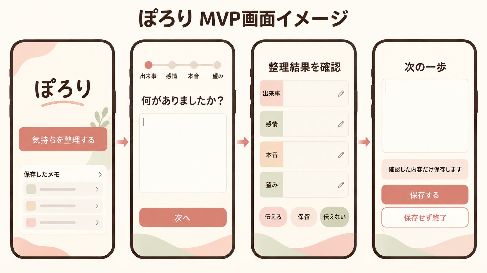

# ぽろり 企画ブラッシュアップ案

> 本資料は、`issue-review-1-revised.md` とチームメンバーの検討内容を基にした、講師確認・チーム協議用の案です。現時点のチーム決定事項ではありません。

## 1. 企画の要約

**ぽろりは、パートナーとの関係を大切にするあまり不満や本音を自分の中だけで処理してしまう人が、利害関係のない「第三の場所」で感情と望みを整理し、その気持ちをどう扱うかを自分で選び、次の一歩を一つ準備するためのWebアプリです。**

ぽろりが目指すのは、パートナーとの問題を自動的に解決することや、必ず本音を伝えさせることではありません。

「何がつらいのか分からないまま抱え込む状態」から、次の状態へ進めることを目指します。

- 自分が感じたことと本当の望みを言葉にできる
- 「伝える・今は保留する・伝えない」を自分で選べる
- 選択に合った小さな次の一歩を一つ決められる

## 2. 背景と着眼点

パートナーとの関係を大切にしている人の中には、相手を尊重するからこそ、不満を「自分で消化すべき」と考える人がいます。

しかし、一人で気持ちを処理し続けると、次のような状態につながる可能性があります。

1. 関係を悪化させたくないため、不満や違和感を抑える
2. 自分の気持ちを後回しにすることが習慣になる
3. 自分が何を感じ、何を望んでいるのか分からなくなる
4. 抱え込む、突然感情があふれる、すれ違いが続くなどの問題が起きる

家族や友人には話しづらく、パートナー本人にもまだ伝えられないとき、評価や利害関係から離れて気持ちを整理できる「第三の場所」が必要になると考えました。

### 根拠として言えること・今後確かめること

参考記事は「相手を尊重するために不満を自分で消化しようとする人がいる」という課題仮説を補強します。一方、この記事だけで、対象者が実際にアプリを必要としていることや、ぽろりの流れで行動を選びやすくなることまでは証明できません。

そのため、開発初期に対象となりそうな人へ短いヒアリングや画面試用を行い、次を確かめます。

- 身近な人や汎用AIでは相談しづらい場面が実際にあるか
- 5段階の問いかけで感情と望みを分けやすくなるか
- 整理後に「選択」と「次の一歩」があることを負担ではなく支援と感じるか

### 今このサービスを作る理由

関係の形や距離感が多様になる一方で、「相手を尊重すること」と「自分の気持ちを後回しにすること」が混ざってしまう場合があります。また、生成AIに自由に相談できるようになった今でも、モヤモヤしている最中に適切な指示文を考え、必要な順序で振り返ることは簡単ではありません。そこで、汎用的な回答ではなく、本音を抱え込む人向けの整理手順と自己決定の流れを提供します。

### Webアプリにする理由

- インストールせず、つらいときにスマートフォンやPCからすぐ使える
- 端末を限定せず、入力しやすい環境を本人が選べる
- AI処理、認証、本人だけが扱えるメモ、削除、決済を一つの体験として提供できる
- 更新を全ユーザーへ同時に反映でき、短期間のチーム開発と改善に向いている

ただし「Webでなければ絶対に実現できない」と主張するのではなく、対象者の利用開始のしやすさと、今回の開発・検証条件に最も合う提供方法として説明します。

## 3. 想定ユーザー

### 中心となるユーザー

パートナーとの関係を大切にしているからこそ、自分の不満や本音を抱え込んでしまう人です。

- 嫌われることや関係悪化が怖く、本音を言いづらい
- 相手を尊重するあまり「自分で解決すべき」と考える
- 波風を立てないため、自分の気持ちを後回しにする
- 我慢が続き、自分が何を感じているのか分からなくなる
- 気持ちは分かっていても、どのように扱えばよいか決められない

### ターゲットの表現方針

「HSP」などの性格・特性名で限定せず、**本音を抱え込む行動や置かれている状況**で対象を定義します。これにより、診断や自己認識の有無にかかわらず、同じ困りごとを持つ人に届けられます。

## 4. 解決したいイシュー

### イシュー

**パートナーとの関係を大切にするあまり、不満や違和感を自分の中だけで処理し続け、自分の感情・本音・望みが分からず、その気持ちをどう扱うか決められない。**

### 根本原因として考えること

- 本音を言うと相手を責めることになる、関係が悪化すると思っている
- 自分の不満より相手の事情を優先してしまう
- 身近な人には評価や関係性があるため相談しづらい
- 一人で考えると、出来事・解釈・感情・望みが混ざってしまう
- 気持ちを整理できても、次に何をすればよいか決められない

### 今回の企画で扱う範囲

ぽろりは、相手の考えを推測したり、相手の行動を変えたりするアプリではありません。まず自分の内側を整理し、自分で選べる状態をつくることに集中します。

## 5. ソリューション

AIとの対話に沿ってモヤモヤを吐き出すだけで、次の順に整理できるよう支援します。

1. **出来事**：何があったか
2. **感情**：そのとき何を感じたか
3. **本音・背景**：なぜそう感じたか、何を恐れているか
4. **望み**：本当はどうしてほしかったか、どうありたいか
5. **選択**：この気持ちをどう扱うか
6. **次の一歩**：選んだ行動を実行しやすい大きさにする

整理結果はAIが一方的に確定せず、本人が確認・編集・承認します。会話全文は自社データベースに保存せず、本人が残したいと判断した整理メモだけを保存します。

## 6. 選択後の支援

もえさんの提案を踏まえ、「整理して終わり」ではなく、ユーザーの選択に合わせて次の一歩を一つ準備します。

### 「伝える」を選んだ場合

- 相手に求めたいことを一つに絞る
- 責める表現を避けた「話し始めの一文」を作る
- 本人が編集して使える短い伝え方メモを作る

### 「今は保留する」を選んだ場合

- 今すぐ伝えない理由を確認する
- いつ振り返るかを自分で決める
- 保留中のメモとして後から見つけられるようにする

### 「伝えない」を選んだ場合

- 我慢による先送りではなく、自分で選んだ判断かを確認する
- 伝えない理由と、自分を守るために行うことを一つ記録する

### 完成形で追加したい支援

- AIとの会話練習と複数の返答パターンの提示
- 実行後の振り返り
- うまくいかなかった理由の再整理
- 次の一歩の再設定

AI会話練習や実行後の継続支援は価値が高い一方、画面・状態管理・安全設計・テストの範囲が大きくなるため、初回MVPでは発展機能とします。

## 7. 目指す状態とゴール

### 1回の利用で目指す状態

ユーザーが、次の内容を自分の言葉で確認できる状態です。

> 私はこの出来事で「○○」と感じ、本当は「○○」を望んでいた。今はこの気持ちを「○○する」と決め、そのためにまず「○○」をする。

### 継続利用で目指す状態

承認した整理メモを振り返ることで、次のような自分の傾向に気づける状態です。

- 我慢しやすい場面
- 繰り返し生まれる感情
- 相手に本当は望んでいること
- 「伝える・保留・伝えない」の選び方

### ゴールに含めないもの

- パートナーとの関係改善を保証すること
- 相手に自動でメッセージを送信すること
- AIがユーザーに代わって決断すること
- 医療的な診断、治療、カウンセリングの代替

### 根本原因とゴールの関係

ぽろりは、関係悪化への恐れ自体をなくすことを目指すものではありません。恐れがあっても自分の気持ちを見失わず、抱え込んだまま動けない状態から、自分の気持ちの扱い方を選べる状態へ進むことを支援します。

つまり、恐れをなくすアプリではなく、**恐れと付き合いながら、自分の気持ちを置き去りにしないためのアプリ**です。

## 8. 既存手段との違い

| 手段 | できること | ぽろりが補う点 |
| --- | --- | --- |
| パートナー本人への相談 | 直接話し合える | まだ話せない段階で、先に自分の気持ちを整理できる |
| 家族・友人への相談 | 共感や助言を得られる | 評価や人間関係を気にせず、自分の内側に集中できる |
| 日記・メモ | 自由に書ける | 問いかけに沿って、出来事から選択・次の一歩まで整理できる |
| ChatGPTなどの汎用AI | 幅広い相談に対応できる | プロンプトを考えなくても専用の流れで進み、承認済みメモと選択を継続的に振り返れる |

差別化の中心は「AIを使うこと」ではなく、**本音を抱え込む人のために、整理から自己決定、次の一歩までの道筋があらかじめ設計されていること**です。

## 9. 想定する利用の流れ

1. モヤモヤや出来事を自由に入力する
2. AIの問いかけで、出来事・感情・本音・望みを分ける
3. 必要に応じて、伝えることを妨げている理由も整理する
4. 整理結果を確認・編集する
5. 「伝える・保留する・伝えない」を選ぶ
6. 選択に合う次の一歩を一つ決める
7. 整理メモを保存するか選ぶ

MVPでは入口別の画面や対話フローを作らず、一つの相談フローの中で必要な問いかけを行います。これにより、ぽろりの中心価値を保ちながら実装とテストの範囲を抑えます。

## 10. 完成形のサービスイメージ

将来的には、次の価値を一連の体験として提供します。

1. 専用の対話フローによる感情整理
2. 本人が承認した整理メモの保存・編集・削除
3. 過去メモの検索、比較、傾向の可視化
4. 選択に応じた次の一歩の準備
5. AIとの伝え方練習
6. 実行後の振り返りと再整理
7. 意味的に似た過去の出来事の検索
8. 保存データを本人が管理できるプライバシー機能

ただし、これらをすべて4週間で実装するのではなく、価値の核を検証できる範囲に絞ります。

## 11. 4週間で目指すMVP

### 稼働時間の前提

5人が1日2時間作業した場合、30日すべて稼働できれば理論上は約300人時間、平日20日を基準にすると約200人時間です。ただし、初学者チームでは調査・学習・ミーティング・レビュー・結合・手戻りにも時間が必要です。

そのため、機能実装へ使う計画時間は**120〜150人時間程度**とし、週末などの追加時間は結合不具合・テスト・遅れを吸収する予備時間として扱います。予備時間を前提に機能を増やさず、まずMVPの完成を優先します。

| 作業区分 | 初期見積もり |
| --- | ---: |
| 仕様・API・DB・画面設計 | 15〜20人時間 |
| AI相談・整理結果・次の一歩 | 25〜35人時間 |
| 認証・暗号化メモCRUD・削除 | 25〜35人時間 |
| Redis・Stripeの最小実装 | 15〜25人時間 |
| セキュリティ・テスト・結合・資料 | 25〜35人時間 |
| 合計 | **105〜150人時間** |

これは企画段階の概算であり、1週目の小さな接続確認後に見直します。

### MVPで必ず実現するプロダクト機能

- ユーザー登録・ログイン
- 一つの流れに絞ったAI相談
- 出来事から選択までを段階的に整理する対話
- AIが作成した整理結果の確認・編集・承認
- 「伝える・保留する・伝えない」の選択
- 整理結果と同じ画面・データ内での次の一歩の作成
- 承認済み整理メモの暗号化保存・一覧・詳細・個別削除
- 退会時の関連メモ一括削除
- 自分のデータだけを閲覧・操作できるアクセス制御
- 会話本文を残さないログとキャッシュ
- 医療・心理相談の代替ではないことの明示と、常時確認できる固定の専門窓口案内

「保留ボックス」は独立した仕組みにせず、一覧上で選択が「保留」と分かる表示にとどめます。複数条件による検索・絞り込みはMVPから外します。

### スクールのMUST要件として組み込むもの

- フロントエンドとバックエンドを分けたWebアプリ
- Docker Composeによる開発環境
- PostgreSQLへの永続保存
- Redisの利用
- Stripeのテスト決済
- 開発用・本番用ログの切り替え
- XSS・SQLインジェクション・認可漏れへの対策
- バックエンドを中心とした単体テスト
- テスト設計書・テストシナリオ

Redisは会話本文の一時保存には使わず、**APIの利用回数制限など、内容を持たない短期データ**に利用します。

Stripeは月額300円の有料プランをテストモードで契約・解約できる最小構成にします。無料でも1回の相談価値は完結させ、有料では相談回数と継続的な振り返り機能を拡張します。

### 余裕があれば追加する機能

- 「保留」のメモだけを表示する簡易絞り込み
- ユーザーが選んだ過去メモとの画面上の比較
- 感情ラベルや選択の件数を示す簡易集計
- デプロイ

### MVPから外す発展機能

- RAG・ベクトル検索による意味的な過去メモ検索
- AIによる過去メモとの自動比較・長期傾向分析
- AIとの伝え方のロールプレイ
- 実行後の自動フォローアップ
- 相手への自動メッセージ送信
- 自由文に対する完全自動の個人情報マスキング
- 日付・感情・選択を組み合わせた複数条件検索
- 入口別に作り込んだ複数のAI相談フロー
- 本格的な管理者画面・監査ログ機能
- 本番運用を想定した複雑な定期課金・プラン管理

### 実装ではなく方針を文書化するもの

- 管理者は原則として整理メモ本文を閲覧しない
- やむを得ず管理上のアクセスが必要な場合の理由・日時・担当者の記録方針
- バックアップの保持期間と削除反映の方針
- 本番運用時の暗号鍵ローテーションと監査体制

## 12. 無料プラン・有料プラン案

> 以下はチーム検討用のたたき台です。価格や回数をめぐさん個人の決定事項にはせず、考え方と試算を示したうえでチーム・講師へ確認します。

### プランを分ける基本方針

ぽろりの中心価値である「感情と望みを整理し、扱い方を選び、次の一歩を一つ決める」体験は無料プランでも最後まで利用できるようにします。

有料プランでは、相談そのものを途中で止めるのではなく、**利用回数と、保存したメモを継続的に振り返る価値**を広げます。削除やプライバシー設定など、安全に利用するための機能は有料にしません。

### 月額プラン案

| 機能 | 無料プラン | 有料プラン（月額300円） |
| --- | --- | --- |
| AI相談 | 月3回まで | 月30回まで |
| 段階的な感情整理 | 利用可能 | 利用可能 |
| 選択と次の一歩メモ | 利用可能 | 利用可能 |
| 整理メモの保存 | 5件まで | 100件まで |
| 一覧・詳細・個別削除 | 利用可能 | 利用可能 |
| 保留中メモの確認 | 利用可能 | 利用可能 |
| 日付・感情・選択による絞り込み | 対象外 | 完成形で追加 |
| 過去メモを2件選んだ比較 | 対象外 | 完成形で追加 |
| 感情・選択の簡易集計 | 対象外 | 完成形で追加 |

無料版の月3回・5件保存と、有料版の月30回・100件保存は仮の上限です。実際の利用頻度、AI費用、ユーザーが制限をどう感じるかを確認して調整します。「無制限」とするとAI費用の上限を管理できないため、初期段階では回数上限を設けます。

有料プランを解約して無料プランへ戻った場合も、すでに保存したメモは勝手に削除しません。閲覧・削除はできる状態を保ち、保存件数が無料上限を超えている間だけ新規保存を停止する案とします。

### MVPで実装する課金差分

4週間では、次の差分に絞ります。

- Stripe Checkoutで月額300円プランを契約する
- Webhookで有料・無料の状態を更新する
- 有料状態に応じて相談回数・保存件数を切り替える
- Stripeのカスタマーポータルなどを利用して解約できるようにする

複数条件による絞り込み・過去比較・簡易集計は、基本の課金切り替えが完成した後の発展機能にします。初回MVPでは、有料状態と利用上限が正しく切り替わることの確認を優先します。

### 月額300円の概算

2026年9月時点の公開料金を用いた概算です。実際の費用は、使用モデル、会話量、為替、契約内容、税、インフラ構成により変動します。

#### 試算条件

- 接続先：スクール提供のAPIキーを使ったOpenRouter API
- AIモデル：試算上の第一候補として GPT-5 Nano
- 1回の相談：入力2万トークン、出力5千トークンと保守的に仮定
- 為替：1ドル150円として仮計算
- Stripe Payments：国内カード決済成功額の3.6%
- Stripe Billing：継続課金額の0.7%

スクール提供キーで利用できる5つのチャットモデルを、2026年9月時点のOpenRouter公開料金で比較します。無料枠やスクール側の契約条件は反映していないため、実際の請求額ではなく、モデル間の比較と上限管理のための概算です。

| モデル | 入力 / 100万トークン | 出力 / 100万トークン | 1相談の概算 |
| --- | ---: | ---: | ---: |
| gpt-oss-120b | $0.03 | $0.17 | 約0.22円 |
| DeepSeek V4 Flash 0731 | $0.05 | $0.16 | 約0.27円 |
| Gemma 4 26B A4B | $0.042 | $0.22 | 約0.29円 |
| GPT-5 Nano | $0.05 | $0.40 | 約0.45円 |
| GLM 4.7 Flash | $0.06 | $0.40 | 約0.48円 |

いずれも月額300円に対するAI原価は小さいため、最安値だけで決めません。まずGPT-5 Nanoを試算上の第一候補とし、`gpt-oss-120b`・DeepSeek V4 Flash 0731なども同じ相談例で比較します。日本語の自然さ、相手を決めつけない問いかけ、危機的な入力への応答、JSON Schemaへの準拠、応答速度を確認して採用モデルを決めます。

参考：[OpenRouter - GPT-5 Nano](https://openrouter.ai/openai/gpt-5-nano) / [OpenRouter - gpt-oss-120b](https://openrouter.ai/openai/gpt-oss-120b) / [OpenRouter - DeepSeek V4 Flash 0731](https://openrouter.ai/deepseek/deepseek-v4-flash-0731) / [OpenRouter - GLM 4.7 Flash](https://openrouter.ai/z-ai/glm-4.7-flash) / [OpenRouter - Gemma 4 26B A4B](https://openrouter.ai/google/gemma-4-26b-a4b-it)

Stripeの公開標準料金を単純に合算すると、月額300円の決済・継続課金手数料は約12.9円です。

参考：[Stripe Payments料金](https://stripe.com/jp/pricing) / [Stripe Billing料金](https://stripe.com/jp/billing/pricing)

| 有料ユーザー1人あたり | 月10回相談 | 月30回相談 |
| --- | ---: | ---: |
| 月額売上 | 300円 | 300円 |
| Stripe概算手数料 | 約12.9円 | 約12.9円 |
| AI概算費用 | 約4.5円 | 約13.5円 |
| 固定費を引く前の残額 | **約282.6円** | **約273.6円** |

有料ユーザー100人、平均月10回相談の場合は、月額売上3万円に対して、Stripe概算手数料が約1,290円、AI概算費用が約450円となり、固定費を引く前の残額は約28,260円です。

さらに無料ユーザー500人が月3回すべて利用すると、AI概算費用は約675円です。この場合、有料・無料ユーザーを合わせた固定費控除前の残額は約27,585円です。

この残額から、サーバー、データベース、監視、ドメイン、メール、税、返金、開発・運用の人件費などを支払うため、これは最終的な利益ではありません。スクール制作では「月額300円でもAIの変動費を管理できそうか」を確認するための参考値として扱います。

参考として、有料ユーザーの平均相談回数を月10回、1人あたりの固定費控除前残額を約283円とすると、月額インフラ費が3,000円なら約11人、5,000円なら約18人の有料ユーザーが、インフラ費だけを賄う目安です。無料ユーザー500人が上限まで利用する例ではAI費用が約675円増えるため、月額インフラ費3,000円と合わせると約14人が目安になります。税や人件費を含まない仮計算です。

### チームで決めたいこと

1. 月額300円を企画上の価格として採用するか
2. 無料・有料の相談回数と保存件数を何件にするか
3. 有料価値の中心を「検索・比較・傾向の振り返り」とするか
4. MVPではどこまでの契約・解約状態を実装するか
5. AI対話品質と費用のバランスから、どのモデルを採用するか

## 13. 最小画面構成

1. 登録・ログイン画面
2. ホーム画面
3. 相談画面
4. 整理結果の確認・編集・選択・次の一歩画面
5. 保存メモの一覧画面
6. 保存メモの詳細・削除画面
7. プラン・テスト決済画面

画面数を増やしすぎないため、相談の各段階は一つの相談画面内で進め、整理結果・選択・次の一歩も一つの画面へまとめます。

### MVPの画面イメージ

以下は、中心となる「相談開始 → 段階的な整理 → 内容の確認・選択 → 次の一歩・保存」の流れを共有するためのイメージです。最終デザインや細かな文言は、チームで確認して調整します。

## 14. データ保存とプライバシー方針

### 取り扱う情報の位置づけ

恋愛相談の内容が直ちに法律上の要配慮個人情報へ該当するとは限りません。一方で、病歴・心身の状態・家庭内の事情などが入力される可能性があるため、設計上は**要配慮個人情報を含み得るデータ**として慎重に取り扱います。この整理は法的判断ではなく、実サービス化する場合は専門家への確認が必要です。

### 自社側で保存するもの

- ユーザーが確認・編集・承認した整理メモの暗号文
- 選択、作成日など機能提供に必要な最小限の構造化データ
- 整理メモに含めた次の一歩
- 決済状態など、機能提供に必要な最小限の情報

### 自社側で保存しないもの

- 相談中の会話全文
- 入力したモヤモヤの原文
- AIとの未承認のやり取り

これらは自社データベース、Redis、アプリケーションログには残しません。相談中だけフロントエンドのメモリ上で保持し、終了時に破棄する設計を基本とします。

### 暗号化と検索項目

承認済み整理メモのうち、要約・本音・望み・次の一歩・伝え方メモなどの自由記述部分は、FastAPI側で認証付き暗号化を行ってからPostgreSQLへ保存します。独自の暗号方式は作らず、実績のある暗号ライブラリを利用します。

内部ユーザーID・作成日時・選択状態・プラン状態など、認可や機能提供に必要な項目は平文で保持します。感情ラベルを平文で保持して検索へ利用するかは、MVPから複数条件検索を外したため、情報の必要性を確認してから決定します。

暗号化により自由記述本文のキーワード検索は難しくなるため、MVPでは本文検索を行いません。将来検索機能を追加する場合も、保存する平文項目を無制限に増やさず、利便性と情報漏えいリスクの両方を検討します。

### データの分離

- 認証情報は認証基盤で管理し、アプリ内部ではランダムな内部ユーザーIDを使用する
- 整理メモはユーザー・決済情報と論理的にテーブルを分ける
- カード情報は自社DBに保存せず、Stripe側で管理する
- ユーザーIDの分離やハッシュ化だけで「匿名化できた」とは説明しない

整理メモの内容から本人や相手を推測できる可能性があるため、IDの分離だけに依存せず、暗号化・アクセス制御・ログ対策を組み合わせます。

### 鍵・シークレット管理

- 暗号鍵・OpenRouter APIキー・StripeのシークレットをGitへコミットしない
- 暗号鍵はDBと同じ場所へ保存せず、デプロイ環境のSecrets機能などで管理する
- 復号した本文やシークレットをログ・エラー詳細へ出力しない
- 本番運用時の鍵ローテーションや鍵のバックアップは方針を文書化し、今回のMVPでは複雑な運用基盤まで構築しない

### アクセス制御と管理者の扱い

API側で毎回、対象メモがログイン中の本人のものか確認します。管理者向けに整理メモ本文を閲覧する画面は作らず、管理者は原則として本文を閲覧しない設計とします。

やむを得ず管理上のアクセスが必要な場合の理由・日時・担当者の記録や、監査ログを閲覧できる権限の管理は、本番運用に向けたルールとして文書化します。今回のMVPでは、本格的な管理者画面・監査ログ基盤は実装しません。

### OpenRouter API利用時の説明

APIへ送信する内容は、AI処理のためOpenRouterと実際に推論を行うモデル提供者へ送られるため、「どこにも保存されない」とは説明しません。ユーザーに送信前の注意を示し、実名・住所・連絡先などを入力しないよう案内します。

OpenRouterは、利用者が明示的に有効化しない限り、OpenRouter側ではプロンプトと回答本文を保存しないと説明しています。一方、実際のモデル提供者ごとに保持・学習方針が異なります。スクール提供キーで設定できる範囲を確認し、プロンプトログと学習利用を無効にします。可能であればZero Data Retention（ZDR）対応の提供先だけに制限します。設定権限がない場合は、利用できる提供先と保持方針をスクールへ確認し、その内容を利用者へ明示します。

参考：[OpenRouter - Data Collection](https://openrouter.ai/docs/guides/privacy/data-collection) / [OpenRouter - Provider Logging](https://openrouter.ai/docs/guides/privacy/provider-logging) / [OpenRouter - Zero Data Retention](https://openrouter.ai/docs/guides/features/zdr)

### ユーザーによる管理

- 保存前に本人が内容を確認・編集できる
- 保存しない選択ができる
- 保存したメモを個別に削除できる
- 退会時にアカウントに紐づく整理メモを一括削除できる
- バックアップへの削除反映は、本番運用時の保持期間と合わせて方針を文書化する

## 15. 技術構成案

| 領域 | 技術案 | 主な役割 |
| --- | --- | --- |
| フロントエンド | Next.js / TypeScript | 相談UI、メモ確認・編集、一覧表示 |
| バックエンド | FastAPI / Python | 認証、AI連携、メモ・決済API |
| データベース | PostgreSQL | 承認済みメモ、ユーザー、決済状態 |
| 一時データ | Redis | API利用回数制限など内容を持たない短期データ |
| AI | OpenRouter API | スクール提供モデルによる段階的な問いかけと整理結果の生成 |
| 決済 | Stripe test mode | 有料機能のテスト決済 |
| 暗号化 | FastAPI側の認証付き暗号化 | 自由記述本文を暗号化してからDBへ保存 |
| 鍵管理 | デプロイ環境のSecrets機能など | 暗号鍵をDB・Gitから分離 |
| 開発環境 | Docker Compose | フロント・バック・DB・Redisの起動 |

### この技術構成を選ぶ理由

#### Next.js / TypeScript

- コンポーネントを再利用し、相談画面・確認画面・メモ画面を同じ設計方針で作りやすい
- TypeScriptにより、AIの整理結果やAPIレスポンスの項目違いを開発中に見つけやすい
- スマートフォン中心のWeb UIとして提供でき、インストールなしで利用してもらえる

#### FastAPI / Python

- OpenRouter APIとの連携処理をPythonでまとめられる
- Pydanticによる入力・出力の検証を使い、AI結果をそのまま無条件に保存しない設計にしやすい
- フロントエンドとバックエンドを分離するスクール要件に対応しやすい
- API仕様をOpenAPIとして確認でき、フロントエンドとの分担・結合に利用できる

#### PostgreSQL

- ユーザー・整理メモ・プラン状態の関係を外部キーで管理できる
- トランザクションを使い、保存・削除・退会時削除の整合性を保ちやすい
- 暗号化済みの自由記述と、認可に必要な構造化データを分けて保存できる

#### Redis

- スクールのMUST要件を満たしつつ、TTL付きの利用回数カウンターに利用できる
- 会話本文を置かないことで、Redisからデリケートな内容が漏れるリスクと削除管理の負担を減らせる

#### OpenRouter API

- 固定の質問だけでは扱いにくい自由なモヤモヤに対して、内容に応じた問いかけを生成できる
- OpenAI互換形式で利用でき、FastAPI側では接続先とモデルIDを切り替えて候補モデルを比較しやすい
- Structured Outputsを利用すると、出来事・感情・本音・望み・選択・次の一歩を定めたJSON形式で受け取り、画面表示前に検証しやすい
- OpenRouter側の本文ログを無効にし、可能であればZDR対応の提供先に制限して、自社側でも会話全文を保存しない方針と整合させる

参考：[OpenRouter - Quickstart](https://openrouter.ai/docs/quickstart) / [OpenRouter - Structured Outputs](https://openrouter.ai/docs/guides/features/structured-outputs)

#### Stripe

- カード情報を自社DBへ保存せず、Stripe Checkoutでテスト決済を実装できる
- Webhookで有料・無料の状態を更新し、相談回数・保存件数の上限切り替えに利用できる

#### アプリ層暗号化

- 平文の自由記述をPostgreSQLへ渡す前に暗号化でき、DBのダンプや管理画面だけを取得された場合でも本文を直接読まれにくくできる
- 鍵をDBと分離しやすく、今回の「承認済みメモのみを最小限保存する」方針と合わせやすい
- 暗号化だけに依存せず、本人確認・削除・ログ対策も組み合わせる

技術は採用すること自体を目的にせず、1週目に最小構成で接続確認を行います。対話品質や実装難易度が想定を超えた場合は、便利機能を追加せず、中心フローと安全性の完成を優先します。

## 16. 4週間の進行案

### 1週目：仕様確定と縦につなぐ

- イシュー・ゴール・MVPを講師に確認
- 画面遷移、API、DB、AI入出力、暗号化対象、鍵管理、保存方針を決定
- 候補モデルへ同じ相談例を入力し、日本語品質・安全性・構造化出力・速度を比較して採用モデルを決定
- Docker Composeと各アプリの土台を作成
- 固定データで「相談開始 → 整理結果表示」を一度つなぐ
- テスト設計書の作成を開始

### 2週目：価値の中心を実装

- ユーザー登録・ログイン
- AIの段階的な相談フロー
- 整理結果の確認・編集・承認
- アプリ層暗号化の小さな検証
- エラー時・AI応答失敗時の表示

### 3週目：保存・選択・MUST条件を実装

- 承認済みメモの暗号化保存・復号・一覧・詳細・個別削除・退会時削除
- 整理結果内での選択と次の一歩
- Redisによる利用回数制限
- Stripeテスト決済と最小限のプラン状態切り替え
- 認可・入力検証・安全なログ出力
- 医療・心理相談の代替ではない旨と、固定の専門窓口案内

### 4週目：結合・品質・説明を整える

- フロントエンドとバックエンドの結合確認
- 単体テスト、主要シナリオの結合テスト
- XSS・SQLインジェクション・認可漏れの確認
- DB上の自由記述が暗号文になっていることの確認
- 会話全文や未承認の入力原文がDB・Redis・ログに残らないことの確認
- 暗号鍵・APIキーがGitやDBへ含まれていないことの確認
- バグ修正、README・設計資料・デモデータの整備
- 週末などの追加時間は結合不具合・テスト・遅れの吸収を優先する
- 予備時間が残った場合のみ簡易絞り込みまたはデプロイを検討する

## 17. MVPの完成条件

次の状態を満たしたら、MVPとして完成と判断します。

- ユーザーが相談を開始し、段階的な問いかけを最後まで進められる
- 自分の感情・望み・選択を整理結果として確認し、編集・承認できる
- 選択に合った次の一歩を一つ作れる
- 承認したメモの自由記述が暗号化され、本人が一覧・詳細確認・個別削除できる
- 退会時に本人の関連メモを一括削除できる
- 自分以外のユーザーのメモを復号・閲覧・削除できない
- 会話全文や入力原文が自社DB・Redis・ログに残らない
- 暗号鍵・APIキーがGitやDBに含まれていない
- 医療・心理相談の代替ではない旨と、固定の専門窓口案内を常時確認できる
- Stripe・Redisを含むスクールのMUST要件が動作確認できる
- 主要な正常系・異常系についてテスト結果を示せる

価値の確認では、利用前後に次の問いへ回答してもらう方法も検討します。

- 今、自分が何を感じているか説明できるか
- 本当はどうしたいか説明できるか
- 次に何をするか自分で選べているか

## 18. 講師に確認したいこと

1. 「自分の感情と望みを言葉にし、扱い方を選び、次の一歩を一つ決める」というゴールで、課題解決の範囲が明確になっているか
2. AI連携をぽろりの価値の中心としてMVPに含める判断でよいか
3. 入口別の画面や対話を作らず、一つの相談フローへ絞る判断でよいか
4. 月額300円で相談回数・保存件数を拡張し、MVPではプラン状態と上限の切り替えまで実装する方針でよいか
5. 検索・比較・集計を発展機能へ移し、120〜150人時間を基準にしたMVP範囲で実現可能か
6. 承認済みメモの自由記述をアプリ層で暗号化し、検索用の平文項目を最小限にする方針でよいか
7. スクール提供のOpenRouter APIキーで、本文ログ・学習利用の無効化やZDR対応の提供先への制限が可能か。チーム側で変更できない場合、どの保持方針を前提にすべきか
7. 管理者アクセス・監査ログ・バックアップ削除を、今回は本格実装せず方針の文書化にとどめてよいか

## 19. 発表時の伝え方

### 短い説明

> ぽろりは、パートナーを大切にするあまり本音を抱え込む人が、身近な人への影響を気にせず気持ちを整理し、「伝える・保留する・伝えない」を自分で選び、次の一歩を一つ準備するためのアプリです。

### 必要性が伝わりにくい人への説明

すぐに相手へ話せる人には、ぽろりは必要ないかもしれません。しかし、関係を壊したくないために話す前の段階で止まり、自分の気持ちさえ分からなくなる人がいます。ぽろりは、その人に「必ず話そう」と迫るのではなく、まず自分の感情と望みを整理し、自分で次の行動を選ぶための準備の場所を提供します。

## 20. 検討に使用した資料

- `issue-review-1-revised.md`
- もえさんのメモ
- じまさんのメモ
- るなさんのメモ
- `teamplan_memo/イシュー①(簡易版).pdf`
- `teamplan_memo/イシュー②(詳細版).pdf`
- 履歴の取扱①（簡易版）
- 履歴の取扱②（詳細版）
- 履歴の取扱③（スコープ表）
- [「第三の場所」の必要性を示す参考記事](https://mainichikirei.jp/prtimes/article/20260501prt00m100000001a.html)
- [OpenRouter - Data Collection](https://openrouter.ai/docs/guides/privacy/data-collection)
- [OpenRouter - Provider Logging](https://openrouter.ai/docs/guides/privacy/provider-logging)
- [OpenRouter - Zero Data Retention](https://openrouter.ai/docs/guides/features/zdr)
- [OpenRouter - Structured Outputs](https://openrouter.ai/docs/guides/features/structured-outputs)
- [OWASP Cryptographic Storage Cheat Sheet](https://cheatsheetseries.owasp.org/cheatsheets/Cryptographic_Storage_Cheat_Sheet.html)
- [PostgreSQL pgcrypto - Security Limitations](https://www.postgresql.org/docs/18/pgcrypto.html#PGCRYPTO-SECURITY-LIMITATIONS)
