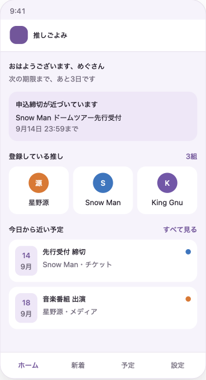
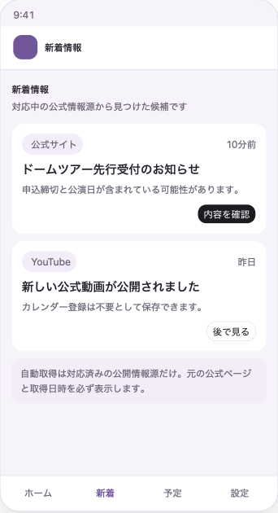
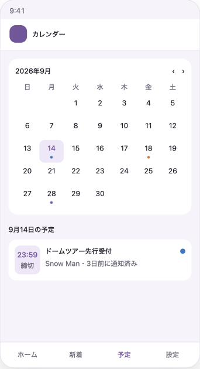
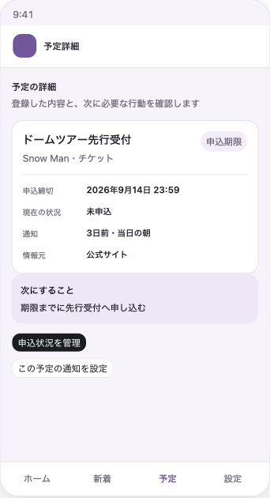
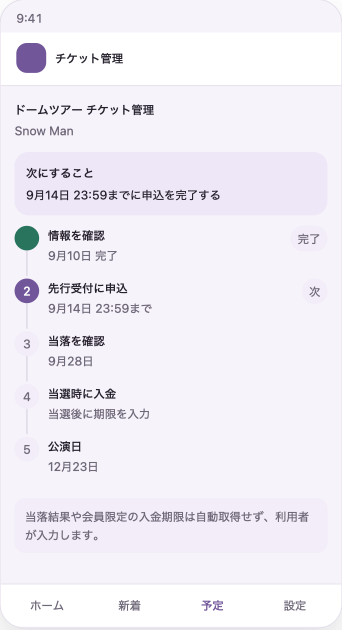

# 最終プロジェクト 第2企画案 推し活公式情報・予定期限管理Webアプリ

#### 企画レビュー用 担当：めぐ ※サービス名・仕様は検討中

## 1. サービス名（仮）

**推しごよみ**

— 推しの情報と、次にすることを、ひとつに。—

※推し＋暦

## 2. サービス概要

推しの公式サイトに公開された新着情報を確認し、ライブ・メディア出演・チケット申込などの予定と、その後に必要な行動期限を一か所で管理するWebサービス。

- 対象ユーザー：複数のアイドル、バンド、俳優などを応援し、仕事や学校などの日常と両立している人
- 提供したい価値：公式情報を見逃さず、一度見た情報も次の行動につなげ、後悔を減らす

## 3. 仮説ペルソナ

20〜30代の会社員を仮定。

2〜3組を応援し、公式サイト、SNS、ファンクラブ、チケットサイトを確認している。

情報源が多いため新着情報そのものを見逃すことがあり、情報を一度見ても「後で申し込もう」と考え、そのまま申込・入金期限を逃すことがある。

## 4. 解決したい課題と目指す状態

### 現在の課題

課題を、次の2段階に分ける。

1. **情報を見逃す問題**：公式情報が複数の場所に分散し、必要な情報に気づけないことがある。
2. **見た後に行動を忘れる問題**：情報を一度確認しても、「後で申し込もう」と考え、そのまま必要な行動を忘れることがある。

さらに、公演日とは別に申込・当落確認・入金・視聴など複数の期限があり、一般的なカレンダーやメモでは「次にすること」を管理しにくい。その結果、「知っていれば申し込めたのに」「見たのに忘れてしまった」と後悔する。

### サービス利用後の状態

- 対応する公式サイトの新着情報をアプリ内で確認できる。
- 必要な情報だけを予定として登録し、次にする行動を整理できる。
- 申込・当落・入金・公演などの期限と完了状態を確認できる。
- 期限前に通知を受け取り、見逃しや行動忘れを減らせる。

## 5. 中心仮説と検証方針

### 中心仮説

複数の推しを持つ人は、対応する公式情報を新着として受け取り、そこから申込・当落確認・入金・公演などの行動期限を管理することで、一般的なカレンダーやメモよりも「次にすること」が分かりやすくなり、期限忘れを減らせるか。

### 検証する2つの仮説

| 仮説 | 確認したいこと |
| --- | --- |
| 技術仮説 | 公開されている公式サイト1か所から、新着情報を継続的に取得できるか |
| ユーザー価値の仮説 | 取得・登録した情報を行動単位で管理することで、次の行動が分かり、期限忘れを減らせるか |

自動取得は「情報を見逃さない」ための入口としてMVPに残す。1か月のMVPでは、取得対象を限定した技術検証を行いつつ、主に「期限管理と通知によって行動忘れを減らせるか」を検証する。

### 利用者への確認事項

- 公式記事から予定登録まで迷わず操作できるか
- 期限を手入力する負担よりも、管理できる価値が上回るか
- 「次にすること」の期限順一覧が、一般的なカレンダーやメモより分かりやすいか
- 通知と完了管理が、行動忘れの防止に役立ちそうか

## 6. 利用の流れ

```text
公式サイトの新着情報を取得
        ↓
アプリの「新着情報」に表示
        ↓
利用者が元の公式情報を確認
        ↓
必要な情報だけ予定・行動期限として登録
        ↓
期限順一覧・カレンダー・予定詳細で確認
        ↓
期限前の通知を受け取り、行動を完了にする
```

## 7. 開発期間約1か月を想定したMVP案

### 公式情報の取得

- 自動取得に対応する対象は、まず**1アーティスト・公開されている公式サイト1か所**に限定する。
- 取得する項目は、公開日・記事タイトル・元ページURLを基本とする。
- 更新は1日1回、または利用者が「最新情報を確認」を押した時に行う。
- 前回取得時になかった記事だけを新着情報として表示する。
- 複数の推しは登録できるが、自動取得は対応済みの情報源に限定し、その他は手動登録とする。

### 予定・期限管理

- ユーザー登録・ログイン
- 推しの登録
- 新着情報の一覧と元の公式ページへのリンク
- 新着情報から予定登録画面への引き継ぎ
- 予定と、申込・当落・入金・公演など複数の行動期限の登録・編集・削除
- 期限順一覧・カレンダー・予定詳細
- 行動の未完了・完了管理
- 通知方法とタイミングは1種類に限定（例：期限前日のメール通知）

### MVPでは自動化しない部分

- 記事本文から申込期限・当落日・入金期限を完全に自動判定すること
- 会員限定ページや利用者個人の当落結果・入金期限の取得

予定名・公開日・情報元は取得情報から引き継ぎ、期限などの重要項目は利用者が公式ページを確認して入力する。

### 自動取得が難しい場合の代替経路

対象サイトの規約・構造・ページ変更などにより自動取得が難しい場合でも、公式ページのURL・予定名・期限を手動登録し、行動期限管理・通知・完了管理の価値を検証できる構成にする。ただし、自動取得は本企画の魅力に関わるため、開発初期に技術検証を行い、実現可否を早期に判断する。

## 8. 想定画面（7画面）

7画面はサービス全体の利用イメージとして残し、1か月の開発では次の順に着手する。

- **優先度A**：新着情報、登録確認・編集、ホーム（次にすることの期限順一覧）、予定詳細
- **優先度B**：チケット管理、リマインド設定、カレンダー

ホームは「登録している推し」の表示よりも、利用者が今すべきことをすぐ確認できる**「次にすること」の期限順一覧**を中心とする。

| 画面 | 主な役割 | 主な遷移 |
| --- | --- | --- |
| ホーム | 「次にすること」を期限順に確認 | 予定を押すと予定詳細へ |
| 新着情報 | 公式サイトから取得した未確認情報を表示 | 「内容を確認」で登録確認へ |
| 登録確認 | 取得した情報を確認し、必要な期限を入力 | 「確認して登録」でカレンダーへ |
| カレンダー | 登録した予定を日付ごとに確認 | 予定を押すと予定詳細へ |
| 予定詳細 | 期限・現在の状況・情報元・次の行動を確認 | チケット管理・リマインドへ |
| チケット管理 | 申込・当落・入金・公演の進み具合を管理 | 各行動を完了にする |
| リマインド | 予定に対する通知内容を確認・設定 | 設定後、予定詳細へ戻る |

画面下部の主要ナビゲーションは「ホーム・新着・予定・設定」とし、予定詳細・チケット管理・リマインドは、選択した予定から開く詳細画面とする。

### 画面イメージ

※企画検討段階のイメージであり、実装時のデザインや表示内容は変更する可能性がある。

<table>
  <tr>
    <td align="center" width="33%"><strong>1. ホーム</strong><br></td>
    <td align="center" width="33%"><strong>2. 新着情報</strong><br></td>
    <td align="center" width="33%"><strong>3. 登録確認</strong><br></td>
  </tr>
</table>

<table>
  <tr>
    <td align="center" width="50%"><strong>4. カレンダー</strong><br></td>
    <td align="center" width="50%"><strong>5. 予定詳細</strong><br></td>
  </tr>
</table>

<table>
  <tr>
    <td align="center" width="50%"><strong>6. チケット管理</strong><br></td>
    <td align="center" width="50%"><strong>7. リマインド</strong><br></td>
  </tr>
</table>

## 9. 差別化の仮説

一般的なカレンダーは、利用者が情報を見つけて入力することが前提となる。

本企画では、対応する公式サイトの新着を確認できることに加え、一つの情報に申込・当落・入金・公演など複数の行動期限と完了状態をひも付ける。

**「情報を見つける」から「忘れずに行動する」までを一つにつなぐこと**を中心価値として検証する。

### 競合調査で確認すること

一般的なカレンダー、メモ・ToDoアプリ、既存の推し活管理アプリについて、次の観点で比較する。調査結果は確認後に追記する。

- 公式情報を自動で見つけられるか
- 一つの情報に複数の行動期限を登録できるか
- 行動の完了状態を管理できるか
- 期限前に通知できるか

## 10. プロジェクトMUST要件への対応案

※プロダクトとして採用された場合に、講師への確認と技術検証を踏まえて確定する。

### 構成

- フロントエンド：React・TypeScript
- バックエンド：FastAPI・Python
- データベース：PostgreSQL候補
- コンテナ：Docker Compose

### キャッシュ・決済・ログ

- Redis：公式情報の取得結果や最終取得状態のキャッシュ候補
- Stripe Checkout：プレミアム機能を解放するテスト決済候補
- ログ：開発環境と本番環境で出力レベルを分ける

### 決済条件の提案

- 無料：推し1組、手動予定登録、アプリ内での期限確認
- プレミアム：複数の推し登録、メールリマインド
- 1か月の開発では、Stripeのテストモードによる単発決済と機能解放を候補とする。
- 本番決済や月額課金・変更・解約管理はMVP外とする。

### 品質・セキュリティ

- 単体テストとシナリオテスト
- XSS・SQL Injection対策
- 認証・認可と、ログへ個人情報や決済情報を出さないための対策
- 決済成功は画面遷移だけで判断せず、Stripeからの通知を確認して反映する

## 11. ADVANCED案

- 対応するアーティスト・公式サイトの追加
- 公式SNS・YouTubeなど複数情報源への対応
- AIなどによる記事本文からの予定・期限候補の抽出
- 推しごとの色分け・絞り込み
- 通知日時・通知方法の細かな設定
- 月額課金とプラン変更・解約管理

## 12. 早期に確認・検証すること

1. 対象とする公式サイトと取得対象ページを1つ決める。
2. 公開日・記事タイトル・URLを継続的に取得できるか、小さな技術検証を行う。
3. 対象サイトの利用条件・アクセス方法・ページ変更時のリスクを確認する。
4. Stripeのテストモードによる単発決済と機能解放で、プロジェクトの決済MUST要件を満たすか講師へ確認する。
5. 実装・テスト・発表準備まで含めた1か月の範囲として現実的か、企画レビューで相談する。
6. 手入力の負担よりも期限管理の価値が上回るか、利用者への確認方法を決める。
7. 一般的なカレンダー・メモ・既存の推し活管理アプリとの違いを調査する。
8. OpenAI APIによる公式情報の要約・行動期限候補の抽出をMVPに含めるか、ADVANCEDとするか検討する。
