# ぽろり MVP画面ワイヤーフレーム案

作成日：2026年9月20日
対象：スマートフォン向けWebアプリ（MVP）

## 1. この資料の目的

この資料は、完成デザインを決めるものではなく、MVPで必要な画面、ユーザーの操作順、各画面の役割をチームで確認するためのたたき台です。

画面は白・温かみのあるグレーを基本とし、淡いピンクベージュとくすみグリーンを補助色にしています。色・装飾・細かな文言は仮のものです。

## 2. 現時点の前提

### 決定として扱うもの

- 最初の悩みテーマは5項目と「その他」から一つ選ぶ
- テーマ選択後に、自分の場合を自由記述する
- テーマによって相談フローを分岐させず、ユーザー全員が同じ段階的な整理へ進む
- AIとの対話で「出来事 → 感情 → 本音・背景 → 望み」を整理する
- 整理結果は本人が確認・編集・承認する
- 「伝える・今は保留する・伝えない」のいずれかを本人が選ぶ
- 退会・ログアウトは専用の設定画面に置く

### 仮置きしているもの

- 扱い方（伝える・今は保留する・伝えない）を選んだ理由の入力は任意とする
- 感情の段階でも、候補から最も近いものを一つ選んだ後、自分の言葉で具体的に入力する
- 感情の候補には「その他・まだよく分からない」を設ける
- 出来事を整理するAIの追加質問は原則1〜2問とし、ユーザーが希望する場合は最大3問までとする
- 扱い方の選択後に別の行動入力は設けず、「次の一歩」ではなく「扱い方の選択・記録」という表現に揃える
- 「伝えない」を選んだ後の行動入力はMVPに含めない
- 利用前の注意は、初回は確認画面、2回目以降は短い表示とする
- 保存後の整理メモは閲覧・削除のみとし、再編集は含めない

### この資料に含めないもの

- 話し始めの一文・伝え方メモの生成
- AIとの会話練習
- 実行後の自動フォローアップ
- 振り返り日時の通知
- 最終的な配色、書体、イラスト、ロゴ配置

## 3. 全体の画面遷移

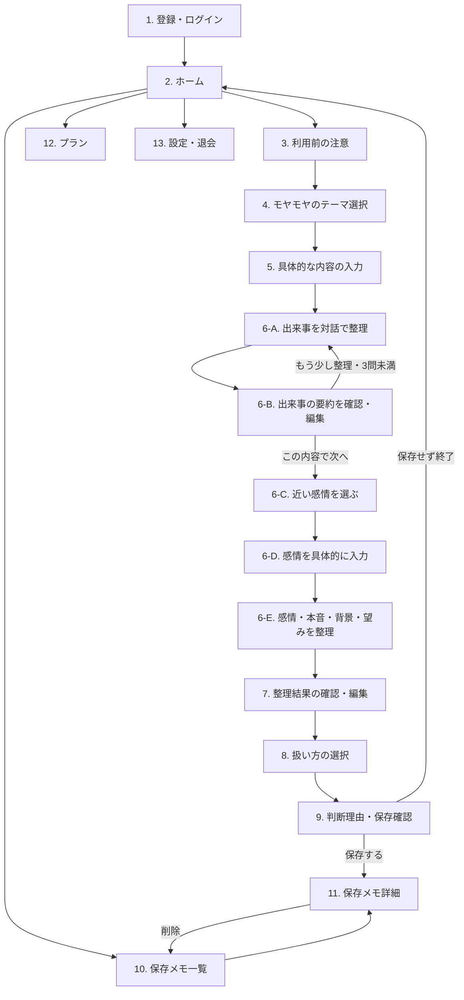

## 4. 画面ワイヤーフレーム

### 画面1：登録・ログイン

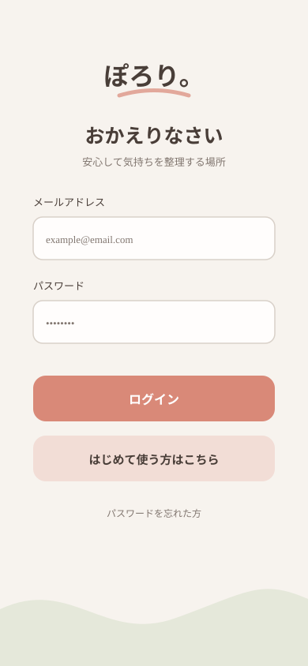

#### この画面の役割

本人の保存メモや利用回数を他の利用者と分けて管理するための入口です。

#### ユーザーの操作

- メールアドレスとパスワードを入力する
- ログインまたは新規登録を選ぶ

#### この構成にした理由

相談を始めたい人の負担を増やさないよう、最初に見せる入力項目を最小限にしています。アプリ名は最初の接点として認識できる大きさにし、強すぎない色・余白・丸みで優しい印象を作ります。パスワード再設定やメール確認の要否は認証方式と合わせて決めます。

---

### 画面2：ホーム

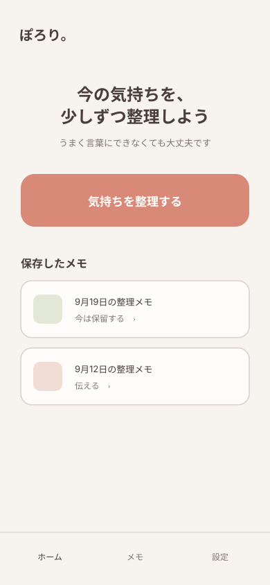

#### この画面の役割

「新しく気持ちを整理する」を主目的として示し、保存メモ・プラン・設定への入口をまとめます。

#### ユーザーの操作

- 新しい相談を始める
- 保存したメモを見る
- プランまたは設定を開く

#### この構成にした理由

中心機能である相談開始を最も目立たせます。過去メモは補助的な入口にし、相談回数などの情報を並べすぎない構成にしています。設定は下部ナビゲーションから開ける構成にしています。

---

### 画面3：利用前の注意

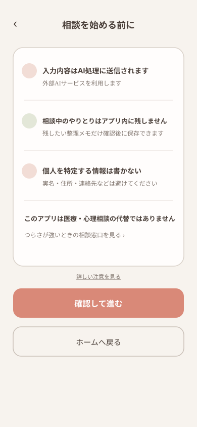

#### この画面の役割

AIへ入力する前に、外部AIへの送信、保存方針、入力を避けたい個人情報を知らせます。

#### ユーザーの操作

- 注意内容を確認する
- 同意して相談へ進む、またはホームへ戻る

#### この構成にした理由

長い規約を読ませる画面ではなく、相談前に知ってほしい要点を短く示します。「会話全文は自社DBに残しません」のような内部用語は避け、画面上では「相談中のやりとりはアプリ内に残しません」「残したい整理メモだけ確認後に保存できます」と説明します。「どこにも保存されない」という誤解を避けるため、外部AIへ送信されることは別の項目で明示します。医療・心理相談の代替ではないことと、専門窓口への導線も常に確認できるようにします。

---

### 画面4：モヤモヤのテーマ選択

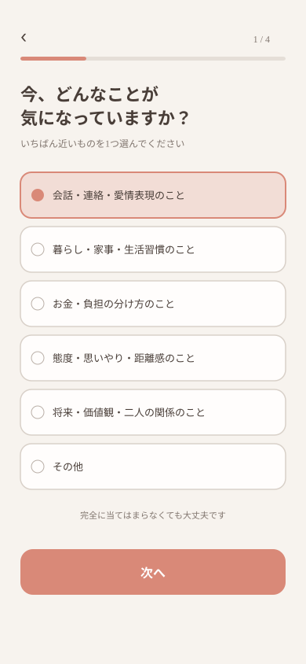

#### この画面の役割

最初から長文を書く負担を減らし、相談を始めるきっかけを作ります。

#### ユーザーの操作

次のうち、今の気持ちに最も近いものを一つ選びます。

1. 会話・連絡・愛情表現
2. 暮らし・家事・生活習慣
3. お金・負担の分け方
4. 態度・思いやり・距離感
5. 将来・価値観・二人の関係
6. その他

#### この構成にした理由

公開アンケートで繰り返し見られた内容を、相手を責める表現ではなく相談テーマとしてまとめています。これは悩みを正確に分類するためではないため、「完全に当てはまらなくても大丈夫」と案内します。

#### 選択肢検討の参考資料

- [株式会社リスミィ：全国の20〜30代未婚男女720名に聞いた、恋人・パートナーとの関係性と不満への対処](https://prtimes.jp/main/html/rd/p/000000025.000160797.html)
- [株式会社メディアシーク：パートナーへの不満ランキング（彼氏彼女編）](https://prtimes.jp/main/html/rd/p/000000229.000040972.html)
- [株式会社オーネット：25〜39歳の既婚男女を対象としたパートナーへの感謝と不満調査](https://prtimes.jp/main/html/rd/p/000000171.000022091.html)
- [株式会社AlbaLink：同棲時によくある揉め事に関する男女500人調査](https://prtimes.jp/main/html/rd/p/000000045.000055654.html)

これらは対象者・婚姻状況・質問方法が異なるため、一つの調査結果をそのままランキングとして採用したものではありません。複数の調査で繰り返し見られた内容を、相談を始めやすい五つのテーマへまとめています。最終的な名称と分け方は、画面試用やヒアリングでも確認します。

---

### 画面5：具体的な内容の入力

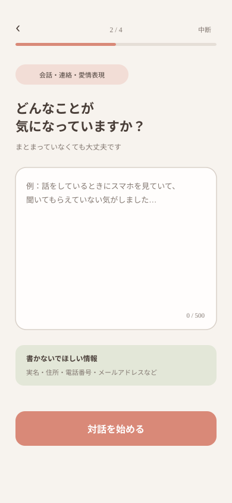

#### この画面の役割

選んだテーマをきっかけに、実際に気になっている出来事や言葉を自分のペースで入力してもらいます。

#### ユーザーの操作

- まとまっていない状態のまま自由記述する
- 入力後にAIとの対話へ進む

#### この構成にした理由

テーマを選んだ後に入力欄を出すことで、真っ白な入力欄から始める負担を減らします。実名・住所・連絡先などを入力しない案内を入力欄の近くに表示します。

---

### 画面6：AIとの段階的な対話

画面6では、一つの相談画面の中で「出来事の確認 → 感情の選択 → 感情の具体化 → 本音・背景・望みの整理」と進みます。別々のページを増やすのではなく、同じ画面の表示内容が順に変わる想定です。

#### 相談内の具体的な動き

1. 画面5で入力した内容について、AIが出来事を確認する
2. 何があったかを整理するため、AIが一度に一問ずつ質問する
3. 原則1〜2問の後、AIが「何があったか」「何が気になったか」を短くまとめる
4. ユーザーが要約を確認し、「この内容で次へ」または「もう少し整理したい」を選ぶ
5. 「もう少し整理したい」場合は追加で一問だけ質問し、最大3問で再度要約する
6. 要約をユーザーが必要に応じて編集して確定する
7. 出来事が整理できたら、近い感情を選ぶ
8. 選んだ感情について、自分の言葉で具体的に入力する
9. AIが選択・入力内容を受けて、感情を確認・整理する
10. 整理した出来事と感情をもとに、本音・背景・望みを一つずつ確認する

出来事の追加質問は原則1〜2問を目安とし、ユーザーがもう少し整理したい場合は最大3問までとします。最大数に達しても内容が十分でない場合は質問を増やさず、AIの要約を本人が直接編集します。これは現時点の設計仮説であり、画面試用で質問数と負担感を確認して調整します。

出来事の段階では、細かな経緯をすべて聞き出すのではなく、次の二点を本人が確認できた状態を完了の目安とします。

- 何があったか
- その中の何が自分にとって気になったか

#### 画面6-A：出来事を対話で整理する

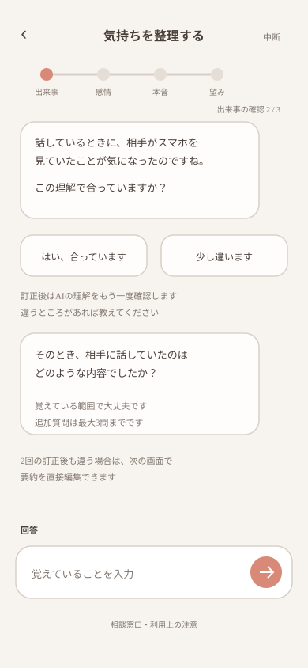

##### この状態の役割

画面5で入力された内容について、何があったかをAIが短いやり取りで確認します。

##### ユーザーの操作

- AIが示した出来事の理解が合っているか答える
- 必要に応じて、言葉や状況を一つずつ補足する

##### この構成にした理由

自由記述からすぐ感情選択へ進むのではなく、先に出来事を本人と一緒に整理します。ただし、細部を際限なく聞くのではなく、感情を考えるために必要な範囲に絞ります。

#### 画面6-B：出来事の要約を確認・編集する

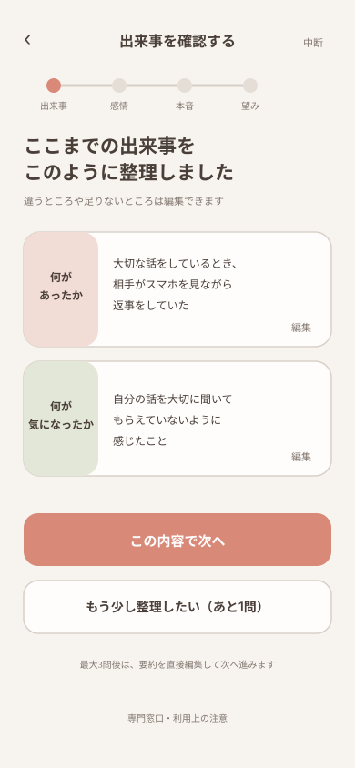

##### この状態の役割

AIが整理した出来事を本人が確認し、感情の整理へ進んでよいかを決めます。

##### ユーザーの操作

- 「何があったか」「何が気になったか」の要約を確認・編集する
- この内容で感情の整理へ進む
- 質問が3問未満の場合は「もう少し整理したい」を選び、追加の一問へ戻る
- 相談を中断する

##### この構成にした理由

質問回数だけでAIが整理完了を決めず、最後は本人が確認します。最大3問に達しても足りない場合は、ラリーを増やす代わりに要約を直接編集できるようにします。

#### 画面6-C：近い感情を選ぶ

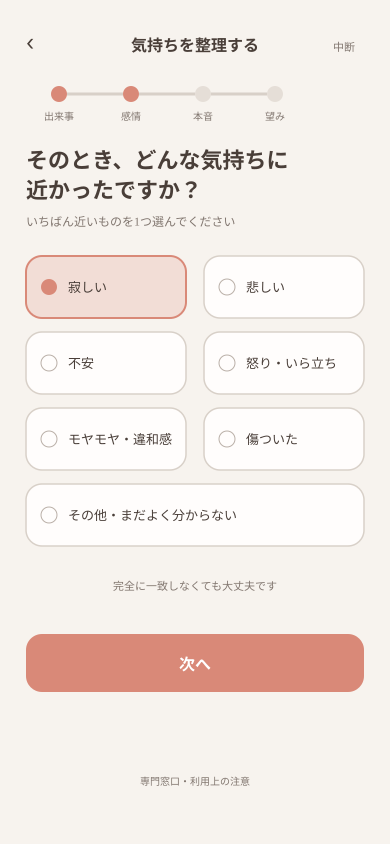

##### この状態の役割

感情をゼロから言葉にする負担を減らし、自分の気持ちに気づくきっかけを作ります。

##### ユーザーの操作

「寂しい」「悲しい」「不安」「怒り・いら立ち」「モヤモヤ・違和感」「傷ついた」「その他・まだよく分からない」から、今の気持ちに最も近いものを一つ選びます。

##### この構成にした理由

出来事と同じように、最初に例を提示することで考え始めやすくします。一方で、候補へ無理に当てはめないよう「その他・まだよく分からない」を用意し、「完全に一致しなくても大丈夫」と案内します。

#### 画面6-D：感情を具体的に入力する

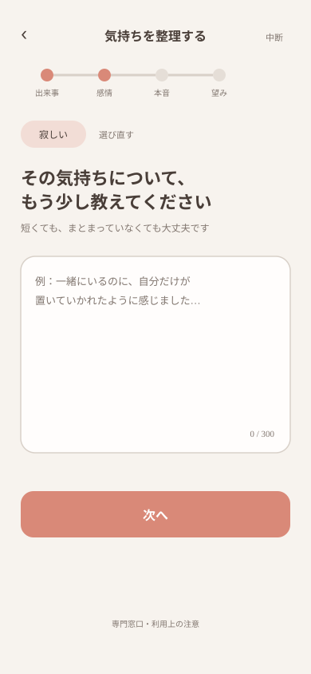

##### この状態の役割

選んだ感情だけで決めつけず、「どんな寂しさか」「何が不安か」などを本人の言葉で補います。

##### ユーザーの操作

- 選んだ感情を確認する
- その気持ちについて、短い文章で具体的に入力する

##### この構成にした理由

選択肢だけでは細かなニュアンスを残せません。先に近い感情を選び、その後に文章で補うことで、入力のきっかけと本人らしい表現の両方を残します。

#### 画面6-E：感情・本音・背景・望みを整理する

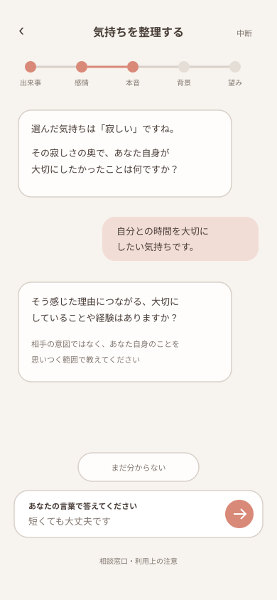

#### この画面の役割

選択・入力した感情を受けて、その理解が合っているかを確認します。感情がある程度整理できたら、出来事と感情を合わせて「本音・背景・望み」を一つずつ整理します。

#### ユーザーの操作

- AIが示した理解が自分の気持ちと合っているか確認する
- AIからの一問に回答する
- 前の内容を確認する
- 途中で相談をやめる

#### この構成にした理由

現在どこを整理しているか分かる進捗表示を置きます。選んだ感情を確定した事実として扱わず、AIは「寂しさに近いのですね。違っていたら教えてください」のように確認します。相手の意図も決めつけません。

---

### 画面7：整理結果の確認・編集

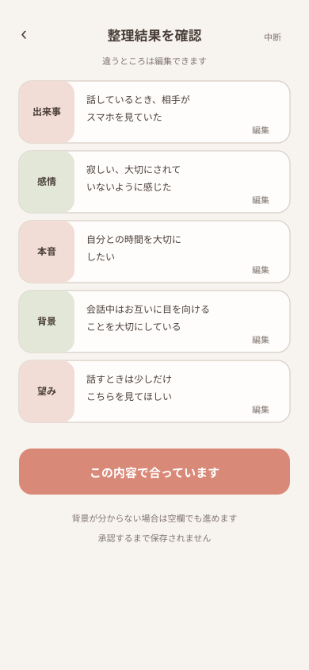

#### この画面の役割

AIがまとめた内容を本人が確認し、自分の気持ちに合う表現へ直して承認します。

#### ユーザーの操作

- 出来事・感情・本音・望みを確認する
- 各項目を編集する
- 「この内容で合っている」を選ぶ

#### この構成にした理由

AIの整理結果を自動的に確定・保存しません。扱い方を選ぶ前に本人が内容を承認することで、AIではなく本人が判断の主体になります。

---

### 画面8：扱い方の選択

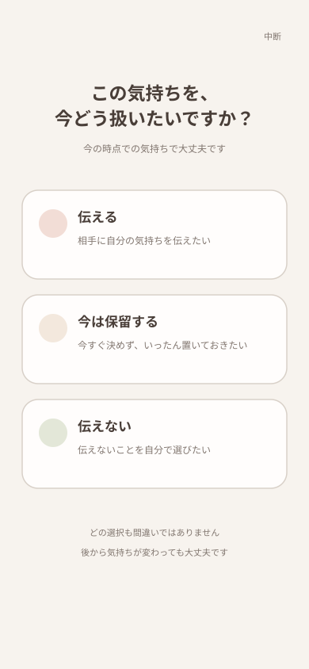

#### この画面の役割

整理した気持ちを今どう扱いたいか、本人が選びます。

#### ユーザーの操作

- 伝える
- 今は保留する
- 伝えない

のいずれか一つを選びます。

#### この構成にした理由

三つを同じ大きさ・強さで表示し、「伝える」を正解として強調しません。「今の時点での選択で、後から気持ちが変わってもよい」と案内します。

---

### 画面9：判断理由・保存確認

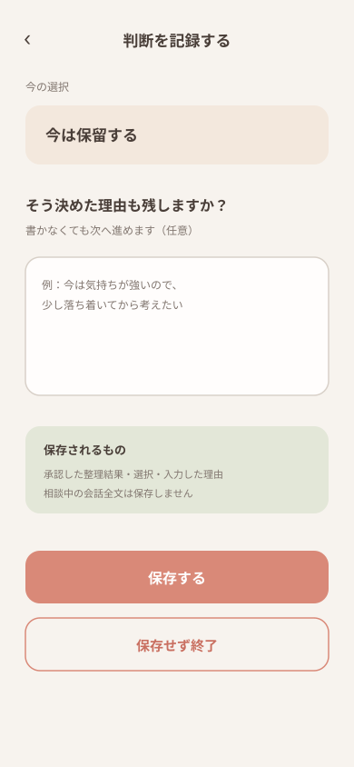

#### この画面の役割

選んだ扱い方と任意の理由を確認し、整理メモを保存するか本人が決めます。

#### ユーザーの操作

- 理由を残したい場合だけ入力する
- 保存する、または保存せず終了する

#### この構成にした理由

理由を必須にすると、言葉にできない利用者が相談を完了できません。そのため任意入力とし、扱い方を選んだ後に別の行動入力は求めません。保存対象を本人が最後に確認できるようにします。

---

### 画面10：保存メモ一覧

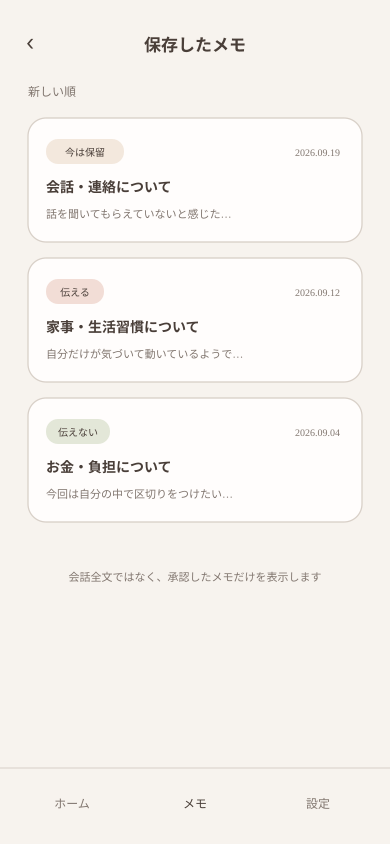

#### この画面の役割

本人が保存した整理メモを、新しいものから確認します。

#### ユーザーの操作

- メモを選んで詳細を開く
- 選択状態（伝える・保留・伝えない）を確認する

#### この構成にした理由

センシティブな本文を一覧へ長く表示せず、日付・短い要約・選択状態だけを表示します。「保留」は一覧で見つけられますが、MVPでは複雑な検索や分析を行いません。

---

### 画面11：保存メモ詳細

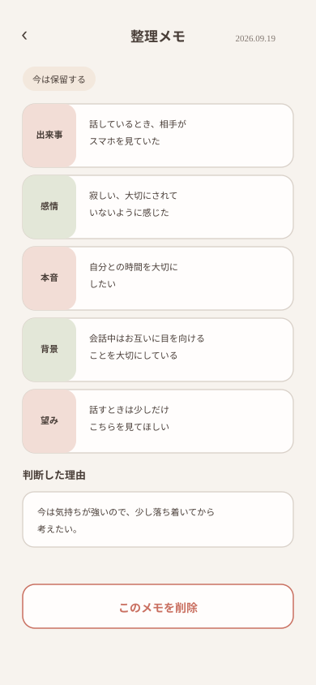

#### この画面の役割

承認して保存した整理内容と判断を見返し、不要な場合は削除します。

#### ユーザーの操作

- 保存した内容を読む
- メモを削除する
- 一覧へ戻る

#### この構成にした理由

保存内容が相談中の会話全文ではなく、本人が承認した整理メモであることを分かるようにします。削除は誤操作を防ぐため確認ダイアログを挟みます。

---

### 画面12：プラン

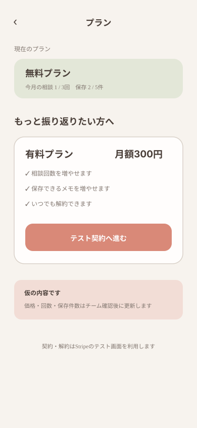

#### この画面の役割

現在のプランと利用上限を確認し、Stripeのテスト契約・解約へ進みます。

#### ユーザーの操作

- 無料・有料プランの違いを確認する
- テスト契約または解約手続きへ進む

#### この構成にした理由

課金を相談画面へ割り込ませず、ホームから独立した画面で確認します。相談回数・保存件数・価格はチームの最終決定に合わせて更新します。

---

### 画面13：設定・退会

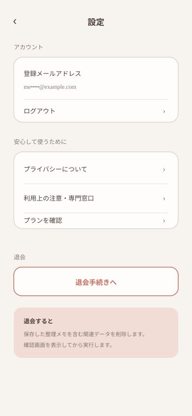

#### この画面の役割

ログアウト、退会、プライバシー情報の確認をまとめます。

#### ユーザーの操作

- ログアウトする
- プライバシーに関する説明を見る
- 退会手続きへ進む

#### この構成にした理由

退会は保存メモの一括削除を伴うため、ホームへ直接置かず、設定画面と確認ダイアログを経由させます。有料契約中の場合の退会手順は、プラン機能の仕様と合わせて決めます。

## 5. チームで確認したい事項

1. 最初に表示する5テーマの名称・説明例は適切か
2. 出来事の追加質問を原則1〜2問、ユーザーが希望する場合は最大3問とする案でよいか
3. 感情の候補はこの7分類でよいか
4. 感情は一つだけ選ぶか、複数選択を認めるか
5. 感情を選んだ後の自由記述を必須にするか、任意にするか
6. 利用前の注意を毎回表示するか、初回だけ詳しく表示するか
7. 扱い方を選んだ理由を、選択肢にかかわらず任意入力としてよいか
8. 保存後の整理メモをMVPで再編集できるようにするか
9. スクールMUST要件の決済機能に対応するため、MVPではStripeテスト決済を採用する案でよいか。また、無料・有料の差を相談回数・保存件数とするか（具体的な価格と上限は、必要な調査と技術検証の後に別途決める）
10. Stripeによる有料契約を採用する場合、退会時は契約の解約成功を確認してからアカウントと保存データを削除する流れでよいか

## 6. この案での相談完了条件

次の状態まで到達したとき、1回の相談が完了したものとします。

> 私はこの出来事で「○○」と感じ、本当は「○○」を望んでいた。今はこの気持ちを「伝える・保留する・伝えない」のどれで扱うか、自分で選んだ。

保存は相談完了の必須条件にせず、保存しない場合もホームへ戻れるものとします。
