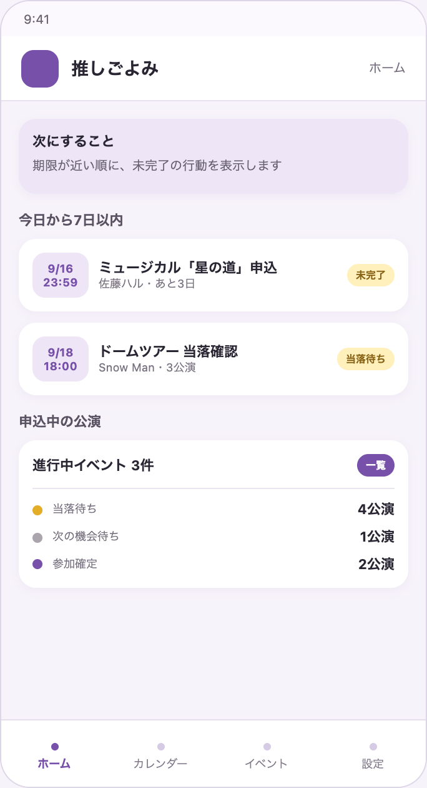
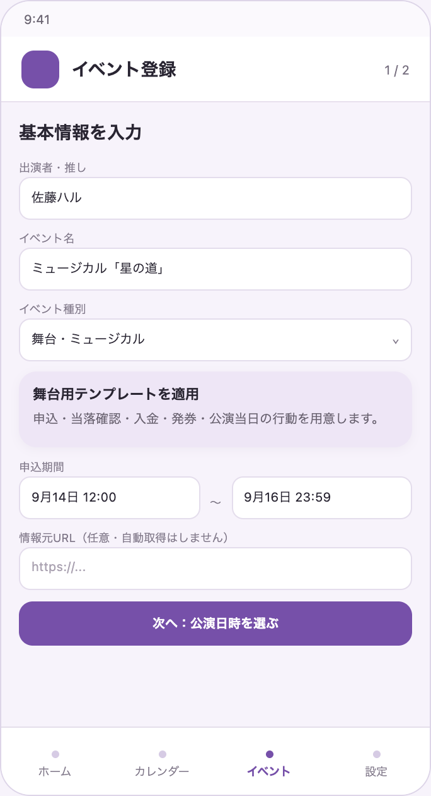
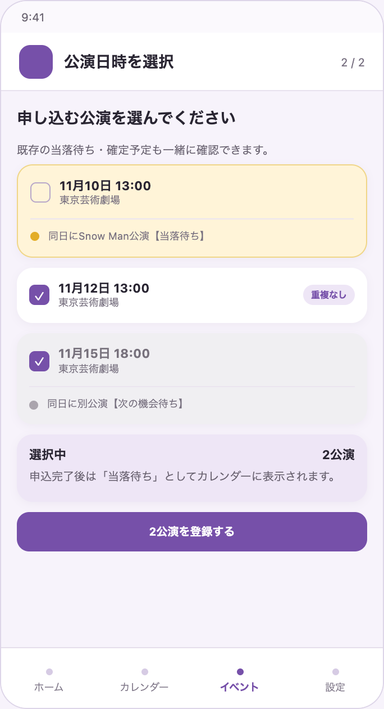
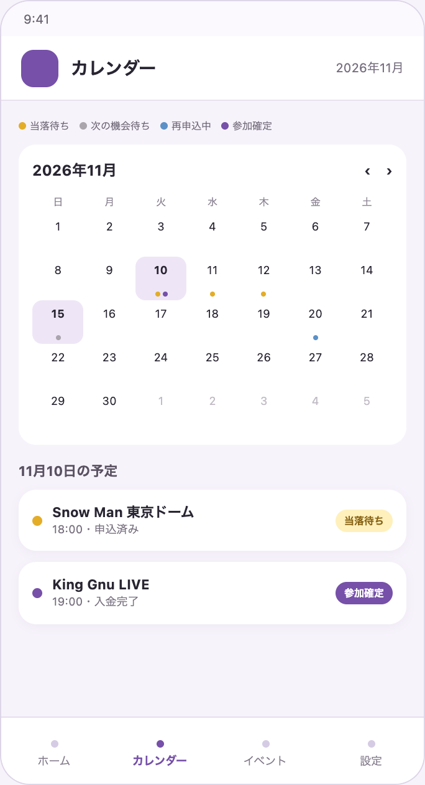
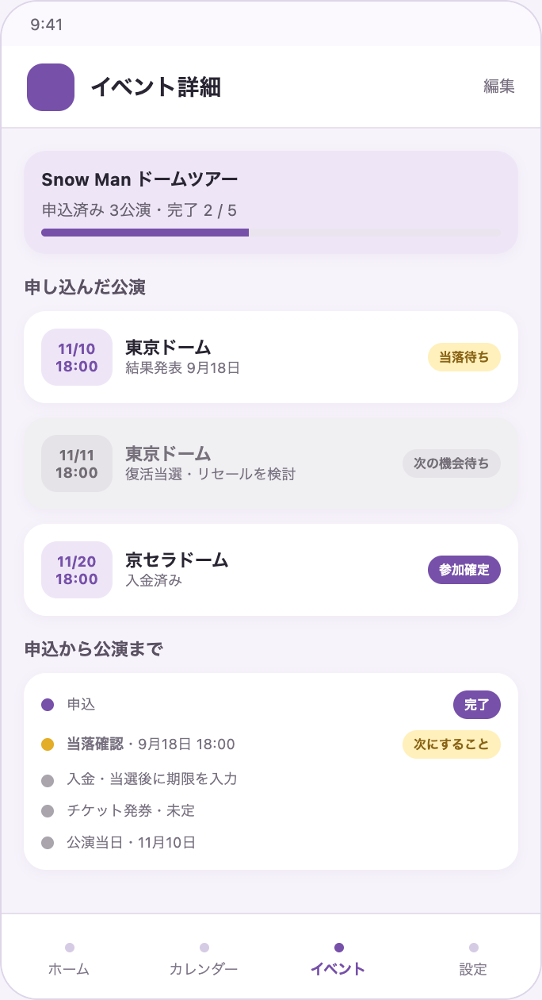
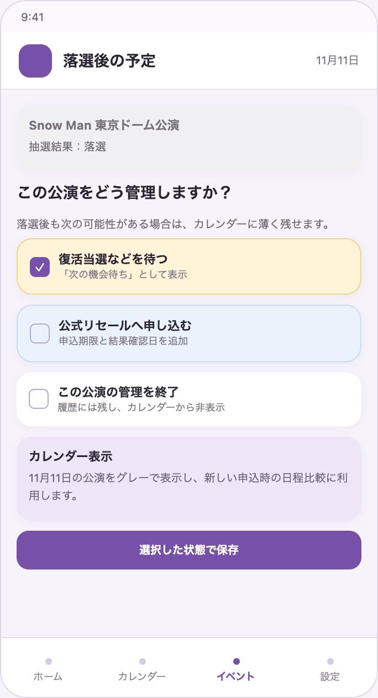
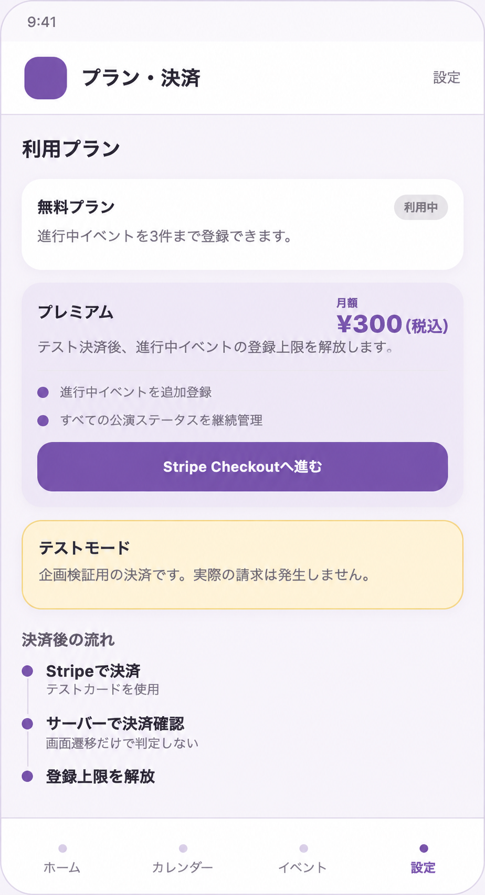

# 最終プロジェクト 第2企画案（再検討版） 推し活イベント・申込期限管理Webアプリ

#### 企画レビュー用 担当：めぐ ※サービス名・仕様は検討中

## 1. サービス名（仮）

**推しごよみ**

— 申し込んだ日も、次にすることも、ひとつに。—

※推し＋暦

## 2. 再検討の背景

当初は、公式サイトの新着情報を自動取得し、予定と行動期限を管理するサービスを想定していた。

しかし、技術検証の結果、次の課題が確認された。

- 公式サイトからの直接取得は、サイトポリシー上、今回の利用が認められるか判断できず、取得を実行せず停止した。
- OpenAI APIのWeb検索では最新情報1件を取得できた一方、最新5件では古い情報や空の項目が混在し、安定取得できなかった。
- 自動取得できたとしても、対象サイトごとの利用条件、仕様変更、取得精度などを継続的に管理する必要がある。

また、利用者としての実体験を振り返ると、困っていたことは情報収集だけではなく、**すでに複数公演へ申し込み、当落待ちの日程がある状態で、新しく発表された別のライブや舞台の申込日程を検討しにくいこと**だと分かった。

そこで、MVPでは公式情報の自動取得を外し、申込済みの公演を当落前から可視化して、次の申込と行動期限を管理できるサービスへ再整理する。

## 3. サービス概要

ライブ、舞台、ミュージカル、配信イベントなどについて、複数の公演日時と、申込・当落確認・入金・発券・公演当日までの行動を一か所で管理するWebサービス。

申込済みで当落が確定していない公演も「当落待ち」としてカレンダーに表示し、新しいイベントへ申し込む際に、確定予定と未確定予定の両方を確認できるようにする。

- 対象ユーザー：複数のライブや舞台へ並行して申し込み、仕事や学校などの日常と両立している人
- 提供したい価値：当落待ちを含む予定を可視化し、新しい申込日程を検討しやすくするとともに、次の行動と期限を忘れない状態をつくる

## 4. 仮説ペルソナ

20〜30代の会社員を仮定する。

アイドルやアーティストを応援しながら、好きな俳優が出演する舞台やミュージカルにも申し込む。1つのイベントで複数公演へ申し込むことがあり、同時期に複数の当落結果を待っている。

公式サイト、ファンクラブメール、チケットサイトなどで情報を確認しているが、過去のメールや申込履歴を探し直さなければ、どの公演日時に申し込んだか分からないことがある。

そのため、新しいイベントが発表された際に、すでに申し込んでいる公演と日程が重なる可能性を把握しづらく、どの日時へ申し込むか判断しにくい。また、当落確認や入金など、申込後に必要な行動を忘れる不安もある。

## 5. 解決したい課題と目指す状態

### 現在の課題

1. **当落待ちの日程を確認しにくい**
   - 申込済みの公演日時が、メールや複数のチケットサイトに分散している。
   - 当落前の予定は一般的なカレンダーに登録しないことがあり、後から確認しにくい。
2. **新しい申込日程を検討しにくい**
   - 別のライブや舞台が発表されたとき、既存の当落待ち・確定予定と重なる可能性をすぐ確認できない。
3. **申込後の行動期限を忘れやすい**
   - 1つのイベントから申込、当落確認、入金、発券、公演など複数の行動が発生する。
   - 公演日時だけをカレンダーに登録しても、「次にすること」と完了状態を管理しにくい。

### サービス利用後の状態

- 1つのイベントに複数の公演日時を登録できる。
- 申し込んだ公演を、当落前から「当落待ち」としてカレンダーで確認できる。
- 新しい公演日時を選ぶとき、既存の当落待ち・入金待ち・参加確定の予定を確認できる。
- 公演ごとに当選・落選などの状態を更新できる。
- 申込・当落確認・入金・発券・公演などの行動を期限順に確認できる。
- ホームの期限順一覧と期限超過表示で次の行動を確認でき、通知まで実装できた場合は期限前にも気づける。

## 6. 中心仮説

複数のライブや舞台へ申し込む人は、申込済みの公演を当落前から状態付きの仮予定としてカレンダーに表示し、イベントごとの行動期限を一連の流れとして管理することで、一般的なカレンダーやメモよりも、新しい申込日程と「次にすること」を判断しやすくなるか。

### 検証したいこと

| 仮説 | 確認したいこと |
| --- | --- |
| 日程管理の仮説 | 当落待ちを含む予定を一覧化すると、新しい申込日程を検討しやすくなるか |
| 行動管理の仮説 | 申込から公演までを行動単位で管理すると、次にすることと期限が分かりやすくなるか |
| 入力負担の仮説 | 登録の手間より、日程と期限を一か所で管理できる価値が上回るか |
| AI支援の仮説 | 自然文から登録候補を作ることで、手入力の負担を減らせるか |

## 7. 利用の流れ

```text
公式サイトやファンクラブメールなどでイベント情報を確認
        ↓
イベント名・出演者・申込期間などを登録
        ↓
複数の公演日時を追加し、申し込む公演を選択
        ↓
申込完了後、各公演を「当落待ち」としてカレンダーに表示
        ↓
別のイベントへ申し込む際、既存予定との重複可能性を確認
        ↓
当落発表後、公演ごとに当選・落選を更新
        ↓
当選した公演の入金・発券・公演当日を期限順に管理
        ↓
期限順一覧で確認し、行動を完了にする
```

## 8. 公演ステータス

「仮予約」は座席が確保されているように見えるため、画面上では実際の状態を表す名称を使用する。

| ステータス | 状態 | カレンダーでの扱い例 |
| --- | --- | --- |
| 申込予定 | 申し込む公演を検討している | グレー |
| 当落待ち | 申込済みで、結果が未確定 | 黄色・点線 |
| 入金待ち | 当選し、入金が未完了 | オレンジ |
| 参加確定 | 入金まで完了し、参加が確定 | 推しごとの色 |
| 落選・次の機会待ち | 一度落選したが、復活当選や公式リセールなどの可能性を残す | グレーで薄く表示 |
| 再申込中 | 公式リセールなどへ申し込み、結果を待っている | 青色・点線 |
| 終了 | 参加しないことが確定し、今後の申込予定もない | 履歴に残し、通常のカレンダーでは非表示 |

日程が重複していても、アプリが申込を禁止することはしない。未確定予定であることを明示したうえで、利用者が判断できるようにする。

表示例：

```text
⚠ 11月10日は、別の公演に申込済みです
Snow Man 東京ドーム公演【当落待ち】

この日程も申込対象に追加しますか？
```

落選後も公演日をすぐに削除せず、利用者が次の状態を選べるようにする。

```text
落選
  ├─ 復活当選などを待つ →「落選・次の機会待ち」
  ├─ 公式リセールへ申し込む →「再申込中」
  └─ 今後は申し込まない →「終了」
```

これにより、落選後に別の申込方法を検討している公演も、日程調整の材料としてカレンダーに残せる。

## 9. 入力負担を減らす方法

### テンプレートによる入力支援

利用者が「ライブ」「舞台」「配信」などのイベント種別を選ぶと、必要になりやすい行動項目を自動で用意する。

```text
ライブを選択
  ↓
申込・当落確認・入金・発券・公演当日を候補として表示
  ↓
利用者は必要な項目と、分かっている日付だけを入力
```

未発表の日付は空欄のまま保存し、新しい情報が届いたときに追加できるようにする。

### OpenAI APIによる入力支援案（ADVANCED）

利用者が自分の言葉で入力した内容から、イベント名・公演日時・行動期限の候補を構造化する。

```text
Snow Manのライブ。申込は9月20日まで、当落は9月30日、
入金は10月2日まで、公演は11月10日と11月11日。
```

AIが候補を作成し、利用者が確認・修正してから登録する。

- AIは不明な情報を推測せず、`null`または「要確認」とする。
- AIの結果だけで自動保存せず、必ず確認画面を挟む。
- ファンクラブメール全文や個人情報を入力することは想定しない。
- AIを利用できない場合も、フォームから手動登録できるようにする。

ただし、LLMはプロジェクトのADVANCED要件であり、中心課題の解決に必須ではない。企画・ドキュメント作成を含む開発期間を約4週間と見込み、MVPでは固定のイベント種別テンプレートとフォーム入力を優先する。OpenAI APIによる候補生成は、中心機能とMUST要件が完成した場合に追加する。

## 10. 開発期間約4週間を想定したMVP

企画・設計・ドキュメント作成を含む開発期間を約4週間とし、その後に発表準備期間が1週間〜10日程度ある想定とする。

1週目はドキュメント作成と技術基盤の準備を並行し、2〜4週目は実装を進める。4週目も発表準備へ切り替えず、機能実装・結合・テスト・修正に使用できるものとする。

そのため、MVPでは「当落待ちの公演を可視化し、新しい申込日程を検討できること」を最優先とする。

### プロダクトMUST：中心価値の検証に必要

- ユーザー登録・ログイン
- イベント名・出演者名の登録・編集・削除
- 1つのイベントへの複数公演日時の登録
- 申し込んだ公演の選択と、公演ごとのステータス管理
- 当落待ち・次の機会待ち・参加確定を含むカレンダー表示
- 新しい公演登録時に、同日の既存予定を表示する簡易的な重複確認
- 申込・当落確認・入金・公演当日の行動期限管理
- 「次にすること」の期限順一覧
- 行動の未完了・完了管理
- ライブ・舞台・配信の固定テンプレートから行動項目を作成

### プロジェクトMUST要件として実装

- フロントエンドとバックエンドを分離したWebアプリ
- Docker Composeによるコンテナ構成
- Redisによるカレンダーまたは期限順一覧のキャッシュ
- Stripeテスト決済による登録上限の解放
- 開発環境と本番環境のログ出し分け
- 単体テスト、テスト設計書、主要シナリオテスト
- XSS・SQL Injection対策

### 実装状況により削る候補

- メール・プッシュによる期限前通知
- 複数条件による検索・絞り込み
- 推しごとの色設定
- リセール専用の詳細入力項目

期限前通知を削る場合も、ホームの「次にすること」と期限超過表示によって、行動期限を確認できる状態は残す。

### MVPの対象外

- 公式サイト・ファンクラブ・SNSの自動巡回
- 公式情報や会員限定情報の自動取得・転載
- チケットサイトへの自動申込・入金
- メールボックスとの連携
- 第一希望・第二希望、申込口数、同行者などの詳細管理
- Googleカレンダーなど外部カレンダーとの連携
- 複数種類の通知方法や細かな通知設定
- OpenAI APIによる自然文からの登録候補生成
- AI候補の確認・修正画面

## 11. 4週間の進め方と必要ドキュメント

1週間を企画・設計だけで終えるのではなく、5人でドキュメント作成と技術基盤の準備を並行する。ただし、画面・データ・APIの認識がそろう前に各機能の本実装へ進まない。

### 1週目：企画・設計と基盤準備

- 課題・ペルソナ・中心仮説・MVPを確定する。
- 画面一覧・画面遷移・簡易ワイヤーフレームを作成する。
- ER図・データ項目を整理する。
- API仕様と成功・空・エラー時のサンプルJSONを決める。
- 技術構成・ディレクトリ構成・環境変数の扱いを決める。
- テスト設計書と主要シナリオの骨組みを作る。
- Issueを依存関係と担当ファイルが重なりにくい単位へ分割する。
- READMEの環境構築手順を作り始める。
- 上記と並行して、Docker Compose、フロントエンド、バックエンド、DBの最小構成を準備する。

### 2週目：中心データの登録

- 認証
- イベント・複数公演日時・行動期限のDBとAPI
- 登録・編集・削除フォーム
- 公演ステータス更新
- 最小単位でフロントエンドからバックエンドへ接続する

### 3週目：中心価値とMUST要件

- 状態付きカレンダー
- 同日予定の簡易的な重複表示
- 「次にすること」の期限順一覧
- Redisキャッシュ
- Stripeテスト決済
- ログ出し分け、単体テスト、セキュリティ対策

### 4週目：実装継続・結合・テスト

- 未完了のプロダクトMUST機能
- RedisキャッシュとStripeテスト決済の結合
- 主要シナリオの結合テスト
- 不具合修正
- MVP外機能の削除・非表示
- README・テスト結果の更新

### 開発期間終了後の1週間〜10日：発表準備

- 発表資料の作成
- デモシナリオ・操作手順の確認
- 発表担当と時間配分の決定
- 必要に応じた軽微な表示修正
- 最終README・提出物の確認

発表準備期間は大きな新機能の追加には使わず、4週間の開発期間内にMVPとプロジェクトMUST要件を完成させる。

### 最低限そろえるドキュメント

| ドキュメント | 目的 |
| --- | --- |
| PRD・企画書 | 誰のどの課題を、どのMVPで解決するかをそろえる |
| 画面一覧・画面遷移 | 利用者の操作と必要画面をそろえる |
| ER図・データ項目 | イベント、公演日時、行動期限、状態の関係をそろえる |
| API仕様・サンプルJSON | フロントエンドとバックエンドの接続条件をそろえる |
| 技術構成・ディレクトリ構成 | 役割分担と担当ファイルの重複を減らす |
| テスト設計書・シナリオ | MUST要件と中心フローの完了条件を決める |
| Issue一覧・依存関係 | 5人が待ち時間を減らして並行作業できるようにする |
| README | 環境構築、起動、テスト方法を共有する |

これらをリーダー1人で作成せず、担当者が初稿を作り、関連機能の担当者が確認する。

## 12. 想定画面

| 画面 | 主な役割 |
| --- | --- |
| ホーム | 「次にすること」を期限順に確認する |
| イベント登録 | イベント名、出演者、申込期間などを登録する |
| 公演日時選択 | 複数公演を追加し、申し込む公演を選ぶ。既存予定との重複可能性も確認する |
| カレンダー | 当落待ち・次の機会待ち・再申込中・参加確定を状態別に表示する |
| イベント詳細 | 複数公演の申込状況と、申込・当落確認・入金・発券・公演当日の進行一覧を確認する |
| プラン・決済 | 無料・プレミアム機能を確認し、テスト決済を行う |

画面下部の主要ナビゲーションは「ホーム・カレンダー・イベント・設定」を候補とする。

### 画面イメージ

※再検討後の利用イメージであり、実装時のデザインや表示内容は変更する可能性がある。

<table>
  <tr>
    <td align="center" width="33%"><strong>1. ホーム</strong><br></td>
    <td align="center" width="33%"><strong>2. イベント登録</strong><br></td>
    <td align="center" width="33%"><strong>3. 公演日時選択</strong><br></td>
  </tr>
</table>

<table>
  <tr>
    <td align="center" width="50%"><strong>4. 状態付きカレンダー</strong><br></td>
    <td align="center" width="50%"><strong>5. イベント詳細</strong><br></td>
  </tr>
</table>

<table>
  <tr>
    <td align="center" width="50%"><strong>6. 落選後の状態選択</strong><br></td>
    <td align="center" width="50%"><strong>7. プラン・決済</strong><br></td>
  </tr>
</table>

## 13. 差別化の仮説

既存の推し活アプリにも、予定、締切、通知、AIによる予定候補作成などの機能がある。

本企画では、次の組み合わせを中心価値として検証する。

- 1つのイベントに複数の公演日時をひも付ける。
- 申し込んだ公演を、当落前からカレンダーへ表示する。
- 当落待ち・入金待ち・参加確定・落選後の次の機会待ちなど、未確定から確定までの状態を可視化する。
- 新しい申込時に、既存の当落待ちを含む予定と比較する。
- 申込から公演当日までの行動と完了状態を一連の流れとして管理する。

**「当選した予定を管理する」のではなく、「申し込んだ時点から予定と行動を管理すること」**を特徴とする。

## 14. 技術検証結果と取得方針

### 公式サイトから直接取得する方法

- Snow Man公式INFOページとサイトポリシーを確認した。
- 文章データ等の複製・転載・再利用を制限する記載があり、今回の利用が例外条件に該当するか判断できなかった。
- 事前に定めた停止条件に従い、プログラムからの取得は実行しなかった。
- 技術的に取得できないという結論ではなく、利用条件や必要な許諾の確認が必要という結果である。

[検証ブランチ：direct-site](https://github.com/ms-engineer-bc26-05/team-d_project-review/tree/spike/direct-site-verification)

### OpenAI APIのWeb検索を使う方法

- 最新情報1件は、公開日・タイトル・URLを取得できた。
- 最新5件では、古い記事や空の項目が含まれた。
- 公式情報の最新5件を、安定して正確に取得する用途には採用しにくい。

[検証ブランチ：openai-web-search](https://github.com/ms-engineer-bc26-05/team-d_project-review/tree/spike/openai-web-search-verification)

### MVPでの判断

- 公式情報の自動取得はMVPから外す。
- 情報源のURLは参考情報として利用者が登録できるようにするが、アプリから自動取得しない。
- 公式API、利用可能なRSS、または権利者の許諾を確認できた情報源への対応はADVANCED案とする。
- OpenAI APIはWeb検索ではなく、利用者が入力した情報の構造化と行動候補の作成に使用する案を検討する。

## 15. プロジェクトMUST要件への対応案

※プロダクトとして採用された場合に、講師への確認と技術検証を踏まえて確定する。

### 構成

- フロントエンド：React・TypeScript
- バックエンド：FastAPI・Python
- データベース：PostgreSQL候補
- コンテナ：Docker Compose

### キャッシュ・決済・ログ

- Redis：期限順一覧や通知対象データなどのキャッシュ候補
- Stripe Checkout：プレミアム機能を解放するテスト決済候補
- ログ：開発環境と本番環境で出力レベルを分け、個人情報や決済情報を記録しない

### 決済条件の提案

- 無料：登録できる進行中イベント数に上限を設ける
- プレミアム：月額300円（税込）を価格仮説とし、進行中イベントの登録上限を解放して、追加のリマインド機能を利用できる
- 300円は、手入力を前提とするサービスを気軽に継続利用できる価格として仮設定する。価格は利用者への支払意思調査を踏まえて調整する。
- Stripeの決済手数料3.6%とBilling手数料0.7%で単純計算すると、1人あたりの受取額は約287円。月額運用費を約2,100円と仮定した場合、有料会員8人前後がインフラ費の損益分岐点となる。
- 開発期間約4週間では、Stripeのテストモードによる単発決済と機能解放に限定する。
- 本番決済、月額課金、プラン変更、解約管理はMVP外とする。

※一般消費者向けの価格表示を想定し、300円は消費税を含む支払総額として表示する。

### 品質・セキュリティ

- 単体テストと主要な利用フローのシナリオテスト
- XSS・SQL Injection対策
- 認証・認可
- AIへの入力内容、個人情報、決済情報をログへ出さないための対策
- 決済成功は画面遷移だけで判断せず、Stripeからの通知を確認して反映する

## 16. ADVANCED案

- 第一希望・第二希望、申込口数、同行者の管理
- Googleカレンダーなど外部カレンダーとの連携
- 公式API・利用可能なRSSによる新着情報の取得
- 利用条件や許諾を確認できたサイトへの対応
- OpenAI APIによる自然文からの登録候補生成
- メールや画像からの予定候補作成（利用条件・個人情報保護を確認したうえで検討）
- 推しごとの色分け・絞り込み
- 通知日時・通知方法の細かな設定
- 月額課金とプラン変更・解約管理

## 17. 次回企画レビューで確認したいこと

1. 「当落待ちを含む日程比較」と「次の行動の期限管理」を中心課題として設定してよいか。
2. ドキュメント作成を含む開発期間約4週間のMVPとして、複数公演・状態付きカレンダー・行動期限管理の範囲が現実的か。
3. OpenAI APIによる自然文からの登録候補生成をADVANCEDとして切り分ける方針でよいか。
4. Stripeのテスト決済では、どの機能を解放するとMUST要件を満たしやすいか。
5. 登録の手間よりも管理できる価値が上回るか、どのように利用者検証を行うか。
6. 既存の推し活アプリと比較し、状態付きの仮予定と日程比較に十分な差別化があるか。
